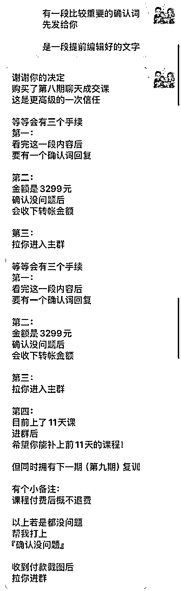

# 《如何处理退费(反对)问题，让高客单产品的退费率大幅降低？》

你有没有遇到过这种情况：花大价钱买了课，学员却突然说要退费，或者嘴上不说退钱，但一个劲抱怨“内容跟我想的不一样”——你们俩都心知肚明，可谁也不好意思捅破那层窗户纸。场面尴尬，处理不好还容易闹得难看。

我是根源，在知识付费和私域运营这块摸爬滚打了两年半。这两年跟明白老师、陈雪一起做俱乐部，成绩还算稳定，会员增长和复购数据都不错。今天就想跟你聊聊让很多交付者头疼的“退费难题”——怎么把高客单产品的退费（反对）问题解决好，甚至让它大幅减少。

其实，不管是卖实体货还是虚拟课，客户因为预期落差想退钱，或者干脆用“这课不行”来施压，都是家常便饭。而退费，往往才是他们真正想要的结果。能不能接住这种心理，是每个做产品交付的人绕不开的本事。下面是我的经验总结，希望能给你一些启发，也欢迎你读完来跟我讨论。

处理这类“反对问题”，核心就两大阶段：**事前准备、事后处理**。

先说事前准备。我的产品是知识付费，属于虚拟交付。个体户不像大公司那么正规，所以我在成交前会额外加一些“文字手续”。关键逻辑是：**退费规则越透明，后续的退费纠纷越少**。这里的规则不是指课程大纲——那本来就应该在海报上讲清楚——而是指“如果我不满意，最差能得到什么”。比如有的产品规定：周四买，周六晚12点前可无条件退。把这种边界写明白，对方心里就有底，知道自己的权益上限在哪，不满时也不至于第一时间找你发泄。如果成交不在平台，而是微信转账或走公司账，那规则就自己定，定到最后就是你个人的原则。

我自己的产品，在付款那一刻会有一句确认词，大概长这样：

规则解说清楚之后，还要走一套清晰的流程，按1234的步骤全部完成，交易才算真正敲定。曾有学员问我，“你让我们回复‘确认没问题’，这有法律效力吗？”我个人知道没有，但这件事根本不是法律问题，而是人情道义。我之所以这么做，就是让对方再想一想。每次我都会特别强调：“这段话发给你，是你付款前的最后考虑时间。毕竟不是小钱，希望你慎重决定，这样每笔钱花出去，都能对自己有个交代。”销售当然想成交，但如果把付款前的流程做得稍微多一点、考虑时间拉长一两分钟，客户反而会感到：你不是单纯想把东西卖给我，而是想把真正适合我的产品卖给我。这后面的麻烦，自然会少很多。

再说事后处理。客户买了之后有疑虑，来找你退费，这时候最大的关键不是讲道理，而是**处理情绪**。他既然来找你，肯定带着不满——也许是交付没达到期待，也许是他想要的你根本没给到。这时要先想清楚自己的策略：如果你的产品体系是“坚决不退费”，那从一开始就要说死；如果你能接受退费，那就别去解释、别去掰扯产品问题和交付内容，直接把钱退了。因为你越聊，对方越会说出更多毛病，你心情也越差。与其费劲去解决那些认知偏差，不如痛快退钱。

我的体系是不退费的，所以在文字沟通上就得格外注意细节。客户来找你，心情一定不好。第一原则就是：**先安抚情绪，再解决问题**。顺序千万别反。不要说“海报上写得很清楚，我全都做到了，你为什么还来退？”这叫先解决事情，对方只会更炸。而正确做法是先接住情绪：“真的对不起，我的交付让你有了这样的感受，能不能告诉我，具体是哪部分让你不满意？”这样说的好处是，先表明我愿意帮你解决，但没承诺退费。而且只有等他情绪平复，你才知道他真正不满意的点是不是跟你的交付有关——搞不好是群里某个人说了句让他不舒服的话呢。

第二个原则，是心态上的准备：**所有反对问题，都是让我变好的机会**。如果你的课程完美到从来没人提过一句负反馈，那才是最大的危机，因为你根本不知道往哪改进。当有人来说“你交付不好”，我反而觉得是好事。有了这个价值观，你就不会一听批评就想回怼。我通常会先道歉：“对不起，我的课程某部分让你有这种感受。能告诉我具体是什么内容或什么交付让你不满意吗？”先问原因，等对方感觉到你是真心想解决，他就会说出真实情况。接着再问：“那在不退费的前提下，你希望我还能提供什么帮助？”这其实就是一场博弈——他知道你的规则是不能退，但他想试试多说几句能不能让你松口。但如果你一开始情绪没安抚好，他就会死死咬住：“不退钱我就去黑你、去搞你。”等情绪解决了，再温和地重提规则：“很抱歉，之前就说好产品不退费，在这个前提下，你还希望我做什么来补救？”

还有一条底线必须守住：**不能给出课程交付范围之外的东西**。交付是主观的，客户因为信任你而买，但发现不如预期时，这种主观很难扭转。你只能在可控范围内把产品做好，如果真的不合适，就引导他怎么使用你的课程。比如我会说：“我的规则里可能有个地方没说清，其实你这样用，就能得到你想要的。”客户真正在乎的，是你有没有把他当回事。一旦他的情绪被看到，你再给出规则内的使用建议，他基本就满意了。最怕的是你不断退让，他就会不断索取——这跟砍价一样，你说100，他还50，你立刻说“好的”，他只会觉得亏了，还想再压。所以交付者必须腰杆硬：“在不退费的基础上，目前该交付的我都做了，你觉得我还能多做点什么？”如果对方提出超出课程范围的要求，我就明确拒绝：“抱歉，这个要求超出课程范围，我没法答应。除了这个，你还希望得到什么样的解答？”一旦你松一个口，对方就会步步紧逼，最后还是会绕回到“那你退费吧”。我一退，前面建立的人设就崩了。所以无论客户多难搞，我的底线都不会消失——当然，如果你的底线就是可以退费，那从一开始就直接退钱，反而干脆。

说到底，处理高客单产品的退费问题，关键不是“怎么把客户怼回去”，而是“怎么在成交前埋好规则、在成交后守好情绪与边界”。事前准备做得足，事后处理才不慌；价值观摆得正，负反馈反而成了产品的养料。我是根源，一个有两万多实战案例的心理咨询师，也做过十二年线下销售和管理。如果你也在做知识付费或私域运营，希望这些经验能给你带来一点新的角度。欢迎看完后来跟我一起聊。