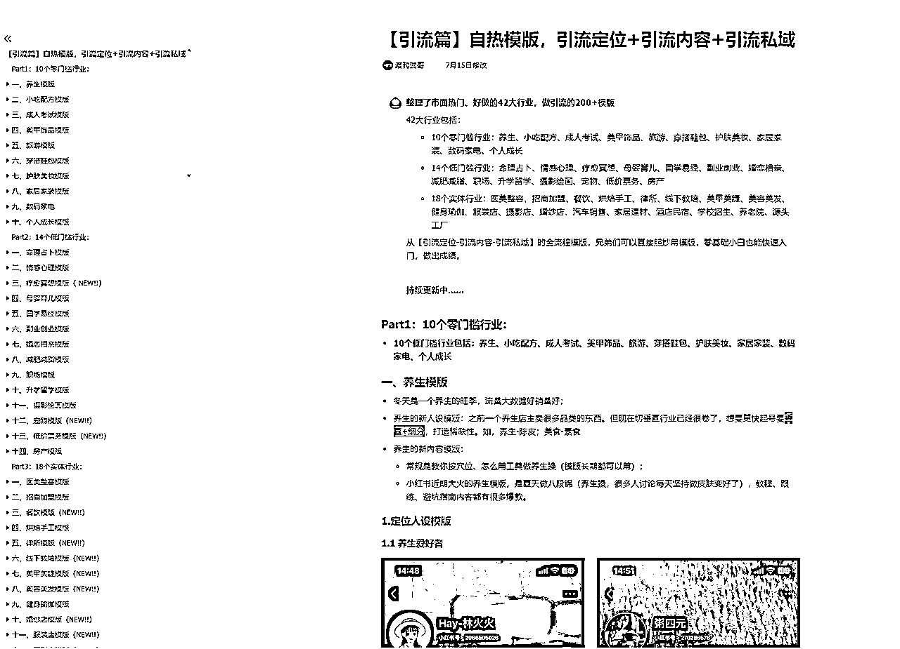
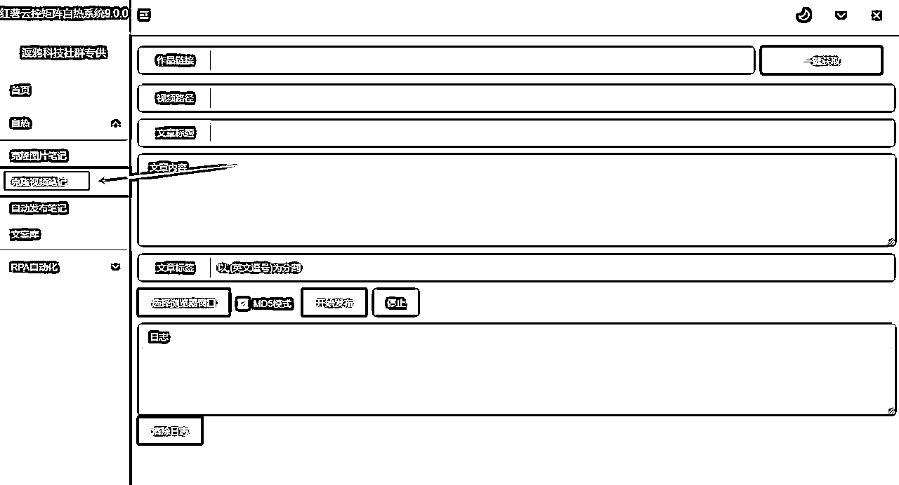
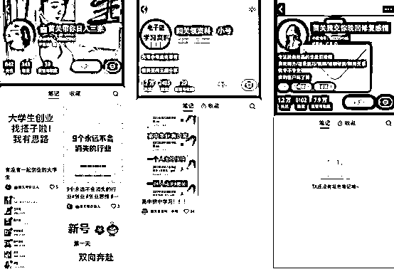
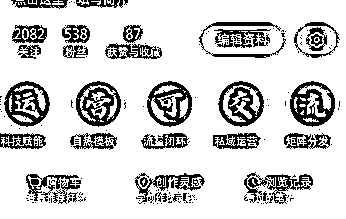
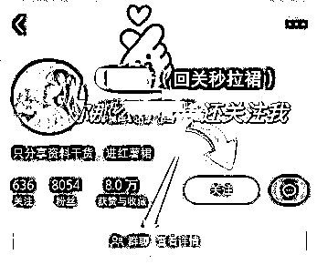
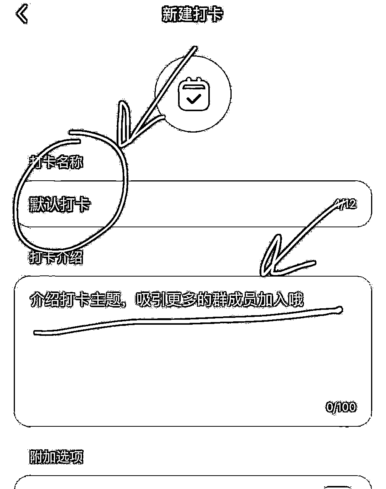

小红书还有这种玩法？把“自然流量+截流”组合起来用，一天丝滑加到500+好友，而且全行业都能套用。这篇就把完整链路拆给你看。

先自我介绍下，我是阿鹏，长期在搞私域引流。今天整理出的这套打法，小红书上现在主流就两条：一条叫“自热”，意思是正常发内容、让平台自然推流；另一条叫“截流”，说白了就是借别人自热带来的热度，常见手法包括评论区埋钩子、主页留钩子求点赞/关注/@留痕等。

【自热篇】

自热要先搞定四个基础条件。

设备上：
- 安卓机：适合小团队做截流或自热，推荐红米8以上；
- 苹果机：更适合自热团队。

账号上：
- 厅卡：三大营业厅的卡都行，广电卡尽量别用；
- 拦截号：属于违规卡，不要碰；
- 四方号：价格实惠，适合做截流；
- 老美+港号：苹果机自热能用，安卓机操作麻烦。

网络上：手机厅卡、流量卡、物联卡、注册卡都行。

IP上：
- 厅卡：用起来最自由，但别让好几台手机共用同一个wifi；
- wifi：适合做价值型内容，不搞废号流，同样不要多台连一个wifi；
- 物联卡/流量卡：自热和截流都能用；
- 软路由：大型团队常用，一个场地能分出几十个不同IP。

模板方面，大致就是“价值输出型”和“暴力废号型”两类。价值输出型就是那种封面精致、内容有干货的笔记；暴力废号型则像路边传单，封面简单、文案直接。
每个行业都可以自己整理一套模板。我这边也整理好了市面上热门好做的42大行业、200多套引流模板：

- 零门槛行业10个：养生、小吃配方、成人考试、美甲饰品、旅游、穿搭鞋包、护肤美妆、家居家装、数码家电、个人成长；
- 低门槛行业14个：命理占卜、情感心理、疗愈冥想、母婴育儿、国学易经、副业创业、婚恋相亲、减肥减脂、职场、升学留学、摄影绘画、宠物、低价票务、房产；
- 实体行业18个：医美整容、招商加盟、餐饮、烘焙手工、律所、线下教培、美甲美睫、美容美发、健身瑜伽、服装店、摄影店、婚纱店、汽车销售、家居建材、酒店民宿、学校招生、养老院、源头工厂。

而且是从“引流定位→引流内容→引流私域”的全流程模板，就算你是零基础，照抄模板也能快速上手并做出成绩。

工具方面，一个两个号手动发就行；想矩阵批量发，就得靠工具。以前我们常用“红薯克隆工具”，但它只能克隆图文；最近新出了一款能克隆视频的工具，一键搞定视频克隆和矩阵分发。

【截流篇】

截流的核心入口，就是评论区、私信、点赞、收藏、关注曝光这些位置。

要做截流，设备必须多准备一些；设备不够的话，建议先专注自热。另外截流要求一机一卡一IP，设备要干净，还得配一个能跑曝光的软件，这类软件市面上很多，自己挑就行。

注意：截流本来就是废号流，红薯号也不值钱，算好成本利润就行；钩子必须好好设计，钩子够强，效果好到你不敢信。

【导流篇】

导流只是手段，内容足够吸引人，用户会自己找钩子，根本不用你追着跑。

第一招：主页引导

第二招：背景图引导
背景图里别放违规词；如果红薯和微信同号，可以用箭头指一下小红书号，再简单写一句提示。比如箭头可以指向群聊或红薯号。

第三招：发语音念微信
不用自己念，AI配音就能搞定，能男能女，风格多，还有方言版。多做几个音频，每次发微信语音时点播放就行。这类小程序很多，不特别推荐了。

第四招：笔记跳转加微图片
我们现在主要用这个。跳转图片可以自定义分享页面和跳转内容，直接拿小号往群里发即可。

第五招：群里打卡

大概流程就是这样，想继续交流的朋友可以加 vx：w0222168，一起生财有术！