# AI实战复盘：如何正确看待并善用AI（万字长文）

过去一年半，我从一个AI小白，到如今能熟练使用各种工具，带过几期AI实战训练营，也在公司里推动过多个AI落地项目。期间踩过坑、走过弯路，也和很多圈友交流过，今天想把这些体会整理出来，希望能帮你少走一些弯路。

这篇内容主要聊四件事：怎样建立对AI的合理预期、怎样让AI工具真正好用、AI在真实场景中的赋能案例，以及提示词工程。其中前三件是重点，提示词工程我准备单独成篇，这里先不展开。

## 一、先建立合理的预期

很多人对AI的态度要么过度神化，要么完全否定。我刚开始也一度觉得“AI好像什么也干不了”，后来才明白，AI不是用来替代人的，而是用来解决具体问题的。

现在我的看法是：AI更像一个伙伴，一个能让我成长更快、生活更方便的伙伴。

关于AI能否完全替代人？确实有些重复机械的岗位会被逐步取代，比如大家常说的智能客服，其实更多是在给客服人员提升效率。真正常见的现象是：一个人加上AI就能完成原本几个人的工作量，于是企业不再需要不会用AI的人。

AI是不是完全没用？也不是。在陌生领域，AI能帮你快速达到70分的水平，省下大量学习成本；如果能把AI融入自己的业务，产出翻倍并不夸张。

所以，不迷信，也不轻视，建立合理预期，才能真正用好AI。

接下来，我们只需要关注两件事：模型能力和算力成本。

模型能力决定了AI能做什么。用过GPT-4o、Claude 3.5 Sonnet、Gemini 1.5 Pro之后，会发现AI的理解和推理能力已经很强，但缺少专业数据时，它依然会答不上来。用Midjourney、ComfyUI能生成精美图片，但对图片里的文字依然束手无策，所以像Canva、稿定设计这类工具短期内不会被AI绘画产品颠覆。面壁智能近期推出V2.6版本支持端侧部署，这也是一个里程碑，意味着未来高性能模型可以大规模本地化。

算力成本则决定了AI应用能铺多广。传统互联网服务的边际成本很低，用户从10万涨到100万，服务器成本不会同步翻十倍；但AI应用每增加一个用户，都要消耗token，成本几乎是线性增长。如果一个企业每天服务用户的token费用是20万，营收只有10万，那这个生意早晚要亏倒。企业要么选择更便宜的模型，要么把成本转嫁给用户，没有别的选择。一旦算力成本降到带宽那么低，AI产品就会遍地开花。

目前国内在模型能力和成本之间平衡得比较好的是DeepSeek，100万token只要2块钱。如果你想试水AI产品，DeepSeek性价比很高。

结合模型能力和算力成本来看：文字生成的模型已经相当成熟，并且通过本地部署或DeepSeek能把成本压得很低；AI搜索、AI办公、企业提效等领域，已经有大量产品落地并取得成果。而文生图、文生视频还处在早期。

所以，AI既不是万能的神，也不是泡沫，它更像一个正在学步的孩子。我们需要多给它一点耐心和宽容。

很多时候，我们对AI的误解来自信息过载。我身边很多朋友最大的问题是看了太多短视频和自媒体的吹嘘，比如去年抖音上就传“GPT-5要来了”，结果到现在还是4o。

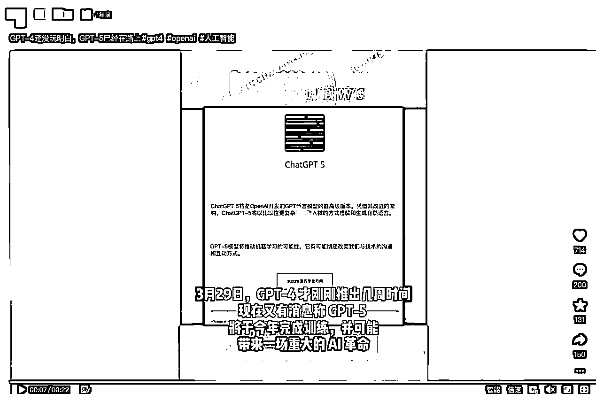

如果你想获取靠谱信息，推荐几个渠道：👸号可以看AIGC Rank排行榜，能及时了解最新动态（当然也有广告）。

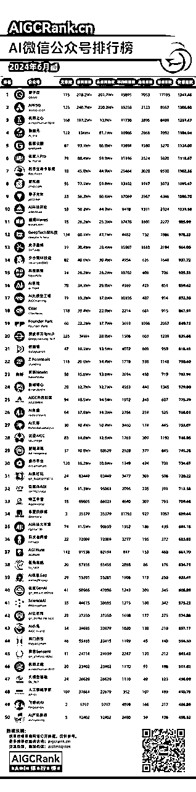

B站是很不错的学习平台，上面有很多质量很高的AI课程，按需搜索、挑高赞的看即可。

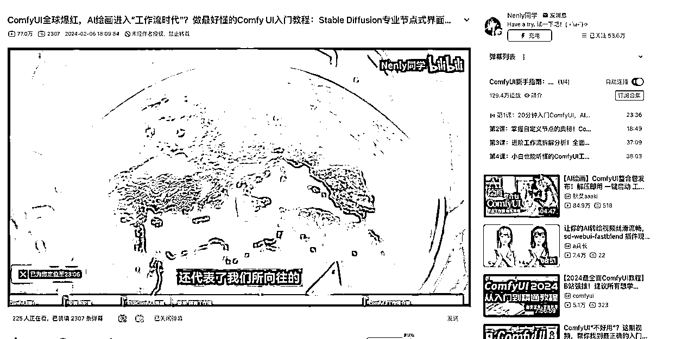

即刻“AI探索站”社区有不少一线一手消息：https://web.okjike.com/topic/63579abb6724cc583b9bba9a

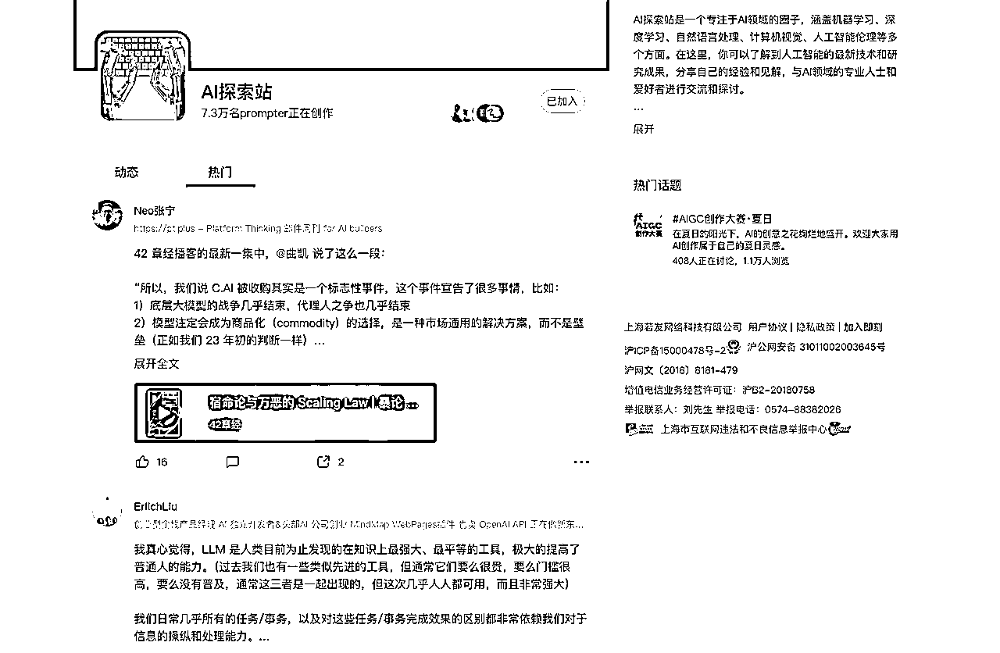

AI周报可以关注《歸藏的AIGC周刊》：https://quail.ink/op7418/，基本涵盖了最新资讯。

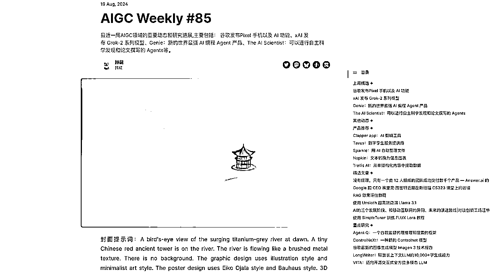

说到底，AI不是神，而是工具，用得好才能创造奇迹。

## 二、怎样用好AI工具

最简单有效的方法只有一条：多用。这比看一百门课、读一百篇👸号都管用。

我发现很多人聊起AI头头是道，但一问到Prompt就傻眼。与其空谈，不如动手练。多用AI不需要掌握高深的提示词技巧，只要你遇到问题先问问AI，看看有没有新思路；有想法时也可以和AI聊聊，验证自己的判断。

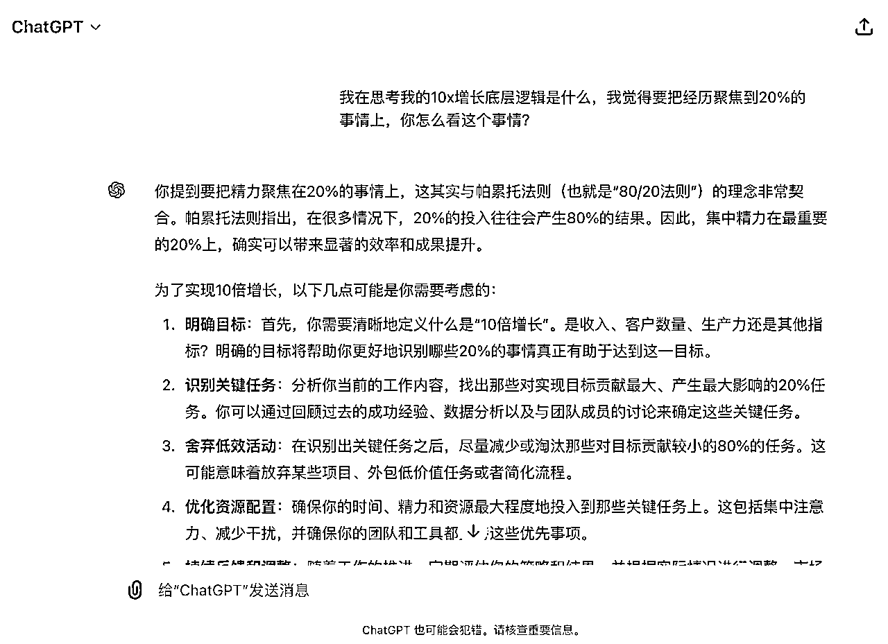

比如有了思考，可以找AI对谈，看看自己的思路对不对。

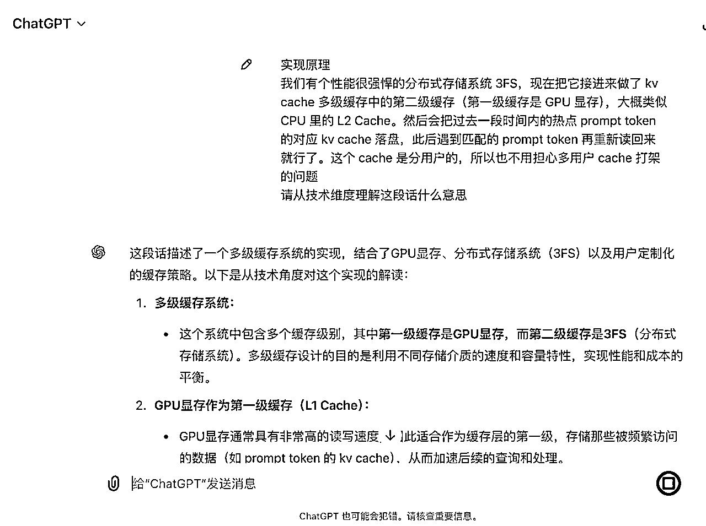

遇到问题，也可以问问AI能不能给出答案。

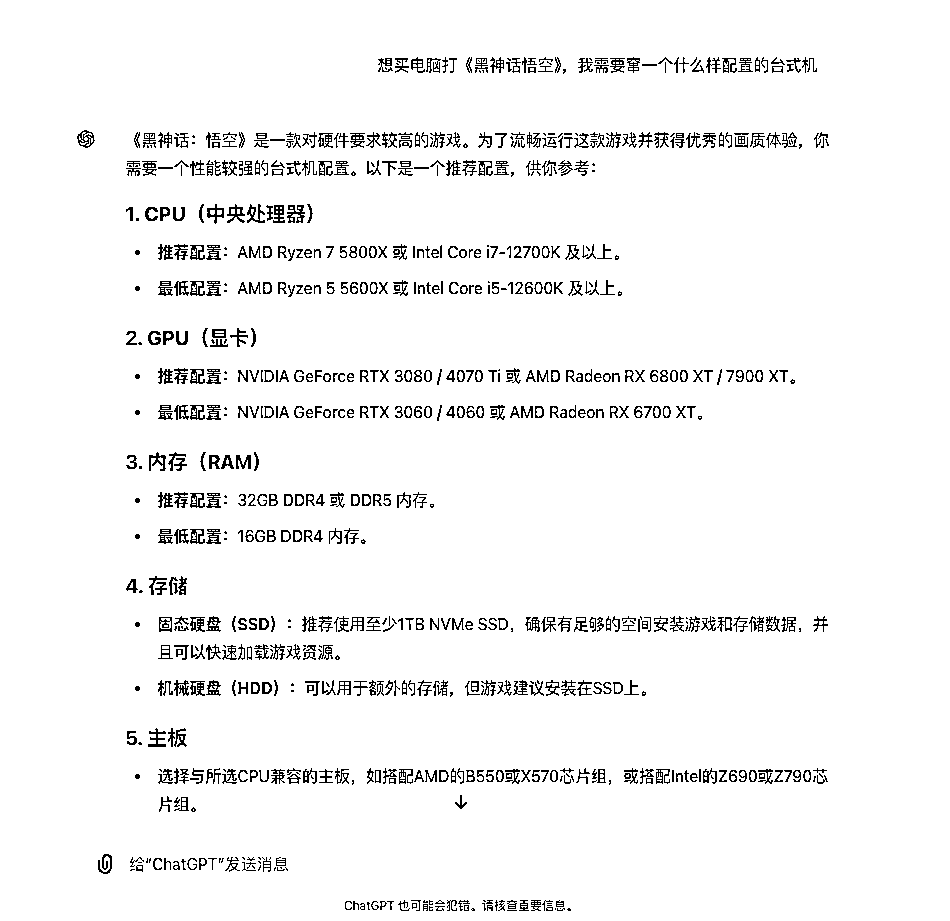

想买台电脑打《黑神话：悟空》，先问问AI什么配置能跑得动。

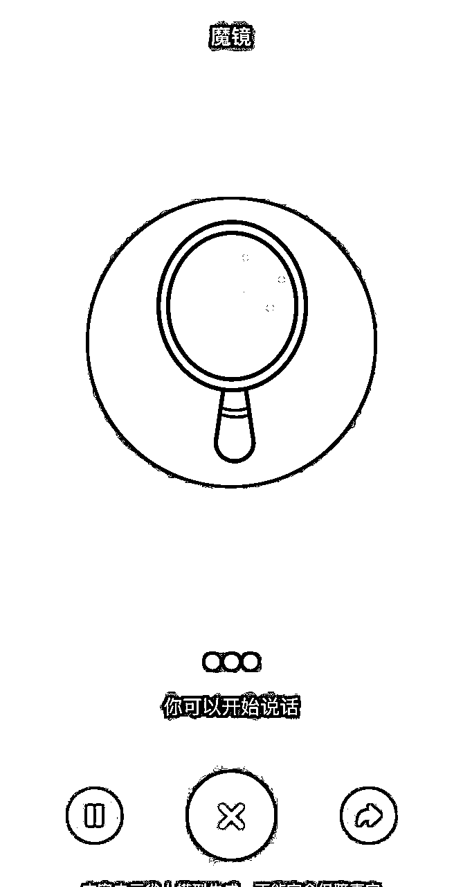

转变思维方式，不需要等到会写Prompt才用AI，随时随地，想到就问。让AI慢慢变成你生活的一部分，这才是掌握它的关键。

不是每个人都必须成为AI专家，但每个人都值得去使用AI。AI既能做专业的事，也能做平凡的事。哪怕只是一个陪你聊天、给你加油的AI，只要对你的生活有帮助，就很有价值。

如果想在专业场景用好AI，要先找到对应场景下的工具，再把它熟练嵌入到业务流程中。

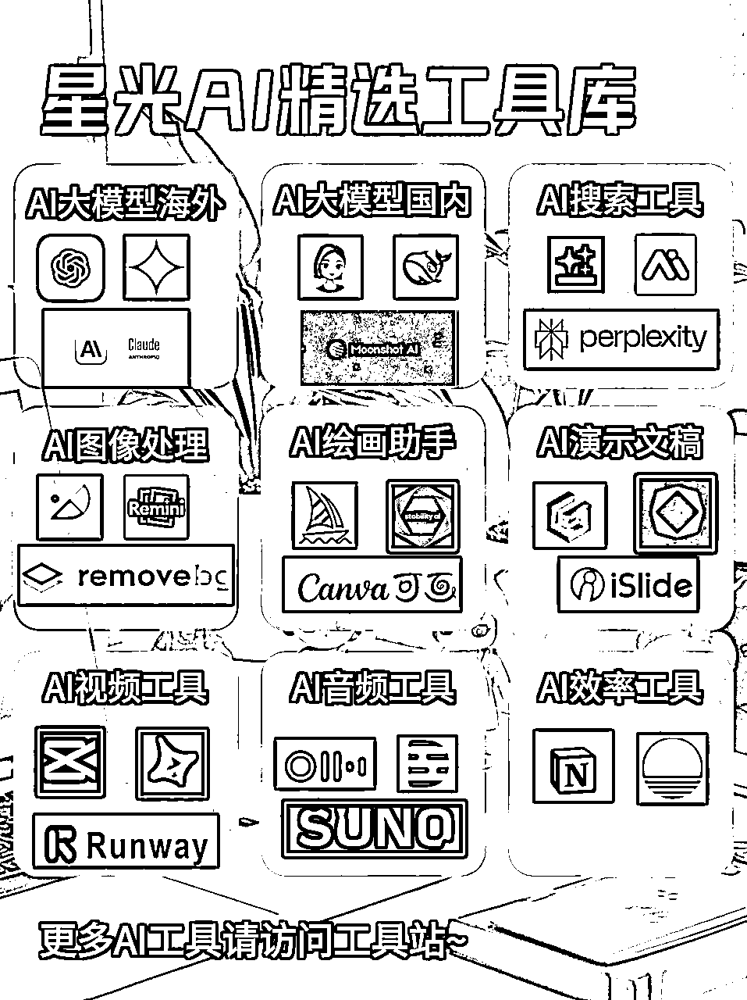

之前带航海训练营时发现，小白用户很难筛选出靠谱的AI产品。网上能找到的AI导航站往往是这样的：

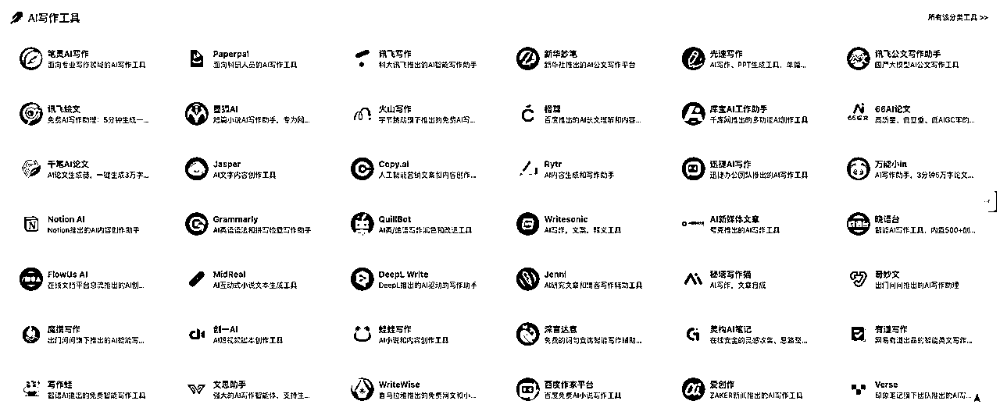

工具太多，看着就不知道用哪个。所以我把自己用过感觉不错的AI产品整理成一个精选工具站，大概100款，希望能帮到更多人。

纸上得来终觉浅，AI能力必须在实践中积累。

## 三、AI赋能案例

再强调一遍：AI是用来解决问题的，不是用来替代人的。

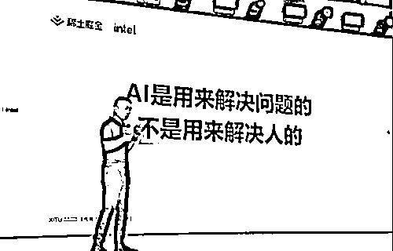

所以这一部分的标题是“AI赋能”，而不是“AI替代人”。

AI赋能主要有两个维度：一是提效，二是提质。提效，就是同样一天原本只能做20件事，用了AI能做40件；提质，就是原本只能卖熟悉的商品，现在借助AI什么都能卖。

AI赋能的核心是工作流。下面用几个案例来说明：

1. 提质案例：写👸号文章
2. 提质+提效案例：AI写营销内容
3. 提质案例：客服系统
4. 暂时无用案例：教育批改作业
5. 提质案例：AI抠图
6. 提效案例：漫画翻译

因为篇幅有限，本文先拆解前三个案例。

### 案例一：写👸号文章

以这篇万字长文为例，写👸号要经过：确定选题、搭大纲、写初稿、打磨成稿、排版。AI在每个环节能做什么？

确定选题时，可以把自己的背景、目的告诉AI，围绕选题思路和它聊，最终碰撞出明确的方向。搭完大纲、写完初稿后，也可以把稿件给AI，请它从逻辑层面提建议，比如哪些地方不够顺畅、哪些点能优化。

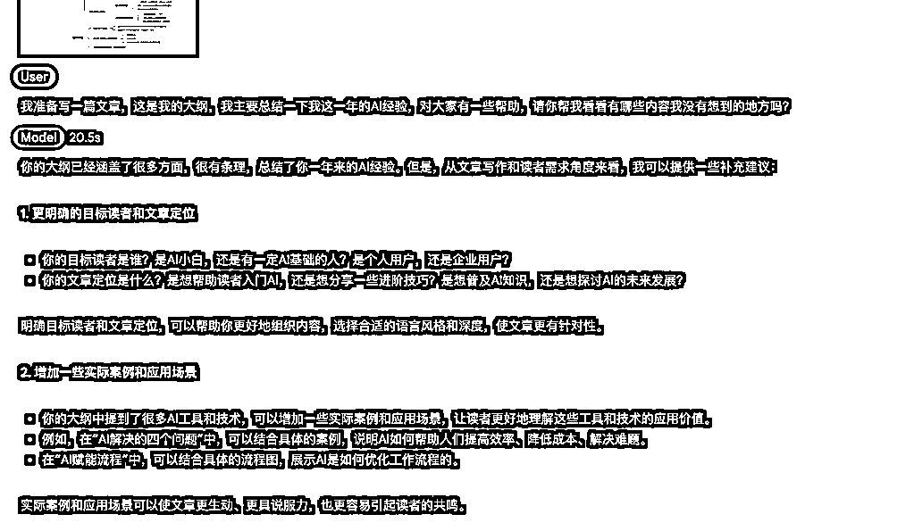

初稿完成后，进入“雕花”阶段，这是由无数细节构成的。我会把全文喂给AI，让它从逻辑上做校核，指出不合理的地方并提出改进建议。

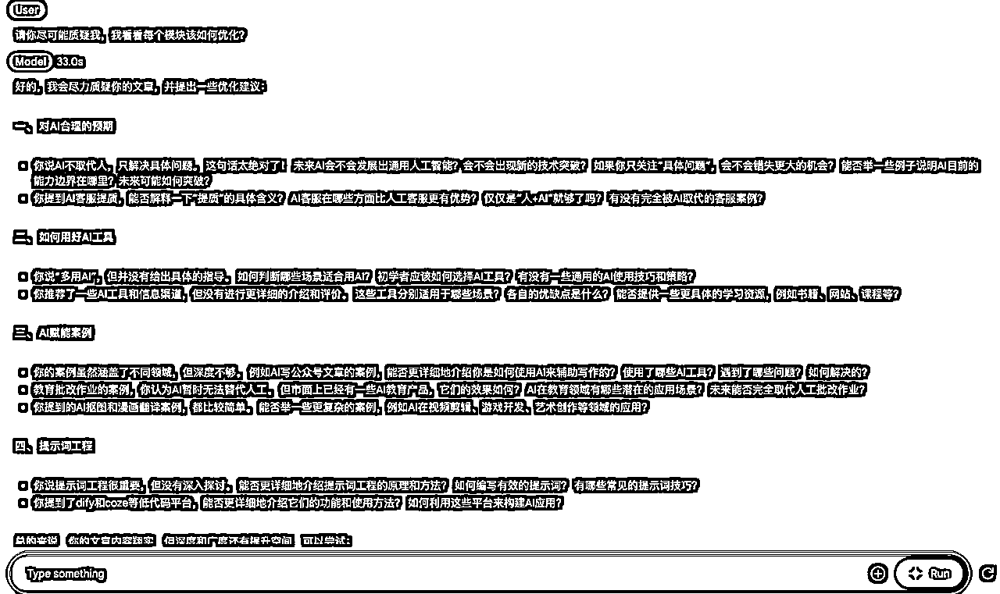

最后的排版布局，目前AI帮助不大，主要靠个人审美。

可以看到，有了AI，这篇文章并没有写得更快，反而更慢了。但质量比以前更高，因为相当于有个人一直在和你反复讨论这篇文章。

### 案例二：AI写营销内容

以电商营销内容为例。私域营销文案的产出流程是：选品和选用户群（策略问题，暂不讨论）→阅读产品详情页→撰写文案。

详情页可以直接交给AI，但这样对模型要求高、token消耗大，识别质量也不稳定。更好的方式是用OCR工具粗提取，再用AI整理。OCR出来的内容往往很乱，比如京东详情页会识别成这个样子：

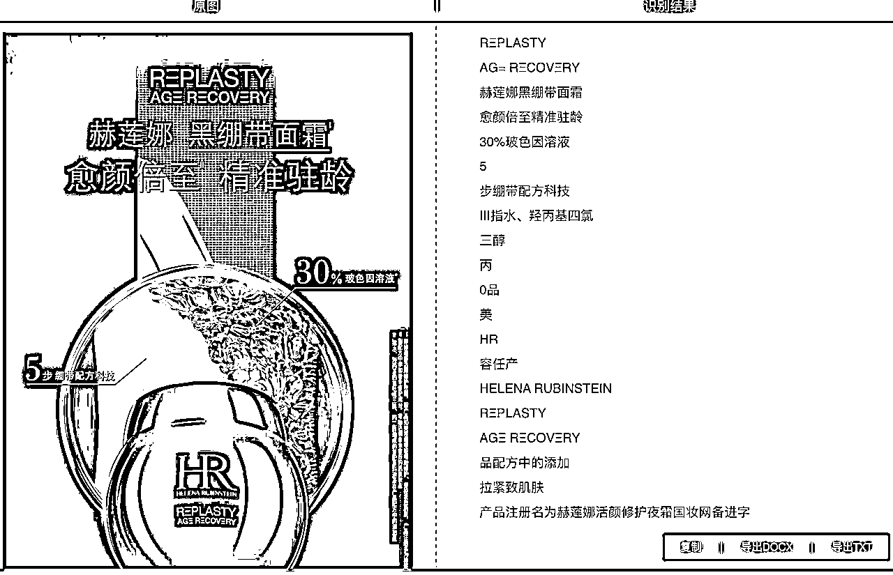

如果直接把杂乱的数据扔给AI，结果也会很糟糕。但先用AI工具清洗一遍，就清爽多了。

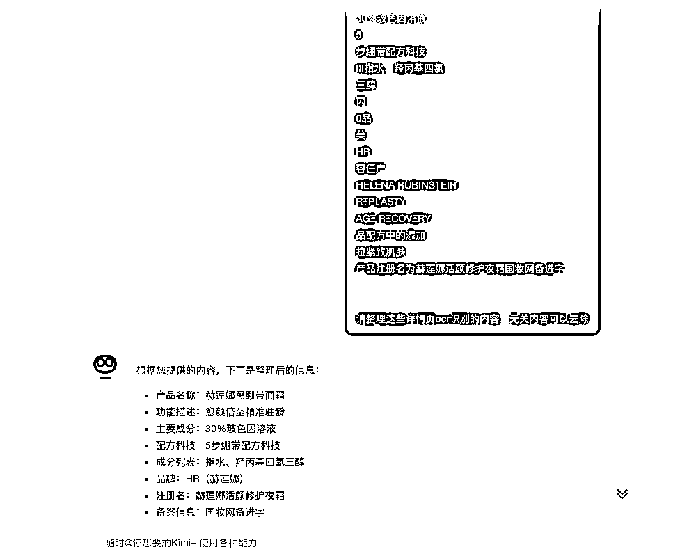

撰写文案对很多人来说是个卡点。比如我，虽然会写C端页面文案，但私域卖货文案从没写过。这时可以去找公司擅长文案的同事取经，看看他们的写作逻辑，也可以到📕、👸号收集好用的写作公式和案例。

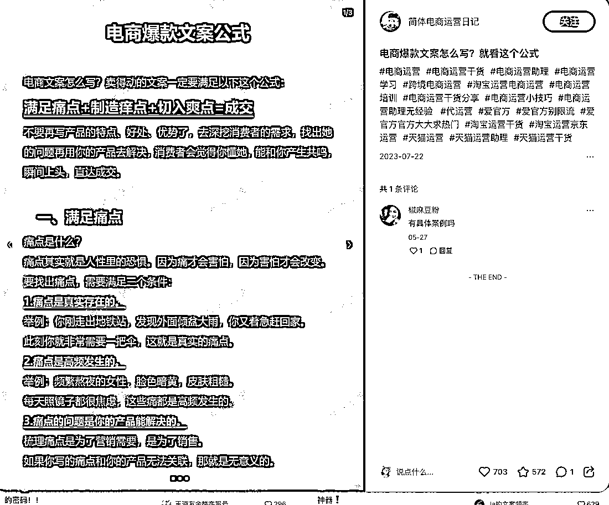

把这些案例整理后，再投喂给AI。

最后把内容封装成Prompt，AI会收到三个信息：
1. 详情页产品信息
2. 用户群信息
3. 商品折扣信息

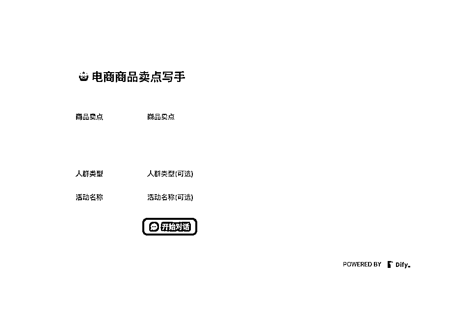

AI需要根据这些信息提炼出5个卖点，再结合用户信息判断哪个卖点最关键，最后围绕这个卖点生成开头话术、卖点话术和促销话术。

举个例子，人群类型和活动名称先留空：

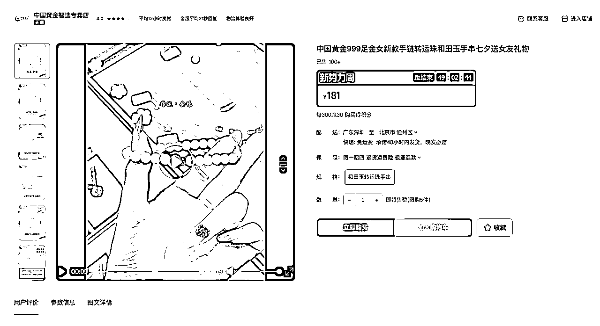

按照配置好的工作流，最终输出的内容是这样的：

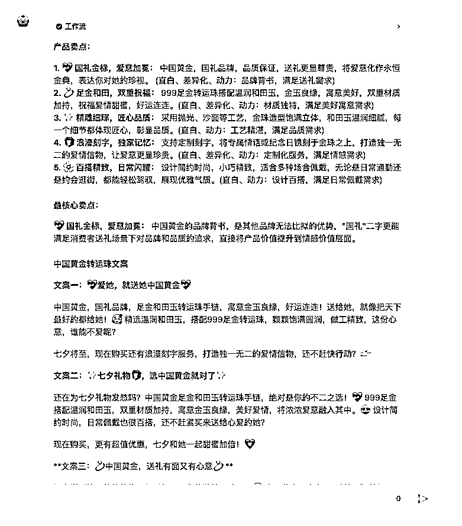

我做过很多轮测试，AI写出来的内容基本能达到公司文案同事80%的水平。要做到更高，需要针对每个品类投喂更多资料。比如服饰类和食品类的用户关注点完全不同，用同一套逻辑，效果会打折扣。

### 案例三：客服系统（知识库+质检）

客服是这波AI落地效果比较好的场景之一，但并不是大家以为的“AI取代客服”，而是AI帮客服解决更多问题，同时帮策略团队做质检、提升服务质量。

为什么AI不是替代客服？因为服务的核心是人与人之间的交互，而不是放一个机器在那里机械匹配答案。

前置的客服机器人通常只能解决基础高频问题，比如退换货几天、是否包邮；但涉及个性化推荐、售后方案等复杂需求，AI很难低成本搞定，不如“客服团队+知识库”的组合。

客服场景主要有两个：知识库和质检。

先说知识库。人工回答用户问题时，最大的痛点是无法记住所有活动规则和商品信息。比如用户问“推荐一款冬天的羽绒服”，如果商品库里有几百个商品，客服根本来不及研究区别，用户也没耐心等。内容电商通过测评内容解决了部分选择问题，但对客服来说，回答这类问题仍很困难。

靠培训能解决吗？看业务复杂度。如果商品种类少、规则简单，培训可以；但如果每个商品售后都不一样，基本没戏。

做RAG也一样，前提是前置文档和商品信息必须完整。我在做这个项目时，最大的时间消耗不是搞RAG，而是一点点面对客服团队，把所有规则重新梳理了一遍。梳理完发现和公司最初存的文档对不上，这种情况下怎么搞RAG都没用。

如果只是做一个资料库，整理好资料用RAG也能实现，本质上是辅助人的助手。那么能替代人的AI客服怎么做？核心是“意图识别+工作流匹配”。通过识别用户意图，引导用户进入预设工作流，在流程里解决问题。这件事最难的是把每个工作流拆清楚、拆细，需要拉着业务团队一点点做。

更简单的做法是：人做意图识别，AI直接提供对应工作流的内容，做一个比资料库更有用的助手。

再说质检。为了让服务团队保持高质量，策略团队需要检测整个服务过程。但服务量太大，无法全部人工查看，只能抽检，再结合用户评价做参考。

AI可以实现全量检测。只要把标准输入AI，它就能检查一个客服与用户的所有对话，全面评估服务水平。但问题也会成倍增加：检测出的问题太多，策略团队可能忙不过来。而且质检往往是多轮检测，每一轮都要重新调用源文件，token消耗巨大。大公司可以自己部署开源模型或7B小模型；小公司建议用DeepSeek这种支持多轮对话缓存的模型，成本能大幅下降。

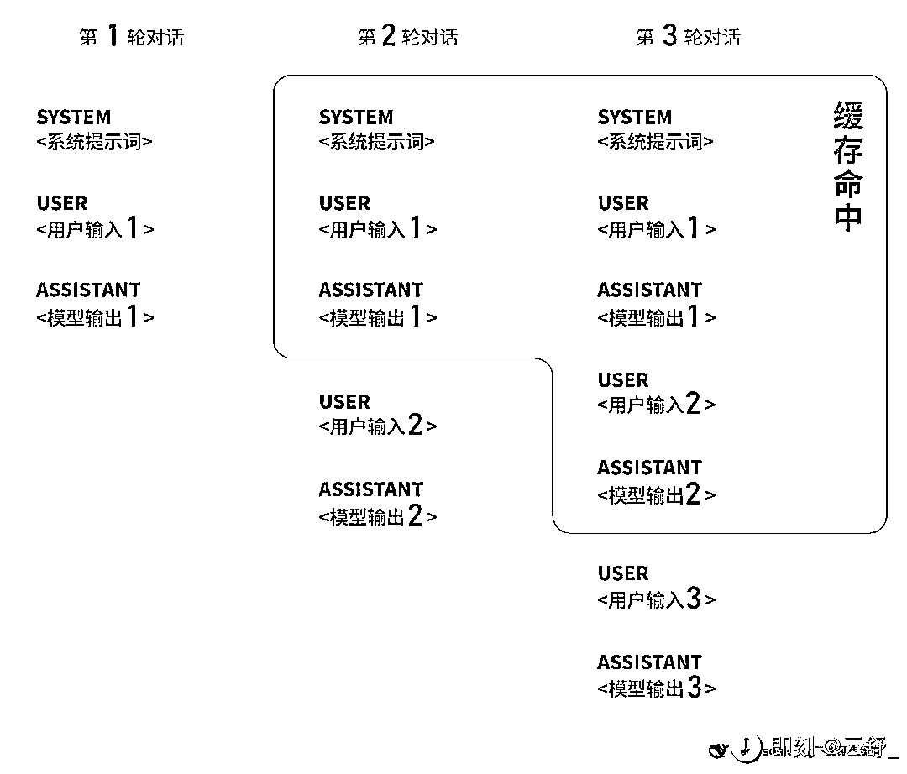

比如有20轮对话，使用缓存后成本可以降到之前的十分之一左右，效果非常显著。

至于教育批改作业、AI抠图、漫画翻译等场景，我会在后续文章中再详细拆解。AI的探索之路还很长，愿我们都能善用这个伙伴，让它真正成为生活和工作的加速器。

先说一个反着来的例子：它算不上靠人工智能大幅省人的成功样板，反倒是我眼中现阶段没必要硬上的情形。

这个例子落在英语作业批改上。最费时间的环节是判作业和写反馈，看起来很适合交给模型处理。但深入流程后会发现，学生提交的是图片，而且每道题的作答方式千差万别：有的直接写字，有的要勾选，还有的会在图上画圈。

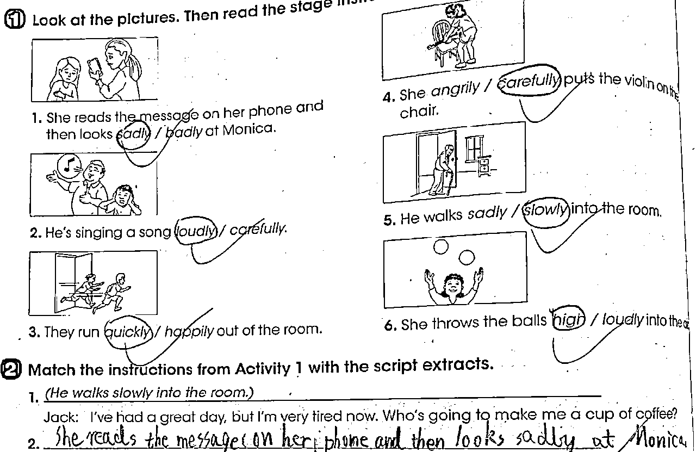

到这一步，常规的文字识别已经崩了。版面信息会失真，学生手写的英文也常被认错。老师靠猜还能看懂，机器就完全没辙。

那换成能理解画面的模型行不行？设想上可行，但真正能承担阅卷任务的很少。Gemini 1.5 Pro 这一级别勉强够看，但你敢指望它全对吗？大概率连 70% 的正确率都很难守住。于是流程变成：模型先处理一遍，老师再复查一遍。原本老师亲手批改加写点评只要十分钟，现在机器跑完还要人工校验，时间也没有省下来。折腾一圈，提了什么效？什么也没提。

如果学生是在线填写作业，情况会好办得多；可惜现实里仍有大量图片输入，只能靠 OCR，那人工反而最稳。也许等视觉识别精度到了 99% 之后，端到端的机器处理才有机会；又或者整套支撑已经足够成熟，但那个阶段的成本未必划算。说来说去，真正决定要不要用的，仍然是模型水平与实际支出之间的权衡。把账算完，结论自然回到了人工。

### 案例 05：大闸蟹商品去背

第二个场景来自京东：标准的大闸蟹商品图要先做成透明背景，方便后续放到不同渠道去拼图。

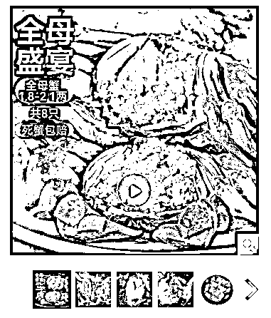

每件商品通常要为轮播准备五张主图。过去不引入机器时，只能人工挑图，再用去背工具一点点处理。货少的时候还能忍，图片攒到几十万张，靠人已经不太可能。如果都是新图，可以用外包或临时团队顶上；但要消化十几万的存量老图，连组织人力都是麻烦。

那能不能让模型全程接管？ChatGPT 可干不了去背的活。比较靠谱的解法是“模型选图 + 工具去背”：先给模型定几条筛选条件，比如主体必须清楚完整、不能有大段文字盖住商品，让它把整套主图审一遍，符合要求的进入去除背景的环节，最后再做一轮质量核验。合格就进入图片库，不合格则打上待处理标记。

我们用螃蟹这类商品跑了一次完整测试，结果如下。

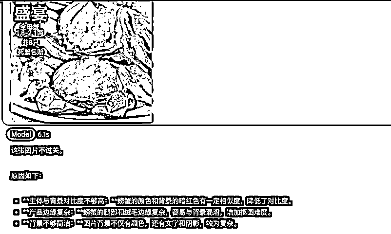

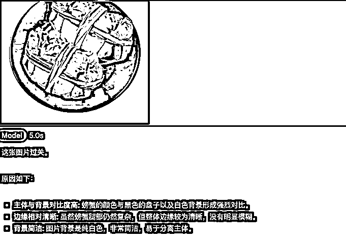

这条链路还可以给不同品类设置专属判断条件，让准确度继续上升。不过那属于精度优化，更重要的是先掌握这种“筛选+处理”的协作模式。

### 案例 06：漫画翻译项目 comic-translate

最近刷到一个叫 comic-translate 的开源项目，它把漫画翻译做成了一条完整流水线，很有意思。

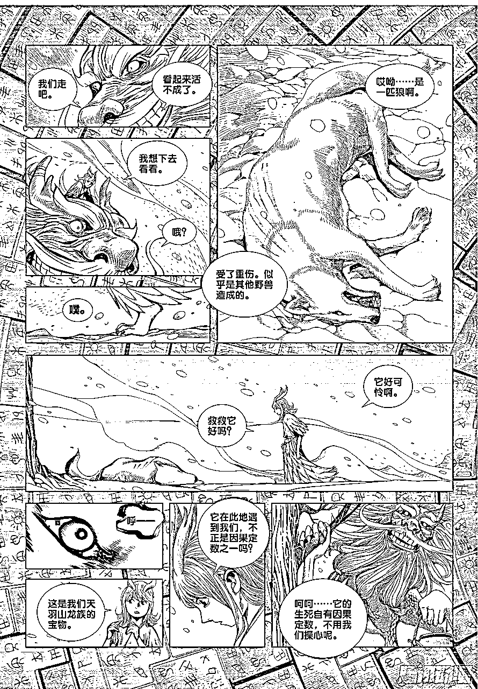

假设有一页漫画要改成英文，过去最快的方式是人海战术：有人负责翻译内容，有人负责修图换字。单纯让 ChatGPT 来做肯定没戏，它最多跟你讲讲这页漫画讲了什么，做不到把图中的文字真的换掉。

最难的部分，是找出画面上有哪些文字区域，以及如何把原文精确替换成译文。整页丢给 OCR，识别结果基本不能看。

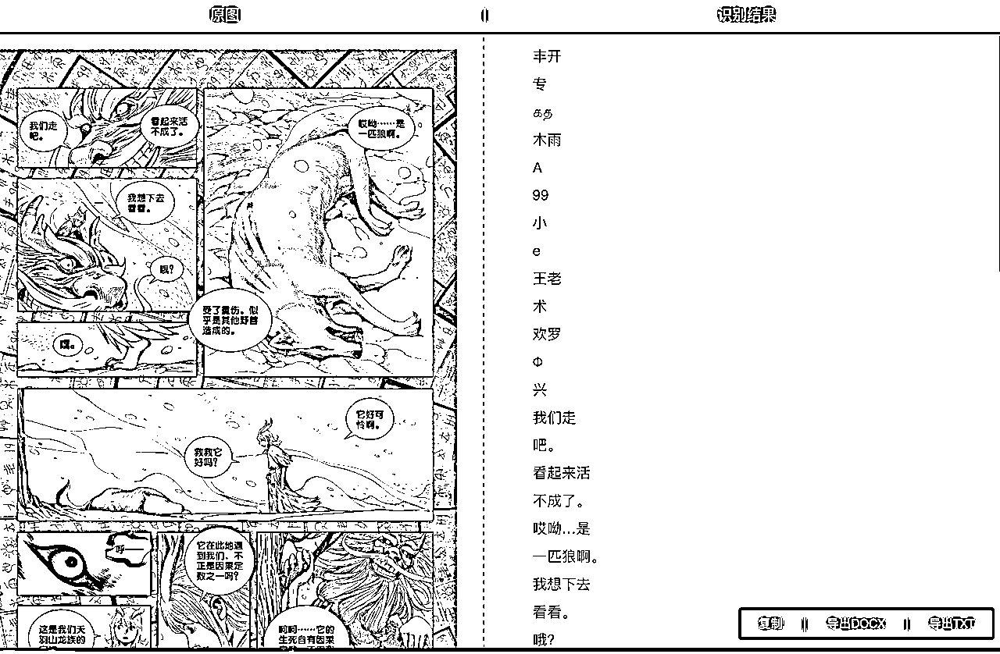

但有趣的是，OCR 一旦被限制在某个小块范围内，识别准确率就高了。

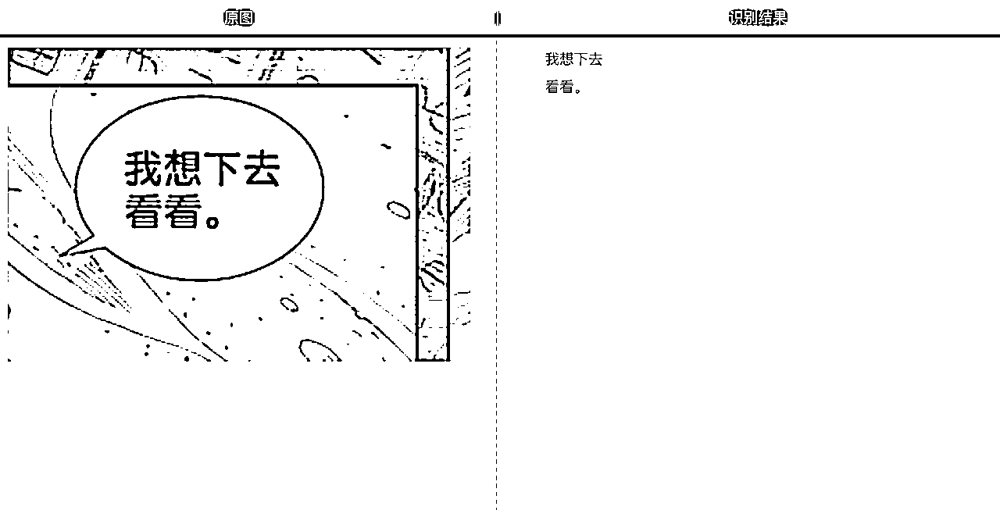

思路因此变得简单：先把页面拆成若干文字块，逐块做识别和替换。comic-translate 的做法是先用两个模型分别识别文本框和对话气泡，随后对每个块单独走 OCR，再交给语言模型翻译，最后由绘图工具把译文渲染回图中。

下面这两个模型的标注结果很直观：

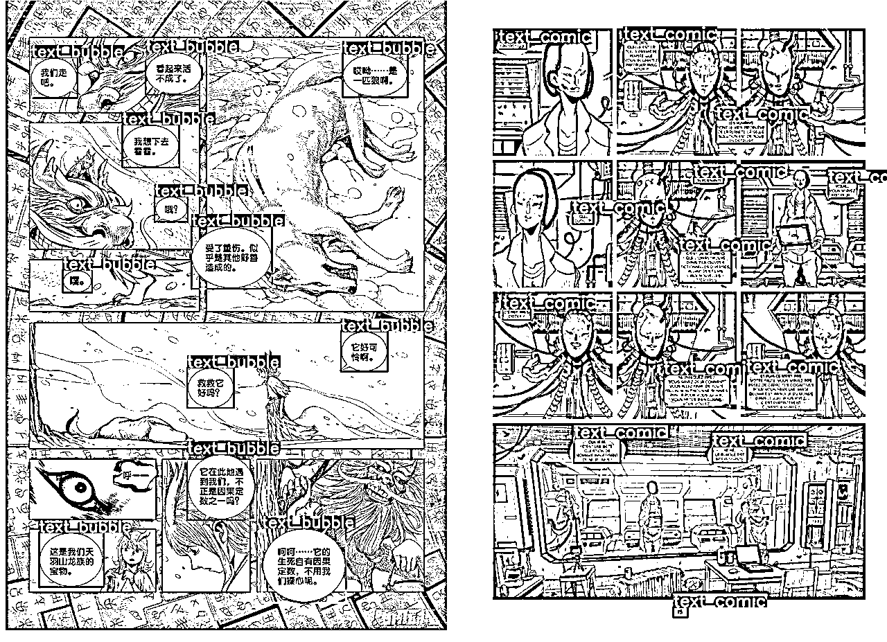

每个文字块识别完，擦掉原来的词句，用语言模型生成目标语言，再把译文写回原本的位置，一版高质量翻译就完成了。

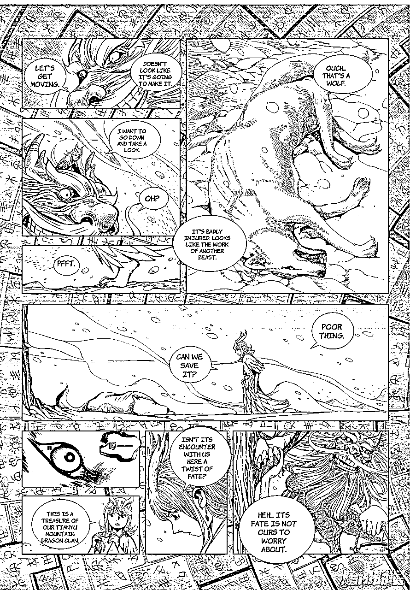

### 企业推动智能化，先算账

聊完这几个案例，我想再强调一件企业容易忽略的事：算账。

在公司里，流程变得更顺不等于这件事值得投入。举个例子，你花 200 万元的成本去为某个 20 万元投入的团队做改进，最后只换来 25 万元的增量，表面有了增长，实际投入产出是亏损的。如果智能化改造不算这笔账，很容易做出看起来光鲜、最后却鸡毛一地的项目。

### 公司里有没有“全员在用”的氛围

除了具体业务，公司整体愿不愿意用新工具，是一个更大的变量。因为不可能每一条业务方向都配专门的人来做流程拆解，很多环节让专人去跟，投入产出比低得无法立项，只能靠一线成员自己摸索。这时全员的自发使用习惯，就成了效率的分水岭。

公司文化好、上下都在积极实践，领导者以解决实际问题为目标而不是天天想裁员，整体生产力自然会拉开差距。最难调整的，其实是老板的认知。假如老板整天刷到各种“人工智能即将取代所有岗位”的夸张内容，开始觉得谁都可以被换掉，那么员工的第一反应必然是给自己的手头任务建立壁垒，把保留工作放在所有事之前，主动拥抱新工具？那等于自己淘汰自己。

这种情况下，最多有几个部门负责人能撑住，让伙伴们切实感受到新工具的好处，愿意为了自己的长期发展去掌握它。但这种队伍十分难得。我观察到的能形成类似氛围的组极少，这些负责人基本都对模型有较深的认识和自己的实践经验。

我越来越觉得，随着模型水平继续向上，不同公司之间的整体运营效率会差得越来越远，说“天差地别”也不过分。一个成员借助工具完成数倍于以前的成果，在技术上完全可以做到；真正的难点在于，这个场景能否发生在普通公司里。

人数不多的团队要建立这种氛围，办法其实很朴素：负责人自己先沉下心去用，去研究，而不是天天讲大道理。你认真动手，大家会看在眼里并跟着做；只会喊口号，最终什么也剩不下。

### 小团队验证想法：用 Coze 还是 Dify

再说落地的工具选择。经验不足时，不要急着让研发团队试错。最好先用 Coze、Dify 这类毋需从零搭建的平台跑通 MVP，再考虑让研发批量实现。研发直接试探的成本很高，而且一个想法在当下到底行不行，本来就要打问号。

Coze 与 Dify 这两款平台都允许用可视化节点去搭建一套可发布的流程应用。

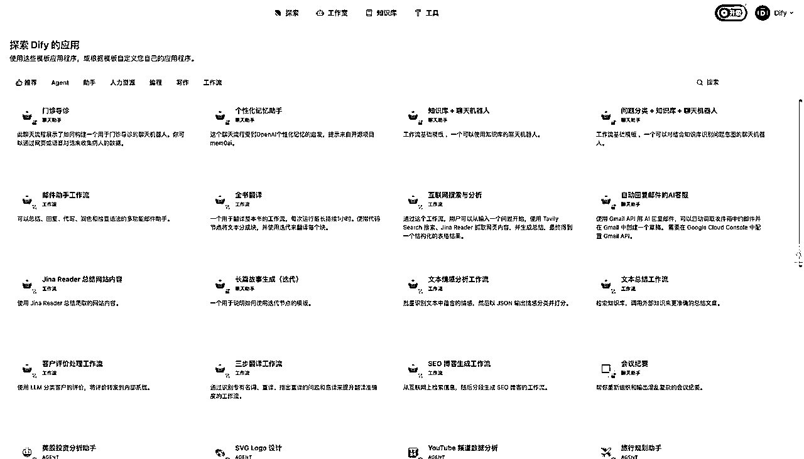

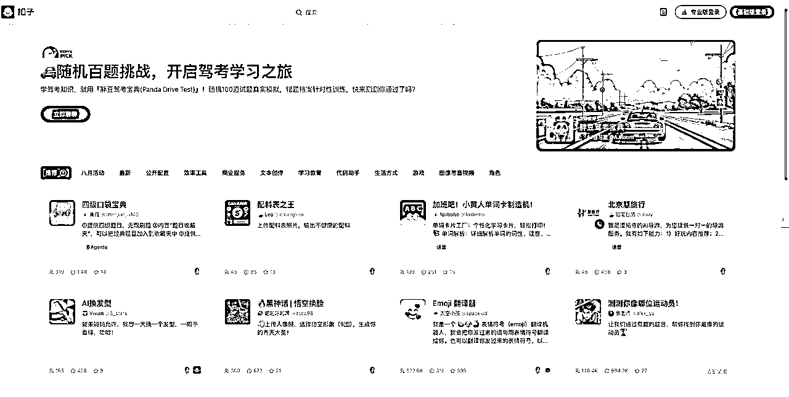

该怎么判断用哪个？如果你的业务对模型表现要求较高，比如要用海外模型，或者想追 DeepSeek、零一万物等团队的最新版本，那 Dify 更合适。它接入了大量模型厂商的接口，版本切换非常自由。

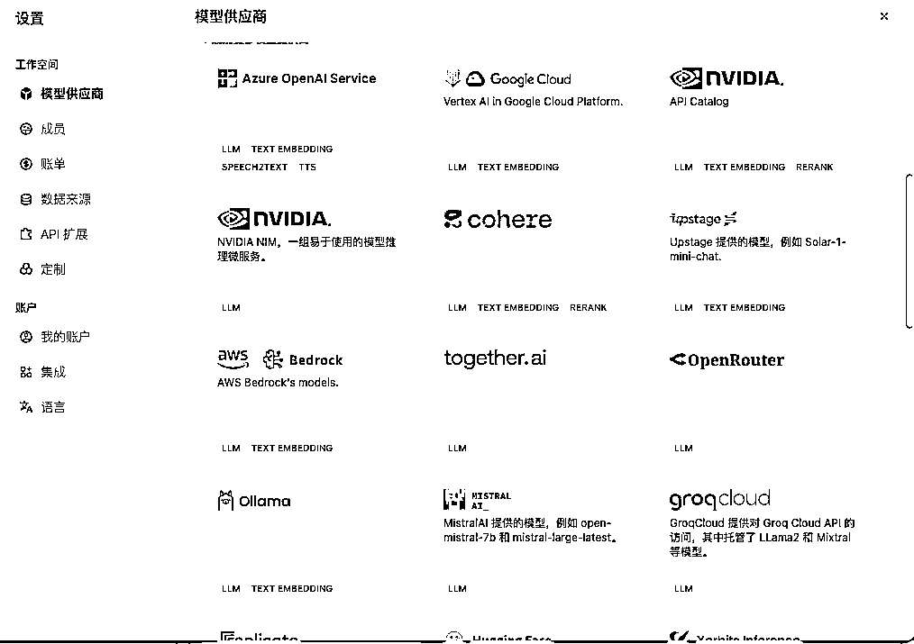

如果你没有太强的模型偏好，更需要借助知识库、插件来解决问题，那 Coze 上手会更顺。Coze 把检索和知识匹配封得比较浅，我用它做过客服售后意图识别的体验版：先让知识库找到相近问题，再让模型把内容归类到具体意图。Dify 的相关操作则更偏工程化，不熟悉 RAG 的人会有点吃力。

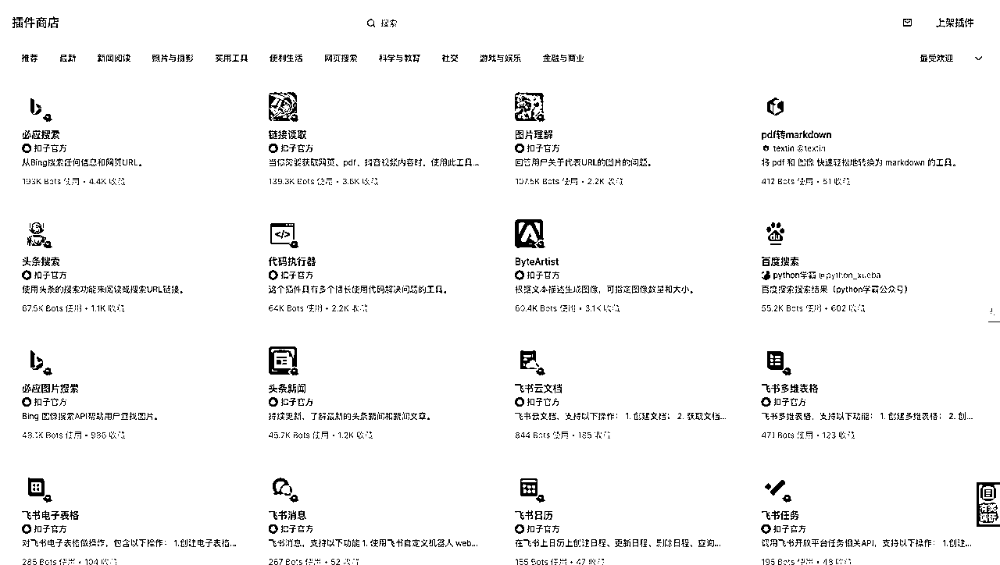

另外，在缺少研发支持的情况下，如果希望把机器人直接发到👸号、抖音、飞书等平台，Coze 的门槛低很多；Dify 在这些平台往往需要走接口对接。两边的可视化流程设计都做得不错，算是各有侧重。

### Prompt 设计：让模型替你干活

从最早接触聊天模型开始，我就觉得写 Prompt 很费劲。所以我一直支持做“技能模板社区”：让熟悉技术的人把现成能力打包好，不懂的人直接调用，这样新工具才更容易进入日常。

但在专业场景里，如何写好 Prompt 依然是自动链路的核心。信息完整、步骤清晰是基础，这里不展开。常见困境是，我们不是某个领域的专家，连需求都描述不清楚。总不能为了写一段 Prompt 先去考个行业证书。

我的应对是三步：收集素材，投喂模型，检查输出。拿短视频脚本来举例。最简单的办法，是找一条你认为拍得不错的视频，直接把内容丢给模型，请它拆解其中的文案结构、镜头逻辑和节奏安排。

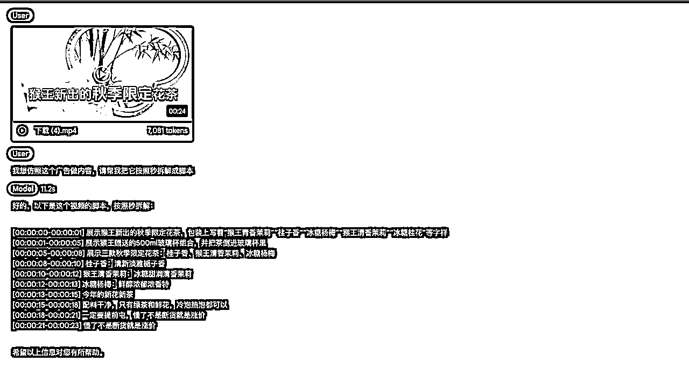

之后再提出你的改写要求，请它照着这份样本做仿写。

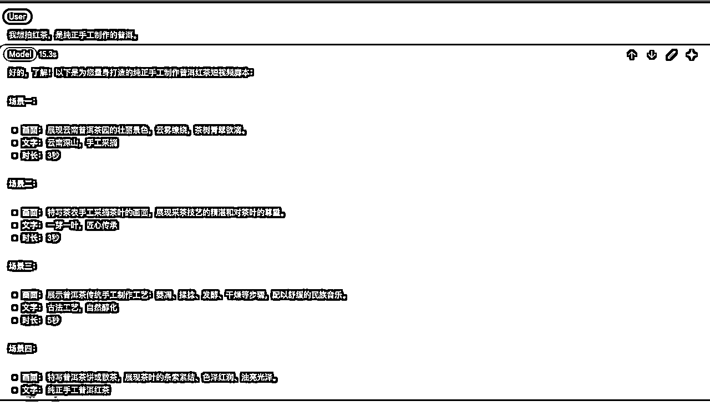

这种做法的上限完全取决于模型的理解力，效果不稳定。想再往前走，就要去吸收真正的行业经验。可以找懂行的人聊，也可以读一批相关文章，最终把写脚本的通用套路提炼成几条明确的规则。

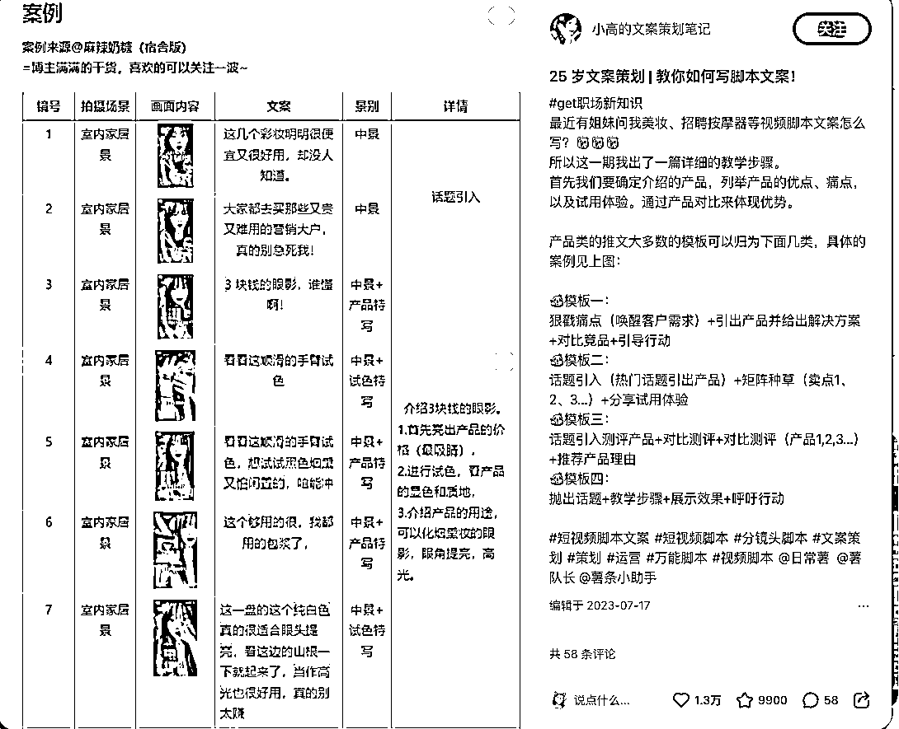

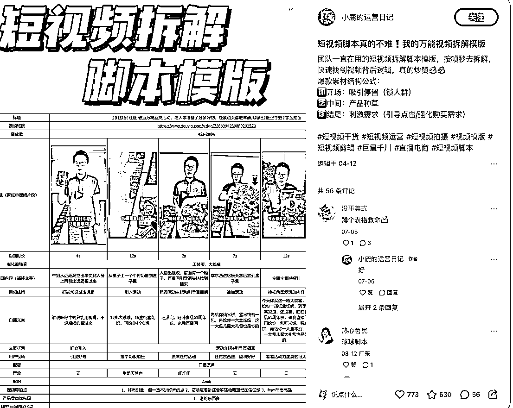

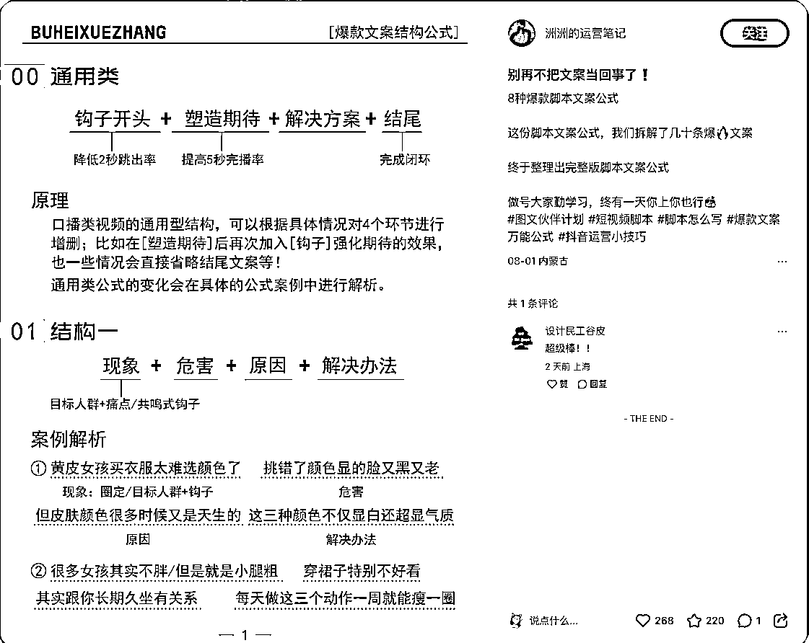

把这些规则交给模型，它再输出时就有了可靠的依据，内容质量会厚实很多。前面提到的营销案例就是这样做的。

如果还想要更高的水准，可以让模型系统学完一套课程。先把课程音频用通义听悟转成文字，再把文字稿一次性投喂给模型，请它学习后自行归纳重点和方法论。

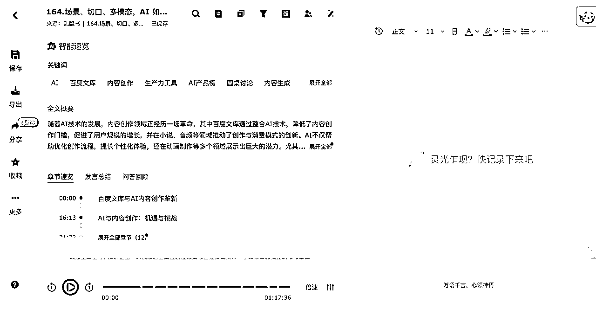

等于是你带着模型一起上完了这门课，最终得到一个既懂领域知识、又会落笔表达的帮手，它会不断给你带来惊喜。

### 结尾：我为什么想清楚了自己的定位

这篇文章从立秋当天开始写，到下旬才结束。大纲用了几天，主体内容写了一周，打磨细节又花了一周。合稿时长出一口气：过去这一年，我经历过项目没做下去的失落，也体验过把一件件小事做成后的充实。

刚开始接触新工具时，我也有过浮躁的阶段：天天刷资讯、尝鲜各种产品，唯独没有静下心来把一件事用工具做深。账号停更了两个月，很大程度上是因为我没找到一个愿意长久投入的题目。后来在即刻断断续续记录了一些实践心得，慢慢整理成了这篇文章。

五周以前，大家在一个由 super黄 发起的讨论组里聊《10x is easier than 2x》，有位朋友问：你自己最关键的那二成是什么？

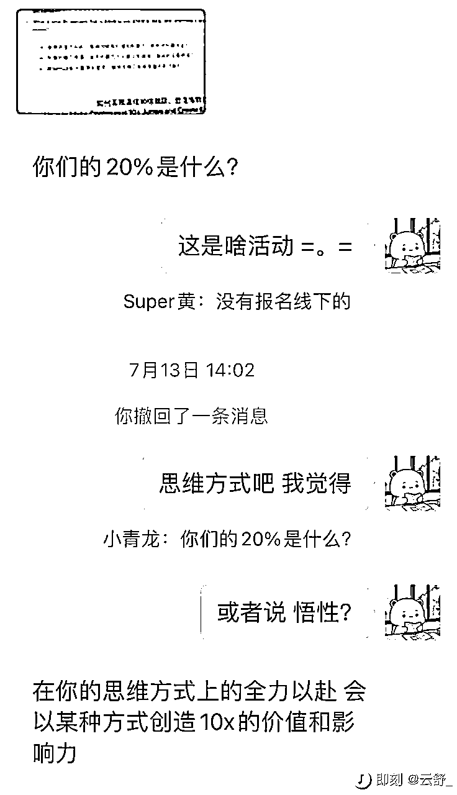

我第一反应说是思考方式，再想想觉得不对，那只是表面，不是我真正拿得出手的东西。后来把候选答案一个个划掉：做界面示意、写产品说明，只算普通水平，放到市场上卖不出价格；对工具的理解也只是一段暂时的红利，等大家都玩明白了，它就会变成基础能力。

直到有一次听完李老师的分享，我在路上走，脑子里突然冒出一句话：能够看清用户真实的痛苦和生意运转的底层逻辑。回看自己做过的项目，好像确实如此。我愿意跑到一线接用户电话，也愿意去仓库搬货，去做那些别人嫌麻烦的小事，才换来对业务关键点的准确把握。

我想，这也是我在新工具时代给自己的定位：持续磨炼对用户和商业的感知力，做真正有兴趣、也愿意一直投入的事情。

最后，我还请 Gemini 帮你我写下一首短诗。那首诗句里，有秋风起时的寒意，也有跋涉中的坚持；虽然路途漫长，但只要专注地往前走，未来总有值得期待的光。