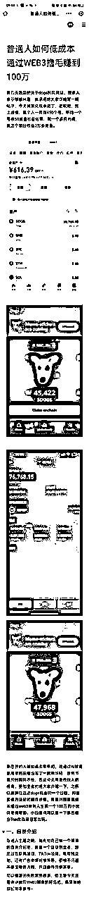
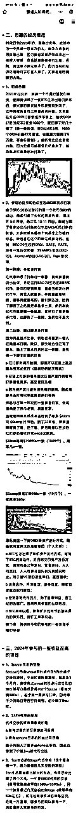
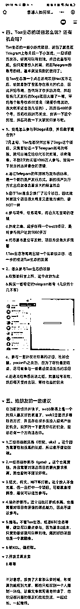

# 零基础普通人，怎么靠Web3“撸毛”用小成本搏百万收益？
作者：龙哥

经常有人问我：Web3到底有没有普通人能抓住的机会？说实话，有，但绝不是靠炒币梭哈，而是靠一种叫“撸毛”的玩法。简单讲，就是去参与那些还没发代币的新项目，通过完成交互任务、积累钱包记录，等项目日后正式空投时，拿到一笔不菲的代币奖励。有人靠这个，用几千块的成本撬动了上百万的回报。

你可能会觉得夸张，但实际上这背后有一套很清晰的逻辑。早期项目为了拉新，会把未来发行的代币预留一部分，分给那些真正用过产品、提供了活跃度的早期用户。只要你愿意花点时间研究，认真做交互，相当于用极小的成本买入了一张有可能中大奖的彩票。

关键是“低成本”这三个字怎么落地。首先要避开那种需要大额资金参与的项目，专挑测试网或低门槛的主网活动。其次，批量操作是常见姿势——准备多个钱包，不是让你作弊，而是为了增加概率，因为空投通常是按“每个地址”来发放的。再加上关注一些靠谱的社区和工具站，提前掌握新项目上线的消息，这样就能用最少的手续费成本，抢在大多数人前面。

当然，这事不是闭眼乱点就行的。你得学会看项目的融资背景、团队信息、社群热度，还要懂得合理安排时间，比如每周固定拿出几个小时做交互任务。更重要的是，心态要摆正——撸毛本质是“概率游戏”，可能某个项目颗粒无收，也可能某个项目直接让你逆袭。所以千万别投入自己承受不起的钱，永远只用闲钱和精力去尝试。

看到这里，你大概明白了：低成本撸毛不是一夜暴富的捷径，而是一场信息、执行力与耐心的较量。如果方向对，方法对，普通人确实有机会靠它把100万拿在手里。至于更细的实操流程，我把它整理在下面了，配图会更直观👇

提醒一句：机会窗口不会一直开着，但莽撞上车更不可取。先看懂，再动手，你才有资格去接住属于你的那枚空投。