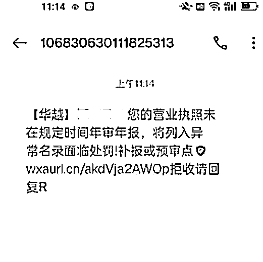
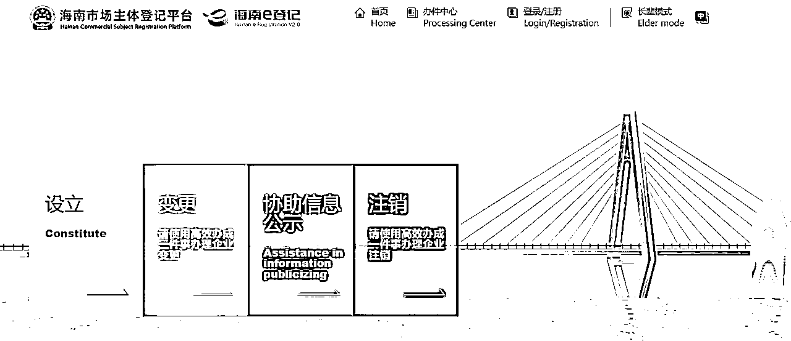
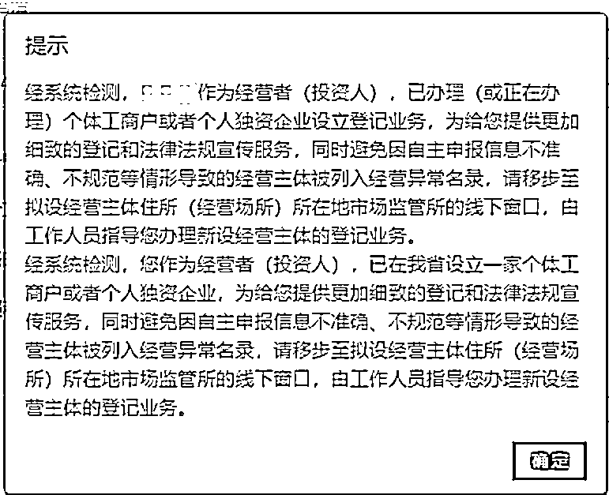
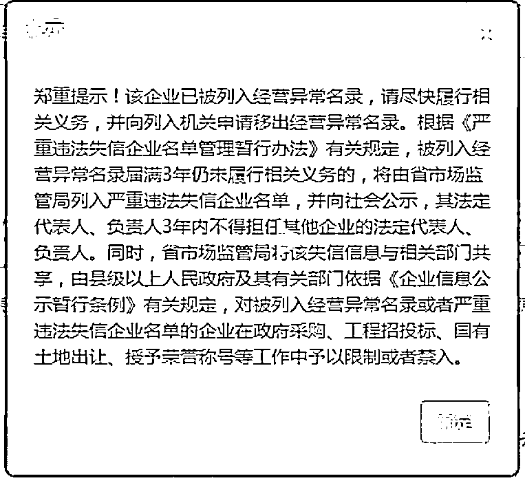

# 营业执照注册注销，出版物经营许可证代办问题

很多人做副业、网赚项目，第一步就是去电商平台开个店。但只要开店，就避不开营业执照和出版物经营许可证这两件事。这些年我一直帮人代办电商执照和相关资质，对这里面的门道和坑都摸得比较清楚，所以这篇就把注册、注销和日常可能会踩的雷一起说清楚。

# 一、出版物经营许可证

## 1、怎么办理出版物许可证

先说一个前提：出版物经营许可证不能独立存在，它是挂在营业执照底下的。换句话说，手头必须先有执照，才能去申请出版物许可。

各个地方办执照的要求不太一样，最核心的差异在于经营地址。大部分地区允许用自己家的地址注册，租房地址通常也行，但不管哪种，都要提供房产证复印件作为凭证；个别地方额外要求居委会开证明。搞定执照之后，再拿执照去申请出版物许可证就行。

有一点要留心：大城市对出版物的审核普遍更严格。有的会要求必须有真实的经营场所，对场地面积、仓库、货架等都有要求，而且住宅不允许作为商用场所。相对偏远的小地方则宽松不少，很多时候只要有执照就能过，但也存在工作人员上门拍照核查的情况。因为标准不统一，最稳妥的办法是去当地县一级以上行政服务中心窗口问清楚具体要求。

## 2、出版物许可证怎么注销

直接注销营业执照就行，出版物资格会随着执照注销自动失效。市面上有些代办会借机单独收一笔“注销出版物”的费用，属于纯套路，完全没必要花这个钱。

## 3、找代办办出版物的几个注意点

不是所有人都满足自行办理的条件，不少人会选择代办，这时候要格外留几个心眼。

出版物本身就比较敏感，关联书籍、禁书、邪教等敏感内容，国家管控一向很严。一旦出现举报、核查、政策收紧之类的情况，县一级就可能启动整顿。轻一些的，是先做网店备案登记；严重的，会实地核查是否真实经营。这也是为什么出版物许可证偶尔会被查、会失效的原因——谁来都没法保证不失效，这种事更多看运气，全国都一样。

真碰上了也别纠结“为什么我的证失效了”，关键是想清楚这张证帮你多赚了多少钱。万一失效了，给网店换绑一套新的执照和出版物就行，不影响店铺正常做。

有人代办会打包票说“绝对不会被查”“年审百分百过”，听听就好。核查是政府部门的行为，个人再怎么承诺也兑现不了。很多代办之所以暴雷跑路，就是过度承诺、收钱之后兜不住。大家要有警惕心，但也不必过度焦虑——要是出版物总出问题，这行早就没人做了。

另外还要说一个很多人问的点：执照地址和出版物地址是否为虚拟地址、挂靠地址、集群地址。直白地说，市面上几百块的执照、一两千的出版物，用的基本都是虚拟地址，成本决定的，没那么多真实地址给你用。

虚拟地址的出版物行情价一般在1500元上下浮动。想要真实地址的出版物也有，比如开天猫店、京东店用的那种，行情价在5000元左右，而且每年还要固定交一笔约3000元的地址使用费。普通小网店的话，1000多块钱的出版物已经够用了。

# 二、电商营业执照

## 1、注册营业执照时要注意什么

注册执照的核心问题还是经营地址，这在上面讲出版物的时候已经提过，就不重复展开了。用得最多的执照类型是个体户和个人独资，二者差别不大，唯一的区别在于：个体户监管相对宽松，大概率能避掉报税的事。

个人独资在税务上会比个体户查得严一点，但也就严一点点。只要不去做税务登记，一般一两年内都不用担心税务问题。不过极少数地区会在办执照后强制开通税务，比如重庆，这种就要注意了：每季度做一次税务零申报就行（不开发票就可以零申报），网上教程很多，照着做即可。

执照每年6月30日要完成年审，自己在网上就能操作，同样是一搜一大把教程的事。

这里有个常见的套路：经常有短信或电话提醒你说“年审收费300元，不交会怎么怎么样”，其实就是想骗你钱。年审自己网上办一分钱不用花，要学会自己辨别。真要拖着不年审，执照就会进入经营异常状态，直接影响网店使用。

## 2、营业执照怎么注销

目前部分城市开通了网上注销，但到底哪些地方支持线上、哪些必须跑线下，并没有一个统一标准。同一个省内，不同城市的政策可能都不一样：有的能网上注销，有的只能线下跑。所以建议先去搜索本省份的政务服务网，找到对应城市入口，看看支不支持线上申请，再根据网上教程自行操作即可。

以最常见的海南来说，不论注册还是注销，都是最便宜、最方便的地区，价格基本在50-100元区间。实际上完全可以全程网上办理，连钱都不用花。海南是个岛，本地人来回跑很折腾，当地政府明显很欢迎外地人来做生意，所以网上注册、网上注销的流程做得特别顺手。登录网站后基本是傻瓜式操作，注销时也不需要归还或销毁执照原件，直接申请就行。

具体操作很简单：手机下载“海易办”，注册并实名认证，然后搜索进入“海南e登记”网站，登录后按需求点“设立”或“注销”，按提示一步步走就好。

不过线上也有一个限制：一个人只能在网上办一家个体户或个人独资企业，想多办几张就得跑线下。

关于注销费用，同样没有一个标准价。不同地区、不同代办收费都不一样，同一个城市也要看具体是哪种情况：有没有税务记录、税务有没有异常、执照有没有经营异常等，都会影响最终价格。一般来说，电商执照只要没税务问题，注销费用在150到800元左右。

## 3、务必要知道的几个注意点

尽量别让执照进入异常状态，因为一旦异常，三年内必须注销。国家企业信用信息公示系统里明确有这条提示：

这是有硬性规定的。超时不处理，后果会严重到以后都不能注册公司、没法参与招投标等，而且到那时再想注销，又贵又麻烦。还有中介会宣传“经营异常不注销会上征信”，这个倒不至于，纯属吓唬人的话术。