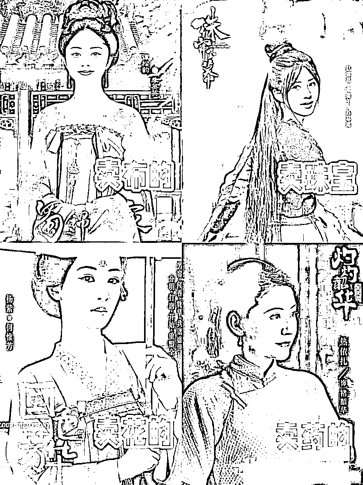
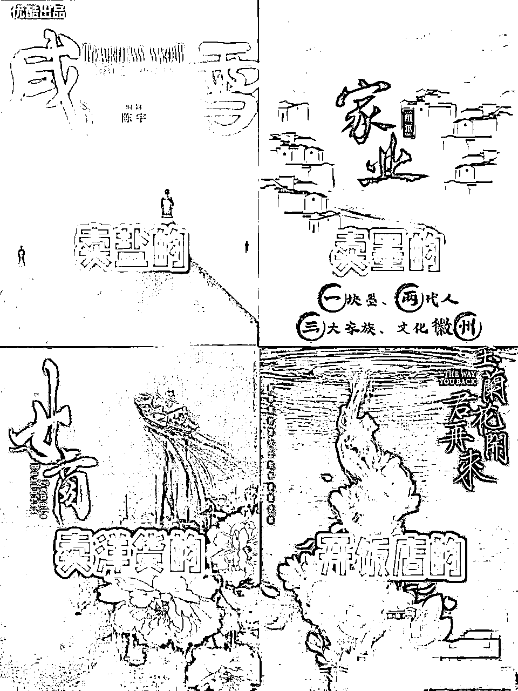

# 人设，才是个人IP最值钱的那块资产

先自我介绍，我叫靠谱，常驻销售培训领域。过去一年，我给上千位付费学员梳理过转化体系，也给上百家企业做过团队销售内训。期间读完几本书，重刷了几部老剧，顺带把巴黎奥运会从头追到尾。

回头盘了盘自己做自媒体的这四年多，再想想那些与我产生过交集的KOL们，一个认知越来越清晰：同样做内容，有人被追捧、有人被无视、有人被骂成筛子，分野的关键不在技巧，而在"你是个什么样的人"。

今天就写写我对这件事的全部思考：人设如何左右个人IP的被接受度、扩散力和变现水平，以及普通人到底该怎么给自己找到那套人设。

全文分四块：
一、人设带来的成交差距可以达到十倍
二、讨厌的人设会在传播中被流量反噬
三、人设的底层逻辑会跟着时代迭代
四、把这十六个字吃透，你也能提炼出人设

先扯扯这个词的由来。人设最初是"人物设定"的简称，用在游戏或影视里，用来定义一个角色的外貌、性格、属性、技能和故事触发机制。

比如《仙剑奇侠传》，承载了我们这代人的青春记忆。它架设了一个神魔人鬼妖五族并存的世界，每个角色背后都有足够深的文化和情感脉络，因此几十年过去依然有生命力，游戏、剧集、周边不断衍生，商业含金量极高，也牢牢占据了几代人的心智。

凡是能成为经典的作品，都有一个共同点：人物绝不脸谱化。他们充满内在矛盾，却又能在每一个情境里做出符合人性的选择。就像漫威宇宙里的钢铁侠，嘴上刻薄、共情力约等于零，可最后愿意为地球把自己搭进去。这种"先天下之忧"的价值观，正是仙侠和英雄片共同的内核。

再看《甄嬛传》里的华妃。她跋扈、狠辣，视人命如草芥，偏偏又一辈子求不得，得到手的东西也会迅速失去。网友因此又恨又怜，调侃她心里只装着三样：老公、哥哥、蟹粉酥。甚至有人说，要是我老公也像皇上对她那样，我照样除光情敌。

好剧本的共通规律是：情节跟着性格走，又合理又抓人。只有不入流的编剧，才拿巧合硬推剧情。

现实生活同样如此。这篇文章我早就想动笔，但真正把我按在键盘前的，是这两个月东京周期的奥运热。比赛早结束了，我还忍不住每天刷回放、买纪念品，跟戒断反应似的。体育赛事的商业化、运动员的IP化，以及这一代运动员退役后能比前辈更体面，都是因为大众的关注和真金白银的付出。

他们能讨人喜欢，归根结底还是人设立体，站在人群里不会被淹没。

自媒体把表达权交到了每个人手里，普通人也能赚到影响力红利。有人被夸，有人被骂，有人被夸了又被骂，有人压根没人看。这背后的分水岭，依然是那两个字：人设。

一个足够厚重的个人IP，可以穿越周期，持续释放用户的终身价值。而它的地基，就是人设。下面聊正题。

# 一、人设带来的成交差距可以达到十倍

做营销的都知道，借势人设，效果翻倍。不管你是做品牌、做直播、做私域还是做选题，逻辑完全一致。先上两个例子感受一下。

第一个例子，职场赛道的账号，靠卖课和卖书变现。

A号标题：职场里怎么提高情商？学会与人相处很重要。

B号标题：一个在体制里干了二十年的前辈阿姨，教会我5条职场生存法则，想往上走的建议看完，早知道这些能少走多少弯路。

你是个上班族，你愿意点开哪篇？

第二个例子，大健康赛道的账号，靠卖保健品变现。

X号：预防大于治疗，等查出病来就晚了，都是平时不重视造成的，然后接条广告。

Y号：协和返聘的老专家反复讲，上医治未病，最高明的医术是让人不生病。很多人小病拖成大病，就败在一个"拖"字上，然后接广告。

如果再配上世界卫生组织的数据——维持同样的健康水平，预防投入、治疗费、抢救费的比例是1:8.5:100，也就是预防上多投入1块钱，治疗能省8块5，还免得花100块的抢救钱。一听没感觉？那乘以一万呢？

然后再把"气血不足、动一动就喘、代谢低、易胖难掉秤"这些具体的痛点摆出来，再放一张调理成功后的状态图，一套完整的高转化文案不就齐了？

所以我们卖任何产品，真不是搭个摊子就能开张。你得拿出诚意，得动脑子。为什么卖、凭什么卖，都要提前想明白、展示充分。

这个"凭什么卖"，就是人设。

你卖减脂服务，你是医生还是营养师？是你自己无痛瘦了几十斤且皮肤没松？你帮多少人减掉了多少脂肪？你做教育，自己是老师还是妈妈？拿过什么奖，带出过多少好学生？还是你孩子从不补习，你亲手陪他考进了清北、藤校、斯坦福？

做知识付费的更得自问：第一，你自己靠知识赚到过钱吗？第二，你有标准化的SOP吗？第三，这套SOP在多少人身上跑通过、验证过？如果三个答案都是否，那你不仅仅是割韭菜，还是空中楼阁里的臭流氓。

至于为什么卖？那是动机、是来路、是故事、是经历。比如自己瘦下来后就想帮更多人瘦；比如心疼家里辛苦，所以去卖农副产品。有动机，你就握住了"道"。古人说，得道多助，失道寡助。

人设可以从零建起，也可以随时更换。我们孵化过一个医美护肤品品牌的投资人，85后男性，已婚已育。他最初在朋友圈晒的是改装车、户外越野。我看了直摇头：你的付费人群是青年和中年女性，她们对你的爱好能有多少兴致？

就算有男性羡慕你、觉得你赚到了钱，可一不卖创业项目转化不了他们，二来想让这些男人买产品送老婆，概率微乎其微。东西再贵重，买回家也会被老婆嫌弃。男性消费力到底几斤几两，看看父亲节有几个品牌愿意投广告就明白了。

我给他开的方子是：把女儿拿来晒。素材现成的，让娃自己挣奶粉钱。把"女儿奴"人设打出去，家庭地位自动排到全家第五——狗排第四，他垫底。在家给老婆护肤、吹头，出门是霸道总裁，进门给女儿当大马骑。

改完人设之后，数据不是增长，是爆炸。评论区精彩极了：有羡慕的，有骂自己老公的，有喊姐妹来围观的，还有提醒大家清醒的——"你老公在家只会放屁和抠脚"之类。评论和转发量一上来，帖子权重跟着起飞，后续再发转化内容，下单量直接翻了好几倍。

有一期选题是我给的：在家庭关系里，越早建立的关系应该拥有越高的权力层级，所以夫妻关系要优于亲子关系，孩子对妈妈不尊重，当爹的必须立刻制止和纠正。这期内容爆了。一个创业者公开认可家庭主妇的价值，还因为妻子去批评自己一直宠着的女儿——光看这个选题，你就知道能戳中多少人。

这个人设本身就是情绪价值，是当下女性意识里最稀缺、最爱看的东西。所以做自媒体，你代表谁在表达，必须刻在脑子里。你代表谁，谁就为你掏钱。要代表兜里有预算的人。

她们会把自己的羡慕、嫉妒、愤怒、委屈、期待，全部转化为下单动力：女人就该对自己好，最好的方式就是从你这里买产品狠狠用自己身上。怎么样，闭环了吧？

所以靠谱对个人品牌的理解是两块拼图。第一块是商业定位：你卖什么东西，为谁提供什么价值、解决什么问题，让用户一有需求就想到你这个品类。

但用户想到品类之后，还要在同类里做选择。具体选谁？为什么选你？这就牵出第二块拼图：主理人自身的标签和设定。

传统商业的竞争比的是性价比和参数：你交付多久、我卖多少钱、你保修几年、我年销多少。可被性价比吸引来的人，也会被别的性价比带走，忠诚度趋近于零。

而个人IP时代，我们用来干预用户决策的武器，是价值观、人格魅力、生活方式。这些东西绑定的客户，黏性极强，别人抢不走。而它们的总和，就是人设。

拿闲鱼培训、AI写作、👸号爆文这类项目来说，如果经营者是一群面貌模糊的年轻人，连照片都不露，用户分不清对方是真人还是AI，他怎么选？根本不产生感觉。

可一旦你有了一个主理人形象、一层社会关系，画面就活了。比如你用RPA管理着20个做爆文的👸号，其中5个负责还房贷和日常开销，5个给媳妇买黄金——家里顺遂时是首饰，万一有变故就是她的退路，5个给女儿攒嫁妆，剩下5个做储蓄。就这么一段话，冷冰冰的账号和数据瞬间有了温度。女性用户不但自己会选你，还会催老公去报课，还会在闺蜜圈里替你传播。

广告和营销行业的底层就是这个道理：很多时候传播的目的不是让眼前的人立刻买，而是让用户替你去向别的用户做解释。买我的产品，或者传我的美名。

你身上的标签其实非常多：经历、爱好、社会关系、家庭……但做内容时不可能全都端出来。具体放大谁、藏起谁，要依照你的商业定位和用户画像来筛，一切为转化让路。

我自己也一样。我也养狗，也爱看悬疑小说、沙雕段子，也喜欢吃好吃的，但我很少在朋友圈晒这些。因为我对外是女性创业者、知识付费主理人，这些爱好和我的IP没关系。那我会晒什么？

我没有孩子，所以我能晒的是和父母的关系。而且这段关系不是天生美好，而是充满哲学意义上的撕扯：小时候的疏离，长大后的观念碰撞，曾经觉得长辈无所不能，到自己成长后完成了精神上的"弑父"，最终抵达理解与和解。同时，和解不代表退让。我孝敬，但不愚孝，保留自己的底线和自由。那个"连亲妈都别想占我便宜"的不好惹人设，帮我挡掉了大量不必要的麻烦。

再比如说，我的主业是医生，但我的生意并不依赖这个身份。所以我的主人设一直围绕商业和销售培训展开，医生只是背景标签。前三年赶上疫情，后两年遇到医疗反腐，这份工作又累、待遇又一般，还有风险、还要挨骂。我展示的真实心路是：靠打工，我买不起商务舱，也送不起朋友像样的礼物，所以我必须创业。

这种身份、经历、心境，特别容易引发共鸣，也特别容易让人向往，最终让人愿意付费。个人品牌的本质就是：让人记住你、喜欢你、追随你，甚至想要复制你。

很多人的朋友圈点进去，全是广告和鸡汤，看完一片空白。我教你一个自查法，用来判断你的朋友圈到底有没有效。

拿你写过的任意一条内容，把头像、昵称一换，换到另一个人身上，是否依然成立、毫无违和感？如果答案是"是"，恭喜你，你的朋友圈发了等于没发。

鸡汤谁都能发，名人金句、古训、网络热梗，人人可抄。但"标签+故事+观点"的组合，才是别人拿不走的东西。

举个例子：

A说：做个人IP能精准获客，是一项长期复利的资产。

B说：在成功孵化出1000+个月入过万、上百个月入十万的IP之后，我算过一笔账，公域获客的成本比传统渠道投放低了近九成，还有长尾效应。如果你手里有产品，正为渠道发愁，我建议你来找我。

B这种内容，别人想抄都抄不走，因为那是我的成绩，拿时间和心血换来的。这个人设，就是我的结果，就是用户的证言。

最后教一个技巧：性格也能成为人设。加过我微信的朋友会看到，我一个公域引流号的签名是：专注IP孵化，销售成交培训，脾气不好，拒绝白嫖。直播时遇到冒犯我的人，我会当面怼回去。

做知识付费的人，最讨厌的就是白嫖党。所以我一直对外维持的设定是：内外分明，脾气冲。结果线下见到我的人都会说：你真人比想象中温柔多了。

你看，如果大家预期你脾气差，你只要稍微正常一点，别人就觉得你温柔；如果预期你是老好人，你拒绝一次不礼貌的要求，就会被说成人设崩塌。

所以我的暴躁，也是人设的一部分，功能是筛选和节约时间。能真正走到线下见面的人，我再把最真实的自己交出来。

所以千万别立虚假人设、完美人设、老好人人设，一点都不管用。大胆做自己，用内容给自己垒一座护城河。

# 二、讨厌的人设会在传播中被流量反噬

时代变了，很多以前叫好的词都变味了，比如"闺蜜"，比如"立人设"。有人演反派反而圈粉，有人拼命维持好人设却一秒塌房，这背后到底有什么规律？

先看几个例子。

立学霸人设的翟天临。当年他晒博士录取，说等毕业那天要让大家看看谁才是真牛。后来直播时，粉丝问他论文能不能在知网查到，他一脸茫然反问"知网是什么"，随后论文重复率被查了个底朝天，还引发了一场全国性的学术整顿。我为什么会记得这么牢？因为我是"天临元年"毕业的。之前论文重复率要求20%，那一年直接改成5%，此后每个毕业季都会有人去他评论区打卡：你睡着了吗？我没睡，我还在降重。

还有立读书人设的靳东、立博学人设的黄磊、立清醒大女主的人设的孙怡，全被骂得很难看。原因无非两种：一是实际做的事和剧本设定对不上；二是人天生对完美有敌意，看到太完美的包装，第一反应是找漏洞、推倒它。所以立人设最忌讳的，就是完美。

还有一个点非常重要：上面那几位，其实早就不缺钱也不缺名了，人设并不能给他们带来什么实际利益。它能带来的只有一个东西，叫情绪价值——享受被夸、被仰望的快感。你去看他们日常的状态，本来就是那种性格的人。壁立千仞，无欲则刚。心里缺什么，就会为了补什么而去做很多事。所以情绪上的自给自足，是真本事。

人设不要完美，不要装，不要假，贵在真实。你看网上受欢迎的那批博主，什么个性都有：暴躁的、财迷的、抠门的、强迫症的，五花八门。正因为真实，他们才代表了千千万万的普通人，反而特别圈粉。

还要警惕一种最致命的人设：双标。对自己零要求，对别人高标准，这种几乎必塌。嘴上喊反对雌竞，手里的活儿全是雌竞；当年信誓旦旦说不割粉丝，靠骂别人对号入座攒热度，过两年自己也照常直播带货。面对这种人，网友只有一句话：他是电，他是光，他是唯一的智障。

塌房的不止娱乐圈和自媒体圈。体育圈，其他任何有流量的圈子，甚至是素人，都会口碑翻车，区别只是被多少人看见。

今年七八月的奥运会，国乒的关注度拉到极满。有些粉丝行为过激，官方一直强调要拒绝饭圈文化。结果奥运结束后第一个商业赛事WTT，票价从往年的69、99直接拉到588、1188，周边产品也卖到几百上千。粉丝们集体破防：这比演唱会还贵，比TFBOYS周年还贵，而且卖的是盲盒票，你根本不知道能不能看到自己喜欢的运动员那一场。

这一波激怒了粉丝，大家纷纷转发吐槽：国乒一边高调抵制饭圈，一边把球迷的钱包掏得心安理得，这就是典型的念完经打和尚。那几天热搜上的关键词全是WTT票卖不出去。我当时也跟着写了篇👸号，结果被推荐了。

这就是当下的规则：以前你再讨厌一个人，拿他没办法；现在不喜欢你，可以直接用钱包和业绩投票。所以不要轻易和受众对立，要永远清醒地知道，谁在给你钱，谁在养你。

不瞎立人设的IP和品牌，就算遇到舆情危机，伤害也不会被放大，甚至还有粉丝主动出来护短。给你举两个例子。

蜜雪冰城被曝出食品安全、原料过期的时候，你看看用户都在说什么："小雪都没嫌我穷，我凭啥嫌它脏"，"都怪我不常去买，它家原料才会放过期"，"千万别让蜜雪下架，不然我五块钱去哪买饮料"。网友玩梗的底下，其实藏着真实的情感账户。

再看某些男演员和爱豆，拼命立爱妻人设，结果私生活爆雷，人设瞬间粉碎，职业生涯直接判死刑。可那些从来不立这人设的呢？黄宗泽在雨天的巴士上跳舞，到现在都是名场面，每次有人塌房，他的粉丝就会说：放心，我家那位本来就是一片废墟。林更新也一样，万花丛中过，片片都沾身，反而没什么把柄可抓。

靠谱我也算把这里面的门道摸清了。所以我给自己立的人设，懒得一批，但省心到极致。给你们列几条：

虽然我是医生，但这就是一份工作。工作都不轻松，也谈不上什么伟大，所以别想用"奉献"绑架我。副业呢，我上网就是为了赚钱，不是来交朋友的。我贪财好色，烂命一条。你想一起搞钱，我们可以聊聊；想从我这里要多余的"爱"，不好意思，付费用户也没有。更别跟我扯什么"你粉丝多就该以身作则、注意言行"——那套道德绑架，在我这儿不好使，一边待着去。

所以当有人想喷我的时候，他会发现我喷自己比他还狠，于是只能悻悻收手："下一家"。只要我先不要道德，谁也绑架不了我；只要我不立牌坊，就不会被世俗的口水淹死。钱赚到了，人也痛快了，家人们，这不好吗？

# 三、人设的底层逻辑会跟着时代迭代

往回看十年，那时候《万万没想到》火遍全网，王大锤天天喊着"升职CEO，迎娶白富美，走上人生巅峰"。为什么？因为那会儿经济好，大家乐意在🧣抖音上看有钱人。现在呢？因为众所周知的原因，省钱攻略、攒钱心得、闲鱼捡漏、一百块在上海撑一周，才是流量密码。

我们这批80后、90后就是最好的样本。小时候电视里播的是琼瑶、是宫斗，看一大群女人为个男人要死要活，看霸道总裁爱上傻白甜。长大后，我们经历了信以为真、梦碎、破防，最终到达"无男一身轻"的境界。现在，已经有不少有影响力、有社会地位的女性公开主张"去父留子"，中国单亲妈妈的数量也超过了3000万。

经济、人口、自媒体发展，多方力量搅在一起，把主流价值观推向了一个新的方向：女性意识的觉醒。自媒体圈尤其明显。所以很多过去评价不差的剧和人物，忽然出现口碑反转。《如懿传》是一个例子，还有一大批"恋爱脑"题材的剧，从今年春天被骂到秋天。

以前的剧集，标配是一个男性和几个女人的情感纠葛，或者几男几女的群像戏。现在的剧集呢？要么是大女主搭配一串男人，比如《玫瑰的故事》；要么干脆不要男人，三个女人一台戏，像《梦华录》。大众想看的是女性成长、女性觉醒，以及girls help girls。

明年要播的剧，更是清一色大女主、清一色做生意。风向标的指向已经明明白白了。

剧里的人设也在跟着变。你要是再像过去那样，为了男人和家里决裂，比如王宝钏苦守寒窑十八年，比如去年那部《我的人间烟火》，这种角色一出现就会被骂回去。还有就是今年年初大热的《南来北往》大结局：姚儿在烧烤摊前遇见年轻时为她要死要活的男人，此时对方早已功成名就、身边另有佳人，她却因自己所爱的人进了监狱，独自拉扯着孩子在摊子里讨生活。

这个结局被骂得极惨。观众说编剧一定是个男的，一定要给所有爱钱、想过好日子的女人安排一个悲惨下场，通篇都是男性凝视和规训的味道，非常恶臭。

所以，如果一个作品、一套营销体系、一个账号不讨喜，甚至被反复审判，大概率是因为它的人设内核和当下用户的价值观错位了。想要被接纳，你首先得搞清楚，观众今天到底爱看什么。

# 四、把这十六个字吃透，你也能提炼出人设

想持续有内容输出、有粉丝为你买单、有热梗帮你传播，第一步是认识自己，第二步是判断哪一部分可以放大展示，哪一部分留着自己欣赏就好。我把提炼人设的路径归纳为十六个字：下海原因、战绩可查、社会关系、特殊癖好。下面逐条拆解。

## 1、下海原因

做个人品牌，先得把“为什么是我”讲清楚，而且要讲得让人信服。

你可能留意到一个很有意思的循环。过去去足疗店的客人，习惯性先问妹子多大、为啥做这个，得到的答案多半是家里困难、给妈妈看病，然后就开始充卡。后来卖茶妹走红，套路也差不多，一句帮爷爷卖茶，就能让一波大哥大叔大爷彻底上头。

这些套路看着像套路，真正能流传开的，从来不是套路本身，而是背后那个合理的“理由”。一个正当的理由等于占住了道，有道就有帮手，没道就没人搭理。助农主播能跑起量，就是因为“帮家乡父老出货”的情怀站得住脚。自己被皮肤问题折磨过就去做美容管理，自己踩过坑就去做产后修复，都是同一个底层逻辑——什么拯救了你，你就拿什么去拯救世界。

理由一旦成立，就自动带上品牌故事和销售话术，比花钱砸出来的品牌策略好使得多。因为道理让人点头，故事让人相信。个人品牌的势能，往往压过产品品牌的势能。

你看得到得到的跨年演讲，雷军的年度演讲，里面永远是故事在先，情绪堆到顶点，再去放新品。这就是典型的非理性营销，产品只是情绪的承接点。

我做自媒体副业五年，被问最多的问题就是为什么。一句话，穷。两个字，贫贱。读了二十多年书，工作第一份工资到手六千多，天都塌了。三十岁不到，还在焦虑而立，连给爸妈更好的生活都做不到。那种无力感太刺痛，所以面子、创业的辛苦都比不上想要翻身的冲动。没有背景没有资源，只剩一股闯劲。成了之后，再难也比没成时好过。

名人的出身故事也很有意思。世家子弟的传记，几乎不写苦日子，偏爱写童年聪慧、对发明痴迷。出身平凡的人，反而会被反复讲逆袭。因为没人想看富二代继承的故事，屌丝逆袭才给普通人希望。

起源值得深挖。像今年的异形宇宙新片《夺命舰》，先靠正剧爆火，再做前传讲起源。漫威也是这个打法，宏大IP都靠起源来续命。看完你也可以回头捋一捋自己的来处。

---

战绩，必须能查。

老话说先敬罗衣后敬人。互联网上别怪别人看人下菜碟，要怪就怪自己不够有分量。贵的东西缺点只有一个，那就是贵在别人身上，不是贵在东西身上。

想让人在快节奏里立刻识别你的价值，就要把结果摆到明面上。写在简介里，放进私域介绍，发在内容里。服务过多少家企业、多少个人，解决了什么问题，投了多少钱引了多少流变现了多少。哪怕是香飘飘一年卖两亿杯绕地球一圈的梗，也能让人记住你的量级。

发帖、发圈、发视频，别超过一周就不秀肌肉。别人说短视频带货有个误区，你可以说交付两千个学员后，我发现大家做短视频带货有个误区。后面再接解决方案，瞬间就立住了经验和权威，人家在你面前说话自然会收敛点。

个人IP的私域，最好一周一露脸加一秀成果，并且置顶。新加的人几分钟内就要搞懂你的赛道和你在赛道的水平。这直接定义了权力关系，也决定了付费意愿有多高。

就像结婚谁管钱一样重要。这个底盘搭不好，后面全是虚的。大家用的模型、鸡汤都差不多，真正拉开差距的，是案例的含金量和客户的档次。能成就个人品牌的，最后都是可查的战绩。所以向上社交、向上成交，永远是上位的捷径。

---

人，是社会关系的集合体。

群像剧让人上头，不是因为单个角色光鲜，而是因为关系。金镶玉和佟湘玉，朋友圈里的那些人，他们的不完美被包容，性格带来的后果大家一起扛。观众会投射自己，我也有这样的朋友，我就是那样的人。这就是情绪价值，也是粉丝长情的原因。

做IP，你要和客户、甲方、贵人、员工、粉丝乃至黑粉打交道。你的态度、你的回应、你的避雷经验，都是价值。玲娜贝儿为什么火，变形金刚为什么还能排队两小时？会互动，会根据不同输入给出不同反应，情绪价值致死。

《张飞流水账》里有个细节，阿斗被嘲吃点心总用屁股蹭一蹭，结果他吃的点心比谁都多。别人以为自己在试探他，其实最高级的猎人永远以猎物的姿态出现。我们对用户的每一次反应，都在被观察。这像极了一个养成系NPC。

社恐不是缺点。i人是e人的玩具。社恐怎么冒汗谈客户、怎么抠出三室一厅、社恐怎么做社群直播，这些细节比光鲜的内容更圈粉。做自媒体，本质上就是做别人的嘴替。

更深一层是可得性。你释放出什么样的代价能得到你，别人就会按这个规则来。有人明知道前任分手了还想试探，也是因为在前任身上看到了被珍惜的样貌。那种征服欲很微妙。

我验证过最好的人设是区别对待。互联网公司奖惩错位太严重，老客户没人管拼命拉新，只能得到短择。对自己人极致交付，对只想用可能性换你确定性的人直接踢出框架。直播和朋友圈里骂得越狠，互动越嗨。用户就是抖M，这事被验证太多次了。

---

个性爱好，既向内也向外。

向内是马斯洛的高级需求。登山、户外、拼图、旅行、音乐、宠物，这些爱好在帮你维持身心健康，提升幸福感。爱好一定烧钱，人到中年连生活都绷紧了，有爱好说明你有成长的倒逼和赚钱的动力。

向外是造梗。梗比产品传得快。《许昕还是太全面了》、《米饭仍旧是一小碗儿》、《灵魂汁子浇给》，以及“螃蟹就吃二两母，青青一果”。这些词会霸榜评论区，点进来关注，久了就下单。广告投放都比不上一个梗。

我们家附近菜市场卖炸鸡柳的小店，两个儿子抢吃打到眼镜碎。后来全城都来问，好吃到打架吗。俩儿子从小学到大学，这个梗还在用，买的时候都说你吃完不会揍我吧。小店不大，孩子出国上学轻轻松松。

把一个形容词讲成一个事件、一个场景、一个感受，记忆点就出来了。肖央的《误杀》里，男主就是用爱好、情绪和场景让证人记住他，从而做假证。个人品牌也是这个道理。

厚重的个人品牌不是喊出来的，是理由、战绩、关系、梗一起堆起来的。祝你的市场和岁月，都能成为下酒菜。