# 借势《黑神话：悟空》7天起盘，40位美金合伙人入场，营收34000+，我把一个游戏服务赛道做到平台TOP1

> 来源：[https://zyr90ttkjb.feishu.cn/docx/To8Cdv7VuopfuSxWnc3cNGG8nRf](https://zyr90ttkjb.feishu.cn/docx/To8Cdv7VuopfuSxWnc3cNGG8nRf)

生财的伙伴们好，我是凳子哥，目前在做跨境电商自选超市和美金变现工作室。

2024年6月24日加入星球，两个月后，这是我在生财的第一篇复盘。想借着《黑神话：悟空》现象级爆火这波浪潮，拆解一下我如何在一周内实现创收，以及这次事件对我认知模型的冲击。

先报战绩：

1，游戏8月20日上线，8月21日我的美金项目就已经上线
2，7天内完成40个美金合作方的招募与集结
3，拿下某全球平台《黑神话：悟空》游戏服务类目TOP1
4，围绕《黑神话：悟空》关键词，已在站内铺设40+服务店铺

这篇复盘能给你的东西：

1，如何从零到一孵化一个项目的能力养成
2，一次热点项目从启动到放量的全流程实战复盘
3，投资人给我的点拨，以及我的落地体会

对创业者来说，流量流向哪，钱就在哪。黑神话的爆火，直接催生了一批创收增益。

你可以看到，游戏博主杨家齐直播通关，3天涨粉51万，打赏170多万，自己到手85万。张大仙等游戏主播也借势涨粉赚钱。

除了直播，还有卖修改器、联动线下旅游、公众号爆文、短视频创作、卖游戏设备、电商卖手机壳、带货联名款瑞幸咖啡等等。

游戏上线首日身边的朋友大致分两类，一类冲着体验去买游戏，一类琢磨怎么赚钱。我当时属于第三类——觉得这事和我没关系的那批普通人。

那晚我睡得安稳，什么也没想。

直到写这篇复盘的8月27日，我才意识到，短短不到7天，我已经借助这波风口切入了一个细分蓝海。

7天，40个合伙人，营收34000+，成为全球平台游戏服务类目TOP1。下面我把来龙去脉拆开说。

投资人说过，你得写清楚，为什么这个机会是你抓住了，而不是别人。

# 一，时间线梳理 2024年

1，8.20 上午10点，《黑神话：悟空》正式上线
2，8.21 下午16:48，项目立项，以美金业务为切口
3，8.22 持续更新内容+腾讯会议宣讲，当晚66人到场听讲
4，8.23 持续更新+宣讲+人脉分销
5，8.24 持续更新+直播1小时+宣讲
6，8.25 持续更新+直播50分钟被提醒下播但完成引流+宣讲
7，8.26 持续更新+自营服务店铺数达35家
8，8.27 凌晨11点前招募到第40个美金合伙人

27号下午14:50 正式关闭招募，晚上开始写这篇复盘。

感谢投资人关键时刻的提点，感谢两位助理扛住后端全流程，感谢推广的合伙人和每位支持的朋友，没有这些环节很难有这个结果。

连更七篇文章的数据截图

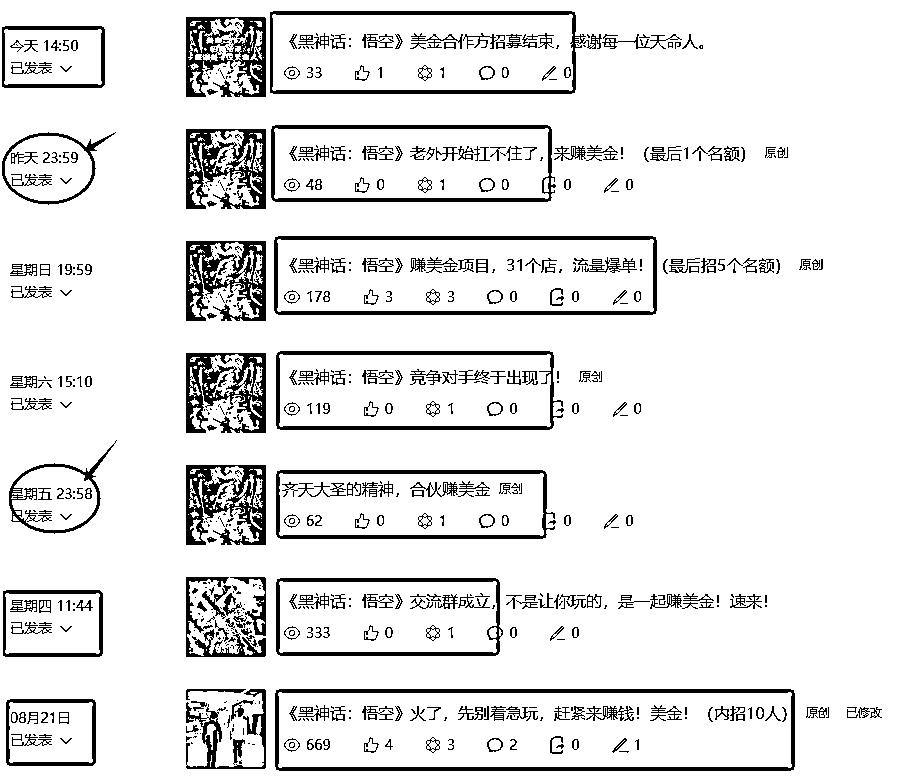

# 二，项目是怎么来的

上线第一天晚上，我完全没头绪，这波和我有什么关系。

21号上午看到一条消息，《黑神话：悟空》在海外也炸了，老外在玩的过程中遇到大量问题：剧情线不懂、人设关系不清、难度高难通关等。

这一刻我才串起来。

我长期在布局海外美金业务。游戏出来前我还专门做过调研，了解欧美国家职业偏好、自由职业者各年龄段年收入。

结果很惊人：欧美14岁的孩子已开始谋生。广州在中国相当于美国洛杉矶，洛杉矶自由职业群体兼职年收入普遍4万美金以上，约合人民币30万+，而广州多数地区全职年薪才8万多。

所以我一直在做：承接劳务外包、编程、网站开发、机器人开发、国内货源采购等面向老外的接单业务。

我知道海外有游戏教练这个角色，等同于游戏陪玩+攻略指导，且需求不错。

想通后毫不犹豫启动了项目，当时只当是个小尝试，不知道能做到什么程度。

21号发完首篇，当晚我还悠闲地去调酒摊喝了一杯。没意识到流量正在涌来。

22号醒来，几十个好友申请等待通过，第一篇文章被推送了，全是来问项目的。

从那一刻起我才真正all in，接下来几天几乎没闲着。3天没好好上过厕所，每天都在招募和服务，生怕错过这扇门。

投资人曾问我，为什么是你抓到而不是别人？

他的回答是：你得先有业务基本盘，并且持续深耕，这决定了你还在牌桌上。谁也不知道机会什么时候来，但只要在桌上就有机会。很多人连牌桌都没上，好牌摆在面前也与他无关。

这次我就是活例子。

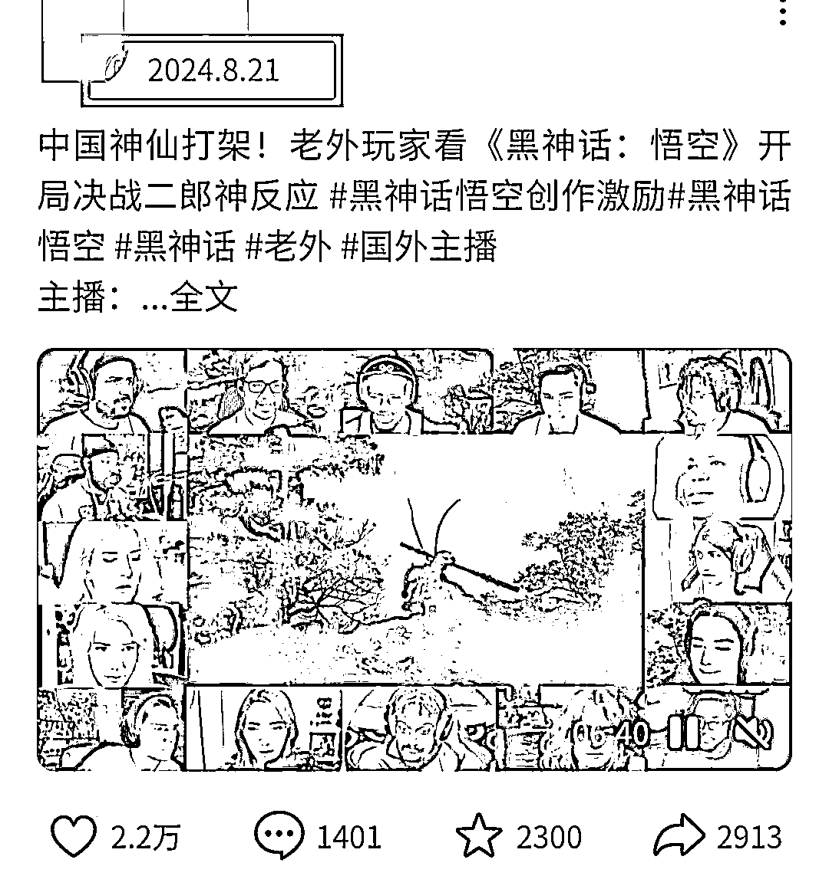

# 三，风口的红利怎么吃

项目逻辑很简单。发现某个自由职业平台，《黑神话：悟空》关键词下只有1个相关服务，是个老外提供参数设置，单价15美金。

我的打法：集中至少40人一起占领平台生态位，趁着大家都在打游戏和反应过来需要服务的时间差卡位。

当时只有1个老外在做，只要我们40人冲上去霸占关键词，就能切走全部需求流量。每人可发5个服务单，40人就是200个单，搜索即全是我们的人。

写帖子时我们已有40多个店铺，已是该子类目TOP1。目标是上到150~200个单，让别人怎么搜都是我们自己。

这几天我常说一句话：列车发动前赶车还来得及，发动后哪怕晚1分钟2分钟也上不了。我从没见过列车倒车来接人。

普通人比拼的就是概率。

“我努力过无数次，但我知道机会只会出现一两次。”——《飞驰人生2》

关键机会之外的其他机会，也需要用尽全力去争取。

这一次机会对我而言：

1，试错成本极低
2，空白蓝海市场
3，竞争对手极少
4，我本身具备相关资源优势

对合作方而言：

1，只需小额加盟费门槛
2，资料交付全包
3，店铺自主权在自己手里，资金先到后台
4，能学到海外知识，很多人第一次接触谷歌账号
5，相当于一次小成本创业

之所以说蓝海，是因为启动时只有1个竞品，直到24号才出现外国人跟进。

做项目就该做下行风险小、上行天花板高的事。

我们的服务SOP：

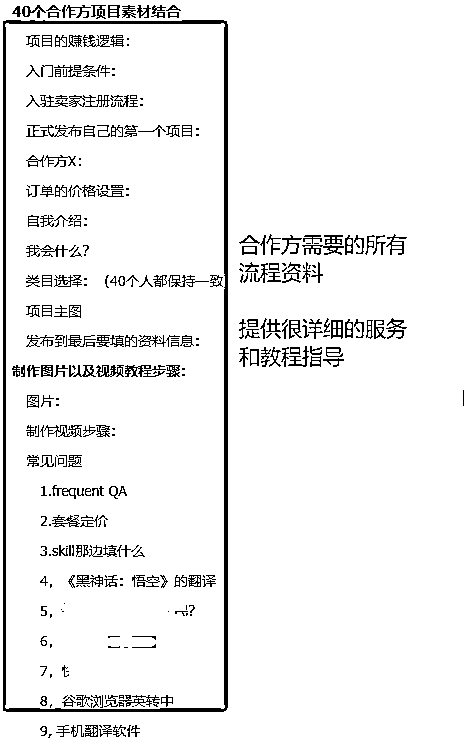

最终目标：

1，借风口在平台赚钱
2，通过项目积累老外私域，实现长期收益

我本身做跨境电商：东南亚TK本土、俄罗斯Ozon本土、TEMU、后续土耳其贺佰狮、Facebook等。

国内一个对跨境感兴趣的私域价值30~50元，若是老外，价值至少翻5~10倍，可在多个领域变现。

所以这个项目利己利人，值得全力推。到一定规模，真正长成自己想要的样子。

只要不上车中途下车，收益增长是必然的。我们要么赚项目收益，要么赚私域用户，要么赚知识体系，哪个角度都有价值。

要么赚短期项目，要么赚长期用户，只要不下牌桌，赚钱是必然结果。

# 四，项目现状

招募结束后，重点放在带大家上架服务单。目前数据跑得平稳。

【店铺数据】从0浏览，到几十，到几百。

要知道很多红海类目，上架后两三个月可能都没有两三百曝光，更别说咨询了。

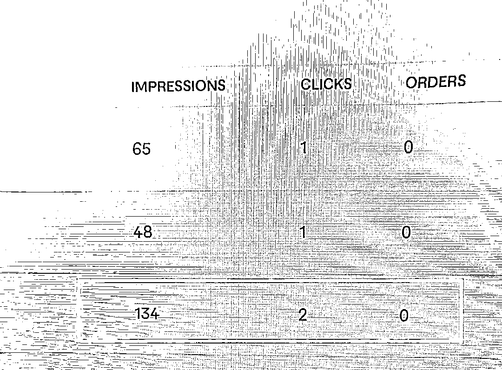

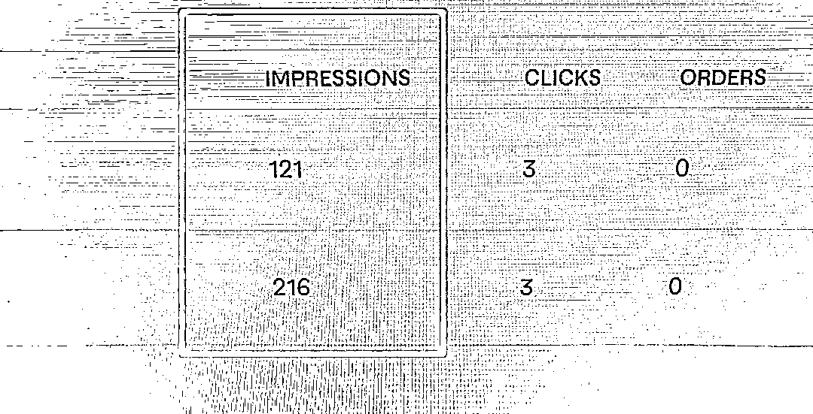

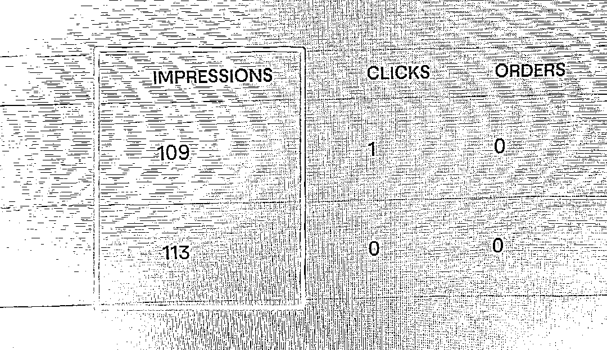

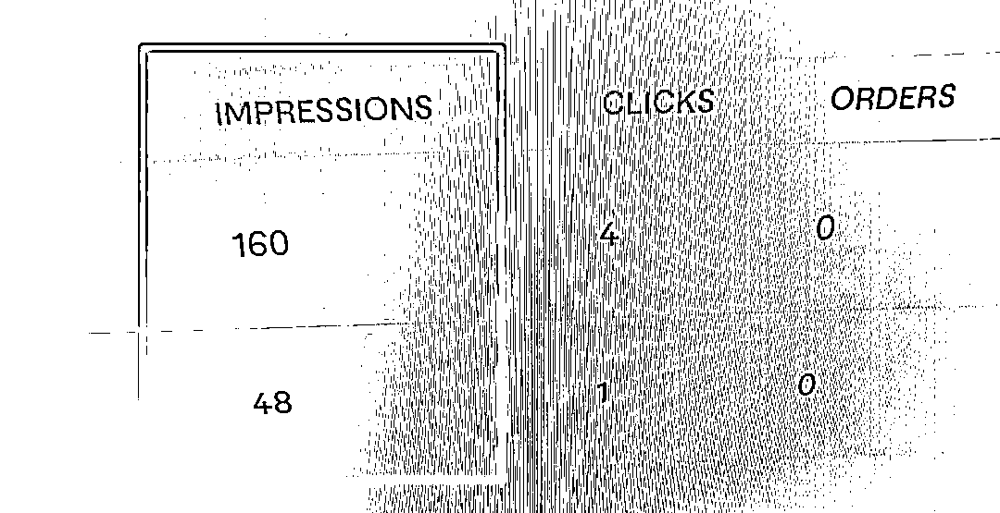

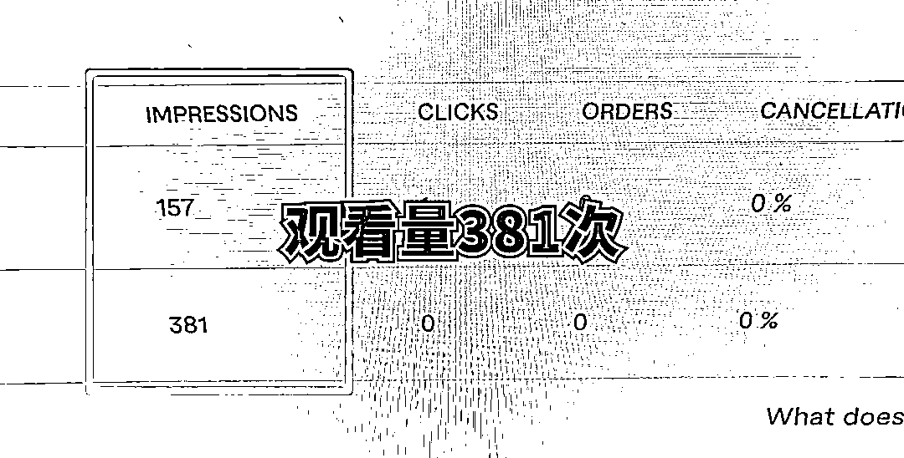

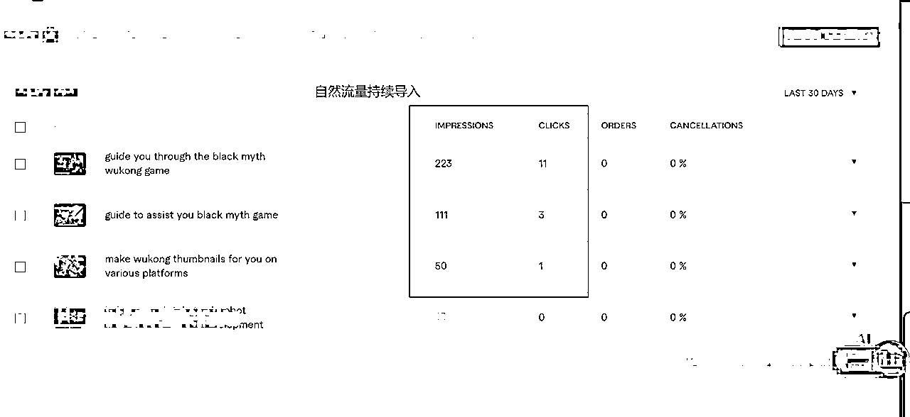

到26号，已开始稳定出单。项目刚上线就拿到正反馈，说明战略方向没问题。

剩下的就是持续建设，等风来。

事情做透了，赚钱是水到渠成。

当前服务类目：游戏陪玩、攻略指导、视频制作、图片制作。

写复盘时已让合作方发布第二批类目，每人4个，40人就是160个单。

从这个维度看，游戏才刚开始。

项目的三个价值：

1，帮助小白建立基础认知，真正学到东西
2，平台接单变现，且人多即有优势
3，积累老外私域用户，为私域电商和去平台化创收做准备

这和我的跨境主业也能形成闭环。

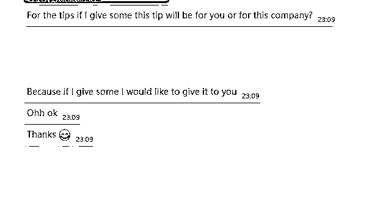

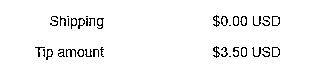

很多人想要确定性，但确定性只带来微薄利润。创业要敢于拥抱不确定性，才有机会体会其中的乐趣。

# 五，自我认知与成长

一，找到核心天赋

认识项目容易，认识自己难。很多人一生都不知道自己的天赋优势。

这次项目让我惊喜地发现了自己的天赋：在《黑神话：悟空》里要集齐灵根重塑大圣，认识自己的天赋优势，就像一次重生。

投资人说：你有从无到有孵化项目，并煽动性扩张放大的天赋。用在跨境上就是建店群能力，比如一个月铺100家店。

我的生意模型可对标苏宁国美，定位渠道商，做大规模，靠数千家店铺和销转能力掌握话语权。

这次黑神话项目的操盘手法，就是该模型的缩影，本质一样。

二，认识局限

1，目前起盘的项目多停留在短平快风口红利期
2，我不确定项目能长到什么程度。第一天要是真懂这个机会，我不会去酒摊喝酒，而是立刻推进。

我的投资人能根据人的人格特质从无到有创长期产业级项目，这是我要继续学习的境界。

三，本次用到的5个关键思维

1，预售思维
创业不是等条件齐全才动。21号我项目立项就开卖，交付流程不完整，助理班子临时组建，后端游戏玩家也是后面才找齐的。若等准备齐全，机会早没了。

2，合作思维
一个人慢，找到强分销伙伴势能叠加。这次AI司强和工程设计师雪儿提供了很大助力。

3，风控思维
做项目前我在该平台被老外骗过几百块，清楚坑在哪，及时给出风控建议。

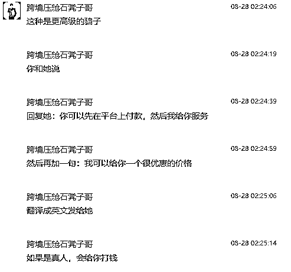

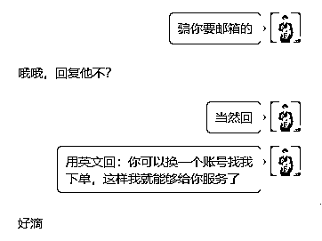

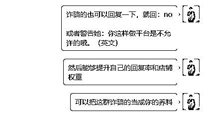

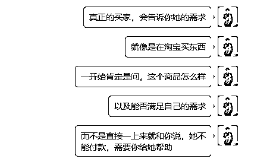

4，收费思维
我基本不做免费服务。合作项目收费是最好筛选，同时滋养能量场。我的合作方都是付费招募，行动力更强，对我认可度也更高，连助理都更舒服。

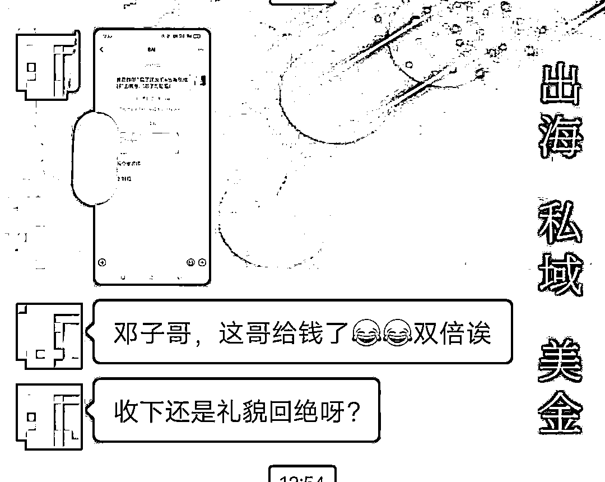

5，统筹思维
招募到20多个合伙人后，我被答疑淹没。是多对一交付，消息爆炸。助理刚搭建，SOP不完善。

我必须解放自己，于是分工：
第一位助理乐观派，负责客户回复答疑，问题同步进SOP；
第二位助理细致，主业医生写病历，交付流程写得好，样本我写，她复制扩展；
另安排专人把中文教程翻译成英文，减少我大量时间；
还有客卿长老、小白同学负责新人账号工具注册等技术问题。

之后我才有精力招募扩张和思考项目发展。

# 六，踏上取经路，比抵达灵山更重要

最后用黑神话里的话共勉：踏上取经路，比抵达灵山更重要。

创业和打工是两码事，大哥和小弟是两路人。

当天命人踏上寻找灵根之路，便回不了头。

这次黑神话风口来了，下一次机会是什么不知道。关键是打磨好基本盘，持续在路上，不下牌桌，一步一个脚印。

核心总结：

1，必须有自己的业务基本盘，机会才抓得住
2，机会要结合自身天赋做事
3，有基本盘不要轻易下牌桌，提前布局
4，人生关键机会就那么一两次，能赚钱时就好好赚，窗口说关就关
5，敢于拥抱不确定性，机会来了就狠干。能否把握在于之前的积累沉淀。

附赠《黑神话：悟空》老猴子语录：

1，“空有天赋，不思进取，小富即安，沉迷享乐，想安逸又想名利，想快意江湖，又想成佛作祖，哪有这样的好事。”
2，“身本多忧，怎可全求，牛魔王如此，孙悟空，也如此，有天命的眷顾，更须有斩断私心凡念的觉悟”
3，“运气只是强者的谦辞”
4，“你原是无名之人，却在集齐六根的途中，斗了重重艰险，战了许多强者，淬炼出了足以配得上那份力量的刚强意志”
5，“世道从来不公。”

附录 营收数据

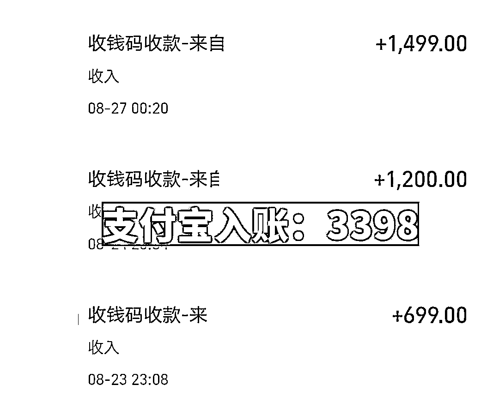

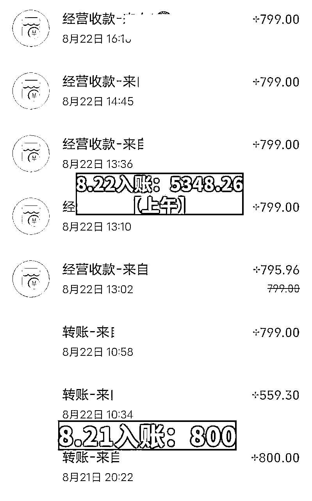

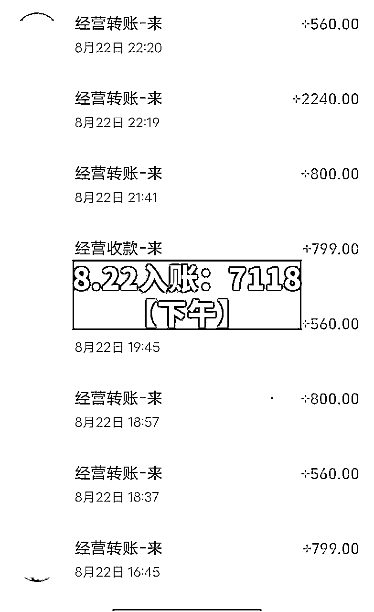

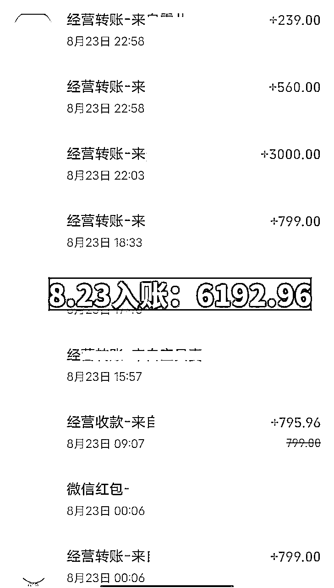

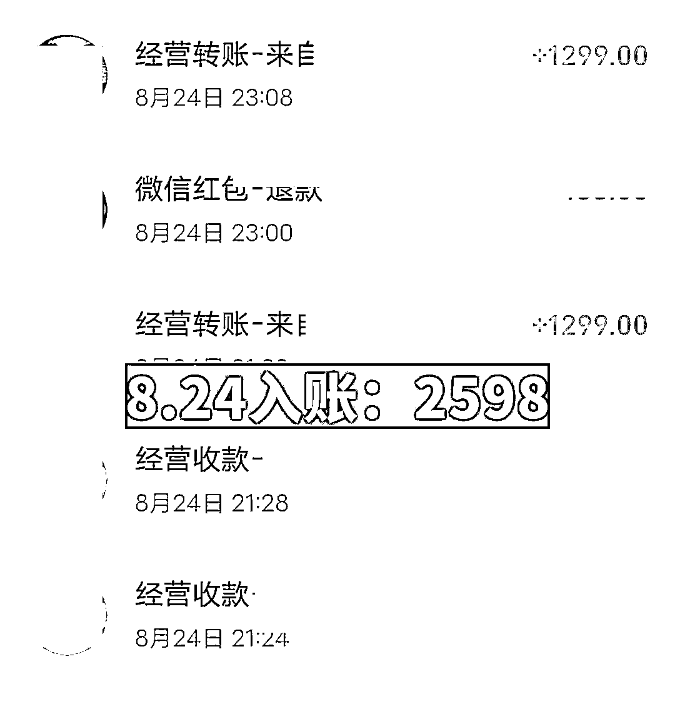

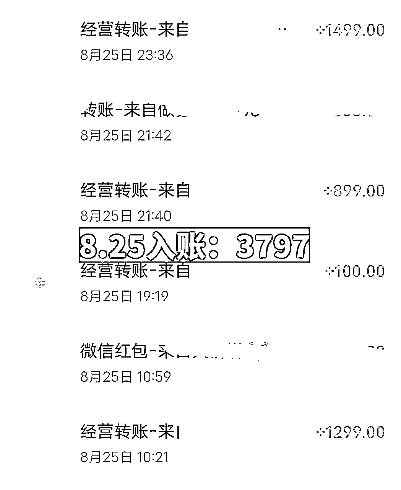

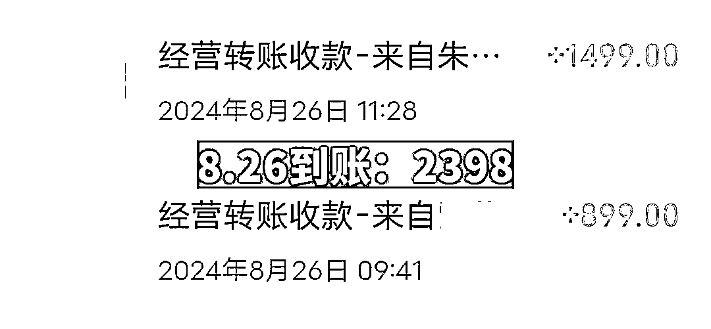

总营收：34768元
图片到账合计：31650.22
其中一笔渠道分销扣除部分费用。

和生财圈友共勉，希望对你有帮助，继续一起生财有术！

永远不下牌桌，打磨好自己的基本盘，我们都是自己人生的天命人。