# 《一位普通圈友的项目踩坑及反思》
作者：龙哥

各位赚钱的圈友，大家好，我是龙哥。作为加入龙哥盟才一年的普通新人，今年四月经涛哥推荐才有幸进来。潜水看了很多帖子，认知长了不少，也看到很多优秀的圈友，越发清楚自己离他们还有很长的距离。

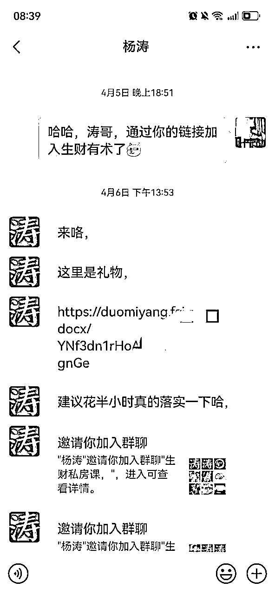

第一次在赚钱发帖，说实话挺惭愧。这篇不聊什么热血的逆袭故事，也没有亮眼的收入数据，更谈不上分享成功经验，只是想把自己做项目这些年踩过的坑、跌过的跤，老老实实讲一遍。如果能给圈友一点提醒，那就值了。

为什么想写这些？创业到现在，我也没做出什么值得一提的成绩。坚持最久的事，大概就是写日记。从2013年6月9日开始，每天记，整整11年。一开始是因为高考完压力大、看不清未来，拿写日记当出口；后来慢慢喜欢上，觉得日子有了痕迹；再后来就成了习惯。就像很多创业者每天跑步、日更一样，起初靠热爱或目标驱动，最后都是靠习惯撑着。一天不做，就像少了点什么。

做成任何事，其实都是从小事开始累积的。这篇也算是对自己过去一段时间的复盘：有咬牙坚持，也有及时止损。多数项目没赚到钱，还搭进去不少精力。我水平有限，观点不一定对，但都是当时最真实的念头。成功让人兴奋、自信，失败却让人难受、煎熬，但也逼着人成长。在赚钱看了那么多翻身故事，也看到很多踩坑教训，其实大家都一样，一路跌跌撞撞。比起听大佬讲怎么成功，不如听一个普通人讲讲怎么失败。

下面进入正题，说说我大学期间做过的几个项目。

先说淘宝客。当初是被一个优惠券🐧群拉进去的，管理员说买东西有隐藏优惠券，把链接发群里就能拿到更便宜的入口。我试了一单，真便宜，就开始琢磨背后的机制。后来上网查、付费学，才知道这玩意儿叫“淘宝客”，买套软件就能自动在🐧群里发单、找券，有人下单就有佣金。我兴冲冲地干了起来。

最初是🐧群发单，先得有人。我自己拉了一些同学朋友，又招兼职帮忙拉人，拉100个给50元，相当于五毛钱一个人。第一个千人大群很快到了800多人，我开心得不行，心想按这个速度裂变下去，赚钱不是梦？结果睡了个午觉醒来，群里只剩100多人。原来有个兼职管理员把我踢了，还删好友，根本联系不上。当时真是被一盆冷水浇醒。

后来我想，这次最大的失误是太相信陌生人，把管理员权限随随便便交给一个没见过面的人。关键的资源，不能交给没有信任基础的人。当时想着拉完人就收回权限，结果还没等收，对方就先动手了。这也是个教训：任务没结束前，该盯紧的还是要盯紧。

后面又尝试🛰️，把人和单往🛰️上引。但发单太频繁，🛰️号一封再封，解封、换老号、改朋友圈发，都是拖时间，最终躲不过。我明白了：跟平台规则对着干，短期可能钻空子，长期一定无效。于是改做APP推广，把用户导入返利APP，下载就有免单礼品，每个人还有专属邀请码，自己推广还能赚钱。我用校园赞助、裂变、表白墙这几招来推：赞助班级和社团，按人头给钱，同时通过邀请码下载APP的人能拿包邮免单礼品；裂变时，被邀请的人有免单和返现，邀请人也有额外红包；表白墙就是付费发广告，当年加了三百多个墙号，后来只剩一百多个，再也没登录过。

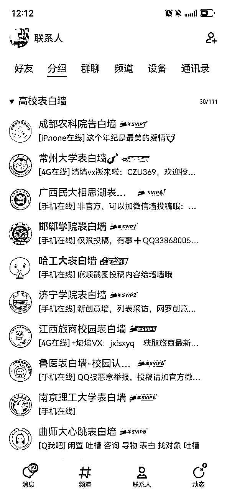

淘宝客前后折腾了半年，因为收入不达标、成本太高，最后放弃了。复盘起来有几条：一是项目有周期，新模式出来，旧玩法就会被冲击，比如拼多多和直播带货对传统淘客的影响就很明显；二是圈子很重要，当时没人交流方法，也没人打气，一个人闷头干，又孤独又无助。后来听说仍有人做淘客年入千万，只能说项目再下行，也有人能赚到钱；三是算投产比，别想着靠规模掩盖低效。当时前后投了十多万，回本遥遥无期，如果当时知道包裹粉这种低成本打法，也许结果会不一样；四是用户进来后要维护，很多人拿了免单礼品就卸载，我们却没有运营；五是要量力而行，那时候还是学生，钱不多，付费推广得看自己扛不扛得住。

第二个项目是人力资源，说白点就是劳务中介。商家搞活动需要人手，比如举牌子、发传单、做礼仪、当客服；学生想找兼职赚零花钱。我大一去干过一次兼职，赚了50块，后来发现做中间人比自己干更轻松，还能帮人，就开始跑。

跑业务是真苦。没钱买车，花100块从学长那买了辆二手自行车，还买了双便宜皮鞋和名片。为了装面子，客户面前不敢骑破车，离得远远的就停下来，等汗干了、衣服整齐了才进门。三个月磨坏两双鞋，把五线城市跑了个遍，一单没成，晚上躲在被子里掉眼泪，还不敢出声。

建🐧群倒是顺利。那时学生用🐧多，群上限也高。我用拉人、去别的群宣传、换群几个方法，一周就弄了20多个自己的群，还加了学校200多个群，基本覆盖本校学生。

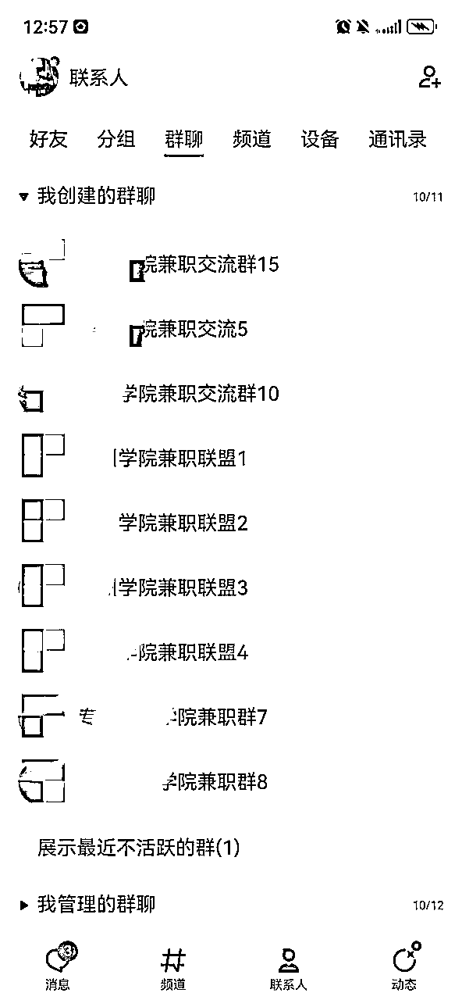

就在想放弃的时候，某天下午2:15，一个商家要人发传单，报酬只有10块钱。我还是接了，安排好兼职，赚到了第一笔收入。虽然少，但如果没有这一单，可能就真不干了。记得当时和合伙人点了两碗3块5的桂林米粉，豪气地各加一个卤蛋，还拿剩下的1块钱平分，当作创业的第一笔纯利润。

后来业务慢慢做起来，大学四年的学费生活费全靠它。我也去广州旅游、看了周杰伦演唱会，买了车，租了一间小办公室，存了几十万（当然，后来做其他项目亏光了）。

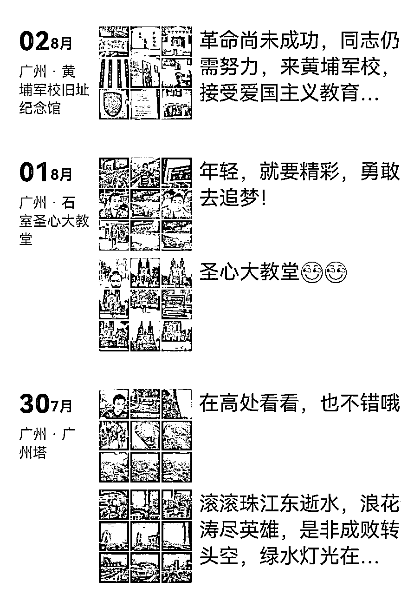

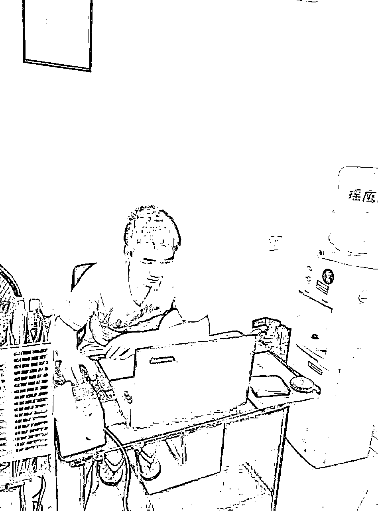

这些成绩和那些厉害的大学生创业者比，真的不算什么。我更想说的是过程中踩过的坑。

问题很多。比如商家拖欠兼职工资，说好月结，结果对方公司出了问题，拖了一年多才要回来。学生只认我们，我们只能先垫钱，风险自己扛。再比如兼职临时放鸽子、迟到，活动马上开始缺人，只能临时找人顶。还有兼职干活不认真，商家要扣钱，学生不乐意，夹在中间很难办。后来招人时我把话讲明：放鸽子永不录用、迟到直接取消、有事提前一天说、不认真提醒不改就限制报名。

还有一些更糟心的事。有商家暗示让我帮忙找女大学生“提供服务”，报酬很高。拒绝就得罪客户，答应又绝对不行，我只好先应承着，过段时间说没找到，糊弄过去。也有对方负责人暗示请客吃饭才谈业务，结果一顿饭吃了几千块，去的是他朋友的酒店，点的都是贵的，最后这人调走了，也没给介绍什么业务。还有暑假工做到一半，厂里负责人突然压价，学生在半路上闹起来，我们只能一边沟通一边安抚，愿意继续的送过去，不愿意的补贴路费送回去。另外，校园里还有其他团队竞争，有人故意压价，甚至冒充兼职放鸽子坑队友。兼职干时间久了还会跳过我们直接联系商家，这也没法完全避免，看商家选择团队还是选择个人了。合伙人也不省心，说好一起干，五五分，干着干着就只忙自己的事，最后只能散伙。临近毕业，业务量越来越少，重心也转移到论文上，这个项目就慢慢结束了。

这些经历让我想明白几点：

第一，垫钱赊账的模式要谨慎。有时候要给兼职提前发工资，商家钱没到，自己就先亏了。就像老家的沙糖桔，很多人跟风种，去化肥店赊账买肥料，结果收成不好或价格低，账还不上，留下一堆烂账。

第二，人员管理和服务质量是根本。放鸽子、迟到、不认真，都得靠管理去约束。当时能做成，靠的其实就是服务好：商家要多少人供得上，要求能满足，人不迟到，活干得认真；学生那边工资发得及时，甚至垫付。

第三，再难也不能做违法乱纪的事。业务里难免遇到灰色地带和利益诱惑，底线一旦突破，人很容易走上不归路。

第四，把“请客吃饭”当谈判前提的，要警醒。正常是生意谈成了再吃，或者边吃边聊。上来就说“请我吃顿饭，这事准成”，还专门点贵的，多半有问题。

第五，沟通和善后能力很重要。突发事件处理得好不好，尤其在利益冲突时，最考验人。

第六，别忘了感恩。别人给你介绍客户、引荐人脉，你起来了，不能忘记那些帮过你的人。

第七，合伙创业，权责、退出机制、利益分配、亏损承担，都要提前讲清楚。很多项目散伙，都是因为一开始没做“坏人”，后面才闹得不欢而散。

第八，平台往往比个人重要。我做人力资源能成，是因为依托大学生身份，看到了商家和学生的需求。就算不是我，也会有别人做成。很多人离开大公司才发现自己没那么厉害，不过是风口把能力放大了。潮水退去，别让自己在裸泳。

第三个项目是驾校代理。当时不满足于人力资源，想开拓新业务。看中一家新开的驾校，觉得人少不用排队、设备新体验好、优惠力度也大。于是开车去谈，谈成合作：我介绍学生去报名，每个学员给我几百块提成。接下来我铺天盖地地宣传，招了几百个学员。正幻想着拿提成去哪里大吃一顿，危险已经在悄悄靠近。

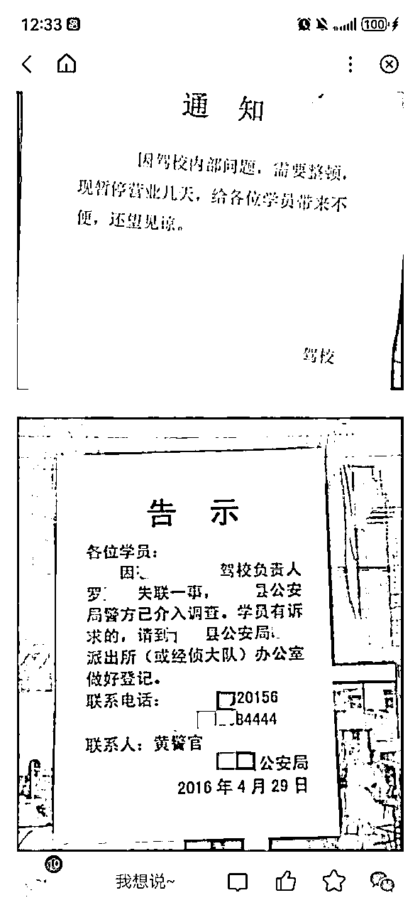

没错，老板卷款跑路了。经侦大队介入调查。几百个报名的学生轮番给我打电话，几乎24小时不停，电话都要炸了，觉也没法睡，只能一遍遍安慰大家说会处理好的。那段时间度日如年，精神压力大到睡不着，课也不想去上。实在受不了，就绕着操场一圈一圈跑，跑到虚脱，然后洗澡、关静音、睡觉，醒来再回电话。一开始还指望经侦能抓到老板、安排退款，我天天去问、天天打电话，得到的回复都是“正在落实”。等了三个月，学生已经忍无可忍。我连宿舍门都不敢出，怕碰见学员尴尬，更怕被愤怒的学生打了，还手不是，不还手也不是。

这就是一个普通圈友的真实踩坑经历。没有大道理，只有血淋淋的教训。希望后来者能少走点弯路，也算我们这些“踩坑人”的一点价值了。

后来想清楚了，学员报名本质上是冲着信任来的。驾校老板经营不善自行消失，那是他的责任；但我们事前没有做好甄别，让学员跟着受损，这笔账只能我们自己承担——受害者从头到尾只有学员。

于是我和几位合伙人商量，决定先自掏腰包把学员的培训费垫付回去，具体怎么使用让学员自行决定，等驾校这边有定论后再把垫付的款项追回。

那一次垫付，直接让我们接下来的几年都背上了负债。

回头看，就算把老板找到又能怎样？车和房子早在跑路前就处理掉了，根本没有剩余可追偿。写到这里已过去八年，那位老板至今仍下落不明。传闻他在消失两年后，又有另一家驾校的老板复制了同样的手法。

心得归纳：

一、刚起步的门店，缴费时务必谨慎。
新店常以优惠做诱饵，但没有时间与市场的沉淀，尤其是非连锁、扎根不久的体量，资金安全风险会明显放大。很多情况是客户刚充值完、课程没用完，门店就关门了。
我了解过一种套路：新店开业时大量招兼职推会员卡，等钱收进来、消耗不多就跑路。法人常是代持人，背后有律师团队设计好退出路径，投诉维权基本无效。

二、遇事要敢担责。
老板跑路后，最容易的做法是把责任推给机构、等经侦、或自称自己也是受害者来拖延垫付。但这都是逃避。学员因相信学长才付款，面对信任唯一能做的就是扛下来。创业路上亦如此。

三、低价促销要留心。
明显亏本的价格，商家必然在别处找补，或藏有其他设计。比如驾校报名费异常低，既可能是急于招生，也可能是现金流断裂、提前收钱为跑路做准备的信号。

四、可分期则分期，降低敞口。
当时学员里有一次性付清的，也有先付首期、科目一通过后再付尾款的。后一种方式客观上分摊了风险。驾校如此，其他可分期消费也一样适用。

### 4. Z 金盘

那个午后微风很轻，我在校园桂花树下的长椅上小憩，花香很足，顺手刷 🐧 空间。学长的动态里在推一个项目：投入四百多，十五天后返六百，首轮投入若亏由学长兜底，盈利归自己。

学长我一直觉得靠谱，群人数截图显示已带了几百人。想着反正亏不了，还能赚点，几百块不算多，就跟着做了。

写到这里你或许会问：是不是后来学长不认账跑路了？
并不是。我投完后不仅没亏，第十五天确实到账了六百。赚钱居然如此简单？项目收益率很高，投入越多回报越高，还有推荐奖励。网站主打的词是“互助”，我帮你你帮我，多投多得，推广还能拿管道收益。

后来才知道，学长半年多靠自投加推广赚了上百万。多年后回看，他在操作和推广时早就留好了后路。

怎么看出？宣传口径是首投四百包赔——亏了学长真的会补。然后等你第一次赚了二百，他会建议用这笔盈利再投一次，亏了就停；或者拿去花，别再投，因为有风险。
但群里每天都在刷日赚数千、上万的战绩，对每个月生活费一千五左右的大学生而言，谁能保持冷静？谁舍得放手？

这就是精妙之处：先用首轮兜底换信任，再建议你用赚来的钱继续投，甚至劝退，反客为主。钱他照赚，名声也不错，后续你亏了也赖不到他。

回到我自己。赚到第一笔二百后，看着别人轻松入账，心里自然不满足。于是拿出存款和做校园贷赚的钱猛投，也体验过日赚上万的刺激，觉得自己马上要起飞了。
按这个速度年入三四百万指日可待，当时我还只是个普通学生，人生高光似乎近在眼前。
网站还说：自投是互助收益，推广是帮助他人的管道收益。胃口被养大后，我也照搬首轮包赔的方式拉了几个好朋友和舍友，他们首轮都赚到了。

那段时间每天盯银行到账，沉浸在收款的亢奋里。
我以为自己是即将腾飞的猪，没想到最后成了待宰的猪。危险正慢慢靠近。

后来提现变慢，公告说是系统升级、稍后恢复。这其实是第一波放血——先释放少量小额单子营造恢复假象，诱导继续投。于是大量人成了第二批接盘，最后血本无归。
我也没逃掉，把前期盈利和存款全部砸进去，最终清零。

如果只用盈利滚动、赚到就收手，结果或许不同。亏钱的人事后都这么想，可利益面前容易当局者迷，往往等到倾家荡产才醒悟。晚了。

反思：

1. 包赔是获客手段。
通常只限首单，且有金额和时间限制，本质是建立首次信任。它是成交的前置条件，但前提是项目正规、自己有把握和兜底能力，不能拿包赔当幌子收割。

2. 高收益必伴高风险。
资金有收益、安全、流动三要素，像三角形的三边，不可能无限拉长。流动性好且收益高的项目，风险必然很高。

3. 看清本质。
若项目不产生真实交换价值，只是资金在人群间循环，本质就是金字塔。用后来者填前者的窟窿，随着人员递减必然崩盘。这是规律。现在大量网投项目包装再好，也难逃此逻辑，远离为妙。

4. 重保本，懂止损。
保本比赚钱更重要。赚到钱后不要全仓甚至加杠杆，一看就像莽夫。及时止损是智慧，当发现继续投入只会越亏且难扭转时，哪怕沉没成本再高也要果断离场。坚持难，放弃更难，但该止损必止损。

### 5. 网上 D 博

亏钱后总想快速翻本，有这种想法的人很容易掉进下一个坑。明知是坑，为了回本也会孤注一掷，回本的执念会压过理性。

不幸的是，下一个坑里的人就是我。
Z 金盘亏损后心情低落，想东山再起、上演逆风翻盘。这次来钱更快，几秒出结果。凭“研究精神”我觉得摸清了规律，前期小赚后认为能把亏损赚回，故筹钱加码。
投入加大后规律失效，我以为没研究透，继续找新规律。最后发现平台的套路很清晰：先让你小赚，再让你大亏，亏亏赚赚终究是亏。

你以为找到了规律，其实只是自我感应。以小博大、放长线钓大鱼的念头，往往是你被钓的对象。

最终只能认赔离场，再玩下去只会亏更多。学生时代不知畏惧，等醒悟时已千疮百孔。

反思：

1. 远离 D 博，别自负。
十赌九输，我没见过靠赌发家的，只见过开赌场发财的，而他们大多最后进了局子。别以为自己能破解、能小玩不瘾、能稳定盈利。身边例子比教科书更真实。
我一个亲戚六年前做红木家具年入六七十万，后来入赌，几年积蓄化为乌有。
老家一个同学的叔叔靠旅游开发暴富后沉迷 D 博，差点倾家荡产。
去年堂姐的儿子因欠赌债被逼离婚，孩子归前妻，上演妻离子散。真实且残酷。

2. 别想着速回本。
大幅亏损很难短时间扳平，越想快回本越容易被盯上。一旦有人拿“快速回本、快速致富”做诱饵，而你又有此心理，你就是目标客户。

3. 学会果断放手。
确认项目无收益或已成坑时，最好的选择是立刻退出。别做恋爱脑式的死磕。

4. 别拉人入局。
项目不可靠就别推广。被你拉进来的人多是信任你，坑了他们就等于毁掉信任。

### 6. 校园代

大学期间做项目缺钱，就去申请校园贷。通过多渠道对接了不少平台，用学生身份拿到一笔可观的资金，还做了几个校园代理。想着同学也可能需要，就帮平台引流收代理费。
宣传一阵后就停了。当时政策在遏制大学生借贷，相关平台陆续关停负面不断：过度消费、贷上贷。
庆幸的是我没违规，也及时撤出。
但我却掉进了以贷还贷的循环。最高峰时近二十个平台每月都要还款。为避免逾期，只能一边赚钱一边做还款计划，用不断补充本金来压缩利息。
每月面对几十笔还款，压力巨大。

反思：

1. 跟政策走。
项目多依托平台，平台依托政策。风向转变时应及时调整。

2. 理性借贷。
借钱前要评估还款能力、利息成本和使用用途，是否值得、有无风险。借来的钱终究要还。

3. 项目有周期且受政策制约。
前期好做后期难做，受平台规则变动影响大者需谨慎。

4. 守住底线。
留得青山在不怕没柴烧，保持本心踏实做事才安心。

### 三、毕业后项目踩坑及反思

### 1. 进入保险公司

毕业后项目不顺，想去大城市学习、也想挂靠公司方便办卡。正好同学升任主任招人，说保险能做大，我就加入了他的团队。

刚到深圳很艰难，一切陌生，预算有限。能在这个行业长期存活并赚钱的人都有真本事。因为无底薪、无包吃住，深圳生活成本高，跑业务还要自负费用，收入完全靠开单，无单则零收入，同业竞争激烈，平均留存约三个月。

2020 年口罩期爆发，长期线上会议，成员和客户难见面，所有活动线上化。
回到深圳后每日戴口罩做核酸，时有楼栋封控，每天提心吊胆。
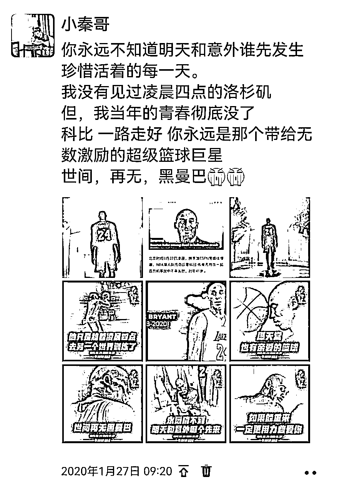
我最爱的球星科比因意外离世，那天我躲在被子里哭，生活真的太难。
2020 年是怎么熬过来的已记不清，只记得咬牙前行。

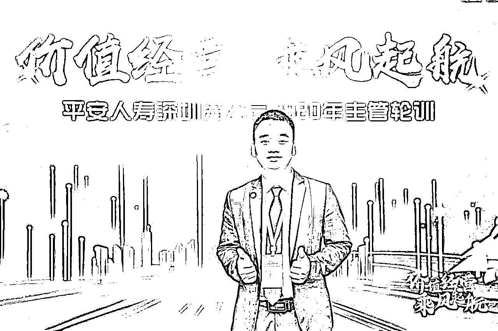
一年后我升上了主管。

收获与退出与反思：

收获：
旅游激励：业绩和管理达标时常有出行奖励，挺开心。
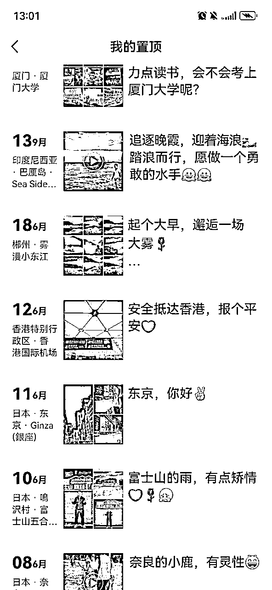
销售能力：学会约访、面谈、礼品营销、活动量管理与跟进。
团队管理：成员心态低落时做疏导，调动积极性，组织活动提升凝聚力。
抗压力：业绩与管理双重压力，都需自我消化并向团队传递正能量。
人脉：遇到不少跨行业优秀人才。

退出原因：
团队业绩波动、收入下降带来心理压力；口罩期业务难度加大；行业进入下行通道；长期高压状态下滑；成员陆续离职；我开始投入米粉店和水果店。

反思：
1. 心态建设是团队命脉。业绩差时需关心辅导，防止负能量扩散；业绩好时需防骄戒躁，保持持续性。
2. 上岗前培训关键。保险公司培训体系完善，新员工效果很大程度上取决于入职前的业务训练。
3. 谨慎选择无保障销售。无底薪销售对经济基础和抗压能力要求高，没准备长期无收入的资金与决心，失败率极高。阿米巴模式招合伙人通常要求不负债、有至少一年生活费储备，正是为提高成才率。
4. 不赚钱团队难存续。最好的团建是带团队赚钱，不赚钱再好的关系也留不住人。前期可亏损，超过窗口期必须造血。
5. 行业有风口与二八。保险曾是蓝海，如今难度倍增。其他行业亦有风口期和二八分化。
6. 活动量管理要闭环。列名单-约访-面谈-成交-转介绍，五步走完结果自然向好，线上线下同理。

### 2. 开米粉店

一个老乡在深圳东门开数家米粉店，口罩前生意不错，经常聊梦想。
2019 年底他在其他区域大举扩张。口罩后现金流断裂、客流减少，撑半年倒闭，欠百万债务。
走投无路后他加入我的保险团队，利用人脉开单，情况略有缓解。
随后他提议合伙开米粉店：他出技术配方供货，我和另一伙伴出资，技术入股分红。
理想很丰满，现实很骨感。
店只撑三个月就关门：口罩影响；选址失误，开业不久门口长期修路，断断续续数月；技术方开业后即躲债，经营受干扰且联系不上。等无望只能关店。

反思：
1. 纯技术入股无资金投入，风险不对等。做不好他损失小，出资方承担主要损失。
2. 大环境不明朗时投资要克制。口罩反复期贸然入局风险高。
3. 实体成本高、退出难。开一家简易店至少20万，押租、水电、人工每月3-5万，利润薄。关店转让还要花钱，部分房东不允许转让，周期数月。
4. 别轻易进入陌生赛道。你进入的是别人深耕数十年的领域，外行想速成很难。

### 3. 开水果店

同事怀二胎无暇管理，想转让其持有的水果店三分之一股份，另外两股东均是熟人。
起初警惕，核查经营数据后发现真实盈利，知根知底便签约。
前几个月分红正常，后来觉得分成少，便陆续开了两家分店。
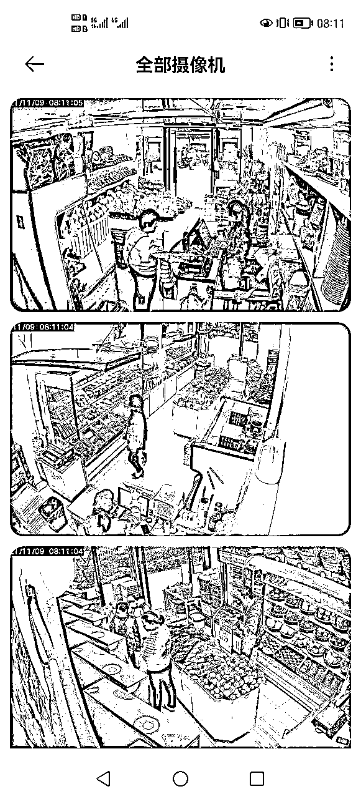
最终有的转让有的倒闭，主因：
1. 社区团购抢客。以业主身份做情感营销，零租金水电人工，价格接近进价，价格优势明显。
2. 临近低价店。周边新开水果店打价格战促销，成本高者扛不住。
3. 生鲜超市与大商场降维打击。超市以低价水果引流，大商场品类丰富顺带消费。
4. 路边流动摊贩竞争。
5. 口罩影响持续。
多重压力下难以为继。

开店那几年，恰好全程赶上了口罩时期。最直接的影响，就是街上没什么人敢出门，水果店周围隔三差五就有楼栋被封。最夸张的一次，深圳公共交通全线停摆了一个星期，可租金照付、工资照发、水电照交，水果又放不住，想保证新鲜，卖不掉的只能整批扔掉，全是白花花的损失。

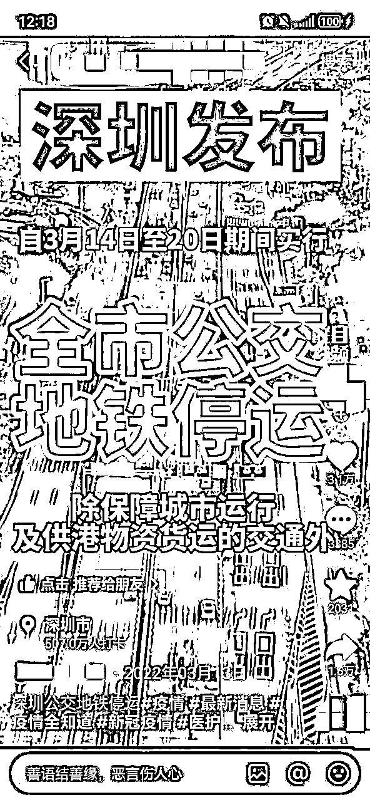

其实开水果店最让人喘不过气的，是房租和人工。前期砸进去20万并不算什么，真正吃人的是每个月的固定开销——光租金、水电、物业和员工工资，加在一起就要3到5万。这也就意味着，一个月营业额不到15万，根本保不住本。持续亏损之下，钱袋子越来越瘪。更要命的是，店一多，精力就被摊薄了，管理也开始跟不上。当时有位女股东，三家水果店还没完全站稳脚跟，就又跑去开餐饮店。她弟弟在四川学过做菜，家里三个孩子，一直闲在家，她就把弟弟叫来深圳，自己出钱、弟弟出人。新商场开业时看着人气还不错，可没过多久就冷清了，餐饮店一直往里搭钱。弟弟压力太大，见这店不赚钱，自己又拿不出钱来投，就跑去跑兼职，基本不怎么管店。姐姐看到自己掏了钱，弟弟却这么不上心，忍不住开骂，两人吵着吵着动了手。等我们发现的时候，姐弟俩已经打得鼻青脸肿。本来资金就紧张，又被这件事一激，水果店的日子就更难了。

事后我认真复盘，有几条特别想说：

1. 先稳住基本盘，再想发展。不管开店还是做项目，没有扎实的基本盘，盲目开分店就是往坑里跳。就算要做新业务，也必须做好亏损的打算，而且这笔亏损绝不能动到老本。

2. 大环境不好，要死死守住钱袋子。行情一差，骗子、割韭菜的就多，创业风险也变得更高，手里有现金，心里才有底。

3. 实体创业要谨慎，建议做轻创业。实体店动辄几十万上百万，钱像流水一样花出去，收入不达标时心态很容易崩。没有足够的把握和资金，别轻易碰实体；相比之下，互联网轻创业是更理性的选择。

4. 合伙必须资金入股，不能单纯技术入股。口头承诺和感情基础在利益面前往往靠不住，大家一起出了钱，才算真正在同一条船上。人性经不起试探，别去考验它。

5. 低价本身就是竞争力。只要品质没大问题，低价就是最有力的武器。不管你认不认，淘宝客、拼多多都是靠这条路杀出来的。

6. 懂技术不等于懂商业。很多会做菜的厨师，并不一定能开好一家餐馆。做菜只需要把菜做好，但开餐馆涉及营销、成本、选址、客户维护等一大堆事，从技术到商业，中间还有很长的路要走。

7. 成家之后顾虑会变多。选合伙人时，对已成家的人要慎重考虑。不是不行，而是成家后精力容易分散，开支压力也大，中途退出的概率更高，他们可能更适合一份稳定的工作。很多互联网创业团队只要00后未婚，是有道理的。

8. 没有永恒的朋友，只有永恒的利益。亲姐弟都能因为钱打成一团，商业场上的冲突只会更明显。与其撕破脸，不如尊重对方的利益，寻求互利共赢。

9. 不要盲目拉亲戚朋友创业。创业前可能是亲戚朋友，创业后很可能变成仇人。合伙人不是靠拉人头拉来的，而是一起经历了事情之后慢慢浮出来的，筛选比拉人更重要。

10. 情绪稳定太重要。创业者本来就面临各种压力和烦恼，一旦情绪失控，就可能做出动手、吵架等过激行为，到时候后悔也来不及。

再聊聊创业的三个点。

先说负债。首先要想清楚自己为什么负债：是盲目消费、盲目投资、被骗，还是沾了坏习惯？有就改，然后努力搞钱。接着具体分析债务：是良性还是恶性？按当前收入能不能还上？欠的是私人还是金融机构？每个月该还多少？把这些理清楚，思路就慢慢清晰了。面对负债，消极一点用也没有，还是要积极乐观地面对。实在还不起，就先保证生活，慢慢还。父母把我们养大不容易，千万别想不开。生命是最宝贵的东西，能健康活着，是很多人从医院出来后最大的感悟。摩擦卡和以贷还贷都只是在拖延时间：摩擦卡大概有千分之六的费用，一万块就要扣60元；以贷还贷只会让窟窿越滚越大。真正能走出来的办法，还是努力赚钱、开源节流，把本金一点点降下去，利息才能越来越少。还有，家人的支持是负债人最后的心理防线。日子好过的时候，多给家人打打电话、多转点钱，别等到“子欲养而亲不待”再后悔。当你跌到最谷底，家人那点温暖，往往是你东山再起最大的底气。

再说创业。不要有年龄焦虑。三十而立，听起来就让人紧张，可多数人都是普通人，毕业就已经23岁左右，再适应社会、碰几次壁，一晃就到30了。看到别人买车买房，事业起飞，自己心里难免发慌，我也曾觉得自个儿像废人，远落后于同龄人。后来学会和自己和解了，只跟自己比，每天进步一点点就行了。闲下来翻翻褚时健的经历，再看看王拾柒逆风翻盘的故事，会重新受到鼓舞。创业失败去上班，并不丢人，这是一种以退为进。上班能重新攒钱，也能重拾信心，还能好好反思，然后再杀回创业圈。就像白龙，创业失败后去上班，接着再创业，那种不服输的劲头很打动人。如果真想好了，那就出发吧，大不了从头再来。

最后说“守正出奇”。这四个字的意思，是先按常规发展，却不被常规捆住，关键时候能突破思维，出奇制胜。韩信的背水一战就是这个道理：他让一万人背靠河水列阵，自己带小部分人迎战赵军，同时派两千人偷袭赵营，拔掉赵军旗帜，全插上汉军旗。赵军想退回大营，一看满营都是汉旗，瞬间军心大溃。很多人只看到那一万勇士的背水气势，却总忽略那两千人的奇兵之效。不要幻想着每次都能靠蛮力力挽狂澜，守正才能出奇，先让自己立于不败，再图制胜，才是更稳妥的打法。赚钱固然重要，但保重身体更加重要——创业到最后，比的是谁不下牌桌，谁更能熬。家庭和睦也极关键，后方安稳，在前面打拼才没有后顾之忧。我看过不少创业故事，成功创业者的家庭大多很和睦。另外要学会规避风险，做事合法合规，就算公司真的倒了，也要把员工工资安排妥当，别连累家人。

回顾这几年，谈不上什么大成绩，有赚有亏，一路坎坎坷坷、跌跌撞撞。希望这些经历对圈友能有一点启发。我能力有限，如果哪里说得不对，欢迎随时指正。很感谢龙哥盟这个平台，让我认识了一帮优秀的圈友。祝大家都能大展宏图，也祝龙哥盟越办越好。写到这里，夜已经深了，晚睡伤身，今晚就到这儿吧。