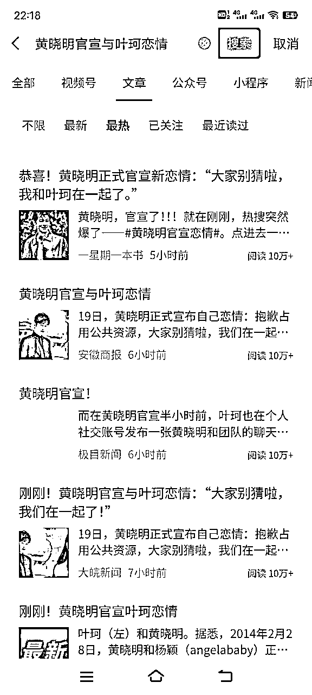
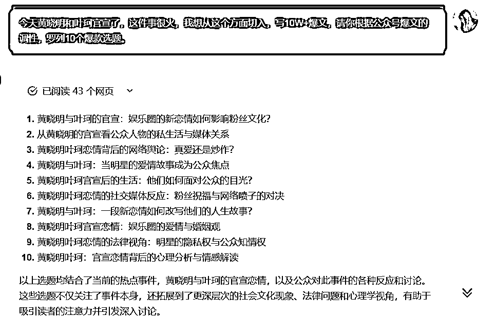
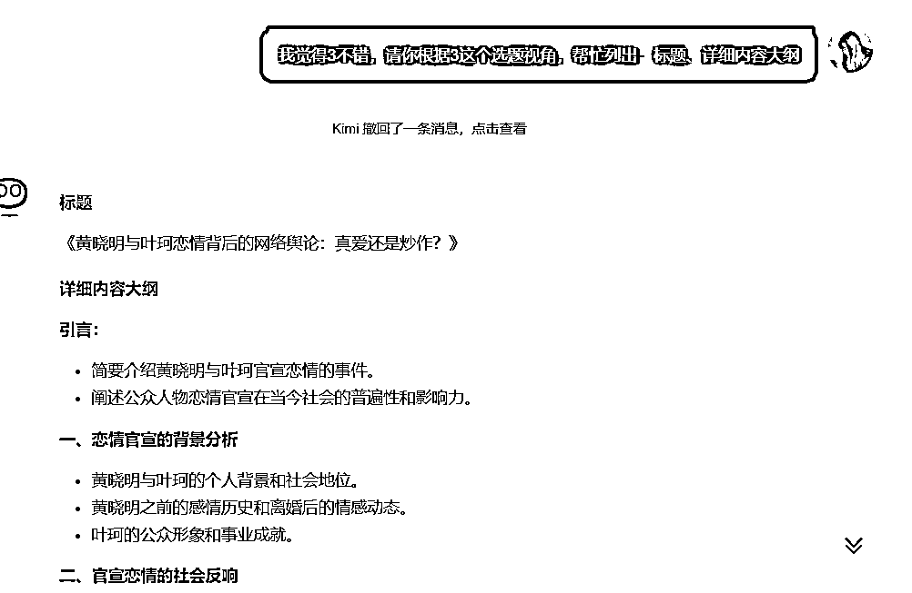
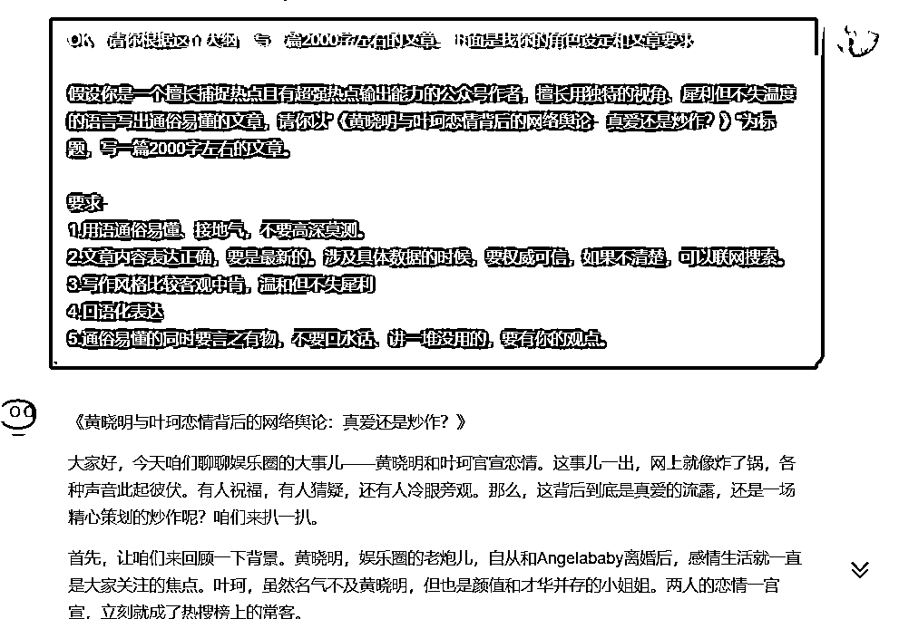
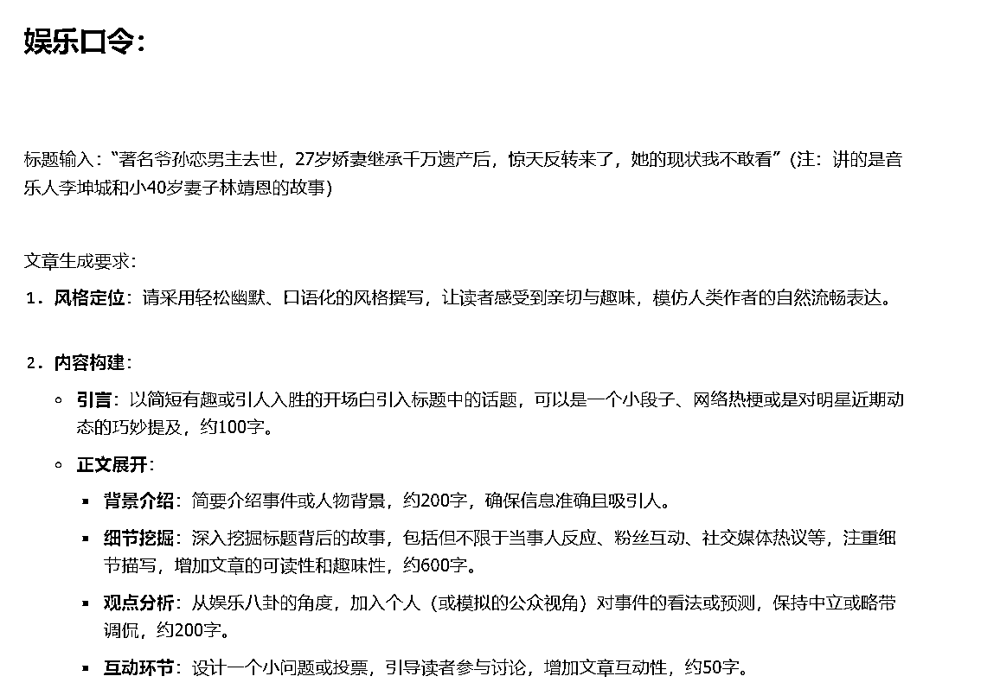
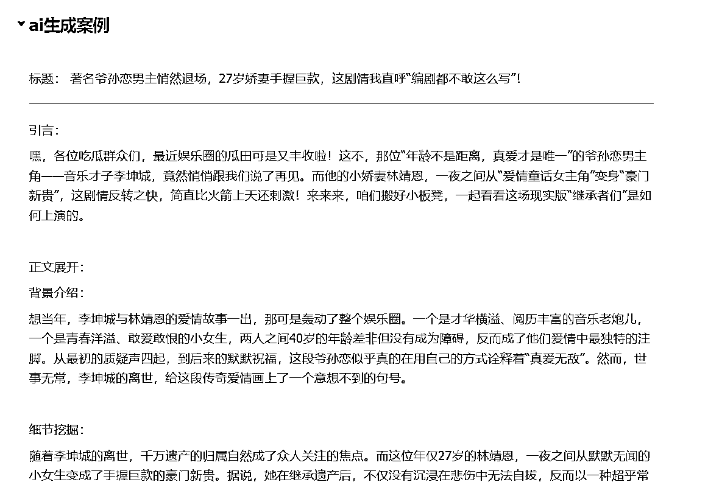

# 热点转瞬即逝？我用AI十分钟搞定一篇瓜文（黄晓明叶珂实操）

大家好，我是安七。毕业第一年，靠“AI+内容”这条道跑到了七位数。最近黄晓明和叶珂公开了恋情，这个瓜在娱乐榜上挂了好几天。做热点号、娱乐号的伙伴，这颗流量糖别不捡。

我拿 Kimi 试了两套玩法，把步骤拆给你看。

**玩法一：从选题到成稿，一站式**

先敲一段指令给它：

“这对情侣现在热度正高，我想围绕他们写一篇能破十万加的文章，请按自媒体爆款的路数，给我10个选题方向。”

从候选里挑一个合我口味的，再让它继续搭框架。

Kimi 很快给出一份七段式骨架：先交代男女双方背景，再说公开后各方反应，把“真情派”和“功流派”的声音分别摆出来，再顺手对比前几年其他名人公开恋情的案例，接着谈这种操作对形象和粉丝的影响，也聊舆论怎样反过来施压，最后落到社会心态上。结构相当完整，省掉了我大量构思时间。

接下来让它写正文。我定义了它的身份：一个很会追热点的自媒体主笔，文风锋利但别刻薄，语句要通俗，要有独立看法，数据不能乱编，可以联网查证。文章标题让它自己取一个够吸睛的。

它给的初稿，开头直接写“娱乐圈又炸了”，然后用背景、争议、案例、结论一步步填满，末尾还不忘引导读者评论点赞。作为第一版，能省我不少功夫。

**玩法二：私房指令包，直接丢**

这套指令是我平时攒的，里面有人设、语气、禁区、结尾钩子等等，写爆款常靠它。

之前用这套指令写另一篇文章时，效果截图放在这里：

这次我把同一套指令包丢给它，让它写这个瓜。它很快吐出另一版，画风更活泼，开头自称“吃瓜群众”，中间把男方微博里“别猜啦”和女方的爱心回复写成撒狗粮现场，最后还扔了个投票链接模板。虽然有些油腻，但润一润就能发。

需要口令，或者想把稿子搬去别的平台的朋友，也可以来找我，我去给你点个赞，哈哈。

**最后说句实在话**

AI只能帮你出初稿、供灵感，别指望它一次生成就能直接推送。阅读量这事，AI也算不准。赚钱，终究要靠自己。

这是AI辅助爆文系列的第5篇，主题是“指令调教”。之前4篇分别是：

- 故事篇：我怎么链接到贵人，把AI爆文做成了主业
- 战略篇：坦白局，自媒体爆文现在还值不值得做
- 数据篇：04年大二助理，从零基础到平均三天一篇十万加
- 领域推荐篇：2024年8月，有哪些小众蓝海方向

还想看什么主题，评论区留言。觉得有用的话，去知识星球的帖子下点个赞，破100赞我把完整口令放出来。

我是安七，下次见。