# 📕单号投流，15天引流500人，AI写作变现5W+
作者：龙哥

单账号投流15天，AI写作变现5w+：我的📕聚光玩代写全复盘

大家好，我是龙哥，一个常年在一线跑流量的实战玩家。目前主要做📕聚光投放，落在代写赛道，走的是高客单价方向，单号月入稳定在10W+，还打出过单日200倍投产比。最近这波，我用AI写作这个选题拿下了标题里的5W+成绩，也把整个投放链路重新验证了一遍。

话不多说，先聊聊代写这门生意怎么从0走到100。

其实现在我更愿意把它看成一整套自动运转的系统：流量端、中控端、交付端，三块各司其职。我自己亲手搭过完整的0到100，所以再看眼下这个盘子，不过是把过去做过的事换了个载体重来一遍。当初入局多少带点玩心，也想验证自己离开大平台后还能不能再次起盘。目前来看，结果不算差，身边明显多了一批志同道合的人。

流量端是我抓得最紧的部分，也是利润最肥、最可能完成自循环的一环。0-1，先靠最小业务闭环认识行业；1-10，把成功打法固化成一整套模板，再复制到更多账号；10-100，把执行派发出去，通过利益分成让其他人帮你跑流量，自己退到中台统管前后端。再往后还可以继续演化：把利润继续稀释，吸引更多同频团队形成联盟。大家的共同目标都是客户，只有协同控价，才更有机会吃到市场份额这块大蛋糕。

中控端的本质是撮合。前端的订单汇总过来，中控把它们分发给匹配度最高的写手。表面看只是赚个差价，但真正掌控资源分配的人，往往才是幕后老板，前中后随便撮合一下，利润就到手了。为什么中间商省不了？因为做流量的人通常不愿写，写得好的人往往不会做流量，甚至懒得研究。有了中间环节，大家只需要专注自己擅长的部分，效率自然更高。

交付端，口碑和复购基本就看这一环。优质写手资源稀缺，要么自己培养，要么直接捡现成的。培养确实费心费力，所以我建议双管齐下：一边带新人，一边把市面上好用的写手资源盘下来，先稳住现有订单，不让流量端和交付端顾此失彼。最后筛选出价值观一致、能力在线且愿意配合团队的人，长期绑定就好。

再讲这次的聚光投放。说句实话，代写类目在平台上的限制一直挺严格，又赶上行业淡季，我才在月初下定决心测试。目前只开了这一个账号在跑，结果有些出乎意料：信息真的回麻了。别人一天接20个咨询已经算不错，我这里刚睡醒就已经聊完20个。等到了业务高峰期，客服团队怕是得再扩编一倍。
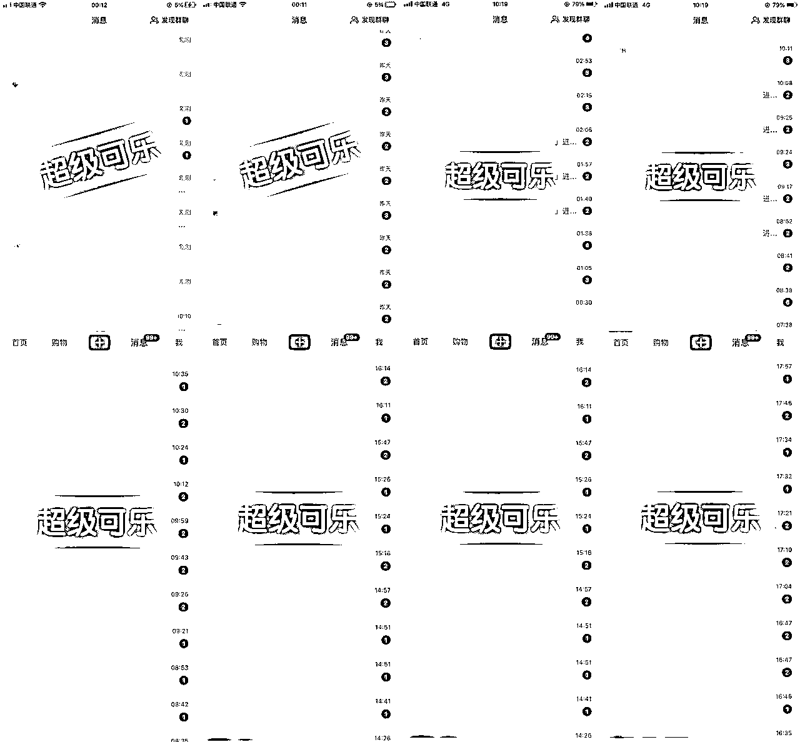
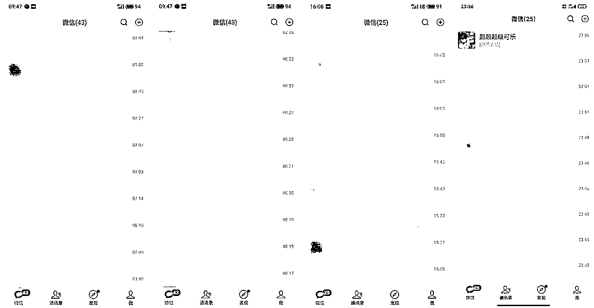

下面进入实战环节：聚光怎么开通？我把完整步骤拆开讲。

先看开通条件。
专业号方面，你需要一张营业执照，经营范围优先带“教育咨询”，差一点带“信息咨询”也行；代办约500元，自己办就几十块钱。另外还要一个📕账号，新号老号都可以，不用特意养号。
聚光账户方面，前提是企业专业号，再备好营业执照和600元认证费。

接着是具体流程。

第一步：先把账号门面做好。
头像：选和写作有关的，卡通或人物头像也可以，但一定要贴合人设。别碰明星、著名动漫角色之类，容易有侵权风险。
昵称：好记是核心。别用生僻字、超长名字和复杂符号。
简介：给一个通用公式——擅长什么+信任背书+能给客户带来什么。拿不准就多参考同行怎么写。
背景图：风景、写作环境等符合人设的图片均可。
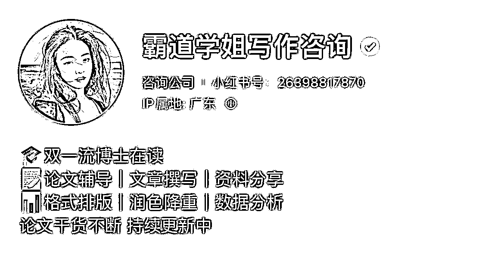

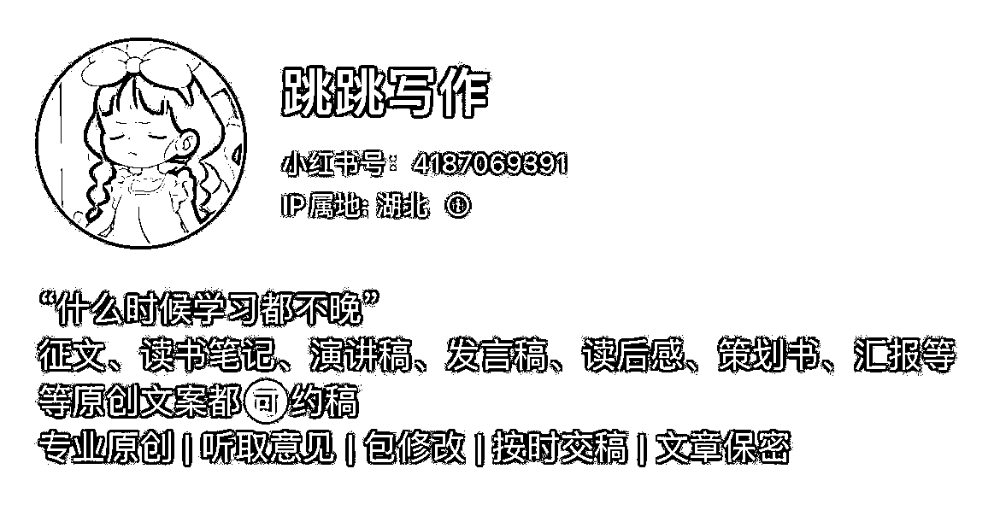
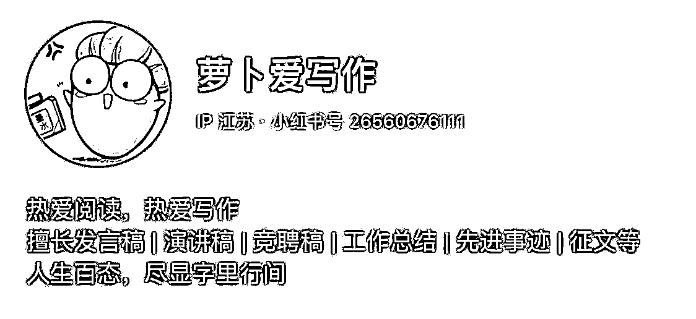

这里多说一句：蓝V账号因为交过“保护费”，平台对它确实更“手软”。某些原本敏感的词汇会偷偷进白名单，你要做的就是反复测试边界。万一简介内容不小心踩线，后台审核员很可能帮你悄悄恢复成上一版，而不是直接处罚。这要是换成普通账号，轻则内容被清空，重则吃到违规记录。

第二步：做企业专业号认证。
一张营业执照最多注册2个📕号，每个号认证费600元，分开交。
操作路径：创作中心 → 开通专业号 → 选择推广投放 → 开通账户 → 填写账号信息 → 填写主题资质 → 支付600元审核费用 → 行业资质选择“商务服务-咨询管理-咨询公司”。
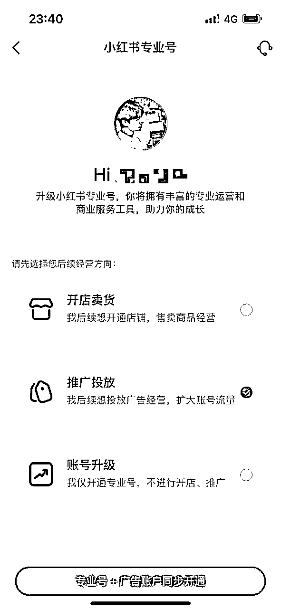
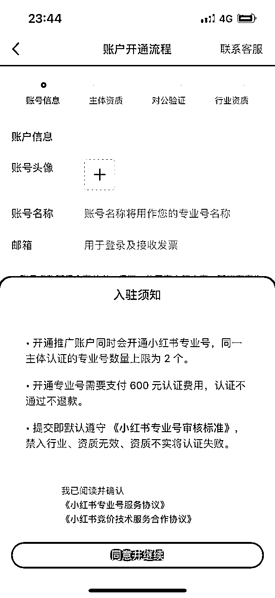

几个容易踩坑的注意点：
- 信息必须一次填对，总共只有3次审核机会，全部失败不退审核费。
- 每次审核费600元，认证有效期一年，每年都要年审。
- 平台承诺3天内审完，正常情况下第二天早上就会有人联系你确认信息。

第三步：走聚光注册。
入口放在这里：https://ad.xiaohongshu.com/
进去后找到【广告】，点【账号管理】→【推广资质认证】，选择【教育培训-线上教育】。

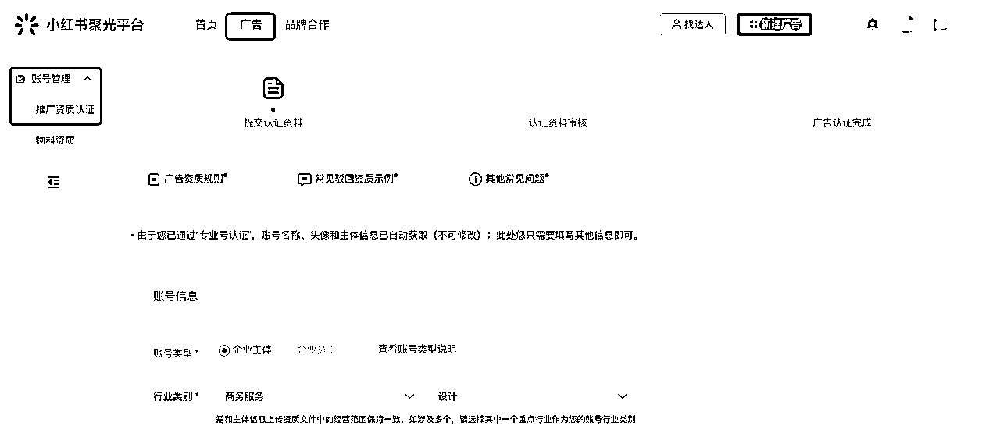

然后按步骤填写：
先写账号信息：账号名、行业类别、头像。
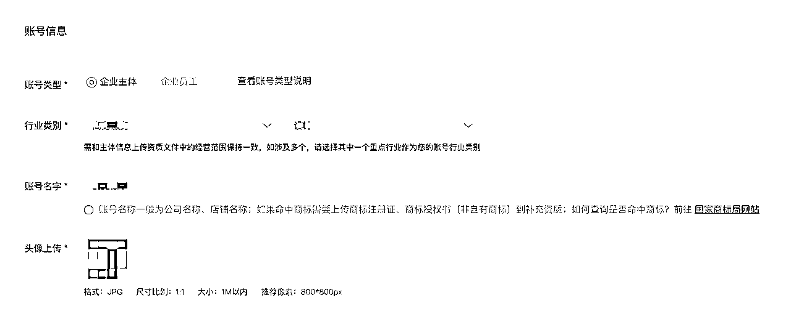

再上传营业执照，完成主体信息。

行业资质这里同样选【教育培训-线上教育】；如果有其他资质材料，也可以按后台提示补充，但这个方向本身并不强制要求提供资质证明。
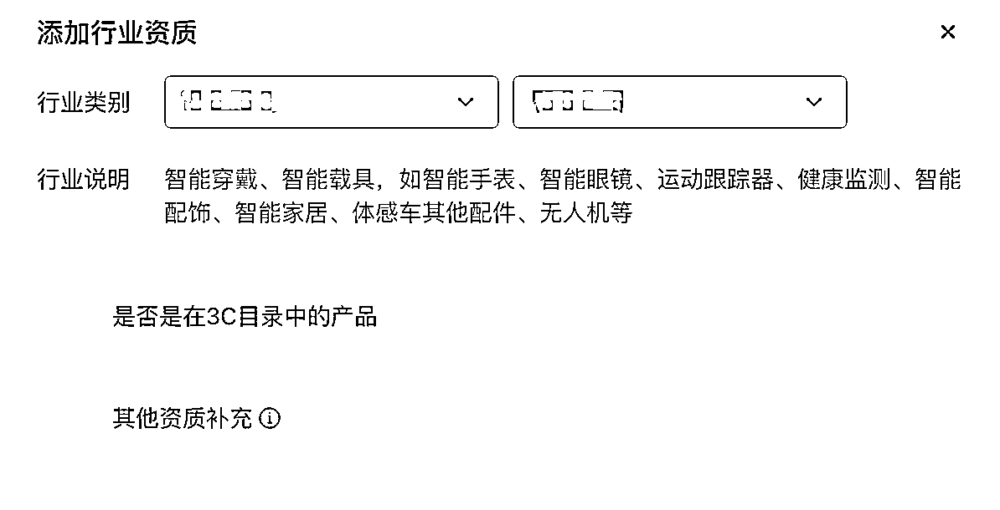
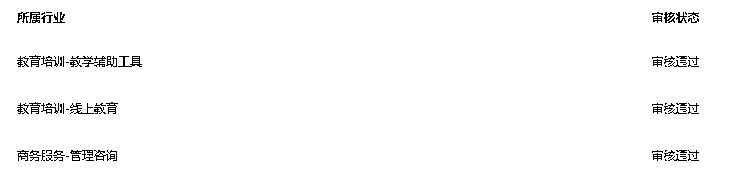

第四步：给聚光账户充值。
自己充值，首充最低2000元，之后就没有金额限制了。
走代理渠道，也是2000元起充，但会免费开通白名单，还能拿到返点。
找官方销售，最低5000元起充，好处是有专人对接，政策动向掌握得比较及时。
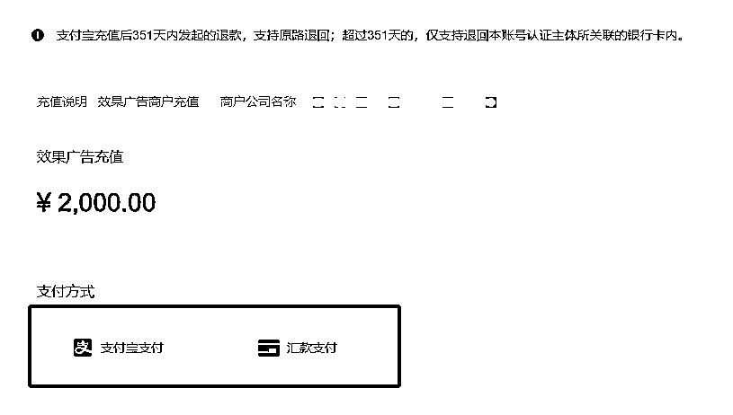

充进账户的钱如果没用完，随时可以申请退费，按平台退费流程操作即可。

等上面这些操作全部落地，账号就具备投放条件了，接下来就是把素材准备好，然后开跑。
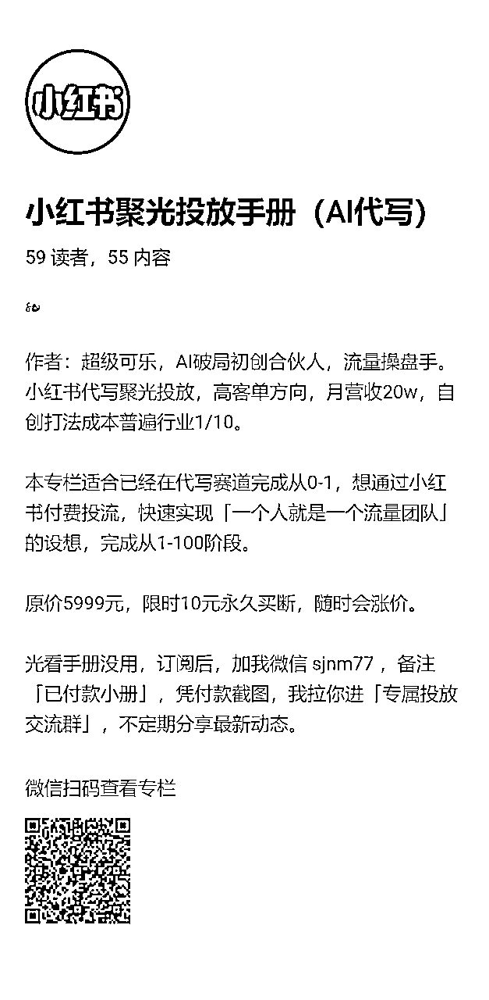