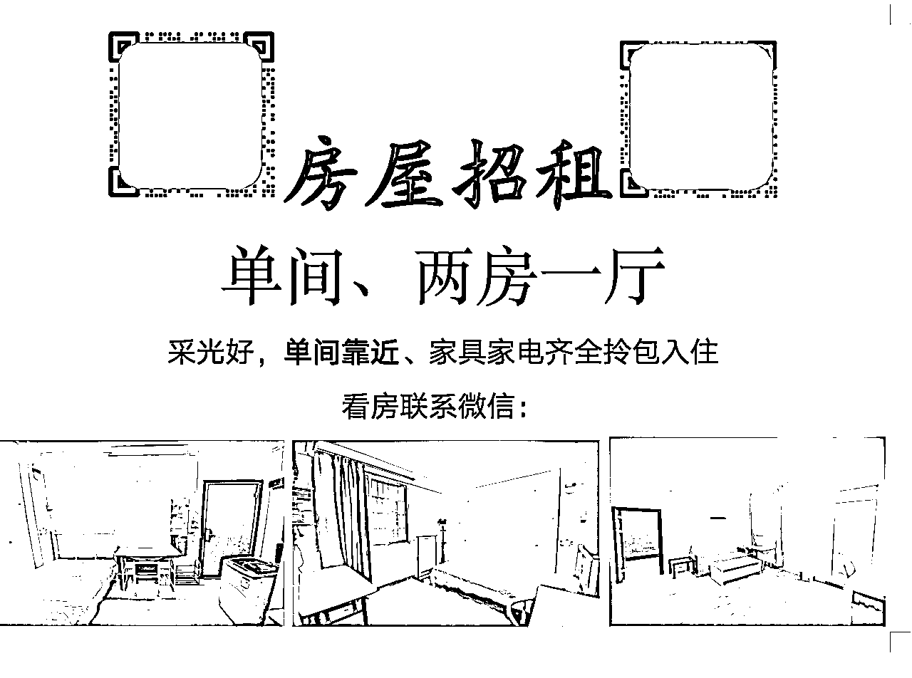
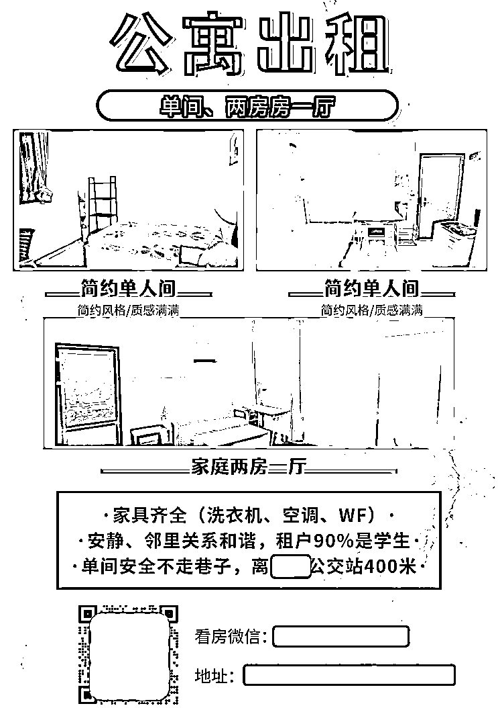
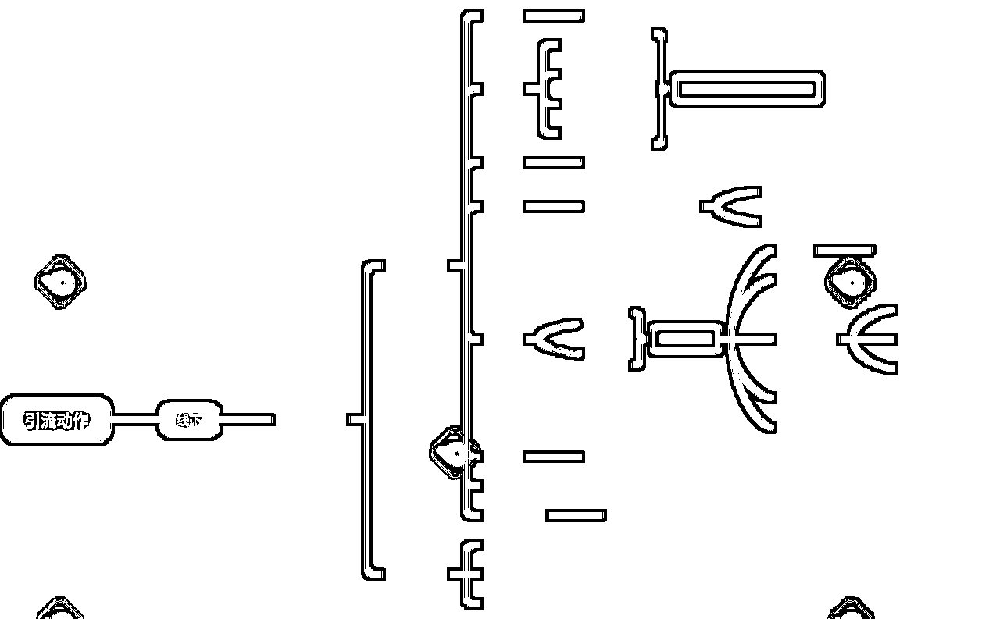
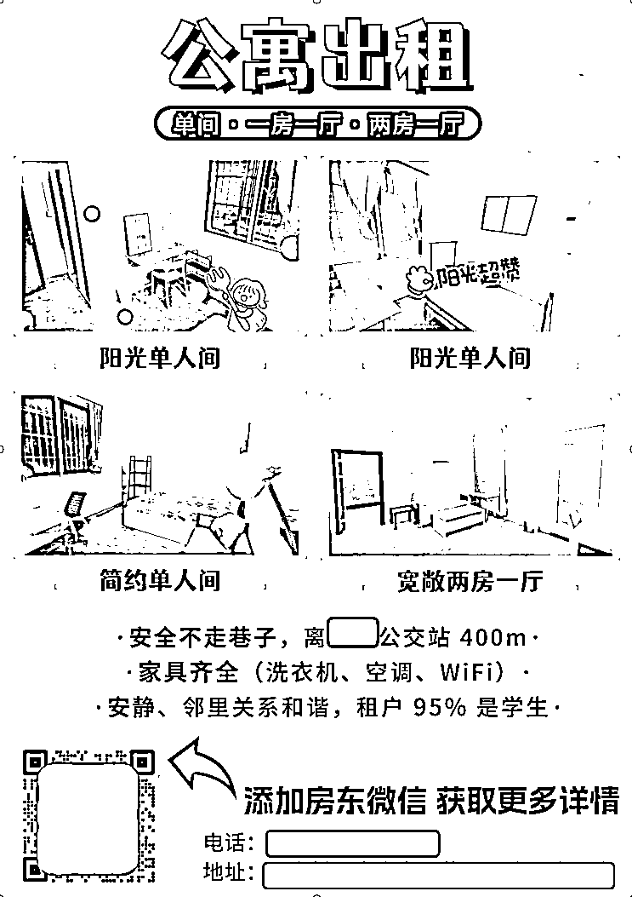
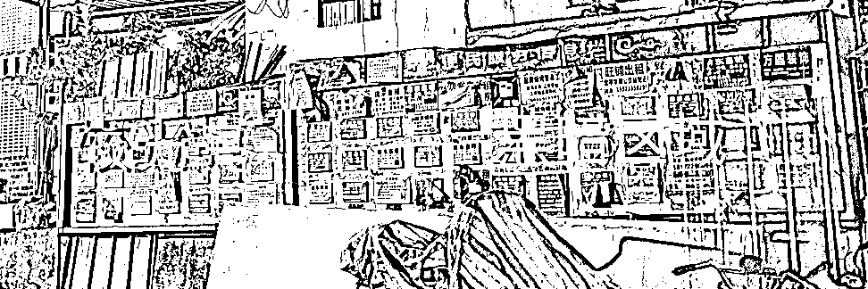
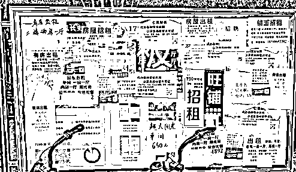
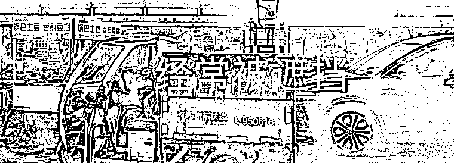
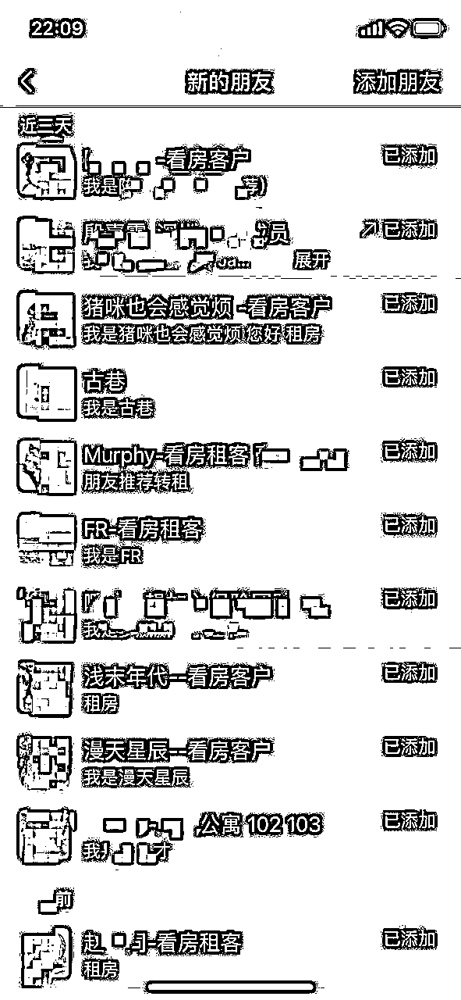
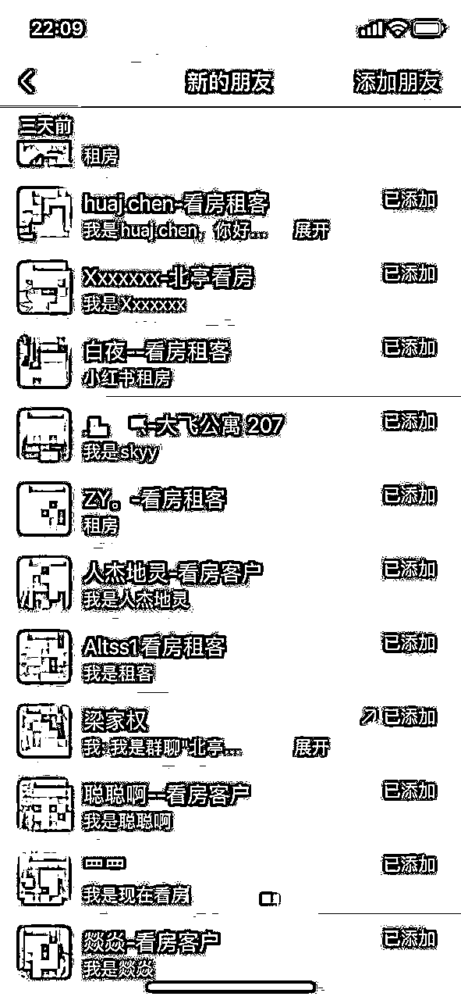
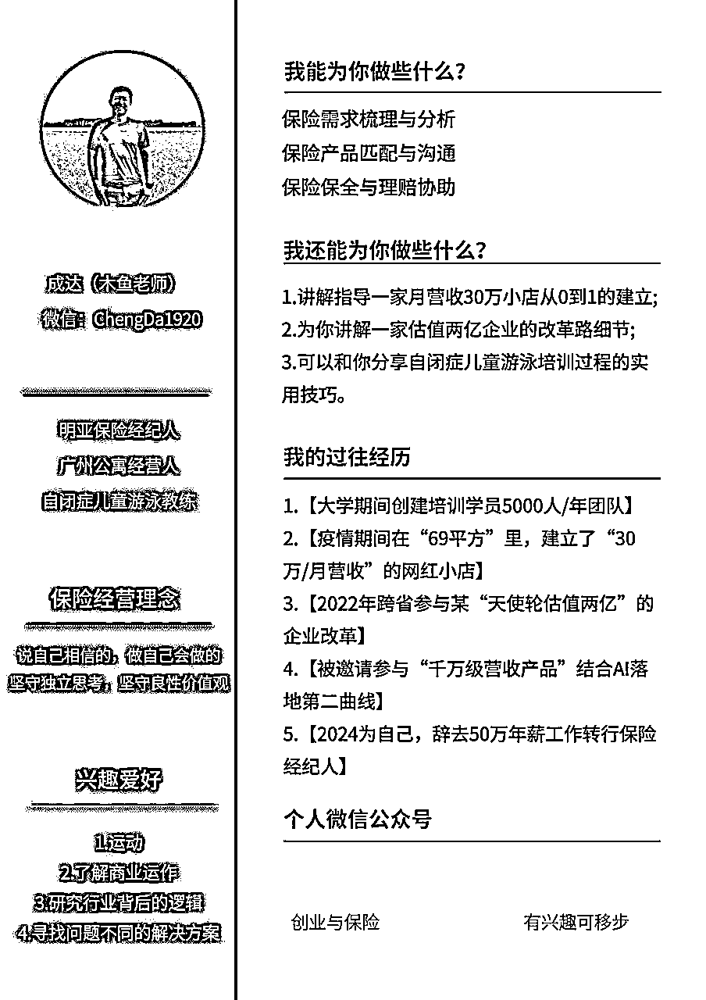

# 入局2个月零成交，新手房东靠一张1元海报翻身：2周清盘，还接管4栋公寓

大家好，我是木鱼。

几个标签：半佛系保险经纪人、野生商业研究员、广州房东。

2024年，我辞掉了一份很舒服的工作，回到广州，转行做保险经纪人。保险这行，长期看是能做的，但刚入场大概率要熬一段苦日子。为了不让现金流断掉，我在主业之外，琢磨着搭一个副业。

正好朋友拉我合伙做公寓。眼看着朋友这几年从租房到买房买车，公寓盘子越做越大，我心动了。当时脑子一热，心想公寓这事儿不复杂——又不是搞几百间的大项目，日常花不了太多精力。再加上朋友有经验，我自己早年也住过类似房子，应该稳。

于是，我几乎没有犹豫，直接入了局。

结果现实给了我两记闷棍：连续两个月，我一间房都没租出去。那段时间，我甚至开始怀疑自己当初是不是脑子进了水。

## 接二连三的坑

### 坑一：对市场判断太乐观

我接手的这栋公寓，以单间为主。房子不算破旧，但也说不上好。我早年住过这种房，潜意识里觉得，这片的租客应该能接受吧。

结果，看房的人纷纷摇头。

现在的租客对居住品质越来越挑剔，甚至细问空调耗不耗电、冰箱什么牌子。还有人专门拿着罗盘来看方位的……我彻底懵了。

合伙人当初劝我：接房之后最好先翻新一下。我嘴上答应，心里想的却是“什么样的客户都有，省点是点”，于是直接挂出去招租。

现实很快就教我做人。房子一天租不出去，我就要多扛一天空置成本。没办法，我只能咬咬牙按合伙人建议做了装修，同时让他给我引点流量。

刚踩完一个坑，另一个坑已经在等着我了。

### 坑二：指望外援，结果外援掉线

我原本的如意算盘是：前期靠朋友的成熟运营能力引流，等我摸清门路再自建流量。

好，我找合伙人要流量。他把我拉进几个群。群里确实有几百人，但——

这些人几乎都是之前积累的老客，有85%已经租到房了。更离谱的是，群里还蹲着几十个房东。

你品品：我一个新手房东，要在群里和几十位老油条抢那不到5%的潜在客户。

倒霉的事还没完。合伙人家里突发急事，必须回老家，只能远程接应。而且他这人在行业里待了挺久，但手法偏传统：转介绍、贴海报。线上运营基本没有——偏偏线上正是我最弱的环节。

局面彻底僵住：房接了，装修材料下单了，搭档掉链子了。

沉默了很久，我问了合伙人一个问题：“你觉得，要是尽快把房租出去，最快最有效的办法是啥？”

电话那头斩钉截铁：“一边装房，一边去村里贴海报。”

“贴海报？？能有用？”我差点以为自己听错。

“信我，最快就是贴海报。”

## 从怀疑到破局

### 死马当活马医

当时没别的辙，我只能去贴海报。

为了省成本，装修也没请人，自己边盯边干。但说实话，我打心底里觉得：贴海报远不如把房子装好来得靠谱。

可合伙人那么坚定，我不能不听。我问另一个也在做公寓的朋友要了张海报模板，照葫芦画瓢做了一版。

一个人如果对事情有抵触，做出来就是不行。

那版海报现在回头看，我怀疑我那会儿是不是智商下线。有一说一，它还是能干掉80%的同行。不信？接着看你就明白了。

海报匆匆打印，匆匆贴出去，我又回去继续刷墙装灯。

装修搞了两周多，某天🛰️忽然冒出一个小红点。我以为是保险客户，对方一开口居然是问公寓。

我愣了一下，赶紧回应，约了看房。当时房子还没收拾利索，又脏又乱，可这位客户完全没嫌弃，直接问一楼什么价。最后因为价格没谈拢。

虽然没成交，但我失眠了一晚上——这可是我第一个自然流客户。

接下来一周，陆续又有3个人加我🛰️，都说是看房。一问来源，全是看了海报来的。

一张那么普通的海报，竟然比合伙人转介绍来的人还多。

我当即扔下装修工具，冲回电脑前，决心重做一张。

### 第二版：让信息开口说话

这次我认真了，套了模板，但加了自己的思考。

#### 1. 提前验货

路上那些招租海报，99%都是红字黄底，通篇只有“招租、电话、几楼几间”。

我从客户角度想：大夏天跑过去一身汗，结果发现房型不对，体验糟糕透顶。所以，我要让客户看海报时，就对房型心里有数。

#### 2. 解决顾虑

租房不光看户型，还有家具、隔音、邻居素质等等。我提前把这些信息写在海报上，让客户快速判断。来的客户自然更精准，也更容易成交。

#### 3. 彩色印刷

你可能会笑：彩色也算亮点？真算。

竞品海报基本都是黑白打印，一毛钱一张；彩印要一块钱一张。可颜色传递出来的房间质感，是完全不同的。

这版海报贴出去5天，流量比之前翻了一倍，来了大约9组看房客户。就在这9组里，我成功租出了2套房。

此时距离我入局，已经过去整整两个多月。

### 第三版：全力冲刺，一个月清盘

看到效果，再加上装修完工，我野心冒出来了：“一个月内，把剩下的房全部租掉。”

我开始琢磨：线下海报还有没有优化空间？

#### 1. 拆解海报逻辑

我把一张海报能传递的信息全部画成思维导图，挨个分析。

不画不知道，一画吓一跳——影响转化的因素太多了，处处都能优化。

第三版我做了这些事：

*   **颜色**：改成明黄色，白天显眼，晚上也容易发现。
*   **重点突出**：第二版信息还是多，这次用红色把核心信息标出来，客户一眼看到要点。
*   **图片风格化**：专门拿给女性朋友看，加了点可爱的字体，房间图也变得更柔和温馨。
*   **引导加微**：有个研究说，加了动感箭头的店招，进店率能提升30%。我也加了动感标注，明确引导客户加🛰️。
*   **黄色腰封**：这招是跟华与华卖书学的。加了腰封，海报会更容易被拿起来看，信息曝光自然更多。

#### 2. 研究客户动线

“现场有神明”，我很喜欢这句话。

贴海报不能闭着眼贴。我把周边贴海报的地点都走了一遍，发现几个问题：

*   海报栏大小不一；
*   有些地方晚上黑得伸手不见五指；
*   海报经常被清理、覆盖；
*   偶尔还会被杂物遮挡。

针对性出招：

*   **黑暗区域**：抢占光源附近的位置，我的海报永远贴着最亮的地方。
*   **被清理覆盖**：不能阻止，那我就天天贴。你清你的，我贴我的。
*   **被遮挡**：尽量往高处贴，即使被人堆了杂物，我的海报也能露出一角。

再加两条狠招：

*   **狂增数量**：信号越大，信息越大。一张小海报不起眼，那就在海报栏里多贴几张，拼成一张超大海报。我的声音自然比谁都大。
*   **主动联合**：经常有租客问“有没有一房一厅”，我没有。怎么办？直接联系朋友，把他们的房源放到我的海报上，流量入口瞬间变大。

这一套组合拳打下去，意外惊喜来了。

原定一个月清盘，结果不到两周就全部租完了。最夸张的一天，签出去12间房。

## 复盘：凭什么是这张海报？

事后我冷静想想，能这么快破局，原因有五个：

1.  **外部流量红利**：这段时间的租房流量确实比两个月前高出好几倍，这是事实。
2.  **学会尊重现实**：一开始根本不信海报有用，非得自己试了才信。这件事教会我：别小看任何渠道，先试再下结论。
3.  **拆解能力的积累**：我过去天天研究商业案例，所以拆起海报逻辑来得心应手，比一般人能拆得更细。
4.  **海报本身确实强**：一张好海报，胜过十次无效推销。
5.  **同行不太爱动脑**：很多房东还在用最传统的老办法，稍微用心就能拉开差距。

## 尾声：从一栋到四栋

两周清完自己的公寓后，合伙人彻底惊呆了。他没想到一个新手能这么快跑通从零到一。

一个月后，他因为个人原因，很长一段时间没法照顾手里的公寓，索性把4栋公寓的招租和管理都委托给了我。

效果怎么样？给你们看一组最近的流量截图。而且说实话，现在流量只有那次高峰期热度的六分之一，但我的实际线索量反而更多更旺。

这就是我一个新手房东的故事：入局2个月，零成交，最终靠一张1元彩印海报突破困局，如今管着4栋公寓。

当然，中间还有合作机制、线上线下转化、合伙人支持等很多细节没来得及展开。但对我来说，这张海报意义特殊——它既是所有流量的起点，也让我真正明白：商业逻辑，永远要向现实低头，然后踩着现实往上走。

分享完毕。希望能给你一点启发。也祝你天天有才，年年发财！😊