0 投放、3 天、近 9.5 万成交：一次完整的内容变现操盘记录

有人靠单价极低的知识产品，3 天时间便收入大几万元，你信吗？

起初我也半信半疑，直到看见群后台截图、直播数据和成交记录。整套玩法的成本几乎可以忽略：不用投流，不需要大主播，只需要一个愿意配合的社群团队，以及一批被你“遗忘”的微信好友。

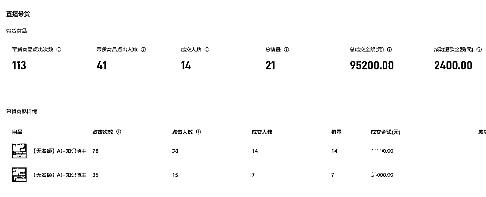

这位博主深耕知识变现赛道，目前年收入过千万，累计带过 22000 多位内容创作者，其中超过 100 人的个人收入突破 50 万。他的另一段履历是在一家知名教育机构任教学管理岗，管理过 80 万人的学习群体；他曾经用 600 个限量首发名额赚到 12 万以上，还创办了知识类 MCN 机构，同时持续开设线下大课，目前已完成 12 期，平均单场到场人数超过 100。

这一次他实践的，是一套“知识变现 3 日体验营”模型。

这套模型的价值，不在于客单价，而在于把原本沉默的存量用户重新唤醒。活动并不复杂：首日让入群者交定位作业；次日开直播，完成第一轮成交；第三日加播一节进阶内容，再做一波推动。表面看起来平淡无奇，实际产品逻辑经过精密设计。

先看数据：一次操作下来，两个体验群各自收了 115 人与 112 人，合计 227 人，成交比例 30%。

更值得留意的是，这批付费用户从哪里来？全部是此前添加过好友但没有付过费的“沉睡名单”。体验营只用了 3 天时间，就把名单重新点燃，变成付费成员。

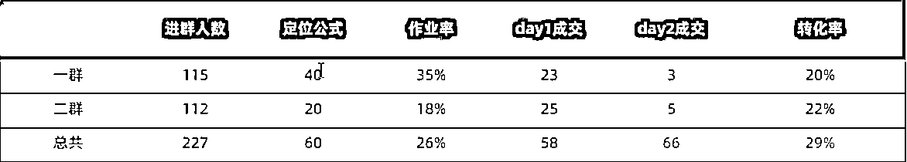

这套模式每月循环一轮或两轮，每次能给账号带来约 10 万元的额外收入。他坦言，至今已重复操作十余轮，每一轮筛选的都是从未付过费的用户，但收益依然稳定。用他的话说，相当于给自己装了一台自动运转的“赚钱机”。

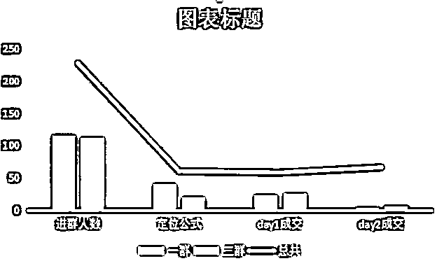

除了自身案例，他还给了两个参照样本：他指导的一位数学赛道头部博主，年营业额过亿，在补上私聊升单动作后，付费比例从 2% 提升到 8%；另外，做中老年健康垂直内容的教练也借同一玩法，让自有池子里的收入近乎翻倍。

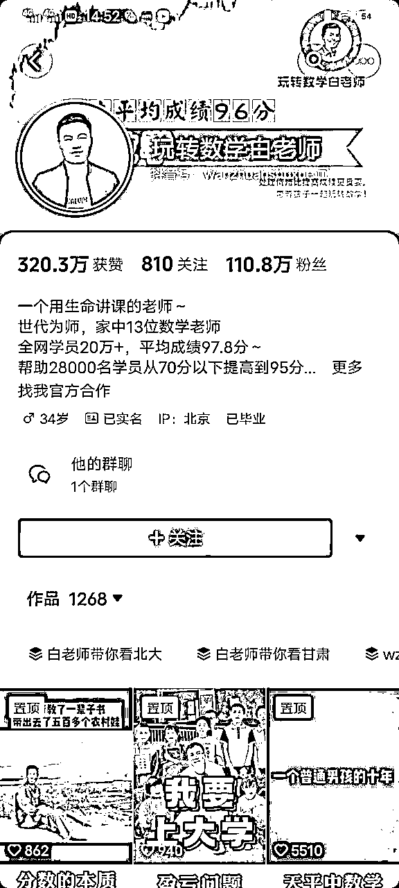
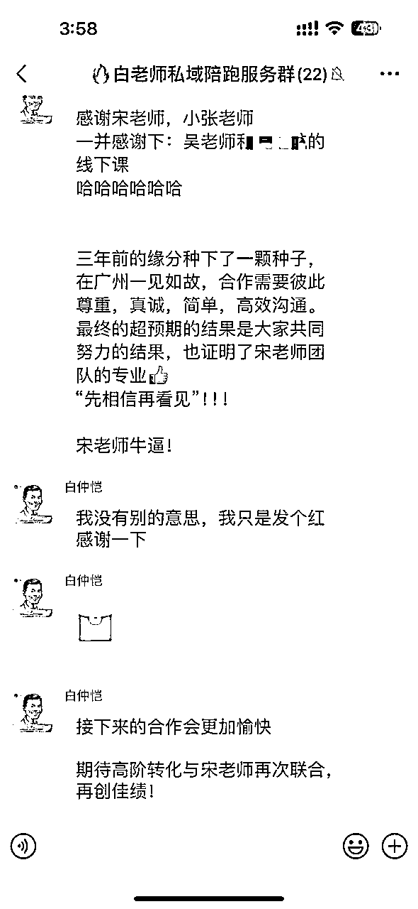
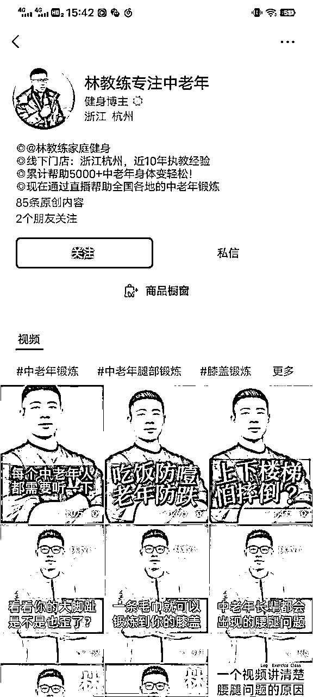
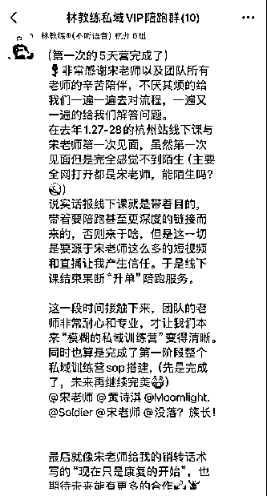

这套玩法并不挑剔账号大小。只要有存量粉丝，都能以自己的方式复制。关键是先把旧用户激活，再让价格过滤器发挥作用。

二、筹备阶段：激活与筛选

筹备环节由两步组成：让老用户重新认识你，以及筛出值得入群的人。

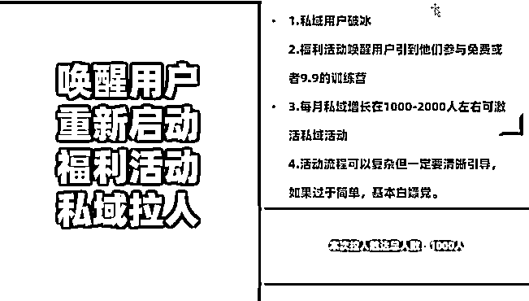

第一步是激活。许多博主不擅长跟老粉重新搭上线。手法并不多：发布一条老粉专属福利信息，配上一张活动说明图，图上同时附问卷入口。用户填写问卷，就能锁定福利。

若手头有存量粉丝，就能立刻启动。按以往经验，每触达 100 人，约有 30 人会进入体验群。

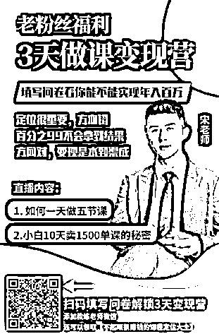

第二步是建群，但建群前要完成意向筛选。他曾做过一次千人触达：私信 1000 人，得到 400 条回复，最终有 40% 进入群内。关键不在触达数量，而在那条触达话术。话术的风格要轻描淡写，像朋友闲谈，不带销售腔调。

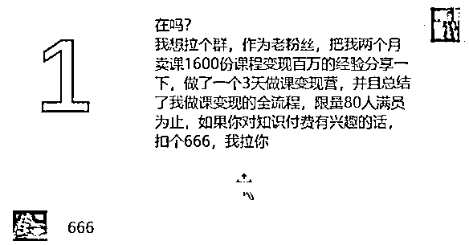

话术的用途在于筛除那些“只想进群、从不参与”的人。若不做筛选，把群二维码随手甩出去，群里很容易涌进大量只看不动的 ID。

他给过一套参考话术：以老粉福利为由头，告知对方自己曾帮一名考生提分 60，还把上百名孩子的成长经验整理成营，限量 80 人，有意向就扣 666，随后再由助教拉群。

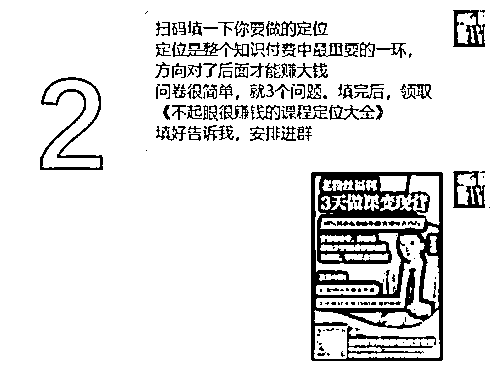

用户扣了 666，并不意味着能直接进群，而是要再完成一份问卷。问卷只有 3 个问题：你打算切入哪个细分方向，现有粉丝体量多大，当前卡点落在哪里。问题越少，参与率越高。问卷的作用是设一道小门槛，顺带摸底，避免拉进来完全零基础的人。

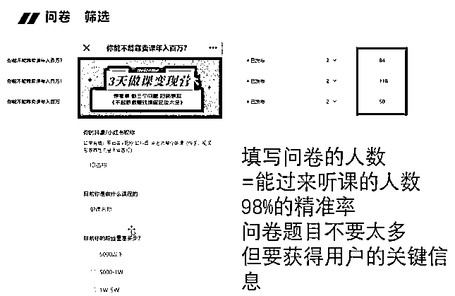

填完问卷后，用户添加的是助教微信，而不是主理人本人。从私信到进群，只有三个信息点、两次问答互动，筛选已经完成。

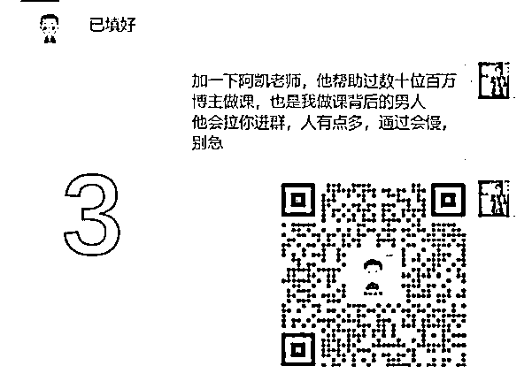

三、3 天节奏：从建立信任到完成收割

首日不考核成交，只考核作业提交率。

开营后，主理人会给出一个极小的作业：定位方向、读出单词、晒出盘面均可。成员完成后，主理人在群里逐条回应，即使只是一句简短指点，也能产生“被看见”的感觉。

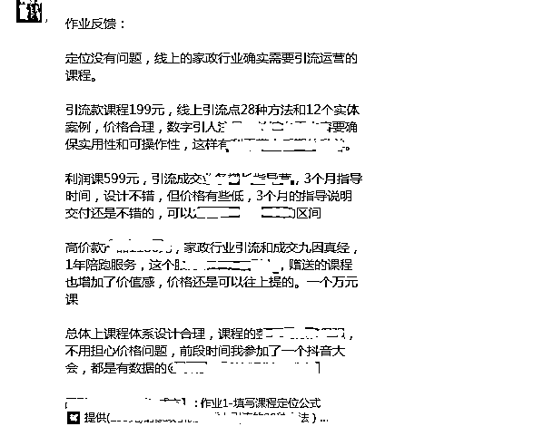

免费群的作业提交率通常不超过 25%，但这不代表失败；提交率能稳定在四分之一左右，就已经说明群内温度足够。

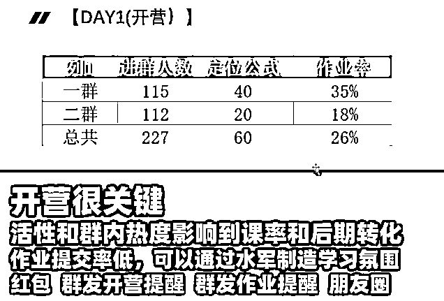

批改作业时，要顺带预告次日晚间直播的看点，相当于为第二天的到课做了铺垫。他也请了几位已购课用户提前入群，在开营当晚分享体验。

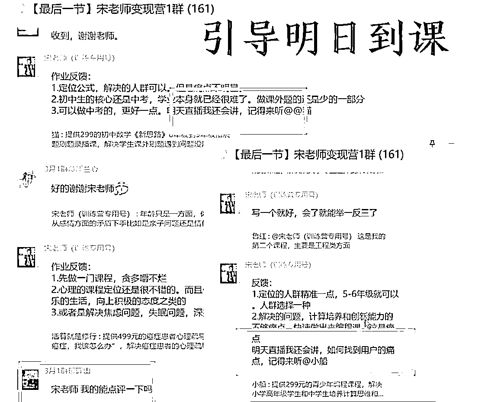

经验显示：第一天积极参与、甚至只是简单回应“收到”的成员，第二天付费概率显著更高；反之，从不交作业的人几乎不会成交。

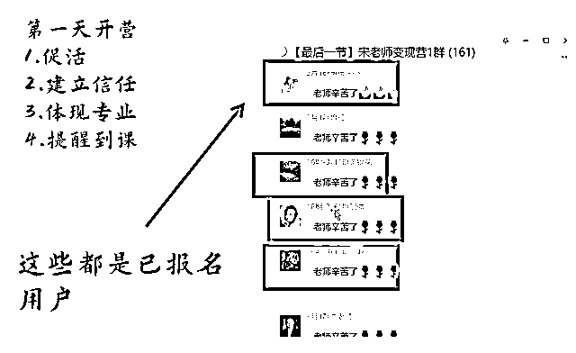

原因并不玄妙：人是先付出，才会更愿意继续付出。

次日切入成交。开始前先看一组后台数据：累计观看 144 人，人均停留 24 分钟，第 30 分钟是直播推课的分水岭。同时要统计：第 30 分钟前跳出了多少人、剩余观众的平均停留时长为多少。这些数据决定何时开口讲产品。

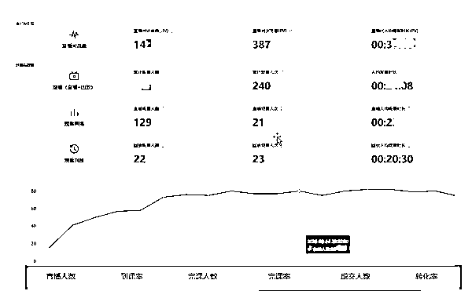

直播前半段，主讲人给出充分干货；后半段则明确指出：完整内容在付费课中。有人觉得这是套路，但实质是在帮用户建立付费边界。能白拿的部分，诚意给够；更深度的内容，就应当付费解锁。

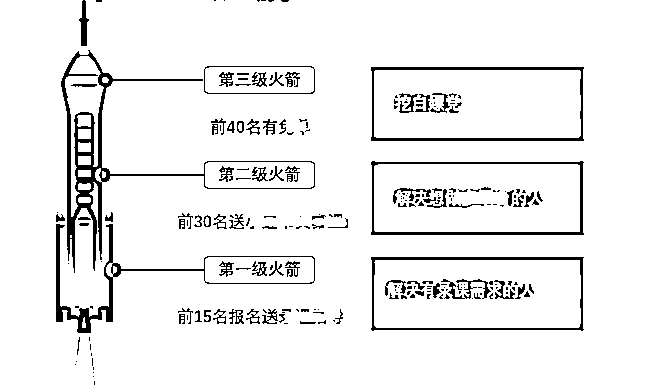

随后进入“三级火箭”环节。三级目标分别是：40 人成团即免单、30 人成团送额外课程、15 人成团解锁专属指导。不同层级对应不同福利，福利一层层叠加，群内自然会形成集体冲刺。

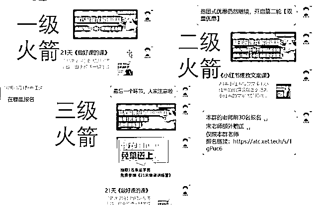

在福利刺激下，群成员会自发在群内排队占位。

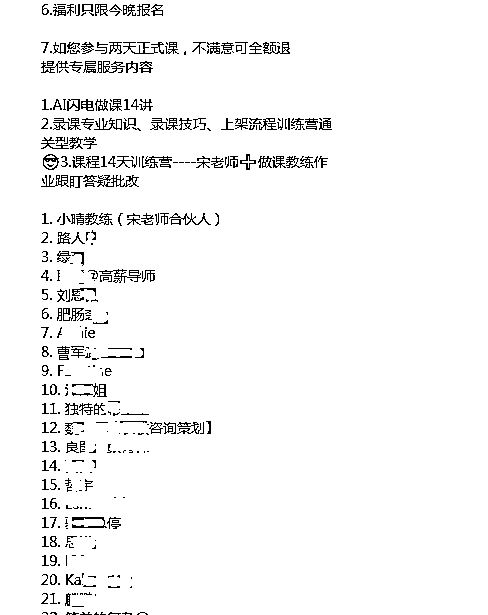

同时助教滚动发布付款截图，让后来者看到名额正被快速消耗。前 40 个席位没有附加福利，有意向的用户会最先抢位；占位后又想放弃的人，也会被私聊催单，不少用户就在这个环节完成支付。

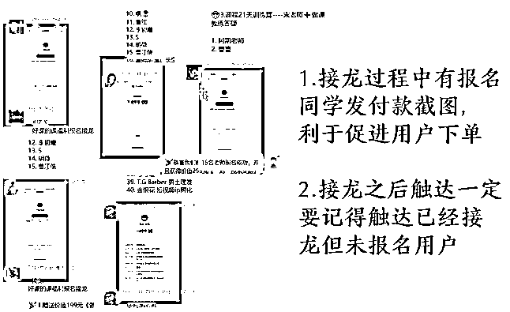

整套节奏一旦跑顺，十分钟内就能收到数万元的预约金。

收官日的任务是追单。让缺席者补听，让犹豫者再经历一次进阶课的冲击。出席率走低非常正常，不必把精力浪费在已经失去兴趣的人身上，只需聚焦于高意向成员。

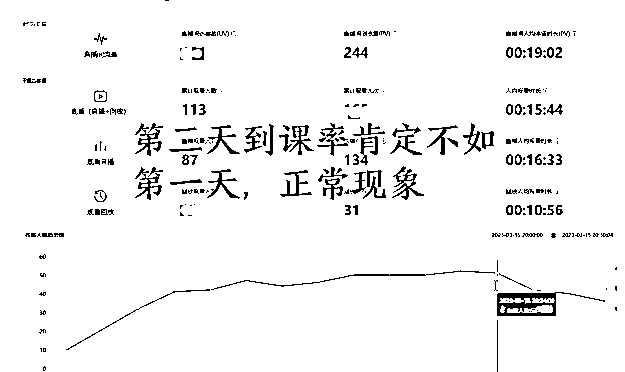

下午的抽奖是收官杠杆。将抽奖小程序链接放到群内，参与资格只向已付费且完成排号的成员开放。抽奖口令单独发给这部分人，未付费成员即使点开链接也无法抽奖，由此形成的心理落差，往往会烧掉最后一道防线。

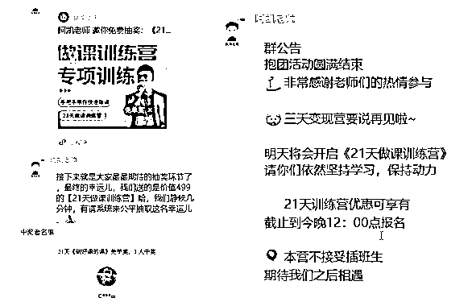
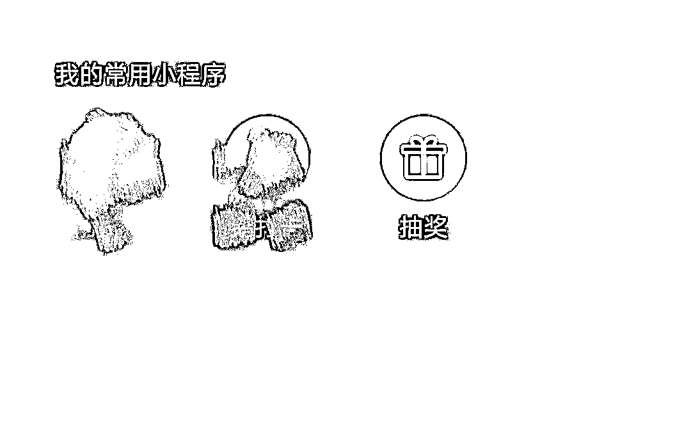
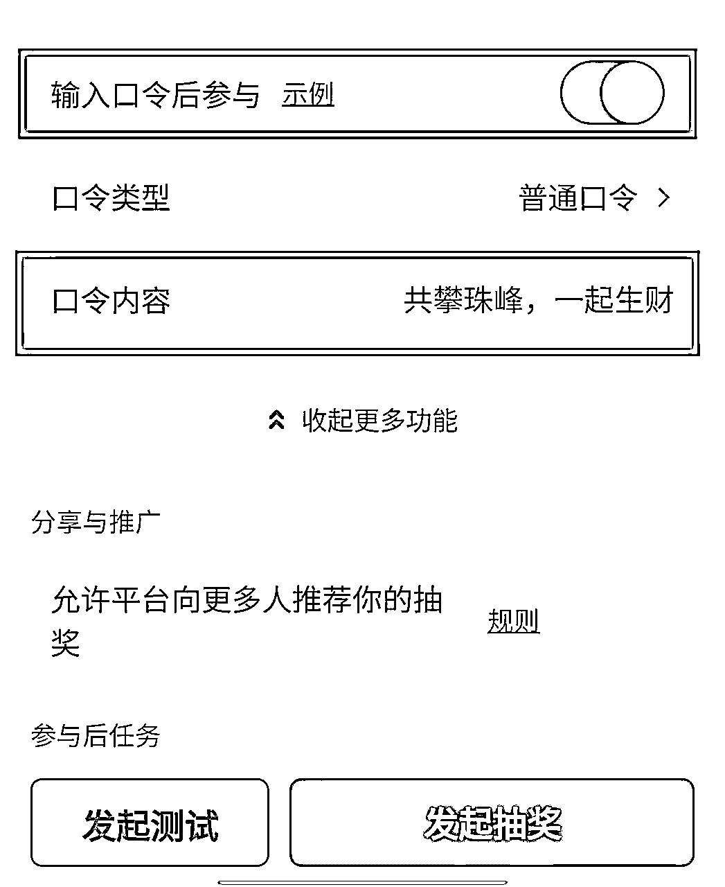

四、高效运营社群的 4 个工具与习惯

第一，标签分层。先给所有联系人贴 A/B/C/D 标签：A 类购买过产品，B 类询问过价格，C/D 类从未付费，长期不活跃。每一轮体验营要唤醒的正是 C/D 类名单。贴上标签后，每次拉群不再大海捞针。

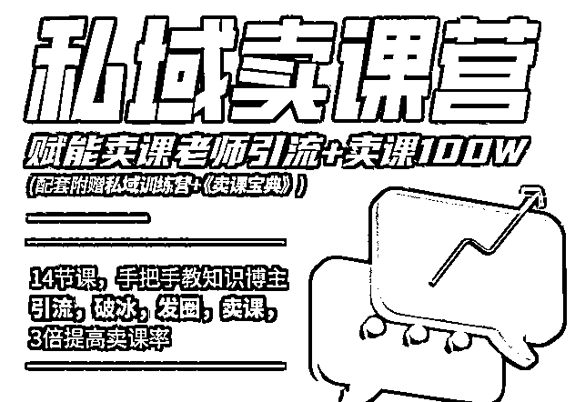

第二，批量建群。有一类工具能协助把用户拉入指定群，也能自动批准好友申请、设定预设回复话术。团队人手不足时，能省下大量重复劳动。

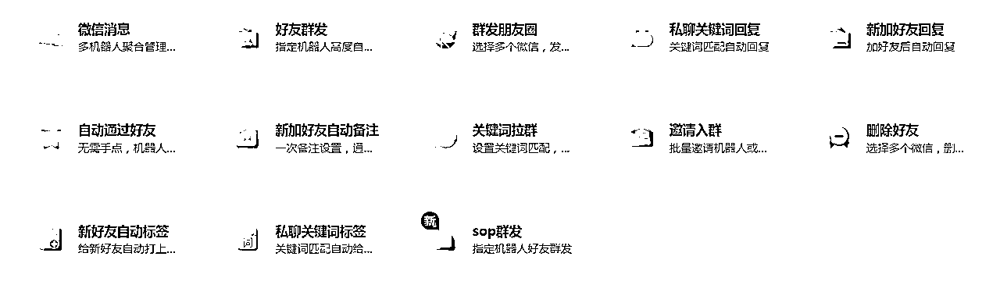

第三，同群转播。同一场直播，在群内做图文转播能有效拉回流。做法是：直播截图 + 一句抓人的摘要 + 直播间链接，三件套齐发。时不时有人跳出直播间，看到群里消息又会点回来。

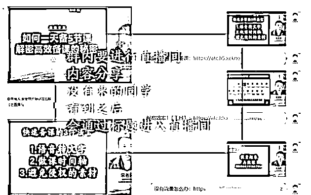

另外，促到场时可以试用“半份资料”策略：直播前抛出一半资料，直播后再补发另一半。用户为了拿到完整版，自然愿意留在节奏里。

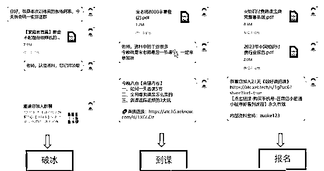

第四，每日小结。当天营业结束后，把所有关键数字和社群动作过一遍，并记入固定的数据表。

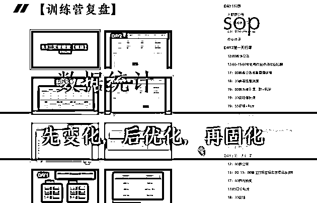
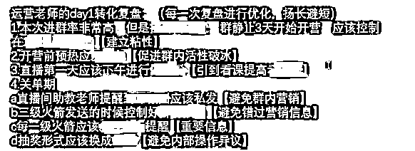
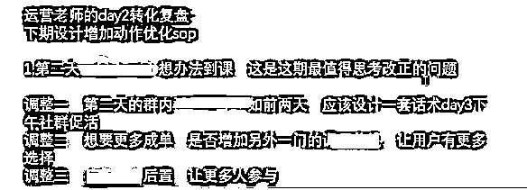

最后给一句忠告：这套玩法的前提不是运气，而是你手里存有足够的私聊关系。平台规则会不断变化，公域流量越来越贵，唯有自己维护起来的用户池，能长期带来复利。

这套“3 日体验营”模型，简单、便宜、可复用。如果你也在做知识变现，不妨先把自己的旧名单整理一遍，再开启一轮小范围测试。

欢迎对课程成交感兴趣的伙伴来交换思路。