# 新起了一批国//学号，我们团队内部最简单的起号方法，手把手照做就行

最近我们团队又跑通了一套极简的“国//学号”起号流程，差不多一天就带来了3个精准付费咨询，单客398元。整套方法已经打包成标准化操作，今天毫无保留分享出来，想抄作业的圈友直接照做就行。

先简单自我介绍：我是樾樾，目前在赚钱和大家相遇。我们自营盘主要深耕身/心灵疗愈和国//学文化方向，自己也做心理咨询和易学研究。小红书上接过不少赛道商家的流量合作，目前在售的变现产品包括冥想、能量提升等线上课程，一对一咨询，以及沉香、能量石、五行手串、天珠等实物周边。同时面向B端创业者提供项目指导、CPS合作、疗愈师IP孵化这类服务。这篇分享主要讲抖音端的起号玩法，之后有机会再聊小红书和更多行业细活。

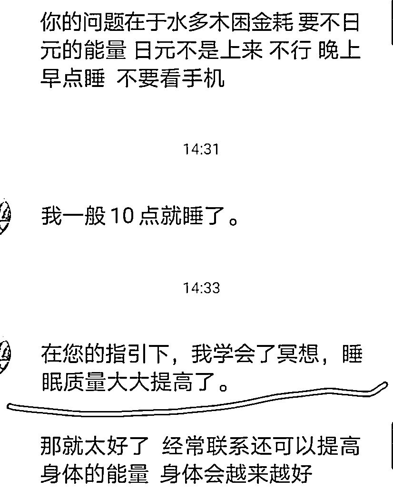

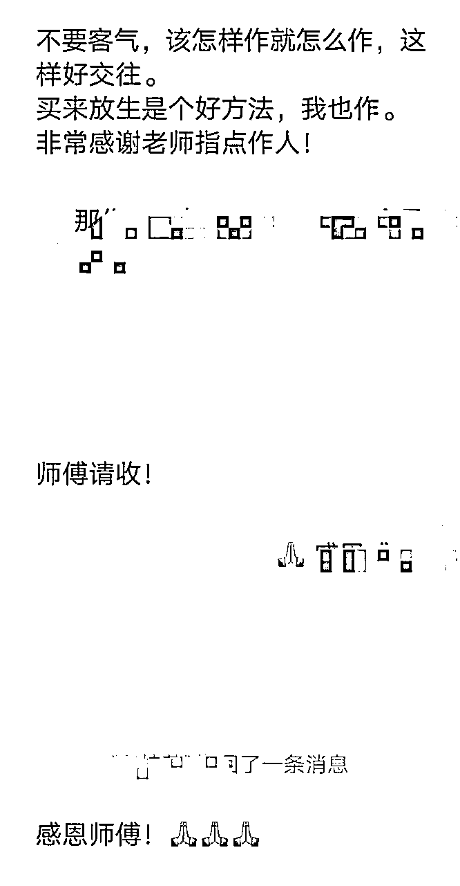

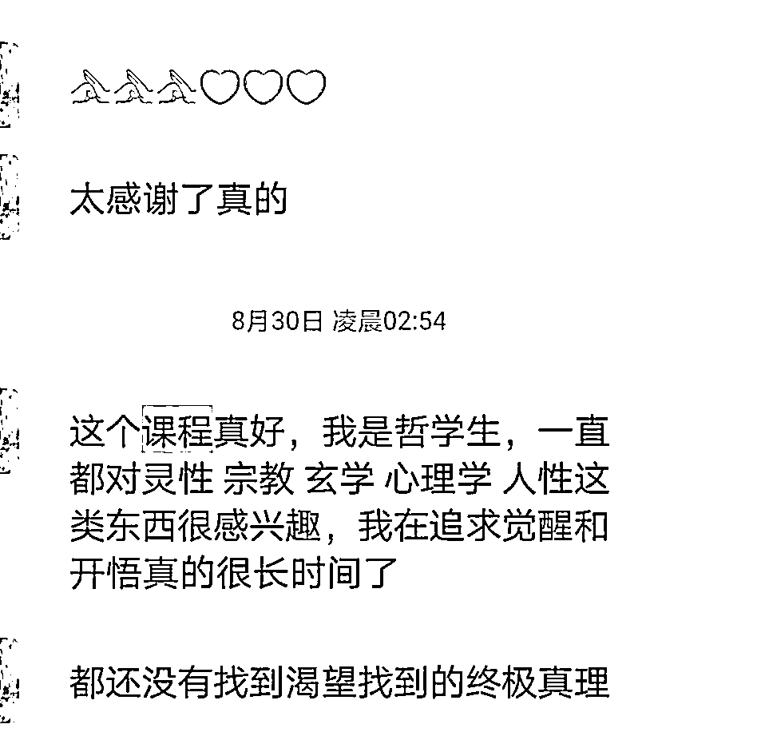

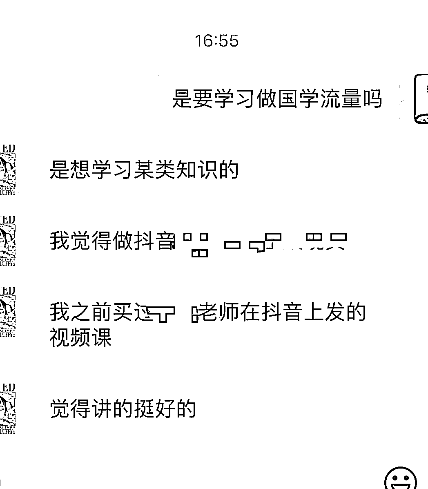

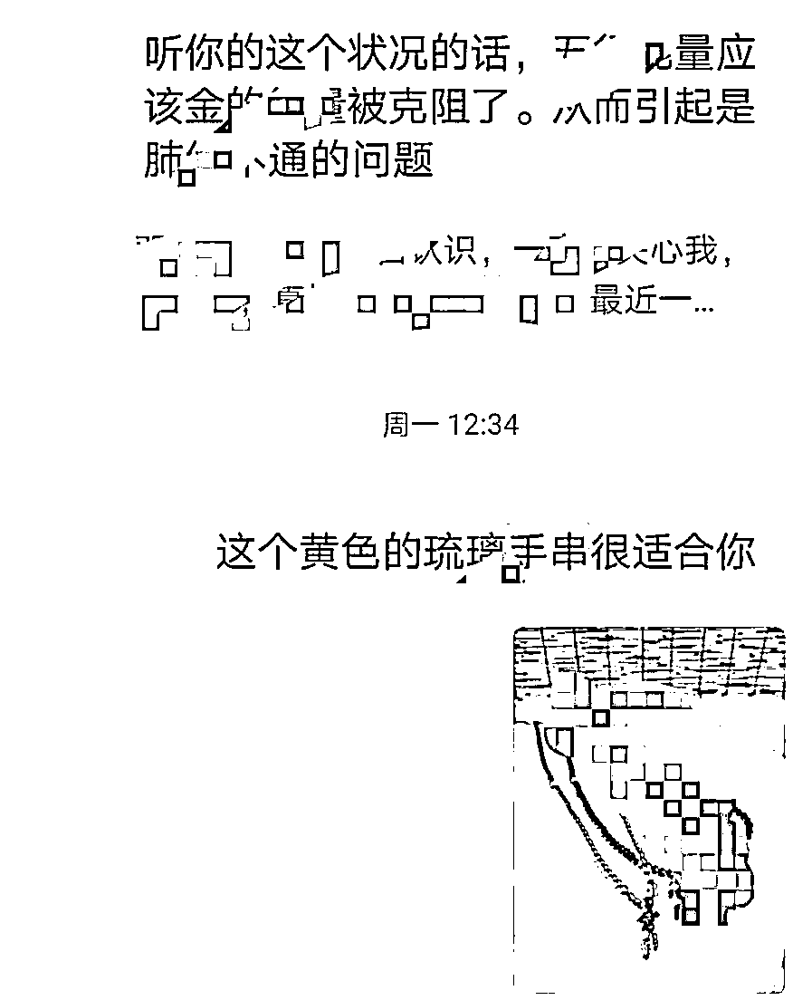

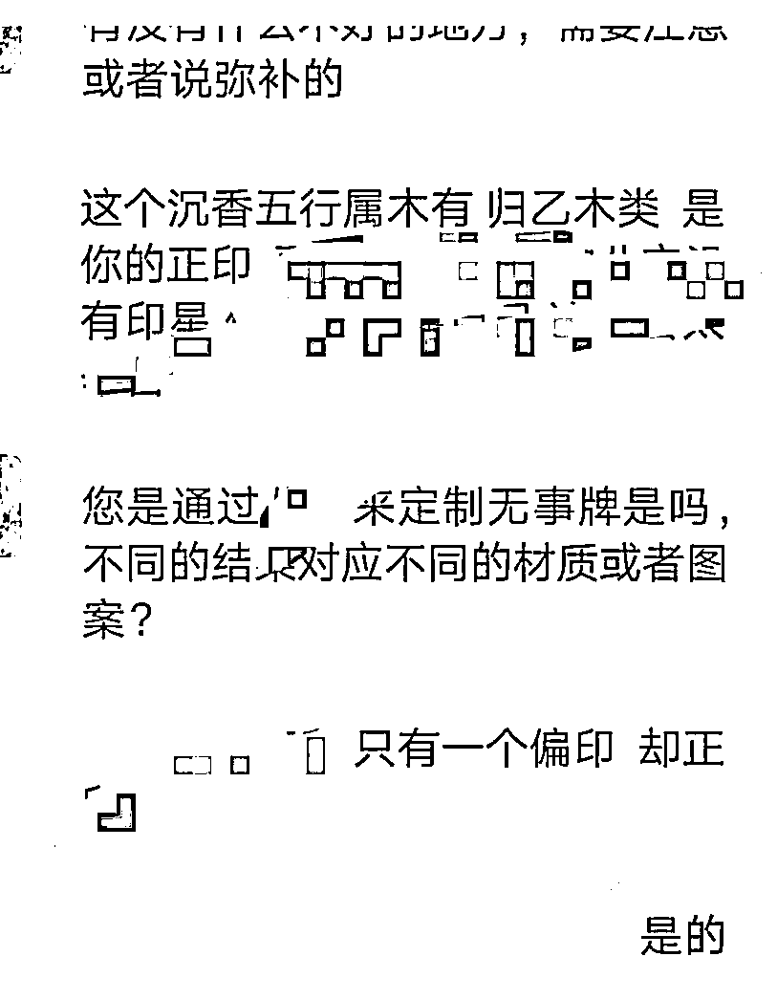

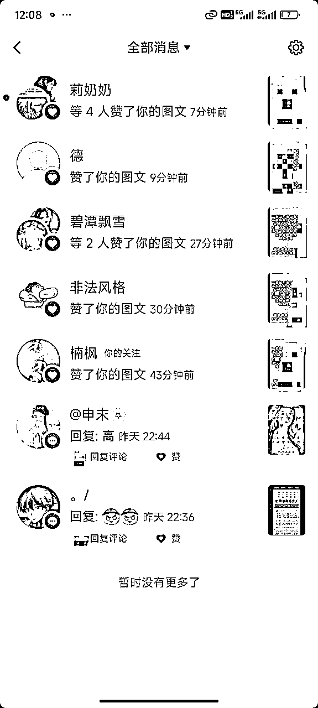

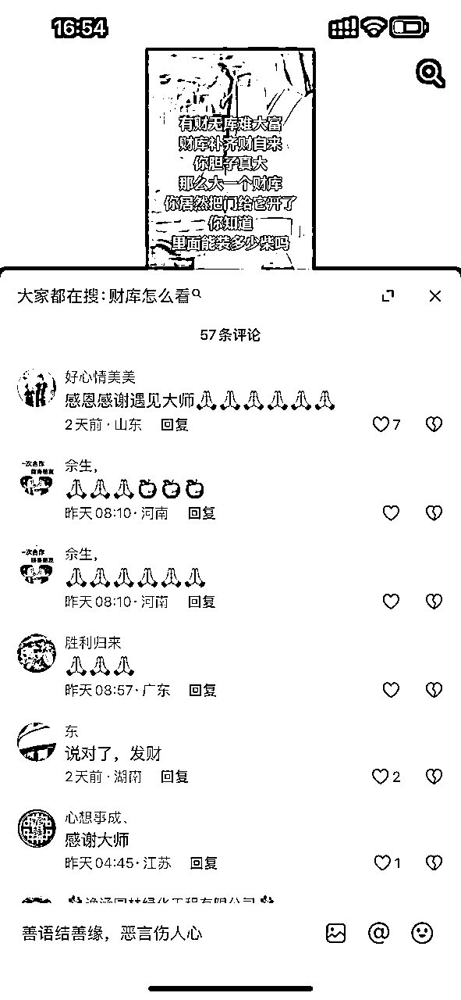

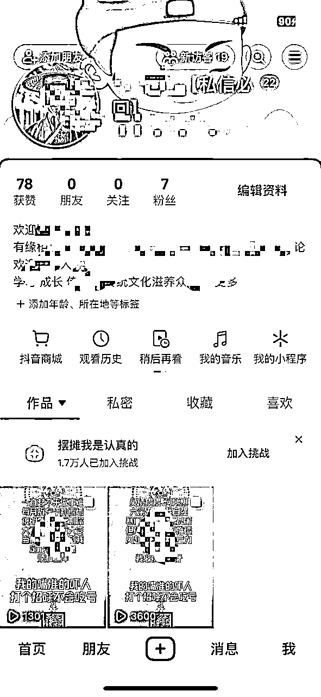

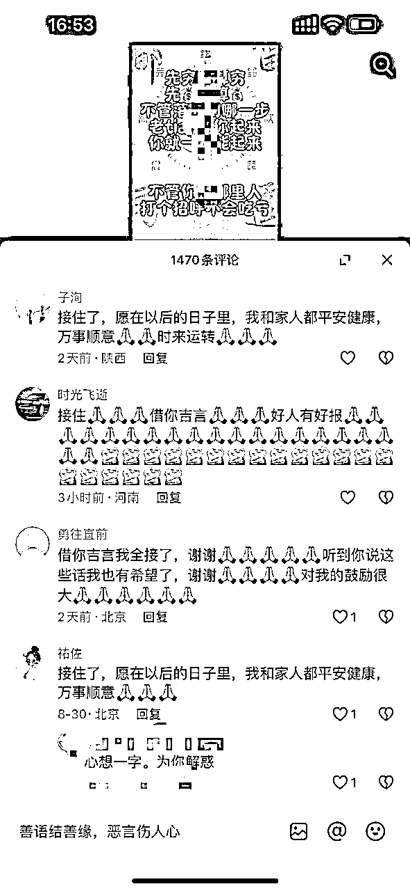

整套流程核心就四个环节：账号环境准备、权重测试、素材克隆、发布评估。我们用的是废号流+小/国流量测试的打法，最终目的是给沉香、琉璃、朱砂这些产品引流，用“买课送咨询”做转化钩子。

第一步，设备和账号。

手机必须干净，没被封过。如果以前封过号，一定要刷机再重新注册。一个批次同时养3个号，普通电话卡和流量卡都行。网络环境也得干净，不然账号容易异常。

还有个更省力的玩法：把账号分散给不同城市的人，你提供素材，让他们每天发内容，最后按比例分润。这样既规避了设备限制，也能批量铺量。

第二步，模拟真人养号。

每天去搜国//学、八字、易学、道友这类关键词，刷对应视频，正常点赞、评论、关注。关注时特意挑那些长期不更新的号和新起的同行号，免得被同行发现拉黑。

刷首页如果刷到不相关的内容，一律长按选“不感兴趣”，直到首页刷到的全是赛道相关内容，就算养得差不多了。

第三步，测权重和流量。

发布播放量是账号权重的核心指标。播放能过200就算正常，低于200要继续养。如果反复测试流量都上不去，就直接注销重开，别恋战。

可以用普通内容来试水，比如发几张生活照片，打上#国//学话题标签，看看自然流量表现。

第四步，选素材和建内容库。

优质素材从哪来？优先找半个月内刚起号的低粉爆款账号，这类账号通常意味着同行也在测试新内容形式，参考价值极高。然后选近一周点赞最高的图文，说明是当下最能吸引人的内容。

选好素材后做像素级模仿。不只是抄文案，连头像、简介、昵称这些包装都要复刻到接近。重点研究评论区置顶和小号水军带节奏的套路，学会他们的互动引导方式。引流设计也要模仿，比如把微信号伪装成合集名，或者在群聊里发微信号。

内容库至少准备20条。量不够就手动采集，用截图、文案提取工具把素材统一存进自己的库里，随取随用。图文可以靠可画这类工具批量做，效率翻倍。

第五步，发布和复盘。

发布时间直接参照对标账号的节奏，摸平台规律。然后给自己7天测试期。如果流量跑得不错，就加大发布频次，同时优化素材和敏感词，尽量延长账号寿命。如果流量还是很差，不用犹豫，注销重起，重新走养号流程。

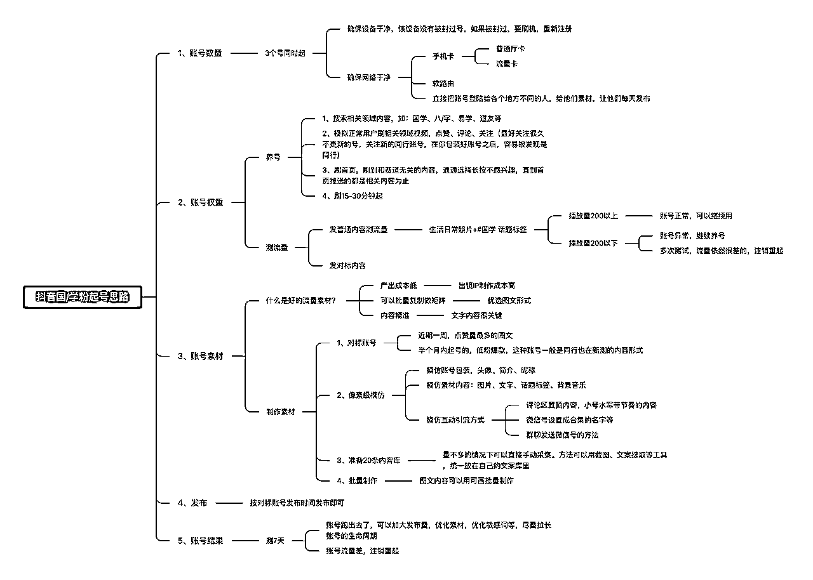

以上就是我们团队内部正在用的起号方法论。关于国//学、疗愈这类赛道的更多干货，以后有机会我再接着分享。我一直待在一线，录课、咨询、研究流量、学新东西、开会、找人才、找货源、谈合作……确实还没做到前辈们那种轻松状态，但也在慢慢进步。今天抽空写了这篇小分享，希望能帮到需要的朋友，感恩赚钱圈友们的陪伴。