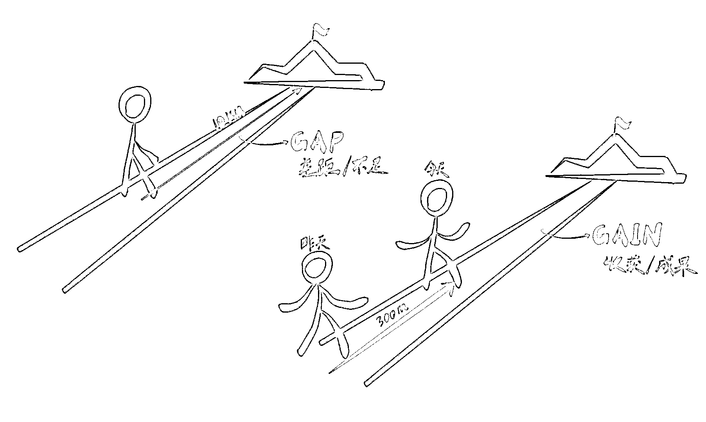
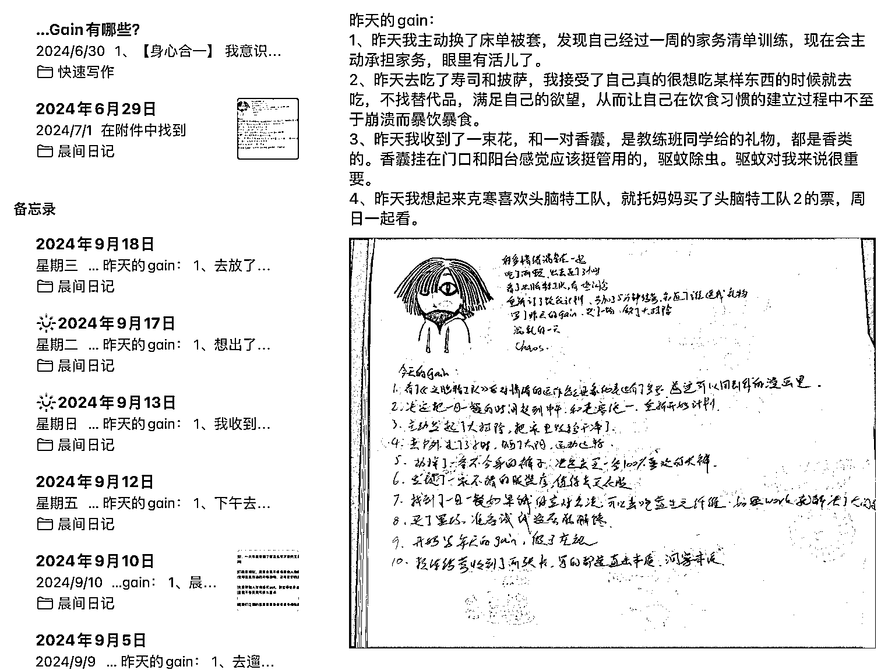
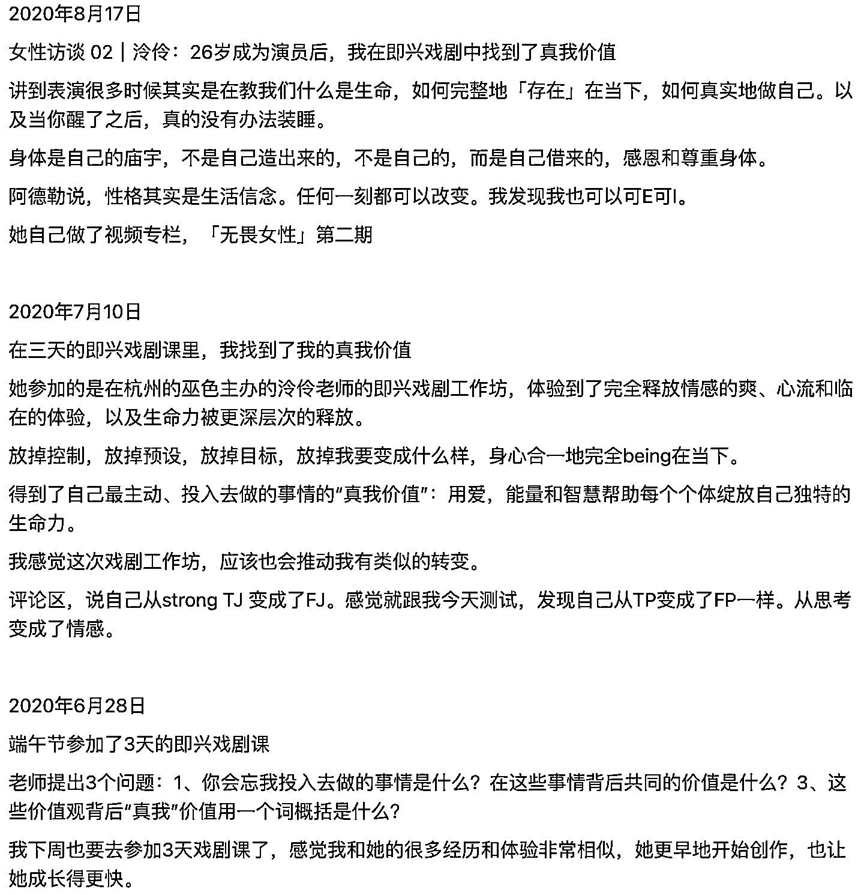
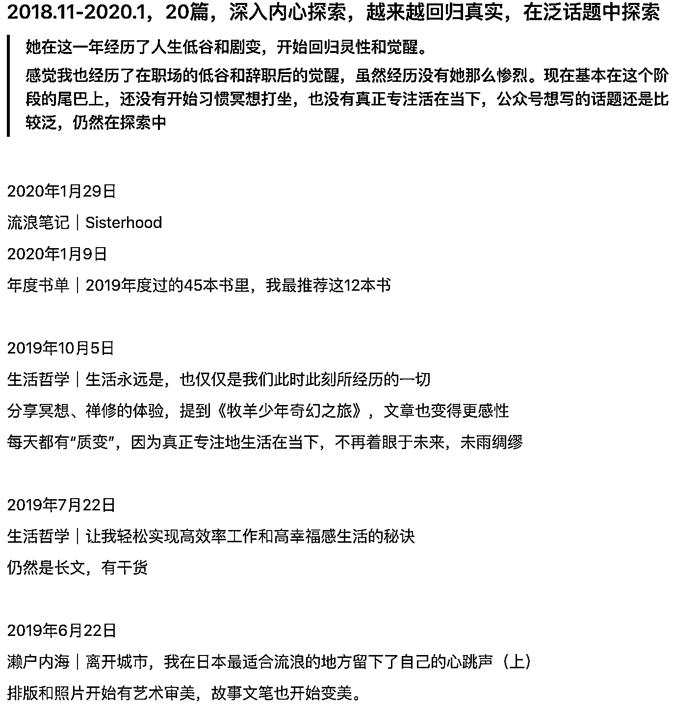

# 从一看赚钱帖就焦虑，到把信息当宝藏：我靠这四步完成了心态翻盘

有大半年没点开知识星球了，昨晚滑开赚钱有术，一篇篇帖子刷下来，越刷越精神，像揣着口袋进了矿山，左一铲子金砂，右一铲子宝石，随手记了不少笔记。搁在以前，这种刷法早就让我心浮气躁了——为什么别人赚钱这么容易？为什么我连模仿的资格都没有？作为一个高敏感体质的人，我太懂那种被信息砸到喘不过气的感觉。可就在这一晚，我清晰地意识到，我对信息的反应方式，已经和从前完全两样了。

回头找原因，最先浮出来的，是两套思维模式的切换：Gap 和 Gain。这个说法来自《10x Is Easier Than 2x》，去年夏天读到时就拍大腿：原来我一直活在 Gap 里——习惯性地盯着“我和理想标准差多少”“我和牛人差多少”。结果要么拿别人碾自己，觉得“反正追不上”；要么拿目标卡自己，觉得“不到满分就是零分”。于是越看越自卑、越看越焦虑。而 Gain 想的是“今天的我比昨天多了什么”，目光放在已经拿到的成果上，接下来关注的自然是：我突破了什么、欣赏到了什么、还能再做点什么。同样是看一篇赚钱帖，Gap 模式看见的是“他好强我太菜”，Gain 模式看见的是“这个思路我也可以试试”。

举个例子：你跟了一期航海，打卡三天后没坚持下去，很多人会忍不住骂自己半途而废。但换个视角——愿意报名、还下场行动了三天，这本身就是 gain，就比三天前的自己多了一截经验，也离理想中那个能赚钱的自己近了一步。这么一想，心气儿就顺了。

道理好懂，但真正把思维拧过来，靠的是三个笨功夫。

第一个笨功夫，是在晨间日记里加了一项“昨天的收获”。一开始，这一栏常常空着，咬着笔杆也凑不满三行。先生给我下了死指标：至少写五条。于是我开始把“去湖边散步发现云很美”“遛狗时间挪到下午，晚上免受蚊子骚扰”“自己做饭没点外卖”“学会了巴氏刷牙法”全写进去。起初觉得这哪算收获？可写了三个月，我承认：没有一天是白过的，那些不起眼的小事在暗暗推着我往前走。后来这个习惯也“传染”到了搞钱心态上——我不再只盯最终回报，朋友圈写得更顺、早上工作更高效、学会给自己安排休息日，这些统统算 gain，统统值得被记一笔。

第二个笨功夫，是近距离观察朋友的成长史。有位朋友创业前是什么样的？读书时怎么打基础、家庭给了什么底色、性格里有什么光斑、做过多少被看到或没被看到的尝试、又失败了多少次——这些统统是冰山下的部分。我接触得越深，越明白所谓“短短两三年做起来”，不过是冰山上的一角；没有人在毫无积累的情况下突然起飞。以前我只看到“人家成功了，我没成功”，情绪自然上头；现在我会问自己：他走过的路，哪些是我也能慢慢走的？

第三个笨功夫，是拆解一位关注多年的博主。我从她2014年写公众号开始，把十年来的文章按日期、标题逐个誊进笔记，再补上一两句批注——写她思维的转折、内容的调整、商业上的试错，也写我的共鸣和启发。十年，就这么一行行在指尖过完了。

（博主拆解笔记节选）

这件事给了我三个特别重要的认知。第一，改变哪里是直线爬坡？它更像螺旋上升，走两步退一步，退过泥潭，才真正换了筋骨。第二，人一旦起了想变的念头，这个念头就会像种子一样自己寻找阳光，“念念不忘，必有回响”不是空话。第三，我现在的段位，大约就在这位博主的2020年上半年。拿今天的她和我比，当然会被碾压；可拿2020年的她和我比，我不仅不慌，还看清了接下来该练什么。

这三个笨功夫，让我逐渐接纳了自己的节奏。每个人当下的课题都不一样，有人要搞钱还房贷，有人要处理亲密关系，有人要先走出职场阴影。我当时的最大课题，是把自己的身心从“坑里”拉出来。离开职场后，我选择休整整整一年：学怎么真正休息，去看医生、针灸、吃药，搬进青山绿水的地方住，靠自然疗愈；交了一群按自己节奏做事的朋友，第一次知道不做一个“有用的人”，也会被喜欢；也把积压多年的家庭课题谈了一遍。还干了件特别“没正事”的事——打了三个月《塞尔达》，直到地图百分百。那种玩到尽兴、彻底放空的体验让我意识到：世界是旷野，不是一座步步高升的金字塔。

也正是因为这种体验，我才真正读懂了硅谷王川那句话：人真正追求的，其实是身心自由流畅的状态。做自己感兴趣的事，拒绝不喜欢的，把做事变成游戏，按自己的节奏学与玩，顺便赚越来越多的钱。所谓经济自由，只是这个过程的副产品。先把心里的坑填平，从-10、-100拉回0，我才从“再不赚钱就完了”的恐惧驱动，变成“我想创造价值、想看看自己能玩出什么名堂”的爱驱动。

这个过程中，我最想告诉自己的是：无论走得多慢、绕了多远，都别骂自己。我做过很多次教练对话，也给别人做过，最终相信：没有哪个行为背后没有积极意图，没有人会故意绊自己一脚。所以，去听听心里那个声音在想什么、想要什么，先理解自己，再找方法。判断自己的节奏本来就是主观题，没有标准答案，更不用要求每一步都精算投产比。模糊的正确就是正确，往哪走都是往前走，停下休息一段时间，也是往前走。

心态稳了以后，还有一关要过：把“别人怎么看”换成“我要什么”。过去我的内心天天被情绪冲刷，一天一个主意，生怕漏掉赚钱信息；现在我知道，那种时候最该做的不是刷帖，而是回到自己身上。我做过很多任性的事：连续三个月什么都不干只玩游戏，赖在家里无所事事，重新画画，把想买的心愿单一次性清空，跟妈妈划清楚我们各自的课题——我怎么活是我的课题，你怎么反应是你的课题。这些事让我一点点长出主体性，重心终于落到自己身上。

现在看到再“营销味”重的帖子，我的第一反应也不是反感，而是阅读它传递出来的信号：这个标题夸张了，我以后要避雷；这里的商业思路有点意思，可以开开眼界；数据可能有水分，但模式没准是真的，这不重要。一切都变成我的资源。

最后一步，是亲手做完一件完整的事。过去这一年，我做了很多以前没做过的事：做一顿色香味俱全的饭、写几篇文章、试着连续早起、打牌输光筹码……每完成一件，都更加佩服那些能把同样的事长期坚持下来的人，他们比我在字面上理解的还要牛得多。回到知识星球再看那些赚钱帖，我看到的不是“炫耀”，而是一群真的把项目做完、跑通、迭代、还愿意写出来分享的人。天啊，这么多宝藏就在眼前，我要一个个去挖。

当然，一个人的转变不可能靠三两个因素。我能回忆的，只是对我有效的东西。如果你跟我一样是高敏感、容易想太多的人，不需要照单全收，找出让你心里“嗡”一下的那一条，在重要的事情上狠狠下重注。哪怕只是每天记录几条收获，也可能会在某个清晨，让你发现自己已经走了很远。这篇写给所有被焦虑困在信息洪流里的人，要是它恰好能给你一点松绑，那就值了。

