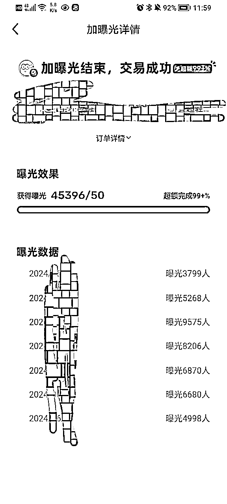

# ('给赚钱航海的见面礼——流量篇', (2, 16))

大家好，我是陈不胖，赚钱六月闲鱼高客单价航道的教练。这次因为一些个人原因，没法全程陪着大家在闲鱼里打怪升级了。不过，精神支持必须到位——就像《亮剑》里楚云飞说的：不管谁在攻打平安县城，这个场子我必须帮。所以有了今天这篇内容。

本来想聊的选题有好几个，比如心态、转化、客户维护等等。但复盘了一下，多数人启动项目时第一个拦路虎就是流量。有了流量，心态自然就稳了；有了客户，转化自然就出来了——毕竟销冠也都是客户真金白银喂出来的。所以今天只聊流量。虽然我是干闲鱼的，但这里面的底层逻辑，放到任何公域平台都成立，希望能给大家一点启发。

我带团队一向信奉：思维决定动作，动作决定结果。所以这篇文章主要讲思维层面怎么看待流量，方向对了，哪怕每天只拱一步，也能到终点。

这篇主要有五大块：

1. 市场从来不是死水，而是流动的海洋
2. 流量不是起点，而是内容质量的回报
3. 及格线人人够得着，但流量偏爱满分选手
4. 别迷信玄学，用数据科学地拿流量
5. 小步快跑，迭代快才是互联网的杀手锏

**一、市场不是死水，是流动的海洋**

上个月龙哥在小灯塔计划里说，他有时想写又不敢写，怕自己的观点带偏圈友。说实话我也有同感。虽然我的影响力远不如龙哥，但同样怕因为自己不成熟的认知，耽误了别人赚钱。这种谨慎来自我混迹闲鱼四年、在网上冲浪七八年的体感：市场从来不静止，表面看着风平浪静，底下全是暗流。

为什么这么肯定？因为市场的最小单元是每个活生生的用户，而用户的需求一直在变。这个变化路径基本是：从无到有，从有到好，从好到更好。

你看：
- 短视频领域，17年的爆款拿到24年根本翻不出水花；
- 数码领域，触屏手机一出来，按键机就慢慢退场；
- 闲鱼里，生命周期走完的链接，短期很难再爆。

这些背后都是用户需求的剧烈转移。而需求一变，市场风向就变。谁能提前感知风向，谁就能吃到下一波份额。当年的iPhone 4横空出世，等于直接打断了诺基亚的腰，靠一次重新定义手机的大创新，让苹果稳坐龙头到今天。所以现在各大手机厂商年年砸钱搞研发、搞创新，图什么？还不是怕在下一个时代掉队，于是主动迭代、被动内卷。

市场变化主要来自两个推力：一是用户需求变了，二是同行相互卷。如果你不明白同行卷为什么会改变市场，我举个例子：

假设客户的需求是1块钱。最开始没人发现这个需求，某个商家发现了，开始给客户1块钱，客户全涌过去了。其他商家一看，也跟给1块钱，市场重新平衡。这时候新商家想：大家都给1块，我这是没戏，那我给10块。于是客户又全跑了。……循环下去，总有人出更高的价来抢流量。

这里说的钱不是真钱，而是产品价值——产品价值高低，取决于你解决了多少用户需求。两者互相作用，市场就变得完全不可预测。

这个变化给我们几个教训：

一是，以前的经验不一定适用于当下，不管这话是谁说的，放到市场里验一验，去伪存真。
二是，要主动求变。大家都在给1块时，你要敢给10块。不断满足新需求、解决新顾虑，就是在抬高产品价值。
三是，要练出挖掘需求的路径。就算赛道不好，你的洞察力和路径依然在。可以在同行的产品表达里找需求，在和客户的聊天里找顾虑。

闲鱼上很多爆款链接有生命周期，要么是同行找到了用户的新需求，要么是同行内容表达更牛。当然也有一种少数情况：你被全平台抄袭、被截流了。但不管哪种，核心都是出现了比你更优秀的产品表达，把流量抢走了。市场竞争就是这么残酷。

小tips：如果你的实体产品卖点改变不了，那就死磕产品表达，看卖点信息有没有传递到位。

**二、流量不是根因，而是内容好的结果**

很多新手在第一次做项目时，容易掉进一个逻辑陷阱：我的内容没人看，所以没流量；没流量所以没客户；没客户所以不赚钱。结论就是，我得搞流量。然后就开始搞各种谣言玄学，比如账号权重、活跃度、每天做任务增加权重……打住吧朋友们。

平台不会因为你多买几件商品就给你分流量。平台分给你流量的唯一原因，是你能帮平台留住用户，符合平台的利益。

每个平台都有两种角色：提供价值的人（卖家/博主）和消费价值的人（用户）。抖音的博主是提供方，用户是消费方；闲鱼的商家是提供方，用户是消费方。但大多数公域平台其实不缺卖家，缺的是买家。因为商人逐利，平台只要有流量，商家自己就闻着味来了。这也解释了为什么抖音卷成这样，自媒体人还是首选抖音——因为流量就在那儿。

另外，平台的流量是有成本的。转转在抖音投广告，要给博主充值；抖音前期拉新要砸钱；拼多多让人砍一刀砍到怀疑人生……这些都是成本。所以平台给流量，本质上是在算账：你能创造多大留住用户的价值，我就给你多少流量。

那么问题来了，谁来判断价值高低？目前主流的平台都是把用户行为变成数据，再用数据赛马来决定。以闲鱼为例，数据面板就三个：曝光、浏览、想要。曝光是看到的人，浏览是点进来的人，想要是来咨询的人。每个环节都是用户动作的量化，环环有转化。平台拿这些转化率和同行比，好的进下一个流量池，差的留在原地，避免伤用户体验。

之前有学员说闲鱼币推广没用，用了也没新增流量，第二天还退币。说白了，就是内容太差，平台不能为了赚你那点闲鱼币，把用户推给垃圾内容。换位思考：你装个App，满屏都是无用垃圾，你留得住吗？

另外，只要有货架电商，就免不了有人刷单，因为刷单确实能影响数据，让系统误判链接优秀，然后给流量。所以屡禁不止。但这种做法能不用就不用——就算你刷来了流量，内容不行，真实用户不点不咨询，照样白搭。

我们接着说。既然数据是用户动作的量化，那提升数据就是提升用户动作的概率。用户为什么产生动作？还是靠内容、靠信息传递。小红书的首图和标题、货架电商的主图、知乎的开头为什么那么重要？因为用户点进来之前，能看到的就只有这些信息。我们要做的，就是通过信息传递，刻意引导用户点击，让用户主动产生数据。公众号标题和首图同理，抖音前5秒讲清主题同理。

所以：内容够好，数据就会好；数据够好，平台不给你流量，难道给数据差的吗？结论很简单：流量是你内容优质的结果，不是项目失败的原因。把心思放在内容优化、数据优化上，没人能挡得住你拿流量。

**三、60分容易够着，但流量偏爱100分**

其实搞流量和赚钱本质一样：先提供价值，再顺手收获结果。前两天刷抖音，看到一个采访头等舱乘客的博主，问成功人士对年轻人有什么建议。被提到最多的答案是：“把眼下的事做好，钱自然就来了。”我当时觉得是鸡汤，琢磨了一下，还真不是。

商业的本质是价值交换，价值由稀缺性决定。这社会样样通样样松的人太多了，真正缺的是在一厘米宽的地方挖一万米深。挖到一万米，你就稀缺了，就有价值了。流量也一样。平台从来不缺内容，缺的是真正好的内容；市场从来不缺产品，缺的是真正好的产品。所以搞流量，就是要用100分的内容，去碾压60分的市场。

雷军在《小米创业思考》里讲过一个故事。他邀请一位技术大牛做空气净化器，大牛觉得这玩意儿太简单，凭自己的技术做这个丢人。雷军劝不动，就让他先去市场逛一圈再说。大牛逛了两天，回来特别兴奋地说要做。雷军问为什么，大牛说：市场上那些净化器做得太简陋了，外形也丑，就这也敢卖四五千，我随便做做都能甩它们几条街，这个产品不可能不赚钱。

我读这本书时还留意到，小米的几个现象级产品，比如充电宝、手环、巨能写、空气净化器，在推出之前，市场上同类产品已经存在，而且价格不低。雷军的第一反应多半不是利润空间大，而是这东西做得太烂，还有巨大的优化空间——换句话说，他觉得这些产品只有60分。可60分都能占住一席之地，那做到100分，岂不是能抢下大部分份额？

所以雷军的选品逻辑，就是挑市场上已有的、优化空间大的产品，然后动用资源把缺陷补上，做到当下的100分。雷军选品是为了卖，我们选品也是为了卖，本质上没区别。只不过雷军能改产品本身，我们只能改产品的呈现方式。所以我们应该去找那种“内容呈现只有60分，但市场仍然有”的品，然后用100分的呈现去碾压它，事半功倍。

很多时候，不是产品没机会，而是当下水平的你没机会。真正的机会，在于你对内容的掌控力。新人在0到60分阶段，靠抄、靠模仿就能到达。但简单就意味着平庸，意味着不稀缺，没价值。所以前期模仿没流量，太正常了。但这过程绝不是白费，它恰恰是你能不能做到100分的关键。

我让学员找对标或抄同行时，总跟他们说：透过数据看内容，透过内容看心理，把自己代入客户的心智里。做互联网常讲“网感”。同样一个选题，网感好的人发出去就爆，网感差的人发出去就凉。我认为网感的本质，就是你对客户心理的了解和判断标准。网感好的人，知道受众爱看什么，然后调整内容侧重点。

网感怎么练？就是在0到60分阶段，不断透过数据看内容、透过内容看心理，反复否定、反复迭代。事实上，任何一个项目都经不起连续50个对标的拆解。之前抖音有个赛道很火：把视频的点赞、收藏都抹掉，让老外猜数据是多少。我觉得这个方法极好。我们培养运营时也这么做：把内容数据打码，让他猜，再对照真实数据。如果真实数据比猜的高一大截，说明这条链接里藏着你没察觉到的用户心理。然后再回去拆解内容，分析心理。

除了基础训练，还有一个节点能快速洞察受众心理，那就是“异常值”。前面说过，数据背后是用户动作，用户动作一定有诱因。异常值本身就是一种心理信号。还记得那个1块钱和10块钱的故事吗？当大家都给1块，某个商家给了10块，用户蜂拥而至。这里的“蜂拥而至”是结果，10块是诱因。你要找到那个能造成蜂拥而至的10块钱。

另外注意，衡量“标准”要和市场同步更新。因为市场一直在变，标准也得跟着变。

**四、别信流量玄学，用数据科学提流**

前面已经论证过：平台靠数据赛马分流量，数据是用户动作的量化，用户动作靠内容触发。所以内容好=数据好，数据好就不可能没流量。基于这个逻辑，没流量时首先要解决内容问题，而内容优化方向就藏在数据里——数据本身会说话。

我们用数据演示一下。假设你链接的数据是：曝光8000、浏览80、想要3、下单1。你拆解对标爆款时，认为标准比例是：曝光:浏览:想要:下单 = 1000:20:3:1。然后一算：爆款点击率2%，你只有1%；爆款浏览咨询比15%，你只有3.75%。哪些环节丢用户，清清楚楚。点击率不行，就去调主图和标题；咨询不行，就去改文案和配图。优先调整点击，因为用户连点都没点，后面什么都不会发生。

还要注意：闲鱼里单一数据高没用，得整体数据都好，才具备爆款潜质。只要内容足够优秀，平台会自己想办法帮你找流量。

至于同城流量、定时上架、每天打卡做任务，这些可能多多少少有点用，但如果主图不行、用户不想点，给你百万曝光也是白费。不如静下心来，深挖内容，琢磨用户心理，把数据转化做好。

**五、小步快跑、快速迭代，才是互联网的武林秘籍**

雷军在《小米创业思考》里总结小米方法论，核心之一就是“快”。这个快不只是行动快，更是迭代快。因为迭代复盘本身就是在不断试错、不断寻找用户的新需求点。哪怕第一次考零蛋，多迭代几次，总能及格。怕就怕完美主义，非要憋大招，一出手就要满堂红。

后期你当然可以追求完美，但那是建立在你已经足够了解市场、足够懂用户心理的前提下。如果前期还在蒙圈状态，硬要憋一个完美内容，大概率创作周期一拖再拖，而市场变化从来不等人。外部环境变了，内部还不变，结果多半很惨。希望大家别走上这条路。

一个阶段干一个阶段的事，别替未来的自己瞎操心。

最后，祝大家在这次航程里顺风顺水，捷报频传。再附一个我此前拿到的闲鱼精华，希望给做闲鱼高客单价的朋友一些帮助：

https://wx.zsxq.com/dweb2/index/topic_detail/811218581824512