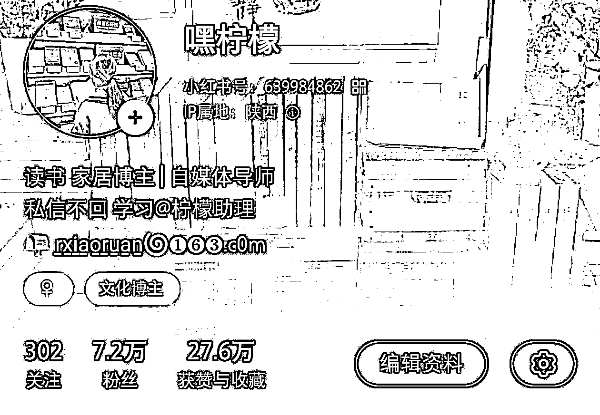

# 普通人也能把小红书做到10万+，我用亲身经历示范了全过程

> 来源：[https://ccn8e4v677xb.feishu.cn/docx/Rj4kdlz62oKh9axQyVNcSbLxnXd](https://ccn8e4v677xb.feishu.cn/docx/Rj4kdlz62oKh9axQyVNcSbLxnXd)

# 一，自己先说清楚

大家好，我是柠檬，很高兴能加入赚钱，和各位交流心得，这是我第一次在这里做分享，先简单自我介绍一下。

现在我是一名全职的小红书博主，再过两个月我就满30岁了。古语有三十而立，现在能不靠家庭背景在30岁就站稳脚跟的人，真的很少。

而我很确定，我的30岁会是心安理得的。

2021年初，我女儿一岁半那会儿，我开始琢磨做自媒体。起初选的是抖音，拍素材、剪视频、配音，忙得挺热闹，结果热闹过后数据平平。后来我转到小红书，先后试过美食、母婴亲子、女性成长、穿搭，最后定格在读书赛道上。

说实话，当时的我并不是一个资深读者，算得上是刚入门的新手。但我有新媒体运营的工作底子，加上从小爱写的习惯，很快就上手了。不到一个月涨了三千粉丝，也接到第一批商务合作，稿费虽少却有了起色。可那点收入养不活家，我只能先回到公司上班。

那半年的职场生活很紧凑，白天在岗位上，午休挤时间写稿，孩子睡下后又起来读书拍片。那段时间我几乎把自己拆成三份用。直到兼职的稿费超过了正职工资，我毅然裸辞，从此没有再回过职场。

现在外界称这种工作是自由职业。对我而言，它更像是多维度的铁饭碗。想在哪儿开始工作就开始在哪儿结束，只要持续输出就不会失业。没有KPI考核，不用接受上司的压迫，也免去同事间的勾心斗角。

几年下来也算有点积累。全网粉丝破十万，打造出了读书博主和家居博主两个个人IP，借小红书实现变现五十万。

如今我每天只工作四小时，其余时间全部留给自己喜欢的事，实现了用30%的时间赚钱，用70%的时间生活，副业真正成了能养活自己的主业。

很感谢自媒体给了我这一切。

下面就把我实操的步骤拆开来说。

# 二，赛道怎么选

先把赛道定下来，因为赛道决定了账号未来的走向。选对了方向，就等于锁定了内容的核心。

我最后落到读书，是因为这个赛道的门槛相对友好，技术要求不高，不需要额外去学太多新技能。只要能读懂书，并把内容提炼成一篇八百字左右的笔记就够了。

赛道确定后就要开始做内容。我做读书，日常发的内容都围绕阅读展开，可以发得面宽一点，比如读书日常、书桌布置、阅读心得、运营经验、干货汇总。绝对不能跑偏，比如跑去发育儿经验、个人Vlog、母婴内容，这些和读书关联度太低，就不适合出现在同一个号里。

账号越垂直，吸粉就越精准。简单说就是，你是什么样的人，就能吸引到什么样的人。

# 三，选题先赢一半

赛道确定了，下一步就是选题。爆文往往起步就在选题上占了优势，内容才排在后面。选题影响点击率，内容影响停留时长，主页影响关注转化。把选题抓住了，就等于把人带进了门。

想做爆款选题，没有捷径，就是多看多写。直接去首页搜同领域的热门笔记，把里面的核心点拆解出来，用自己的话重新表达。写得多了，对话题的敏感度自然会提升。

# 四，起号别等准备好了

很多人起号会犯一个错误，总想准备充分再开工。书桌不够精致先买摆件，书不够多先去囤书，甚至觉得家不够漂亮才不敢做家居号。其实大部分人都是先开号，再把家慢慢改造起来。先准备再出手的人，要么浪费太多时间热情被磨没，要么被自己吓退直接放弃。

永远没有完美的起步时机，觉得不够好就先发出去，后面再慢慢优化。实操的过程本身就是养号的过程，账号会随着创作者一起成长。

所以起号没有固定套路，核心就是边做边试，根据数据反馈及时调整内容。行动力加上迭代能力，就能顺利起号。

# 五，账号基础配置

昵称：简短好记，或者直接体现赛道，比如“xxx的小书屋/书房/书桌”。

头像：和主页调性统一，最好用真人照，能增加信任感，背影图也是一个不错的选择。

背景图：能体现账号风格，比如读书类就用氛围感的书桌照。

简介：分两部分写。第一，介绍自己：过往学历、职业、擅长。第二，说明账号定位：分享书桌、读书日常、家居布置、收纳整理。

联系方式：简介里一定要留下联系邮箱，方便品牌找合作。注意小红书对邮箱有检测，可以像我一样换一种写法留存。

# 六，笔记怎么写

刚开始写的时候记住一点：别把小红书当成朋友圈发日常碎碎念。这里是公共平台，深度和价值才会被看见。更不要为了做自己而做自己，这里不需要自我展示，只需要对读者有用。

那么小红书的爆文长什么样呢？

先找爆文。直接用关键词搜索你所在的领域，比如读书、书桌、书房、阅读角、书单、阅读方法等等，把相关笔记都看一遍。

找到后就要学着模仿。新手写笔记，先学抄，但抄是有门道的，不是照搬。

模仿封面、标题、文案结构和关键词。

抄标题：做久了你会发现，某个阶段里能火的关键词就那几个。标题的核心词确定了，内容的大致方向也就出来了。从爆款标题里提炼可用关键词再组合。

抄主图：一篇笔记能不能被点开，标题和封面要配合。看爆文主图先看风格和构图。比如治愈类书籍的爆文常在阳光窗边拍，我们就可以借鉴拍摄位置和角度，风格接近但保持原创。或者爆文是四宫格加花字，就参考字体、花字位置、排版方式，多练审美和网感。

抄文案框架：决定用户是否停留、点赞收藏评论的还是内容。内容要有价值，可以是情绪价值也可以是干货，最重要的是“利他”。

好的框架通常包含：自己的观点、干货罗列、引发思考、引导互动。有了这四点，不火也难。

# 七，心态要稳住

做自媒体，数据起伏是家常便饭，焦虑几乎是标配。很多人最后不是被技术淘汰，而是被心态淘汰。

我见过发一篇就嫌不火的，也见过做一年没起色的人。前者太急，后者太松。数据波动很正常，心态也会跟着波动，但波动幅度不能太大。如果连续三篇数据都很差，就该反思选题并尝试新方向，而不是发了三篇就否定这个平台。任何事都有周期，要允许它发生。

沉下心深耕内容，才是长久之道。

# 八，坚持比技巧重要

探索新事物像种花，需要时间浇灌。不要因为暂时没成果就心急放弃。

小红书上常说一句话：百篇内必出爆文。

所以别在第99篇放弃，光是坚持这一点，就能筛掉一大批竞争者。

慢慢走总比停在原地强。行动起来，你会从小白变入门，从入门变博主。保持节奏，总有一天你会感谢曾经坚持的自己，也会收获应有的回报。

# 九，最后的话

分享到这里，希望对想做自媒体的你有点启发。做小红书并不难，难的是开始行动并坚持下去。

欢迎在评论区交流，也可以在私信里找我聊聊。