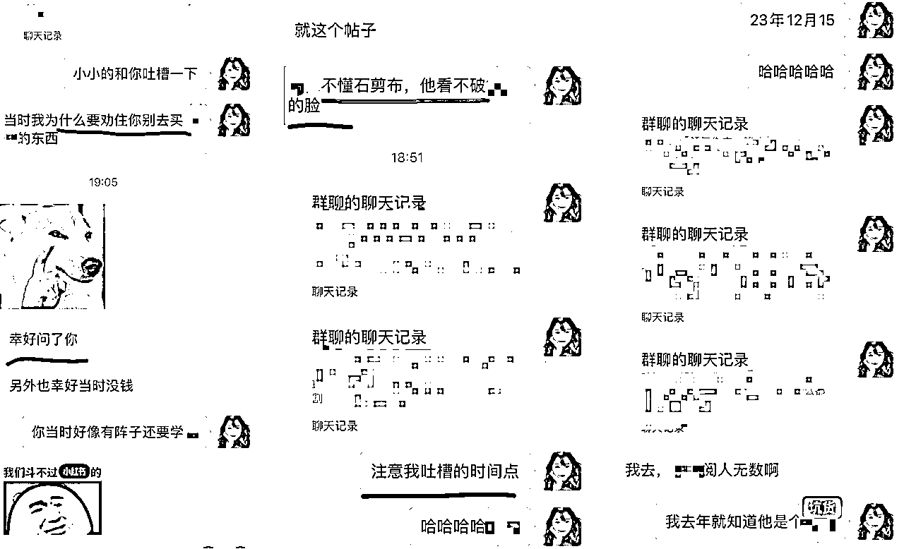
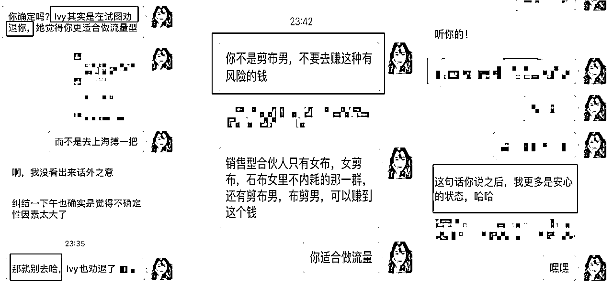
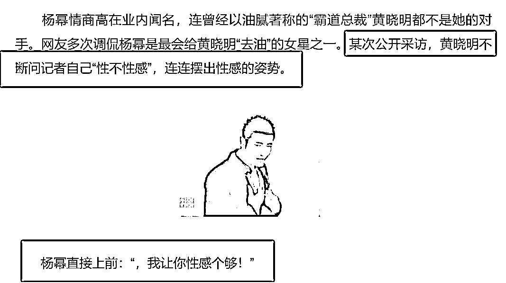
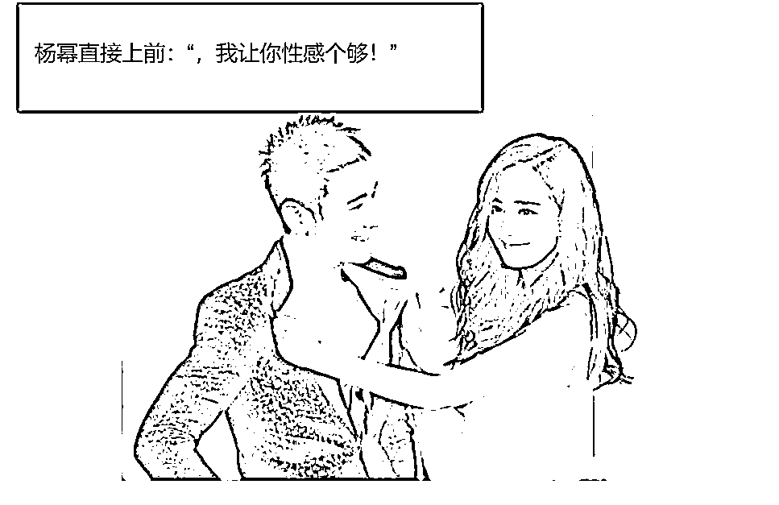
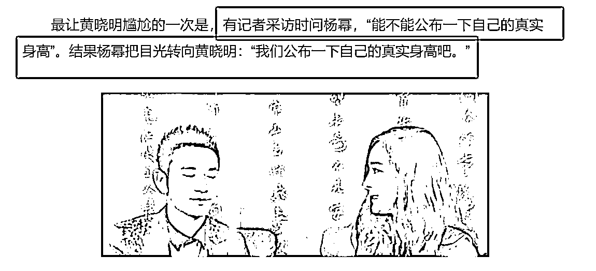
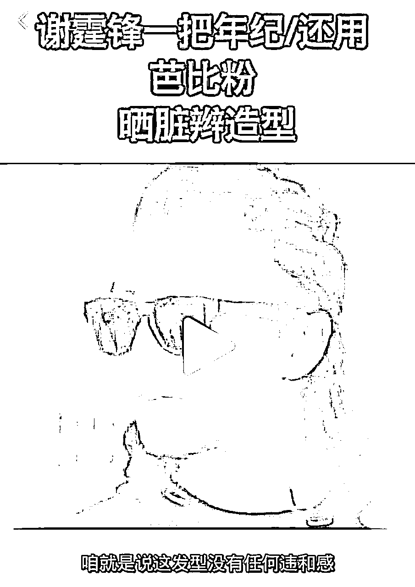
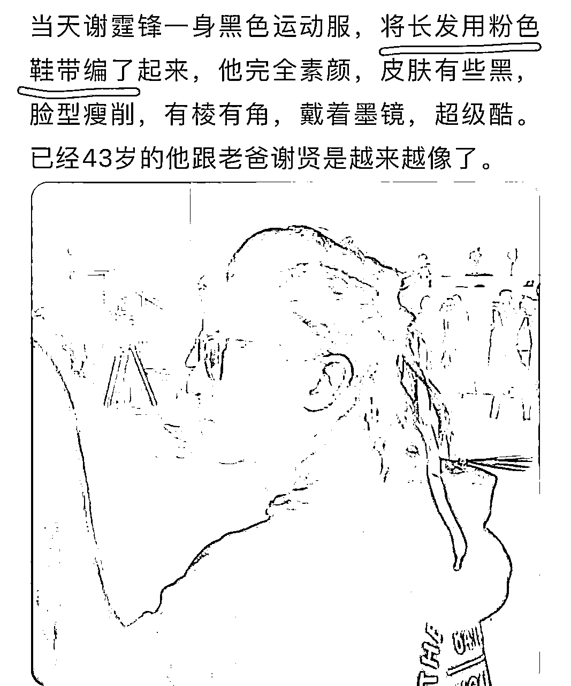

老板们，你有没有被自己亲手招进来的人坑过？

我身边不少创业者都有这种经历。好在踩过几次坑以后，我和搭档总算是摸出了一套判断人的方法。靠着它，我们在留学这条赛道上做到过2700万营收，后来转去卖房，六十天也创下过亿的战绩。方法不算玄，但确实管用。

说一个真事。去年十二月，有位朋友来打听某个人的产品是否可信。那家的货我没买过，可长期围观对方写的文章、发的动态和社群发言，我心里基本有数了。这种话不能直说，我只能含含糊糊点一下。可惜朋友没读懂，照样掏了钱。没过多久，那个牌子果然爆雷。他回来跟我感叹：还是你准。

这不是什么直觉，背后有一套逻辑。当时我还和搭档私下唠过这事：

上图是去年底我和搭档吐槽某人的对话。
后来又有几位圈友来问，我们也是同样的提醒：

上面这几位圈友后来也差点入坑，被我们拦住了。

这套划分最早出自娃姐。光听名字会以为只讲婚恋，其实放到公司用人上同样通透。市面上的测评我也看过一些，它们大多在给人优点点赞，缺点一笔带过；石剪布却敢把人性里不漂亮的那面也摊开。我们当然不是拿它去挑事，而是要提前推演：有人掉到低谷时会做什么选择，那些选择受不受得了。

先补一点基础。
所谓石头属性，好的一面是忠心、肯干、让上哪儿就上哪儿；坏的一面是认死理，你布置A他就只做A，不会多想B。
所谓剪刀属性，好的一面是让周围人轻松、情绪稳定、会哄人；坏的一面是容易只挑好听的说，落地时掉链子，可信度要打个大问号。
所谓布属性，好的一面是行动猛、能推动、一个顶几个；坏的一面是一开口就呛人，爱抢地盘，还不服管。

绝大多数都不是单一属性，而是主次搭配。比如剪刀占四成、布占六成，就叫作剪布；反过来称布剪。同理，石头和剪、布和石头都可以两两组合。

但要想摸清此人底细，光看办公室里的他是不够的。职场就是秀场，人人都能演。真正能暴露底色的，是他在婚姻里、以及长期关系里怎么待伴侣。尤其是位置越高的人，越会分场合切换面孔。倒是基层的人面具薄，聊上几回就能猜到七八分。今天聊的所有判断，都先限定在职场表现上，不扯私人生活。

从运营说起。
运营活儿分很多种，有的偏内容，有的偏用户维护，有的偏项目推进。笼统地说，适合干这摊事的是以石头属性为底、带一点剪刀属性的人。他们稳得住，又能给人好情绪，团队不累。真正要小心的，是那种表面客气、心里极有主意、九头牛都拉不回的。你交代任务，他当下满口答应，交出来的成果却没法看。好的运营，你交代A，他能顺手把B也办了；差的运营，连A都能做成一团浆糊，还以为自己劳苦功高。

关于销售。
干销售这行，能出成绩的，说来说去主要归为两个方向。一类剪刀为主、布为辅，一类布为主、剪为辅。她们的共同点是内核都有那股布性的冲劲，下手快，推进猛。
别以为给这类女生多捧几句、多嘘寒问暖，她就会死心塌地。她们认的，无非两种：要么你明显比她强，还得有视野；要么你肯给真金白银，或砸下实际资源。只有眼光没有付出，她不服；只会说软话，办事却掉链子，她照样走人。
线上卖货，以及线下当面谈单，也不一样。线上拼的是隔着屏幕也能让人安心，所以要更多的剪刀属性；线下的场子需要有人压得住，布属性要更重。
还有一点值得留意：以布为主、剪为辅的男生，跑业务虽然冲劲足，但也容易到处撒网，专注度反而吃亏。以剪为主、布为辅的男生，看着温和，但在关键时刻会突然变得很强硬。
想区分这两种男生，可以看几个细节：他争不争功、抢不抢资源、跟同事是互助还是利用。女生那边也有类似的分野：一种是我很强、你得听我的；另一种是我很强，但我让你舒服。前者会更直接地显露出掌控欲，后者会放下身段来给你情绪养分。女生如果颜值高、能力强，还愿意处处捧着你，那大概就是后者；如果美得很有攻击性，习惯拿身边的人当梯子，那就是前者。

再聊交付这环。
做服务、做细节的交付，适合石头加剪刀的组队。有耐心、能抠细节、懂得安抚客户情绪，就算合格。
做落地、做执行的交付，适合布加石头的组队。能扛事、能推动，又不丢细节，遇事不推诿，就是上佳。
这里有两组容易看走眼的人。
石头加剪刀的女生，和剪刀加石头的女生，差别在压力之下。前者内心稳定、对外柔和，第一反应是先照顾别人心情，但到了该硬的时候也绝不退；后者做事踏实、心里有数，第一反应是先把手头的活干完，嘴未必甜。
男生同理。石头加剪刀的男生，往往厨艺不错、爱带孩子、待客户如沐春风，但别以为他没脾气；剪刀加石头的男生，常常闷头做活，偶尔说话噎人，可交付结果特别稳。

还要小心一类人：表面老实，其实主见极强，而且怨气很重。你刚加上好友，她就要求你出示各种资质证明；买了个便宜货，还指望你倒贴一堆赠品。到了团队里，天天讲老公不体贴、婆婆难伺候、孩子拖累自己、同事针对自己。她们未必存心使坏，但心里依赖太重，内耗又多，扛不了大事。
这种特质不分性别。男性若是这个类型，常表现为表面稳重、内在固执，开口就是怀才不遇，把问题都归到环境或别人头上。
尤其是生育以后，不少女性会短暂滑进这种状态。这不是永久标签，能调整过来。最怕的是不肯调整，非要被现实狠狠教育一通，才被迫把期望值降下来。

这套框架的意义不在于给谁贴标签，而在于配位置。每个类型都有两面，关键是弄清对方怎么想，也看清自己那套，再判断能否搭伙。对方若是朋友，就在他犯糊涂之前提个醒；若不是，别蹚进他的因果。每个人各有各的弯路要走，强行拦下人家要吃的苦，未必是帮忙。

我也知道有创业者会烦：总不能天天琢磨人家两口子怎么过日子吧？确实，所以更实用的招数是看优点背后的短板。某人如果浑身光环、找不到任何缺点，你反而要多留个心眼。他大概率是那种以剪为表、以布为里的高手，而且是藏得很深的高手。

我自己也吃过这套框架的红利。早年的我，依赖感很强，怨气十足，情绪常常笼罩在阴云里。后来被同学一句点醒，才一步一步把自己拽出来。现在谈不上多强，至少清楚要去哪儿、现在站在哪。

能遇到一个舍得点醒你的人，是福气；能真的听进去，是更大的福气。希望你也有这份运气，往后的路，少走弯，少交学费。

在感情和职场的配对里，有一个特别扎心的现象：石头男那种“老婆在哪我在哪”的黏人劲儿，石布女根本扛不住。他们把伴侣当成生活重心，恨不得时刻围着转，严重到影响正常工作。而石布女骨子里并不是真正的核心剪女，所以跟石头男长期待在一起，双方都会很累。

如果你嫌爹味太重，剪子男身上绝对闻不到那股说教气。但反过来，剪子男往往希望你站出来当家作主、扛起大梁。剪布男则自带一种爹味，可这种爹味放在石布女面前，反而成了加分项——比如珍妮自己就觉得：人家条件已经那么好了，带点大男子主义不是很正常吗？

剪布男通常混得很开，事业上常有贵人相助。但在忠诚这件事上，男女版本完全不一样：剪布女对实力雄厚的大布男死心塌地；剪布男却偏偏对布剪女情有独钟——所谓布剪女，就是身份地位高、情商高、颜值也可能很高，但心气却放得很低的女人。

职场上，剪布男遇到剪布女，多半是合作关系。毕竟两边都是核心布，为了工作，其中一方会拿出石头牌：听话、忠诚、指哪打哪。可一旦离开职场，这两类人基本不会有下文，更别说走进婚姻——两个核心布，谁都没法在婚姻里长期向对方低头。除非剪布男到了中年，有钱有资源，娶个年纪很小的剪布老婆，这时候小妻子才愿意把自己变成高级石头女。

在婚姻契约里，剪布男的期待是女方出“布+石”组合：社会地位高、有钱有资源，同时愿意做家务带娃、专一顾家。而剪布女的期待则是男方出“石+剪”组合：在家做饭带娃，事业有没有无所谓，但情绪价值必须给足。说起剪布男的长相，可以参考黄晓明。

再看布剪男。优质的布剪男：给资源、事业心强、情商极高，营销能力一流，简直是自媒体领域的天才，外表看起来特别像剪布男。参考小米的雷军。赚钱圈子里也有不少这类人，被大家疯狂追捧，人人都想付费靠近，因为他们集齐了布剪的所有正面属性。布剪男和布剪女本来就是男女属性里选择权极高的存在，一个只有正面、没有负面的布剪男，他如果不能搞钱，谁还能搞钱？正面属性拉满的顶级布剪男，天生就是站在高位上的王者。

而低质量的布剪男：爱梭哈，有钱时挥金如土，梭哈完就亏到破产。喜欢吹牛，今天说开豪车，明天说戴名表，后天讲私人飞机客户，其实兜里没几个钱。追女人的时候先砸糖衣炮弹，越往后给的钱越少，最后甚至让女人掏钱帮他还债，堪称PUA大师。做事全靠赌，业务好的时候盲目扩张，最后还不上债。最差的还会连累身边人替他蹲局子、背赌债。这里不点名举例，毕竟是公众场合，大家自己去搜新闻就好。

那布剪男和剪布男到底怎么分？有时俩人连长相都像。如果一个人剪性45%、布性55%，是剪布男；剪性55%、布性45%，就是布剪男。虽然他们在职场上可以随时切换属性，但核心属性很难变，除非遭遇巨大人生波折。所以要辨别他们，主要看和谁结婚、怎么跟老婆相处。

最大的区别在于：剪布男忍受不了老婆对他布（比如无理取闹、乱发脾气）；布剪男却可以，甚至愿意跪搓衣板。剪布男结婚一定要生孩子，而且偏好儿子；布剪男可以丁克，甚至主动倡导丁克，要是生娃，更喜欢女儿。珍妮说自己跟布剪男谈过恋爱长跑，分手后嫁给了剪布男，所以对这两类人的差别摸得门儿清。

在职场上，他们都可能对身边人出“布剪牌”：哪怕对方是个傻逼，也能平静地处理这个傻逼。所以单看工作表现，很难分清他们的底色。两者也都能给人提供情绪价值，但布剪男是情绪价值发动机，他们提供情绪价值就像呼吸一样自然。这并不代表能被无限索取，只是他们的承受范围很大，比如能被人薅100的量。剪布男不行，作为核心布，给完情绪价值后，被人薅个三四十、四五十就累得不行，回家倒头就睡。被索取多了，就会跟老婆吐槽领导同事客户是傻逼，然后从老婆那里找补情绪价值。

布剪男爱迁徙，经常旅游出差也不觉得累，自己DIY攻略越玩越精神。剪布男是核心布，不爱动，出差全是迫于生计，回来脸色铁青，像被外界抽干了元气，睡一大觉才能缓过来。他们也不爱旅游，除非有人把高端私人订制全部安排妥当，才“赏脸”去一趟，但还是觉得累，不如宅家。

说完感情，聊运营。

运营岗位按不同维度可以这样分：做个人IP和不做个人IP；掌舵的和指哪打哪的；经常动脑和无脑执行的；长期坚持和三天打鱼两天晒网的。不同标准，需要不同石剪布属性的员工。同一个岗位，可能适合石剪男石剪女，也可能适合剪布女剪布男，还有石布女布石女、石布男布石男等等。

怎么把属性用到招聘里？

如果是自己做IP，必须要有非常强的布性和在行业的深耕，否则做出来的只是自以为是的垃圾IP。因为做IP不是拍拍视频、写写文案那么简单。拿房产中介举例，那么多中介露脸做IP，客户会因为他露过脸就指定找他买房租房吗？不会。如果不能通过自媒体传递价值观，拿出“我比对手更值得信任”的证据，那拍视频和写图文在成交数据上根本没啥区别。有了信任基础，视频才是加速器；没有信任，拍不拍都差不多。能自己做IP的人，布性很强——深耕行业多年，了解漏洞和内幕；同时有剪性——知道观众想看什么。

如果是给别人做IP，就需要强布+强剪+强石。因为是团队作战，会有助理分工：
1. 深挖创始人的行业故事和对行业的理解——这需要剪性，只有剪性才能让人愿意聊下去；当然，如果创始人本身剪性强，可能不用问就全说了。
2. 整理文字资料——需要剪性和石性。剪性是为了把逻辑理顺，让外行也能听懂；石性是因为要长期干活，没石性的人干一会儿就烦，或者整理出一堆垃圾文件。
3. 根据资料剪视频或做图文笔记——需要布性和剪性。布性是为了研究怎么做效果更好；剪性是为了内容编排：什么放开头、什么放中间结尾，这本质是换位思考。

掌舵型运营：强布+强剪+强石。布性管战略方向，知道往哪走能赚钱；剪性管客户洞察，知道目标受众爱看什么；石性管长期坚持，水平高还得持续干。

指哪打哪型运营：需要石性和布性，掺一点剪性。方案都定好了，跟着执行就行，这时候要的是听话照做。至于那些合作起来让人舒服、不磕磕绊绊的，往往带点剪性。

经常动脑的运营：强布+剪+石。无脑执行的运营：强石即可，布性别太多，布性多了就不听劝。长期坚持的岗位：强布+石。三天打鱼两天晒网的岗位：一般只有石剪男能做得好，因为他们太懂客户想法了，哪怕三天打鱼两天晒网，也有人上赶着送钱。

算下来，适合做运营的只有这几类：石布女、石剪男、布剪男、剪布女、剪布男、布剪女。布剪女太少见，基本招不到，不做分析。

可以去这些行业里找：会计、英语、教育、法律、金融、宠物、护士、旅游、咖啡、医生、保险、跨境贸易、小初高老师、体制内基层、运动员、销售。这些人才普遍聚集在北上广深江浙沪、海外、云贵川、重庆、湖南、东北、香港、台湾。不信你看，自媒体博主是不是大多来自这些地方？男剪女布就是自媒体界的扛把子。珍妮和她的合伙人都是湖南老乡。

再讲销售。

销售分两种：一种是高情商又有进攻性的；一种是没有进攻性、春风化雨帮人解决问题、佛系等开单的。明显第一种更能签单。第二种虽然也能成，但数量差远了，企业有的选肯定选第一种。那第一种是什么属性？有进攻性必须带布性，情商高必须带剪性。所以销售只有两类人能做好：剪布（核心布）和布剪（核心剪）。准确说，剪布女、布剪女、布剪男做得最好。剪布男做销售也可以，但他更适合线下，线上不太行。

线上销售适合：剪布女、布剪女、布剪男。线下销售适合：剪布女、剪布男、布剪女、布剪男。为什么剪布男线上不行、线下行？因为线上销售得靠文字表达想法，而靠文字发财的规律是：男人要带剪性，女人要带布性。知识付费圈就是男剪女布大融合，所以精华帖特别多，这俩都是写字的一把好手。换到厨艺圈，帖子的含金量就差远了。核心布男不擅长文字，多数布男语文不好，从小不爱写作文。剪布男虽然带剪性、是布男里语文最好的，但依然不喜欢码字。论文字操控能力，布剪男和石剪男都很强，布剪男又比石剪男更有事业冲劲，所以靠写作发家的男博主大多是布剪男。

可一旦转到线下，剪布男的优势就出来了。剪布男带剪性，剪性可以是情商高、身材好、长得帅，所以剪布男哪怕核心是布，也普遍挺帅。他们未必会提供情绪价值，但往客户面前一坐，观赏价值本身就提供了情绪价值。线下见面更信任，面对面说话沟通，核心剪布男就变得擅长销售了。当然别的男剪女布若能线下见面，业绩更是蹭蹭涨。

那剪布男为什么还不是最顶尖的销售？因为他们是核心布，短期提供情绪价值可以，没法当发动机。遇到石布女客户——杀伤力比石布男还猛——偶尔能压下排斥应付一下，但没法长期跟进。比如珍妮老公，遇到石布女客户打电话问东问西，电话里能客客气气出布剪牌，一挂电话就骂对方傻杯。看到石布女同事能躲多远躲多远，就怕她们大嘴巴把事传领导那儿。要是对方不是客户而是陌生人，直接硬怼开骂。珍妮对他出石布牌，照样挨骂。让剪布男长期跟石布男女打交道，会被气出病。他们的本能使他们遇事就延迟回复、不接电话、装开会、装开车。所以剪布男做销售，只能说还行，不够顶级。

核心剪男为什么擅长？他们是情绪价值发动机，能满足90%石布女需要的情绪价值，轻松签下石布女的单。但剩下10%的铁血石布女，他们也会拒单——再怎么提供情绪价值，也受不了天天被薅。剪布女也是核心布，为什么能做得好？因为女人天生比男人更剪，所以同样是剪布属性，剪布女比剪布男更能照顾客户情绪，销售业绩自然更好。布剪女本来就少，而且多数直接当老板或高管，基本招不到，也不分析了。

最后说说做销售出身和做运营出身的人，完全是两类。

能做好销售的人，往往也能做好运营，比如Ivy。她写的第一篇爆款给我们英文润色业务带来了大量客户，把生意放大了。珍妮做的只是在Ivy基础上找打法而已。销售出身还能做好运营的人，通常有很强的换位思考能力：猜得到对方想什么，知道什么东西吸引人，还能用大白话精简表达。

销售里做不好运营的那批人，原因有两个：
一是换位思考浮于表面，只是为了签单才挤出一丁点共情力。一旦不涉及签单、需要去公域引流，让他们想想写什么吸引客户，就头疼得要命。这类人通常也发不好朋友圈，发出来的东西让人不知所云。
二是缺石性。运营表面看又布又剪，但公域平台规则变化极快，一个打法铺矩阵号，三个月前还有效，三个月后就废了。有石性的人愿意反复琢磨新旧打法的差异，没石性的人会认为在公域引流很痛苦——平台一变，布性重的人就觉得失去掌控，浑身难受。比如同一件失控的事，Ivy会很难受，珍妮觉得“还好还好”。

这正好能看出布性重和石性重的人区别有多大。有一年Ivy和珍妮合买东西，先寄给珍妮，珍妮拿走一半再把另一半转寄过去。珍妮那阵子不敢寄快递就一直没寄，Ivy特别难受，珍妮愣了半天才意识到问题有多严重，最后让老公帮忙寄了。Ivy收到快递如果不马上拆开也会难受，总觉得事情失控。而珍妮能让待收包裹在菜鸟驿站躺四五天再领，回来再拖一周才拆。甚至有过：买完东西三个月没收到也没催，登上淘宝发现早就自动确认收货和评价了，一查是空包裹，才去找卖家评理——这种事在Ivy家绝对不可能发生。

运营出身的人如果做不了销售，多半是布性不够。运营强调石性多于布性，运营是个日复一日的活，每天要看不同打法、不断琢磨。运营出身的人顶多是后天加了些布性，但没法拿来做销售。比如让珍妮去跟进客户、拿捏进退，她会累死。有那时间她已经琢磨完好几个赛道的打法了。让她进攻客户，她就躺平：爱买不买，没空。她这类人根本做不好销售，除非扭转性格。可扭转性格太难太累了，能和Ivy配合好，干嘛要硬改？舒适过一生，何必把自己卷成六边形？而且珍妮真把自己改成Ivy那样的剪布女，就是她离婚的时候了——剪布女和剪布男没法长期待在同一段婚姻里，除非年龄差十几岁，不然两人会互骂娘。珍妮不喜欢单打独斗，能抱团就不独行，她对当大老板没兴趣，只要头顶有个布男布女罩着，就绝不出来独当一面。

这里还有一个经典差异：布性重的人会说：“能当大老板、当大哥、开疆拓土，为什么要当小弟？”石性重的人会说：“能有大佬罩着、跟着吃肉喝汤，为什么要自己当大佬？”珍妮和Ivy布性都重——Ivy剪布，珍妮石布——但Ivy更适合冲锋，珍妮更适合守业。除非非要珍妮出山，否则她永远躲在幕后。

最后，关于企业招人怎么区分剪布男和布剪男，先从几个角度说起。

第一，看爱不爱迁徙。核心剪男爱动，布剪男尤其爱旅游爱出差；核心布男不爱动，剪布男要不是生活所迫，能不出门就不出门，旅游频率也远低于布剪男。

第二，看爱不爱健身。核心剪男真热爱健身，核心布男不爱。剪布男会因为职场需要加上外剪性去练一练，但并非发自真心；一旦有了卸下心防的环境，知道不用靠外剪吃饭，立刻在健身上摆烂。布剪男则终生热爱健身，很多六十多岁还保持好身材，娱乐圈男明星里有大把例子。

第三，看语文和数学。核心剪男语文好，核心布男语文差。三个属性里数学最好的是石头男，剪布男算是高级石头男，数学也不错，但拼不过核心石头男。所以核心剪男特别容易靠文字自媒体发财，文学界一堆核心剪男，比如莫言、余华、史铁生。

记住这些角度，再看人时，心里大概就有数了。

知识付费领域里，那些能扎根为精华帖的内容，执笔者几乎清一色是核心剪男。

核心布男想在这类平台上争得一席之地，难度相当大。除非技术硬到能直接碾压同行，否则布剪男发出去的东西，往往连个水花都激不起来——毕竟写作这个事，真不是他们擅长的赛道。

剪布男的数理脑，跟布剪男一比，完全是两个物种。

珍妮的前任（布剪男）和现任老公（剪布男），在这方面的差距可以说是天壤之别。前任的数学水平比她还拿不出手，而老公的数学能力直接把她按在地上摩擦。早年和前任一起做事，每到要算账的关口，珍妮就一个头两个大——两个数学都不行的人凑在一起，根本没人能出来收拾烂摊子。最后只能由她这个"矮子里面拔高个"硬着头皮顶上，那滋味简直让人想撞墙。

自那以后，珍妮彻底不碰算账那摊事了，业务对接也一并甩手。这些活儿如今全部归Ivy管，Ivy是那种对数字极其敏感的人。

### 从拍照能力来辨别

剪性越高的人，镜头感就越强。娱乐圈的明星普遍剪性突出，所以当中不少人摄影技术可圈可点，比如黄lei、黄bo，在这方面都有口碑。倒不是说他们就是布剪男——珍妮不关心娱乐圈，对他们的属性无从判断。只不过圈里一直流传黄bo是布剪男的说法。

布剪男的拍照水平远在平均线之上，石剪男同样如此。

而核心布男拿起相机，出来的效果就很有"钢铁直男"那味儿了。

剪布男倒是能靠后天练习把摄影这门手艺学个七七八八，可要谈天赋，真谈不上。

### 从对情绪的耐受度来辨别

布剪男的性情普遍更随和，别人向他倾泻情绪垃圾，甚至毫无来由地发火，动不动就"既要又要还要"，他也能接得住。

剪布男完全是另一回事。为了利益、为了资源，他们可以短期压着火，任由别人索取情绪价值，可内心早就翻江倒海，火气一点没消。

### 从能否与石布女走下去来辨别

布剪男的正缘是石布女。这类女性数量惊人，尤其在一线城市，几乎遍地都是。

布剪男找石布女，图的往往是个"保底"：哪怕自己常年出差、不着家，创业失败，欠一屁股债，甚至离了婚，她依然愿意掏出积蓄来替他还债，或者一个人把孩子拉扯大，不再改嫁，专心抚养两人共同的孩子。

说到底，石布女本身再婚也不容易。她们这类人，进入婚姻就已经很费劲了，倘若离婚，境遇只会更糟，遇到的男人不是更差，就是更擅长骗女人钱。

剪布男的正缘是布石女，可布石女的数量稀罕得很，就算在一线城市也不常见。所以剪布男娶妻时，找不到头号理想型布石女，就只能将就一下，选石布女、石头女或剪石女。但绝大多数人越处越觉得"鞋不合脚"，认为自己吃了大亏。等到妻子年纪上去，石性被布性盖过，剪布男就容易在外面动心思，或者干脆换人。

注：

石布女的面貌：外面看起来老实巴交，一副石性很足的样子，内核却是不折不扣的女布。她们贪心，什么都想要，索取情绪价值的本事一流。可毕竟不是女剪布，雄竞能力上不去。干活不太行，却总想以最小的投入换最大的回报，搞钱能力马马虎虎，比纯石头女和剪石女强一些罢了。

年薪到了三十万，就自觉非常了得，长相平平，却笃定男人就该围着自己转、跪着舔自己——这种类型，多半是女石布。

当然也有高质量的石布女：能干活，身体抗造，但同样免不了在情绪上向你伸手。

布石女的画像：事业心强得惊人，在核心石头女中算是最会搞钱的那一拨。顾家，专一，做饭做家务带孩子样样能来，但不一定亲手做，请人代劳也行，不过花时间陪孩子这点不含糊。颜值有高有低，越漂亮的行情越高，比如娃圈流传的那位斯坦福博士、颜值极高的布石女，就嫁得相当风光。

石头女的画像：长相中等，感情专一，性子闷，不怎么会来事，但做饭做家务带孩子是一把好手。

剪石女的画像：长相漂亮，感情专一，性子也偏木讷，不会来事，做饭做家务带孩子的本事则比较一般。

### 从谈生意时的花钱手笔来辨别

谈到花钱，剪布男的荷包明显捂得更紧，布剪男则大大咧咧。

剪布男骨子里是布，分钱的时候斤斤计较。布剪男骨子里是剪，散起财来眼都不眨。

就拿珍妮的老公（剪布男）举例，他因为工作调动进了新群，会发个像样的红包意思意思，发完心里还隐隐作痛。平时为了经营职场关系也肯掏钱，但手把得极紧，不该花的绝不多花一分。

珍妮那位前任（布剪男）则完全相反，钱从他手里过，跟长了翅膀似的，花的时候只图一个爽字。

### 从社交偏好来辨别

布剪男天生爱往人堆里扎。

剪布男虽然也爱与人打交道（跟对着冷冰冰的技术比），可论起与人周旋的本事，比布剪男终究差了一截。剪布男的社交，多数是职场逼出来的应酬，没办法才硬着头皮上。布剪男玩人际关系，那是老天爷追着喂饭，天生就擅长这一套。

两种类型的朋友都不缺，但和布剪男定期聚会的朋友，数量比和剪布男来往的要高出一大截。而且布剪男特别喜欢张罗饭局。剪布男则抱着"你不叫我，我也不叫你"的态度，除非有业绩压力、有求于人，否则甭指望他来组局。

### 从做生意的偏好来辨别

布剪男偏好看不见摸不着的虚拟产业，像自媒体、金融这类。剪布男则更中意实打实的实体产业，比如办厂。

### 从生育观念来辨别

布剪男大多数想丁克，或是"意思意思生一个就行"，最好还是女儿。剪布男一听丁克就皱眉，恨不得生一窝，还非得有儿子。

## 从6个维度看招聘：剪布女和布剪女的分野

### 从气场来辨别

剪布女走路带风，飒得利落。布剪女则给人温温柔柔的印象。放到娱乐圈对照，杨mi走的是温婉路线，张雨qi是妥妥的飒姐。

### 从脾气来辨别

剪布女的火爆脾气是出了名的，张雨qi持刀砍前夫就是例证。布剪女的涵养则好得多，比如大S，被汪小f劈腿，离了婚还要忍受对方的死缠烂打，居然还能给麻六记送一波流量。都分道扬镳了还不能安生，被前夫和婆婆泼脏水也不回嘴骂人，这定力实在让人服气。

### 从与剪石男/石剪男的相处模式来辨别

先科普一下：剪石男是那种脾气一般、情商一般，但长得特别帅、专一顾家的男人。石剪男则是脾气好、情商高、顾家的类型。

剪布女的心头好是石剪男。石剪男雄竞能力平平，可一手好厨艺，情绪价值管够，他们偏偏就吃明艳大气的剪布女这一套。这种结合，是典型的"女强男弱"。剪布女在婚姻里常常把石剪男当工具人使唤：打扫卫生、修电器、采买日用品、做饭、端茶倒水，安排得明明白白。

布剪女则喜欢剪石男。剪石男脾气烂，就是个情绪黑洞，可架不住人家帅，而且专一、顾家，正好踩在布剪女的审美点上。反过来，剪石男在婚姻里恨不得把老婆当工具人，要是老婆没能做到又美、又有社会地位、又能给他提供情绪价值，那就是老婆的失职。剪石男对自己的感觉，一向好得很。

### 从生育意愿来辨别

剪布女对孩子的事普遍提不起劲，更别说趁早生了。布剪女则表现得坦然很多。当然，这不表示所有剪布女都拒生，有的剪布女年轻时布性还没那么重，28岁之前当妈也大有人在。

### 从"给布男去油腻"的功力来辨别

剪布女的第二匹配对象是大布男，为了这类男人，她们愿意把自己打磨成高级石头女，自然不可能去拆布男的台。布剪女则和核心布男犯冲，她们一眼就能看穿布男的油腻并且精准拆解。杨mi（布剪女）给黄晓ming（剪布男）去油腻那一幕，就是最好的示范。

### 从身体素质来辨别

剪布女体内有核心女布的底子，体格往往极好，踩着高跟鞋冲刀山火海都不在话下。布剪女以剪为核心，身体底子没那么硬，虽说也有布性撑着、不至于太差，但要说扛造，离剪布女还差着好几个档次。

# 交付篇：

干交付这一行，需要踏踏实实出活的人。身上得同时有布性和石性，或者剪性加石性。说到底，缺了石性那一块，根本撑不起交付，更别谈长久了。

### 偏剪性+石性的岗位

拿公司前台来举例，这岗位一般要求形象好，但又不能长相太凶、气势太强，还得应付各种电话和客户。所以既需要剪性的灵活，也需要石性的沉稳，石剪女就是这块料。换作剪石女，虽然漂亮，可嘴笨，遇事转不过弯来，只适合待在那种"没人来找麻烦"的闲岗上。

再比如秘书、助理这类位置，布剪女、布剪男能胜任，石剪男、石剪女也站得住脚。他们剪性足，哪怕老板（那个出布的）反复横跳、朝令夕改，核心剪也不会焦躁。他们能在乱成一团的日程里理出头绪，抓到最重要的那几件事，让老板舒舒服服。

应急救援电话的接听岗位，挑人也得是核心剪。举个例子，大爷出了车祸，焦急地打进来，偏偏普通话讲不明白。这时候接线的核心剪男或剪女，就得从嘈杂声音夹着方言的碎片信息里，判断出人到底在哪儿、需要什么帮助。

### 偏布性+石性的岗位

珍妮以前做翻译润色的生意，团队里的外教和做二轮审核的二级笔译译员，都是"布+石"结合的典型。布，体现在学历漂亮、专业能力过硬；石，体现在能耐得住性子，对着几千上万字的稿子，逐词逐句抠语法和表达，还愿意下苦功，去啃下全国每年通过率才8%-12%的二级笔译证书。

财务也属于这一类。做财务的人天天跟数字打交道，没点数学功底根本混不下去。石头男和女布的数学能力向来突出。借此推断，能把财务做明白的，男的大概率石性强，女的大概率布性强。既然是跟数字死磕而不是跟人周旋，这份工作确实得布+石兼具的人来担。

## 从5个维度看招聘：剪石女和石剪女的分野

### 从应变能力来辨别

剪石女的底色是石头，人偏木，遇到突发状况就发懵，更适合按部就班地执行。石剪女底色是剪，剪性强，随机应变是本能，天生就是当老板助理的料。要是把剪石女放在助理的位置上，老板分分钟被气到心梗。

### 从伴侣类型来辨别

剪石女的正缘老公是核心布男，也就是石布男。石剪女的正缘老公则是核心石头男，也就是布石男。但姻缘这东西，哪能人人遇到头号理想型？所以剪石女也可能嫁给第二选项剪布男，石剪女也可能和纯石头男走到一起。

核心布男和核心石头男之间的差异，大得就像人和狗没法比。具体珍妮会在5.6节细讲。

### 从相处感受来辨别

剪石女闷得很，问一句答一句，实话实说，偶尔把人得罪了也不知道。好在人家长得好看，又一脸呆萌，别人也懒得计较。石剪女则是那种特别会看眼色的存在，跟她们相处，如沐春风，舒服得没边儿。谁能不喜欢石剪女呢？珍妮说句夸张的，光看石剪女写出来的文字，她都觉得像猛吸了一口高纯度情绪价值。

### 从情绪价值的给予能力来辨别

剪石女本质是石头，可以被布男随意索取情绪价值。比如明明自己没错，被布男劈头盖脸一顿骂也不还嘴；被布男鸡蛋里挑骨头，也忍气吞声。这是被动地被索取。

可要论主动提供情绪价值，石头属性的她们就黔驴技穷了，剪石女正是如此。而石剪女因为内核带剪，给人递情绪价值几乎是本能反应，跟她们聊上几句，整个人都通透了。

### 从感恩之心来辨别

剪石女说白了就是年轻貌美的石头女，从小日子顺风顺水，没太多机会去刻意感念什么。当然，这并不代表她们不懂得感恩。不过剪石女生完孩子以后，很容易蜕变成石布女，一旦变成石布女，"感恩"这个词就跟她们没什么缘分了。

石剪女则因内核是剪，感恩心满得快要溢出来。

娃圈有首被娃姐和婚规师反复推荐的诗，叫《我允许》，作者是海格尔。站在珍妮这种女布的角度去读，"我允许"的意味就是：允许一切发生，承认万事万物并不受自己掌控，所有看似负面的遭遇，都能调转方向去理解，并学着对已经发生的所有人心怀谢意。

我允许

海灵格

我允许任何事情的发生。

我允许，事情是如此地开始，如此地发展，如此地结局。

因为我知道，所有的事情，都是因缘和合而来，一切的发生，都是必然。

若我觉得应该是另外一种可能，伤害的，

只是自己。我唯一能做的，就是允许。

我允许别人如他所是。

我允许，他会有这样的所思所想，如此地评判我，如此地对待我。

因为我知道，他本来就是这个样子，在他那里，他是对的。若我觉得他应该是另外一种样子，伤害的，只是自己。我唯一能做的，就是允许。我允许我有了这样的念头。

我允许，每一个念头的出现，任它存在，任它消失。因为我知道，念头本身本无意义，与我无关，它该来会来，该走会走。若我觉得不应该出现这样的念头，伤害的，只是自己。

我唯一能做的，就是允许。我允许我升起了这样的情绪。我允许，每一种情绪的发生，任其发展，任其穿过。

因为我知道，情绪只是身体上的觉受，本无好坏。越是抗拒，越是强烈。

若我觉得不应该出现这样的情绪，伤害的，只是自己。我唯一能做的，就是允许。

我允许我就是这个样子。我允许，我就是这样的表现，我表现如何，就任我表现如何。因为我知道，外在是什么样子，只是自我的积淀而已。真正的我，智慧具足。

若我觉得应该是另外一个样子，伤害的，只是自己。我唯一能做的，就是允许。

我知道，我是为了生命在当下的体验而来。

在每一个当下时刻，我唯一要做的，

就是全然地允许，全然地经历，全然地享受。看，只是看。允许一切如其所是。

## 从9个维度看招聘：剪石男和石剪男的分野

先抛结论：石剪男放老板助理的岗位上，是块好料。剪石男要坐那个位置，老板能被活活气升天。

### 从情绪价值供给来辨别

石剪男以剪为核，是行走的情绪价值生产机。剪石男呢，就是男版石布女，主业是向别人索取情绪价值。

### 从衣着调性来辨别

石剪男穿衣服走的是低调路线，家里哪怕金山银山，照样穿百来块的T恤。那身打扮，人畜无害。剪石男则骚气外露，买东西专挑贵的，谢霆feng那个粉色墨镜、拿粉鞋带编头发的造型，就是活招牌。

### 从相处体验来辨别

核心剪男跟人打交道，对方打心眼里觉得舒服。剪石男作为石布女的性转版，脾气和性格就一言难尽了。

### 从结婚难易来辨别

石剪男想结婚，那是分分钟的事。只要他愿意，面前就排着一大串剪布女任他挑，挑最美的、最飒的、最赚钱的当老婆。那些正面属性越拉满的石剪男，甚至能拿下顶流女明星，李chen和范冰bing那段恋情就是例证。

剪石男颜值出众，平均而言比石剪男更帅，向来不缺女生倒追（以剪布女为主）。可他们心里的理想对象是布剪女：有地位、有资源、有钱，还能反过来供着他们、向他们提供情绪价值。布剪女这种生物太过稀缺，每嫁出去一个，剪石男可选的池子就浅一分。所以剪石男想顺利成婚，难度不小——他们渴望的那类女人，稀罕得跟大熊猫似的，多少人还在一旁虎视眈眈呢。

布剪女都有谁？杨mi、关晓tong、高圆yuan、迪丽re ba、蔡少fen、伊能jing，都是。

### 从感恩心来辨别

石剪男和石剪女一个样，都是情绪价值发动机，对生活中的一切常怀感恩。剪石男就够呛了，作为性转版石布女，要是没遇到一个布剪女老婆把他哄得服服帖帖，他的负能量能把自己淹没，"感恩"两个字跟他八竿子打不着。看看汪小fei离婚后的做派就明白了。

### 从黏人的分寸来辨别

石剪男极有眼力见，黏老婆也黏得恰到好处。老婆忙得脚不沾地时，他绝不添乱，甚至切好水果端到办公桌边上。剪石男黏老婆可不管什么时机，专挑对方焦头烂额时刷存在感。要是一时没得到回应，他就觉得"她不愛我了"，负能量瞬间拉满。

### 从消费习惯来辨别

石剪男过日子精打细算，不该花的钱一分不动。剪石男则与"节俭"绝缘，人家就爱贵的、讲究的。

### 从朋友多少来辨别

石剪男的社交圈，明显比剪石男的大。剪石男只要能天天黏着老婆，朋友有没有都无所谓。石剪男则是人见人爱，谁见了都想跟他做朋友。

### 从专一度来辨别

剪石男比石剪男专一得多，毕竟底子是核心石头男。可真到了岁数布化，变成剪布男，劈腿这事也未必做不出来。

核心石头男的专一程度，能吊打核心剪男和核心布男。但有前提——这种专一，是要用"被你黏到窒息""被你无度索取情绪价值"来交换的。

## 从11个维度看招聘：石布女和布石女的分野

### 从负能量密度来辨别

石布女核心是女布，负能量本来就不轻，再叠上石布这层buff，简直是行走的负能量发电站。

那些动不动就发捂脸叹气表情包，嘴里挂着"烦死了""好讨厌""好麻烦""好累啊"，看着又老实巴交的女人，多半是石布女。

布石女的核心是石头女，几乎不见抱怨。珍妮的婆婆就很像布石女，珍妮老公原话是："从没听我妈抱怨过工作。"

### 从相处顺畅度来辨别

布石女的相处体验，比石布女好太多。

石布女的毛病是贪心，又要这个又要那个。要没在娃圈里泡过、打磨过，圈外能克服自身缺陷的好石布女，掰着手指头都数得过来。多数石布女被网上各种负面新闻牵着走，浑身上下都是怨气，靠近她们等于给自己添堵。

她们爱贪小便宜：你卖她一两百块的物件，得为她操几千上万的心；你送她一两千甚至五千的礼，人家不当回事，转头回你一个几十块的小玩意儿。跟你越熟，越觉得"你也不过如此"，哪怕你实际牛得不行。向你请教完问题，转脸给八竿子打不着的人打钱，等被割了韭菜，又跑回来说"还是你对"。

布男常把石布女误认成石头女去追，原因是她看起来老实。可真到追求阶段，布男会发现：石布女是终极话题终结者，聊什么都能聊死。

她们的真实诉求是：希望有人能透过自己毫不起眼的皮囊，看见自己独一无二的内在，然后掏出一份独属于她的、特别的爱情。所以她们故意把天聊死，考验对方接不接得住这波情绪索取，看看对方愿不愿意给这份"特供"的爱。

布男追了一阵子，基本就落荒而逃了。

石布含量没那么高、或者年轻漂亮的石布女，也许侥幸能嫁进布家，可要是不修心，早晚也是离。

石布女满世界找"对自己好的男人"。可"对自己好"这五个字，意味着这个男人必须有剪性，能按照女方的要求去示好——这要求只有剪男接得住。偏偏石布女不像剪布女那么有钱，砸不出足够的钱来"买"男人的剪性。她们和石剪男又不在一个频道上，嫌石剪男太软，不够霸道总裁。

石布女的头号匹配对象是布剪男（那种能营造"霸道总裁偏爱我一人"氛围的男人）。可是布剪男面前排着太多石布女可选。布剪男每结一次婚，就有更多石布女只能被短择。所以大量石布女始终迈不进婚姻的门槛，侥幸进去的，也可能被踢出来。

石布女还有一手"隐形攻击"的绝活，石头女和布石女都没这个技能。

两相对比，谁更好相处，一目了然。

### 从生育态度来辨别

石布女对生孩子谈不上热络，但也会生，只是一生完，怨气能掀翻屋顶，宝妈群里那些怨声冲天的女人就是标本。她们的想法是："我拼了半条命才生下这个孩子，我为生育付出了多少！"通常生完头胎，就再也不想受第二回罪。

还没生的那批，则多半恐婚恐育，认定生孩子是自我折磨，会留下一辈子不可逆的损伤。

可事实上，做过买卖的女性心里都清楚：生孩子，还真没有做生意累。搞事业，远比生娃复杂得多。

有人常觉得：男人在外面打拼没喊过累，女人在家生孩子，还有人伺候月子，怎么还整天喊辛苦？说句实话，这跟“吃没吃过苦”无关，更多是内在属性在作怪。一个人拥有得太多，却少了感恩的心，自然觉得全世界都欠她。

就拿生孩子这件事来说，布石女是真的认同“家里要有人”。珍妮的婆婆虽然不清楚是不是布石属性，但做派很像：她总说，老一辈教过她，钱攒得再多也没用，关键得有人，血脉得传下去。这就是典型的“后继有人”观念。

那么，到底怎么区分布石女和石布女？从七个细节就能看明白。

**第一，看她们怎么对待大男子主义。**
布石女不反感男人的大男子主义，反而觉得这种男人有担当、够man。
石布女却只想要霸道总裁对自己一人宠爱，而不是霸道总裁的大男子主义。如果石布女嫁给了布男，布男大多大男子主义，石布女就会抱怨：“他凭什么指挥我做家务？他躺在那儿，我却要扫地做饭？”可布男之所以给钱给资源，拿她当石头女娶进门，就是指望她用石性来换啊——石性的内容之一，就是操持家务、下厨做饭。

**第二，比收入。**
同一阶层里，布石女的收入基本高于石布女。

**第三，看追星程度。**
石布女更容易疯狂追星。因为石布女骨子里迷布剪属性，明星往往布性和剪性都特别强，正好击中她们的心。布石女则没这个闲功夫。

**第四，看离婚后带娃的状态。**
石布女离婚率高，而且一旦离了，很容易一个人带孩子。原因很简单：当初结婚时，老公给了她“别人给不了的待遇”，又有钱又哄人，离了婚再看谁都觉得差一截。就算再找，二婚市场里的布剪男说不定还能把她钱骗光。
布石女则很少离婚，更不会轻易走到独自拖娃那一步。

**第五，看会不会奖惩错逆。**
布石女不会奖惩错逆。
石布女则是行家：你对她越好，她越蹬鼻子上脸，觉得你被拿捏了。就像珍妮举的例子——越熟她越觉得“你也不过如此”，哪怕你明明很牛；她请教完你，转头给陌生人打钱，被割了韭菜又回来问你说“你是对的”。所以，跟石布女相处得留点距离，太熟了容易被薅羊毛。

**第六，看懂不懂感恩。**
布石女虽是核心石头，不像剪女那样把感恩挂在嘴边，但起码没有负能量。
石布女是核心女布，负能量多，更不懂感恩。真正懂感恩的人会想：以前女人生孩子连无痛都没有，也没什么产假。如今无痛能打、产假能休、家里还有人照顾月子，该知足。而石布女只会怨：家人不给我订七八万一月的月子中心；婆婆月子只炖那种菜，我记她一辈子；公司休产假还让我干点小活，真是垃圾公司。

**第七，看聊八卦和鸡娃的方式。**
石布女爱八卦；布石女不爱，因为她们忙着拼事业、顾家庭、培养下一代，哪有空嚼舌根。珍妮的婆婆就是退休后被返聘，还和年轻人一起学财务知识，下班回来满脸笑意、抱着孙子举高高的那种“最强王者”。

鸡娃也不一样。石布女鸡娃，砸好几万上早教，自己刷小学数学题再给孩子讲。布石女鸡娃，先自己拼命搞钱搞资源，等孩子需要时再搭手，不严格管控但引导得当。珍妮老公就说自己从没被鸡过，婆婆只是在他高考那年带他逛复旦交大，用氛围感染他；还早早把房产配好，让孩子不用吃还房贷的苦。

说完了女人，男人在职场里也分石布男和布石男。老板想招对人，同样可以从几个角度判断。

第一，看谁木讷。布石男话少、不健谈；石布男反而特别能侃。
第二，看数学。布石男是核心石头，数学能力通常碾压核心布男，参考北大韦神。
第三，看粘老婆。布石男很粘老婆，核心石头男都这样；石布男是核心布，喜欢“我主动行，你主动就是麻烦”。
第四，看专一。核心石头男专一，所以布石男比石布男专一得多。
第五，看离婚后的表现。石布男一旦离婚，人到中年，带着孩子相亲很难找对象。他们剪性不足，却喜欢在追求期装剪子，只想花一点点钱就让人爱上自己，偏偏又没有剪子的颜值身材和性格，结果一直单身，甚至可能被绿茶当杀猪盘。布石男舍得给女人花钱花资源，但这份投入只给有剪性的女人，缺乏剪性的女人享受不到他的专一和付出。
第六，看爱不爱钻研技术。核心石头男喜欢扎在技术岗，比如程序员里石头男很多。剪布男虽然也能做程序员，但更想去金融、跨境电商、法律、医生这类行业。石布男不爱钻研技术，偶尔被提成小主管，会在背后被下属骂成傻杯。
第七，看踏实程度。布石男实打实，不吹牛；石布男则满嘴跑火车，没什么斤两还特别能吹。

说到底，每个属性都有自己的长短处。但不管男女，只要是石布属性，在婚姻里最容易跌跟头，所以娃姐才反复强调。珍妮自己也承认是石布女，她对自己说“有则改之”。在职场上，每个属性都能修炼出正面的东西，我们要把优点发挥出来，把缺点打磨掉，才能经营好人生。

还有句话得提醒：不会游泳的人，换个游泳池照样不会。一个人不会识人、不懂辨别项目，还总助长自己的贪欲，骗子闻着味就来了。事业和婚姻，逻辑都一样。那些看到卖房项目火了就非要来上海试试的老板们，如果我和Ivy没有第一时间欢迎你，那真不是摆谱——而是说明你来了大概率会亏钱。别浪费车票。看看上面这些分析，先搞清楚自己是哪种属性，适合挣哪份钱，别脑袋一热就去赌一把。毕竟，不是所有人都适合搏一搏。