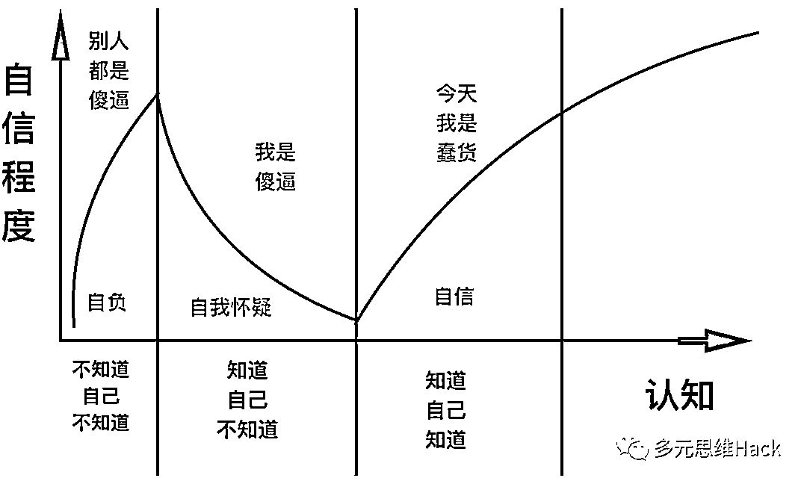

# 越是急着搞钱，越容易两手空空：问题出在两个“认知盲区”

> 来源：赚钱有术圈友分享

我是明白，一名赚钱 8 期老圈友。

前两天，一个圈友和我聊天时提到：他真的特别想搞钱，前前后后试过不少项目，结果没一件做起来。道理他都懂，得先安下心学习、提升能力，可心里总有一股劲儿拉着他往“快”处跑。他问我：这种急功近利的状态，到底还有没有救？

我想说，有救，而且有这种困扰的人远不止他一个。我公众号后台隔三差五就会冒出类似提问。说出来你可能不信，我当年也是这副德行，只是后来被现实反复捶打，才慢慢把心态调过来，也想明白了一些事。

今天就把这些思考整理出来，希望能给同样焦虑的你一些参考。

# 一、我也疯狂寻找过“赚钱快捷键”

2017年刚进赚钱有术时，我刷着圈友们的帖子，觉得别人赚钱怎么跟喝水一样轻松。再看看自己，又急又慌，天天琢磨：到底有没有什么秘诀，能让我一下子翻身？

当时我试过不少“看着省力来钱快”的路子，结果无一例外，全都没跑通。越跑不通我越焦虑，越焦虑就越浮躁。发展到后来，我只要点开赚钱有术，心就会莫名其妙地狂跳，胸口像压了块石头，难受得很。没办法，我索性不再打开了。

缓了一阵子，我开始给自己补课，学了一些个人成长方面的内容。印象最深的是得到App上李笑来老师的《通往财富自由之路》，里面有几个观念像一盆冷水，把我浇醒了：

- 注意力 > 时间 > 金钱
- 成长才是最好的投资
- 付费就是捡便宜
- 一切都是积累

这些观念让我慢慢静了下来，不再天天盯着别人赚了多少，而是愿意坐下来啃基础、练技能。后来，我做了一门《不用写代码的爬虫课》，从开发到运营，把学到的知识一点点用出来；再后来又做了知识星球精选站、公众号，以及其他一些尝试。

当然，这条路并不笔直。每隔一阵子，我心里就会冒出个声音：要不再找找什么速成的路子？于是我又跑去研究各种“翻身秘籍”，结果什么也没研究出来，反倒搭进去不少时间和精力。

现在回头看，如果我能早一点把“一切都是积累”真正活进脑子里，早一点放下暴富的执念，至少能少走一两年的冤枉路。

我最近认真复盘了一下，发现一个人之所以总想赚快钱，根源其实有两个。

# 二、赚不到钱又想赚快钱，卡在两个“不够”

先理清一个底层逻辑：赚钱本身并不是一门可以直接上手的手艺，你没法通过学习“赚钱”这件事来学会赚钱，也没法因为“想赚钱”就赚到钱。

钱更像是一张成绩单，反映的是你有没有把某件事做成。事做成了，成绩单才好看；事没做成，钱自然不会来。所以，想赚钱的人真正该研究的不是钱，而是事：做什么事能赚钱？怎么把事做成？前者靠眼界，后者靠实力。眼界和实力都到位，事能成，钱是必然结果。

反过来，如果你做了很多事却始终没赚到钱，还一直急着要结果，那通常是两个问题没想明白：一，你不知道哪些事能赚钱，对世界的运行规则认识不足；二，你不知道自己能做好什么，对自己的能力边界认识不足。

## 1. 看不清自己：对自己的能力盲区一无所知

心理学里有个“达克效应”，说的是人从懵懂到通透，通常要经历四个阶段——第一个阶段是“不知道自己不知道”，以为自己啥都懂；第二个阶段是“知道自己不知道”，开始心虚；第三个阶段是“知道自己知道”，边界逐渐清晰；第四个阶段是“不知道自己知道”，已经内化成直觉。

急着赚快钱的人，大多卡在第一个阶段：对自己的水平、资源、能力边界完全没有概念。看到别人靠某个项目赚了钱，第一反应就是：“我也行！”结果一上手就露馅。

如果一个人足够理性，失败几次之后就会反思：为什么别人行我不行？想来想去，答案不是事情有问题，而是自己的能力还差得远。能力不提升，换一百个项目也还是白搭。想通这一层，他就能踏踏实实去磨本事，再听到什么风口、红利，也不会冲动入场，因为他清楚自己现在还接不住。

但现实中，更多人是不理性的。他们会把失败归因于运气：“我只是运气差了点，多试几次，总能撞上一个轻松赚钱的好事吧？”于是，一看到“机会来了”就冲进去，根本不考虑自己有没有对应的实力。结果东一榔头西一棒子，样样都沾，样样都不精，能力一直原地踏步。

能力越差，赚钱越难；赚钱越难，心里越急；心里越急，就越想去抓那些“看起来快”的机会；时间全耗在找机会上，哪里还腾得出手来练本事？就这样，人很容易掉进一个无解的循环里。

## 2. 看不清世界：只看见冰山一角，就以为一切简单

以前在朋友圈看到过一段话，我一直记到现在：人总是会错估自己的擅长与不擅长。在不擅长的领域，因为只看到皮毛，就觉得这有什么难的，我上我也行；反过来，在自己真正擅长的领域，因为看得深，才清楚里面的水有多深、坑有多多，反而畏手畏脚，觉得自己不行。

这个道理放到赚钱上也一样。很多人一听说某个项目能挣钱，就兴奋地冲过去，本质是因为对这个项目了解得太浅。正因为不了解，才会产生“这钱好像很好赚”的错觉。

可稍微懂点能量守恒就知道，世上哪有什么只有收获、不用付出的好事？那些宣传“轻松快速赚钱”的人，展示给你的，通常只是整条链路里最光鲜的一小段，真正要命的前提条件和隐形门槛，早就被他们藏起来了。

我举自己的例子。早些年我学写作，经常看到写作课的广告：“听完这堂课，你也能写出10w+爆文，靠写作轻松变现。”还贴出不少学员案例，看起来有图有真相。我当时心动了，马上下单。

后来我才明白，写作和赚钱之间只是相关性，不是因果性。写作只是赚钱链条上的一环，后面还有九十九环等着。只要任意一环没打通，赚钱的结果就出不来。所以，课听完，钱没赚到，是意料之中的事。

任何一条来钱的路，都不是一个因素就能撑起来的，它需要很多因素在同一时间凑齐，缺一不可。

再举个例子。有人在网上分享知乎好物的赚钱方法，步骤写得特别清楚：怎么养号、怎么选品、怎么买赞、怎么提升盐值、怎么写文章更容易出单。评论区很多人直呼“学到了”，觉得自己照着做也能月入五万。

但真相是：一个人能分享出来的，一定只是赚钱链条上可以说清楚的那一部分，绝不是全部。真正决定你能不能赚到钱的，往往是那些没法写出来的东西，比如——

- 根据情况灵活调整策略的能力
- 懂得用户心理，知道哪类产品需求最旺
- 有不错的文案功底，知道怎么微调一下提高转化
- 有研究能力，能摸清平台用户的偏好
- 有死磕精神，一天写十篇稿子还能坚持
- ……

这些写不出来的东西，才是能力。能力没法靠一篇文章、一门课程、一个训练营速成，只能靠长年累月的积累。

因为对一件事了解得太浅，看不到商业世界的运转规则，也不知道做成这件事到底需要什么本事，于是“无知者无畏”，迷之自信地冲进去，最后灰头土脸地退出来。

一个人对自己不了解，对世界也不了解，眼前再挂着一个“赚大钱”的钩子，自然很容易被诱惑，去做那些看起来简单、轻松、来钱快的事情。可这两个“了解”，恰恰是赚钱的前提。前提不存在，结果只能是失败。

# 三、怎么跳出这个坑？

前面说了，想快速赚钱的人，心里通常有两个假设在支撑：第一，这件事我有能力做到；第二，这件事做起来很简单。

那解法也很直接：别光看这件事本身，去研究做成了这件事的人。

第一，那个人手里到底握着什么资源、什么能力、什么条件？这些我全都有吗？
第二，这件事要做成，需要解决哪些问题？这些问题我能不能一个一个解决掉？

如果这两个问题你完全答不上来，也研究不明白，那说明基本功还差得远。基本功不够，就算机会砸到你头上，你也接不住。

我自己也有被外界噪音带偏的时候。为了防止自己头脑发热，我特意在书桌前贴了两张条子：

1. 天上不会掉馅饼
2. 这件事，我有能力做好吗？

每天一抬头就能看到，躁动的心就冷静了大半，然后老老实实回去学习、练习。

要是反过来，不管不顾地冲进一个又一个“看起来能赚钱”的项目里，最后大概率是：钱没赚到，时间白花花地流走了，人还变得越来越浮躁，越来越停不下来。

# 写在最后

再把赚钱的第一性原理说一遍：你能赚钱，本质是因为你创造了价值；创造价值的根基，是能力。

所以，无论外界怎么喧嚣，守住这个核心，持续提升能力，你会创造越来越多的价值，赚钱自然就是水到渠成的事。

一切都是积累，慢就是快。

祝每个看到这里的圈友，都能在赚钱的路上，把钱赚了，还练出一身越来越值钱的本事。

---

*我是明白，赚钱 8 期老圈友，星球编号 20。程序员出身，现在自己创业，做一个成长社群《日新月异俱乐部》。*

*欢迎加我微信「mingbai62」交流。*

*下面是我在赚钱的历史精华帖，也是我一路走来的成长轨迹，感兴趣可以点开看看：*

*2024年*

1. 《参加航海实战，如何让自己每天都有正反馈？》 https://t.zsxq.com/9e2ns
2. 《详解：写作和赚钱的 4 个关系！看完你一定会忍不住想开始写！》 https://t.zsxq.com/192OLDlds
3. 《7 年赚钱拉新 1100 +，我只做对了一件事》 https://t.zsxq.com/19SqL7McC
4. 《当思考成为习惯，赚钱会更容易》 https://t.zsxq.com/19vgy7kcp

*2023年*

1. 《身体残疾卧床 3 年，我在人生最低谷加入赚钱有术，有哪些成长？》 https://t.zsxq.com/19KWDvzz0

*2021年*

1. 《复盘 | 龙哥 3 年前的帖子，帮我每月被动收入 1 万块》 https://t.zsxq.com/19jaotwbv
2. 《嘉宾问答|“想去更好的公司，我该如何利用好时间？”》 https://t.zsxq.com/1952Q3a92
3. 《2883 人向朋友介绍赚钱有术时，说的最多是 16 个词！》 https://t.zsxq.com/19MYWwvCl

*2020年*

1. 《产品想要获得更大收益，应该不断向用户的真实需求靠近》 https://t.zsxq.com/19kQ7NILy
2. 《我的 2019：普通人如何培养自己的用户视角？》 https://t.zsxq.com/19fyFdZRL
3. 《如何通过分析成功案例，帮自己建立赚钱清单》 https://t.zsxq.com/19FNjtIjB
4. 《思路详解：如何为某个细分领域用户提供产品，并赚钱》 https://t.zsxq.com/19qoI1QQB
5. 《学习和赚钱是什么关系？》 https://t.zsxq.com/19uQcuMzJ
6. 《5000 字深度拆解 | Manchuan 公众号 2 个月涨粉百万，普通人如何复制？》 https://t.zsxq.com/19cD1keUB

*2019年*

1. 《在赚钱有术，普通人如何从 0 到 1，培养赚钱思维》 https://t.zsxq.com/19rA0kWrD
2. 《赚钱有术第 3 期，我是如果做到邀请 245 个用户的？》 https://t.zsxq.com/1968tlTAx
3. 《公众号和抖音之间的赚钱机会》 https://t.zsxq.com/19OfzDckK
4. 《可复制，零门槛 | 如何借别人的流量，打造一个稳定的被动收入系统》 https://t.zsxq.com/19sVRn6Yx
5. 《做自己擅长的事，把技能树打通，然后再去赚钱》 https://t.zsxq.com/19evWC1Xl
6. 《信息整合：一个可复用，低门槛的成熟商业模式》 https://t.zsxq.com/192zoSooT
7. 《产品名字，只有一个目的：降低用户认知成本》 https://t.zsxq.com/19QUBrDOT
8. 《数据是需求的抽象化 | 帮你快速找到 100 个赚钱思路 》 https://t.zsxq.com/19QrIpsuC

*2018年*

1. 《分享一下，抓取其他微信号的方式，而且是精准粉》 https://t.zsxq.com/19sKQT9bF
2. 《如何几乎零成本做到 1w 多付费学员？》 https://t.zsxq.com/198XWAGhV
3. 《36 个小而美赚钱项目之一：蛋黄酥白皮书》 https://t.zsxq.com/19G4PKUXr

*2017年*

1. 《一个零成本，为公众号增粉，并高转化率为付费社群，进而再次付费转化加入小密圈的案例》 https://t.zsxq.com/19WJ8NILt
2. 《一款软件，webscraper，帮助非技术领域的朋友，做到爬虫可以做的事情》 https://t.zsxq.com/19RSl40n5