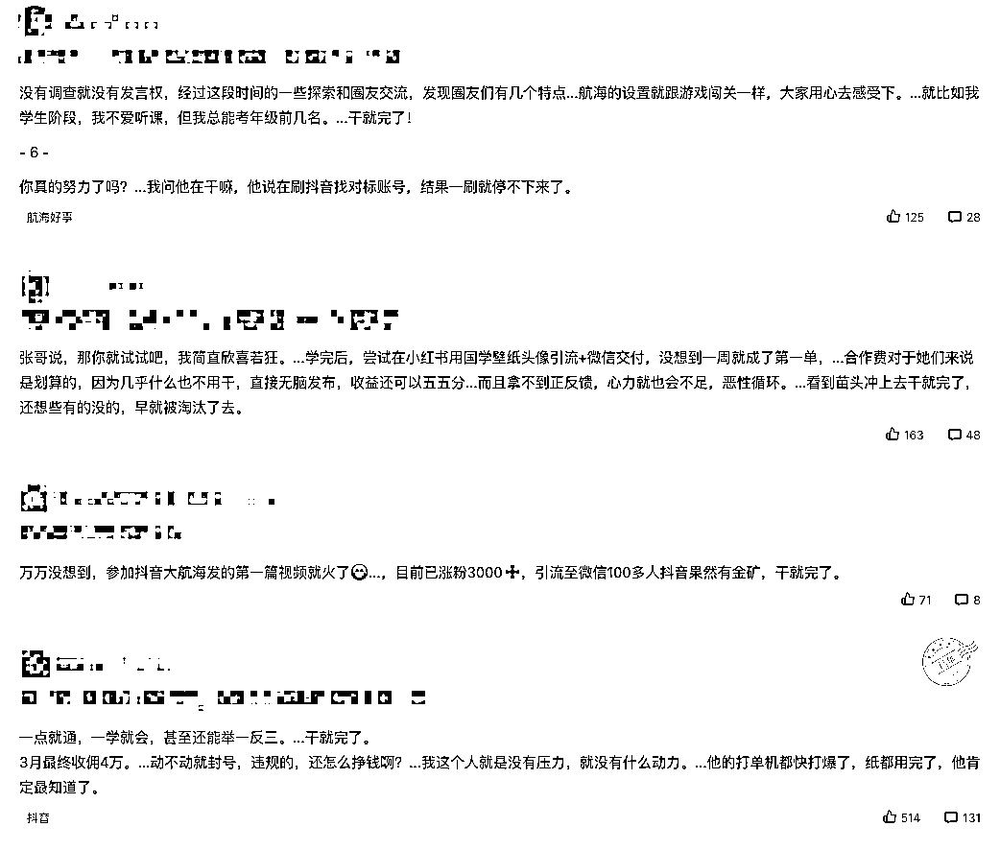
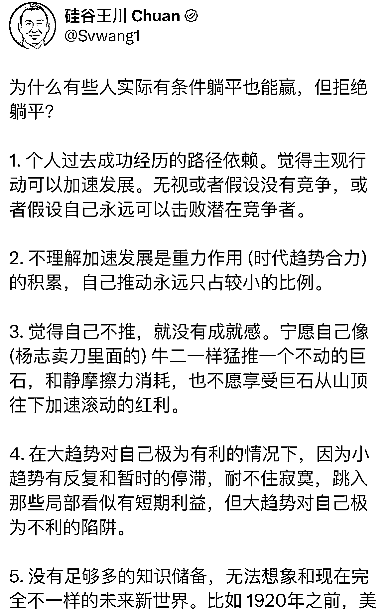
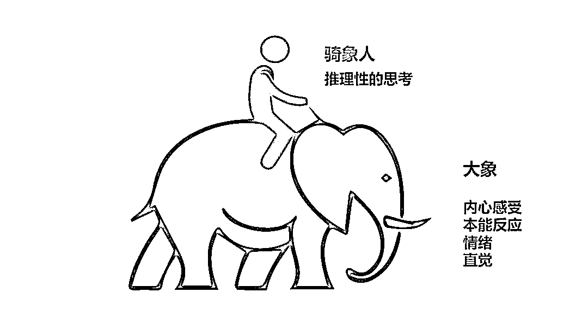
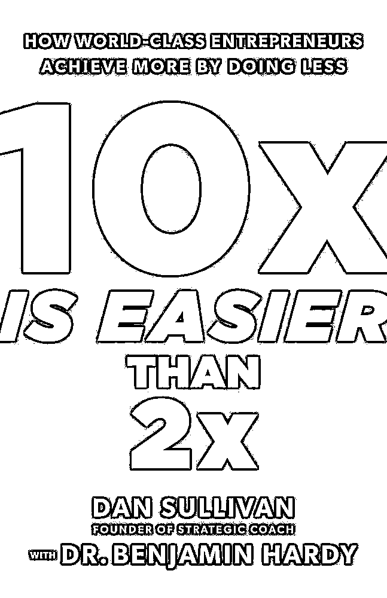
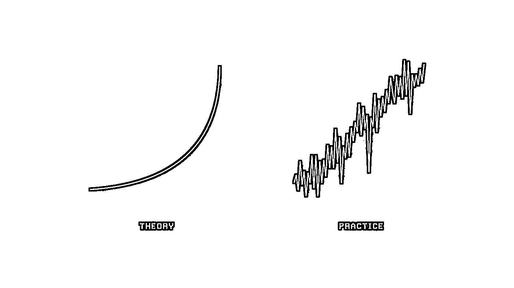
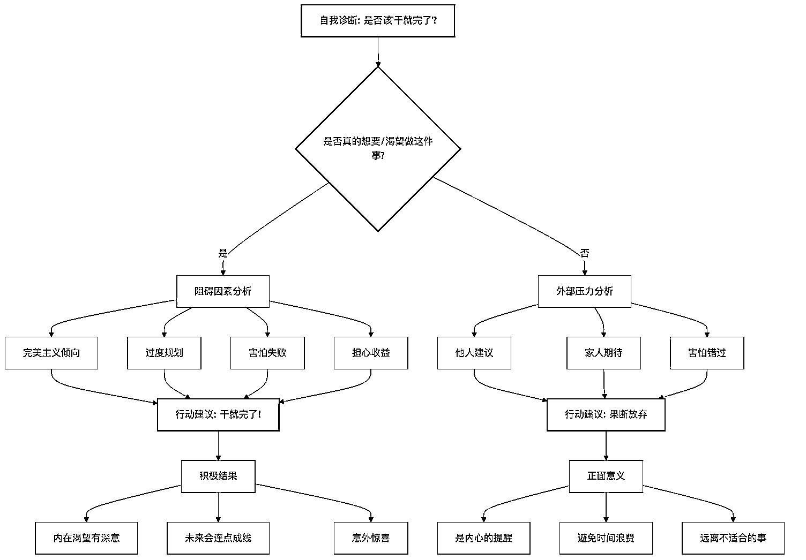
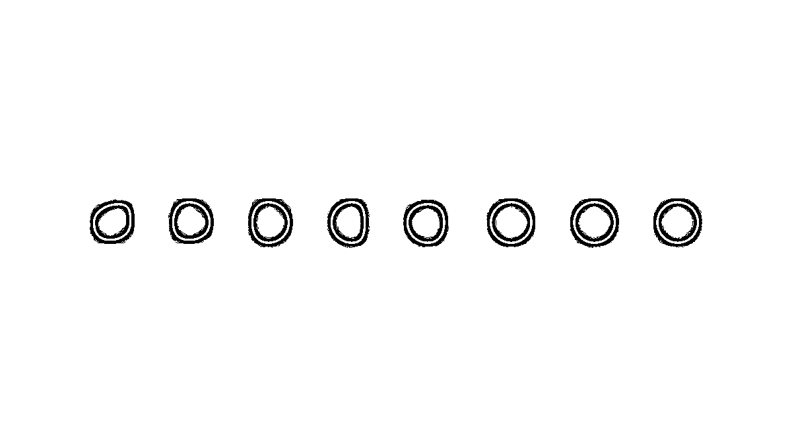

# 别再让“干就完了”绑架你：写给所有内心经常打架的人

加入赚钱圈子之后，你是不是也经历过这些瞬间？

刚开始看到大量赚钱信息时，兴奋感还没保持多久，就被无休止的压力、焦虑和迷茫吞没了；看着圈里的大神一个个操盘千万项目、大学时就赚到百万，再低头看看自己，总觉得自己拿不出手，甚至忍不住骂自己：怎么这么没用？都XX岁了还一事无成。有的人加入好几年，却始终在潜水，看着别人赚钱干着急，却不知道自己该做什么；每次实战营报名时一口气报好几个，结果一周不到就放弃；哪怕面对整理好的、照着做就能赚钱的项目，也迟迟迈不出第一步……如果你有这些感受，请放心，你不是一个人。作为一个在这里待了三年的老圈友，我全都经历过。

而当我试图把这些困惑说出来的时候，我听到最多的回复就是：“别多想，干就完了。”

这句话在圈子里的出现频率之高，简直可以取代“谈钱不伤感情”成为新的口号了。

“干就完了”搜索结果的部分截图

说实话，两年前如果有人这样劝我，我心里会想：你根本就是在敷衍我，或者你自己也没办法，只是不愿意承认而已。我会在内心回怼：我要能行动，还用你说？

但这两年，我的看法彻底变了。

我开始明白，当初的厌恶其实是一种内在投射。“干就完了”像一剂猛药，对某些人也许是毒药，但对另一些人却是救命良药。而决定它是好是坏的，恰恰藏在我们最容易忽略的内心里。

这个过程是怎么发生的？下面我来聊聊自己的心路历程，或许能给你一点启发。

## “干就完了”不是万能药

最初听到“别多想，干就完了”时，我确实有种被当头棒喝的感觉。我心想：对啊，我想这么多干嘛？这么矫情干嘛？结果不是靠想出来的，是靠做出来的。别磨叽了，先去行动。于是我就卯着劲去跟项目，做自媒体、做抖音……

可惜这股劲头很快就耗尽了。干不动之后，我又开始自我攻击：你怎么这么多事？别人怎么就能做出来？分明是你自己的问题。于是我就陷入了一个死循环：鼓起勇气做——半途而废——自责——再鼓起勇气——更早放弃……

一个死循环

后来我渐渐发现不对：如果“干就完了”总让我掉进同一个坑里，那也许不是我的问题，而是这句话有问题。

静下来仔细一琢磨，问题还真不少。我们一起来看看这句简单建议背后，藏着哪些需要警惕的东西。

### 第一，它回避了真正的问题

仔细想想，这个建议其实有点荒谬。我的瓶颈就是“干不动”，你告诉我去干，可“去干”恰好是我做不到的事情啊。就好比你失眠了很久，终于去医院，结果医生什么药都没开，只丢给你一句：你好好睡觉。你恨不得抽他两个耳光吧？

更糟的是，“干就完了”逐渐变成很多人的条件反射：自己没动力了，来一句；别人有问题了，也来一句。当具体问题完全没人去分析和拆解，只剩复读机一样的口号时，真正困顿的人会感到一种窒息和孤独——自己鲜活真实的问题就摆在那里，却好像被所有人无视了。

### 第二，它只看到了事，却没看到人

赚钱里确实有很多行动力超强的老板，脑袋里有个想法，直接就能开干。这种人（比如ENTJ、INTJ、ESTJ、ISTJ）在我看来是天生带着“福报”的，他们往往也是这个圈子里收获最大的一批人。对他们来说，“干就完了”非常适用。

但还有另一类人，比如ENFP、INFP、INFJ等等，他们在行动前会想很多、反复酝酿，特别容易内耗。

INFJ 的梗图（图片来自网络）

我自己就是这一类。如果要做一件事，我需要时间去思考、去发酵，得先看到这件事对自己的价值和意义，才会有发自内心的驱动力。单纯说“赚钱”本身，不足以构成我行动的理由。对这样的人说“别多想，干就完了”，根本没用——我需要先搞清楚目的、意义、价值是什么，真的是我需要的吗？把这些想通了，才能轮到“干”这一步。

而且，即使做同一件事，不同的人节奏、路径也完全不同。我们不是机器人，不可能用同一种方式对待所有人。

### 第三，它忽视了机会成本，也违背了10x思维

做任何事都有时间和机会成本。你把精力投入事情A，就等于失去了做事情B、C、D的可能。但同样的投入，不同事情带来的回报差异可能天差地别。“干就完了”是对时间和精力不加筛选地全盘投入，这显然是和10x思维背道而驰的。

10x思维要求我们持续筛选自己的投入，不断澄清自己真正的核心价值，只做那些最关键的工作，其余尽量少做、不做甚至外包。就像王川老师说的：

技术进步太快了，现在的最佳策略，反而可能是“躺平，养好身体，等待”。否则你拼命攒下的那点资源，过几年可能因为技术变革而一文不值，但你的健康损失却是实打实的。

王川老师关于躺平的一条分享

随随便便地“干就完了”，折腾得越猛，可能挂得越快。

### 第四，它看重外在可见的进步，却忽略了内在不可见的成长

一天做完了几件事，这是清清楚楚、可量化的结果，它能带给我们安全感和掌控感：你看，我今天确实行动了，确实进步了。我们很容易沉浸在这种感觉里。

但还有另一类结果，看不见也测不准，比如我比去年更诚实了、更勇敢了。你能感觉到，却很难量化，更不好意思向别人展示。于是这种内在的提升往往被我们忽视，可它恰恰才是关键。同样一个项目、差不多的能力，别人做得起来，你做不起来，最核心的差距往往不在具体技巧，而在内在层面。

拿到结果的三个层次，越往上越是不可见的（图片来自 Jack Butcher）

“干就完了”把不可见的庞大人间完全屏蔽了，只认可看得见的那一小部分。这其实是舍本逐末。

## “干就完了”也可以是一剂良药

吐槽了这么多，你是不是觉得我彻底否定了这句话？如果这篇文章到此结束，那它也不过是一篇以偏概全、宣泄情绪、制造对立的文章。

所以接下来我想说说，这两年我是怎么重新看见“干就完了”的含金量的。

我最近参加了一个叫《戏剧与内在转化》的课程。和那些讲概念、理论、方法的课堂不同，老师一上来就直接演示动作或游戏，然后让我们跟着做。刚开始我非常不适应，但过了一阵子就发现：有时候真的不需要提前懂那么多，在做的过程中，体验和感受会自然涌现，我自然就明白该怎么做了。

比如课上有个抛接球的游戏。球很小，不太好接，刚开始我特别有压力，因为脑子里总有思考。但玩着玩着，当我把全部注意力集中到球上、放下大脑的评判时，抛接突然变得顺畅起来。

原来我的身体一直知道如何做，只是大脑的思考不断在干扰我。

关于大脑与身体的关系的一个经典隐喻：象与骑象人（图片来自壹心理）

这件小事让我明白了一个道理：在某些领域，思考反而会妨碍我们直接感知本质。就像开车时，如果每个动作都要在大脑里过一遍，反而会开得不顺。“干就完了”之所以在特定场景下能产生奇效，正是因为它让我们绕过了大脑的过度参与，直接进入身体的自发性学习状态。

其实你小时候也有过类似体验。你背唐诗宋词的时候，真的理解那些词句的意思吗？并不理解。但你还是听老师的话，直接硬背下来。最初可能无感，可当背诵量突破某个临界点后，你忽然发现，自己似乎能够感知千百年前的古人真正在表达什么了，甚至可以自己提笔写诗。

这就是“别多想，干就完了”的秘密。有些经验和真相，用语言讲不清楚，不亲身体验，永远只能隔靴搔痒。而“干就完了”能帮我们快速完成初期的积累，跨过那个临界点，真正理解我们在做的事。

很多投入开始时看起来毫无意义，但跨越临界后，一切都不一样了（图片来自 Jack Butcher）

再讲两个我自己的例子吧。

一个是写作。我以前写东西特别痛苦。我总是想先想清楚再动笔，列个详细大纲，然后按大纲写。但这个方法从来没灵过，反而让我纠结、无助，甚至最后放弃了编辑岗位。后来我才意识到，是在动笔的过程中，思路才慢慢浮现；我根本不可能在动笔之前想明白一切。现在我写作的方式是：有了灵感就直接写，不加修饰地把脑海里冒出的想法倒出来，让手别停。只要持续写下去，出乎意料的文字就会自己冒出来。写完之后回看，我常常惊呼：这竟然是我写的？这就是“干就完了”的魔力。

另一个是英语。23 年 7 月，我通过王川老师发现了《10x is easier than 2x》这本书，当时只有英文版。

《10x is easier than 2x》英文版封面

我英语一般，读英文长文都很费劲，更别说整本书了。但中文翻译版实在太烂，我又特别想看，心一横，直接硬啃原版。开头确实痛苦，但越读越顺，两周多一点就读完了。书里的思想让我震撼，更让我惊喜的是，从此以后阅读英文书对我来说不再是个坎。直到今天，我还在读英文书。这件事让我悟到一个道理：很多东西根本不需要“准备好”，直接上手用、直接做，过程中缺什么补什么，反而就是最快的路。

这就是“干就完了”的力量所在——它能逼你突破自我设限，撞见意想不到的可能。

那么总结一下，“干就完了”到底含金量在哪里？

### 第一，它顺应了人类最自然、高效的学习方式

婴儿是怎么学会说话和走路的？观察、模仿、然后直接练习。老匠人怎么教徒弟的？先把基本功练上十年再说。从模仿开始，直接去做，再根据反馈调整，这是我们每个人与生俱来的学习本能。可惜现代学校教育把人的自然学习过程硬生生切开了，在知识和实践之间挖了一条鸿沟。这条鸿沟对我们影响太深，以至于我们走出校园后，依然总觉得要“先学好再动手”。

从这个意义上说，“干就完了”是一次回归，回到实践中学习的原点。

### 第二，它提醒我们看见头脑的局限，也愿意拥抱不确定性

我身边很多人（包括我自己）特别爱做规划，想把未来一年、三年、十年都定得清清楚楚。有规划意识当然好，但它有一个陷阱：我们会沉迷于规划带来的安全感，从而本能地拒绝现实中的不确定性。比如我今年比去年多赚了10万，那我明年能不能多赚30万？等到了明年发现差不多，就开始失落，觉得自己没做好——却不愿意承认，事情本来就不会都按预期发展。

理论与实际（图片来自 Jack Butcher）

有了规划就有了预期，而预期会变成我们观察现实的滤镜。如果你意识不到这层滤镜，现实就会在你的眼里变形，露出狰狞的面目，直到有一天把你唤醒。

所以真正健康的心态是：一方面，积极做规划，用它把渴望变成现实；另一方面，又要保持坦诚，尊重现实，随时准备推翻规划、随时调整。因为从根本上讲，我们无法预知未来，只能去发现并臣服于未来。我们只能基于当下有限的信息和思考做决定，这个决定未必是高质量的选择。可当我们真正开始行动时，新的信息会涌现，新的思考会被激发，未来的轮廓也会因此慢慢清晰。

“干就完了”，在这一层意义上，其实就是一场属于每个人的“臣服实验”。

## 良药还是毒药？关键在你对自己的诊断

看到这，你可能会说：你这不是正反方都让你说了吗？但到了真实场景里，我还是不知道该怎么办啊。

别急，现在就来解决问题。

分辨“干就完了”适不适合你，核心是问自己一个问题：

我做这件事，到底是为了什么？我是不是真的发自内心想做这件事？

如果你确实发自内心渴望做这件事，只是因为性格追求完美、想提前把每个细节都规划好，或者害怕失败、担心不赚钱，那你现在要做的，就是闭嘴、直接干。

你内心的渴望，一定有它深刻的道理。也许眼下看不出路径，但等到未来某个节点回头看时，你会发现每一段经历都连点成线，画出一条你当初不敢想象的、却让你庆幸无比的路。

但如果你并不真的想做这件事，而是因为别人说这个项目好、父母或伴侣说你应该多赚钱、你怕错过这波红利……这时你的纠结和内耗，根本不是问题，反而是内心在给你发信号。它正在提醒你：这件事不适合你，不是你想走的路，别再浪费时间了，趁早放下。

如果有人在这个时候还跟你说“别多想，干就完了”，你可以直接回他一句：去你的吧。

核心思路的图示

所以，判断的信号很明确：你是出于恐惧和自我怀疑而卡住，还是出于内心真实的声音而犹豫？前者需要推自己一把，后者需要听从自己。

至于怎么判断自己是不是“真的渴望”做一件事，我分享一个特别简单的方法：

1. 闭上眼睛，深呼吸五次，然后出声问自己：“XXX（具体的事）是我真正想做的吗？”
2. 问完之后，给自己一点安静的时间，感受心里有没有答案浮现。
3. 如果答案出现了，就出声说：“XXX 是我真正想做的”或者“XXX 不是我真正想做的”。
4. 如果没浮现，就再问一遍同样的问题。

这里有三点要提醒你：

一是，越具体越好。比如“写20篇📕帖子”比“做一个内容创作者”更容易获得内心回应；“掌握了直播带货技巧并完成10场直播”比“做直播带货”更清晰。

二是，身体的答案比头脑的答案更诚实。当我们问自己时，心里往往有两种声音：头脑的声音和身体的声音。头脑声音常常占上风，会压制住身体的感受。但我们身体不会说谎。之所以让你把问题和答案说出口，就是为了区分这两种声音。你可能大脑告诉你“是的，这就是我想要的”，但当你出声说出来时，会发现说得不确定、不流畅，喉咙有些发紧。这些感受都在提醒你：真正的答案其实是“不”。比如你现在缺钱，看到📕上有个红利项目，你问自己“三个月靠它赚一万是我真正想做的吗”，大脑立刻说“是”。但当你开口说“三个月靠它赚一万是我真正想做的”，却顺畅不起来——那你的真实想法就是“不想”。

三是，这个方法需要练习。跟任何技能一样，一开始你可能什么都感受不到，也可能被大脑带偏。没关系，多观察自己的身体感受，慢慢你就会越来越敏锐。

熟能生巧（图片来自 Jack Butcher）

当你通过一件件小事不断练习，越来越清楚自己的“想要”时，你内心深处的渴望也会慢慢浮出水面，你的人生主线自然就会清晰起来。

* * *

说到底，“干就完了”从来都不是一句简单的口号。它可能是你的枷锁，也可能成为你的钥匙，关键在你是否清楚地看见自己的心。

如果你已经确认那是内心真正渴望的方向，那别犹豫了，去干吧。所有在等待中消耗的时间，都不过是在为勇敢让路。

有人会忍不住反问：

> 你这套做法，和当年那个劝失眠的人“好好睡”的医生，到底有什么不一样？

正是因为这个疑问，我才想把「干就完了」怎么真正落地讲清楚。**下面这份行动处方，就是我给出的具体答案。**

这份处方由一个心态加两个自问构成。

### 心态：我允许

我允许自己在推进过程中会走弯路。
我允许自己犯错。
我允许自己坚持一段时间后选择停手。
我允许自己不尽善尽美。
我允许自己出现紧张、害怕、焦虑。

### 两个自问

#### 1. 最坏的结果会是什么？

拖着不动，往往是因为被一些模糊的不确定性吓住了。

把最坏的情况具体写出来、说出来，你会发现它其实没想象中那么可怕。

我特别喜欢姜 Dora 在即刻分享的一个例子，她把这个思路示范得非常清楚：

姜 Dora 即刻截图 _

#### 2. 针对我想做的事，我接下来 5 分钟能完成什么？

很多人说不出来“干就完了”，是因为整件事看起来一团乱，让人无从下手、压力爆棚。

这时要做的不是想更多，而是先让自己动起来。

就像拉着满载货车的马，第一下最难，启动之后阻力就小了不少。

迈第一步时最容易犯的错，就是步子迈得过大。

这里有个小诀窍：**把第一步调小到你觉得毫无压力，甚至有点好笑的程度。**

比如，你想养成跑步习惯，第一步甚至不用真的跑，只需要起床后把跑鞋穿上。穿好就算完成，跑不跑不强求。

比如，你是直播带货小白，第一步不是去选品，而是给一个有经验的朋友发条🛰️请教。信息发出就算完成。

比如，你想成为内容创作者，第一步不是承诺周更，而是今天只写三句话。写到三句就够了。

所以当你感到行动有阻力时，可以问自己：

> 在我想做的事上，我现在 5 分钟内能做到什么？

想清楚后，用 5 分钟把它做掉。

完成这一件小事，你就已经和原地不动的自己不一样了。这种微小的前进感会带来力量。

 qvGuTTyJA4W)下决定——〉养成习惯——〉成为技能（图片来自 Jack Butcher）_

* * *

## 收尾

还记得开头说的那些困扰吗？

面对信息过载的焦虑与迷茫...
看到别人成果时的自我怀疑...
想动却总被自己绊住...

这些不是你独有，也不是你的错。

「干就完了」确实像一种特效药，但药要在对的地方用才管用。

现在你已经学会怎么给自己诊断，也知道怎么正确服用这剂药。接下来只需要按对的方法和节奏，一步步把心流状态找回来。

记住：

1. 每次犹豫都在为重要的选择积累经验
2. 每一分焦虑都在提醒你去聆听内心
3. 每一回尝试都在把你推向更真实的自己

最后，写给同样卡在这些困扰里的你：

希望你能认出自己本就够好，不必过度苛责自己；
也祝愿你在真心在意的事情上，找回行动的从容。

你所期待的，终会到来。

* * *

后记

1.感谢在兰卡那篇《从一看赚钱帖就焦虑浮躁，到平和开放地吸收信息，我是如何转变的》帖子下留言的伙伴。是你们的留言让我看到，我曾经的内耗并非个例。现虽已不被困扰，但仍有很多人走在其中。希望这段分享能带来一点启发。

2.这篇文章走了两条路：一条是赚钱常见的干货派，剔除情绪只留方法；另一条是在方法之外保留感受。我选了后者，**因为这些情绪感受并非我一人所有，它们值得被看见和表达**。我想让赚钱的内容，除了年入百万的干货，也能多一些走心的温度，让社区少一点焦虑，多一点温暖。

3.附上一组 2023 年国税局披露的数据，帮大家安心一点。  images.zsxq.com/FkDoFu8Ckup3uYYjSyT_tPXHMLxn)

* * *

评论区精华回顾，内容保留原文观点不变。