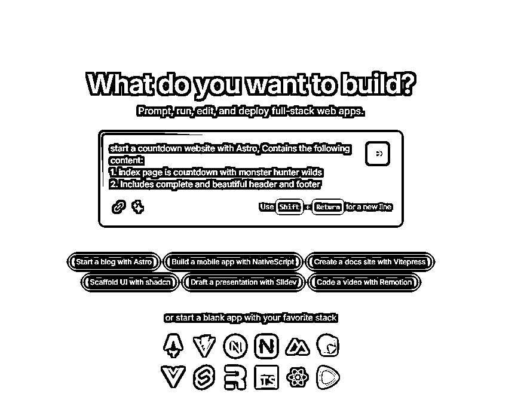
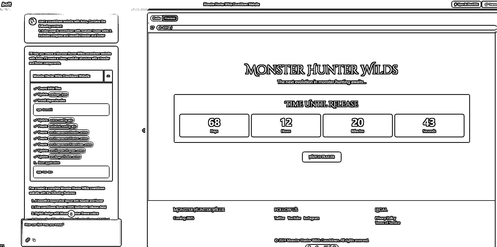
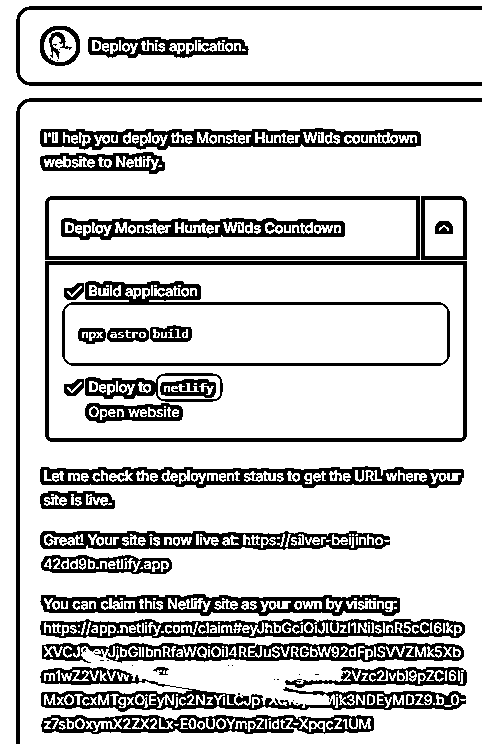

# ('输入需求，一键生成网站所有代码，支持预览，一键发布', (2, 27))

今早刷到一个有意思的工具，忍不住想分享给大家：只要把你的想法用大白话写进去，它就能把整个网站的前后端代码全给你写出来，还能直接预览、一键部署，全程不用碰代码。

这玩意儿是 StackBlitz 刚推出来的全栈应用 AI 生成器，叫 bolt.new。操作特别简单，你输入需求，它自动帮你搞定前端和后端，所有代码一次性生成，而且你还可以直接在页面里运行、编辑、部署，一步到位。

我随手试了一下，拿我最爱的一个游戏做了个倒计时页面。需求写得很随意，就两条：
- 首页展示这个游戏的发布倒计时
- 整个网页要有好看且完整的 header 和 footer

然后就是坐等几秒钟，结果直接出来了。页面预览效果和 Claude 那种差不多，看起来没有任何问题，我截个图给大家看：

看到左上角的 Deploy 按钮没？我顺手点了一下，结果它直接在 Netlify 上面把项目部署好了，点开链接就能访问真实页面，链接我就不放了，感兴趣可以自己试。Netlify 和 Vercel 都是同类项目托管平台，用来部署个人网站很合适。

Netlify 的免费额度其实挺够用的：每月 100G 流量、300 分钟编译时长，还能同时跑 1 个编译队列。部署完成之后，会出现第二个认领链接，点一下就能把项目同步到你自己账号，之后这个项目就完全归你管了。

说真的，现在出海搞东西比以前轻松太多了，这种工具一出来，技术门槛又往下掉了一大截。

