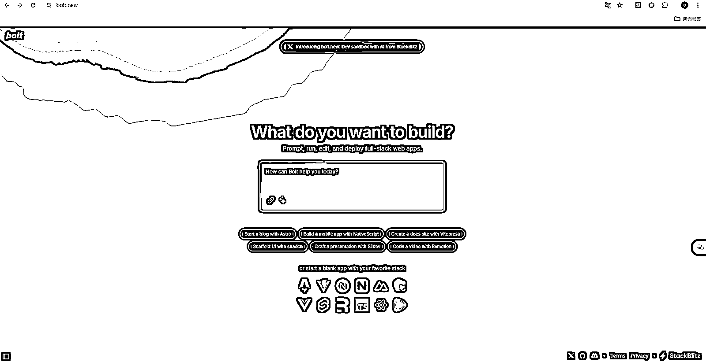
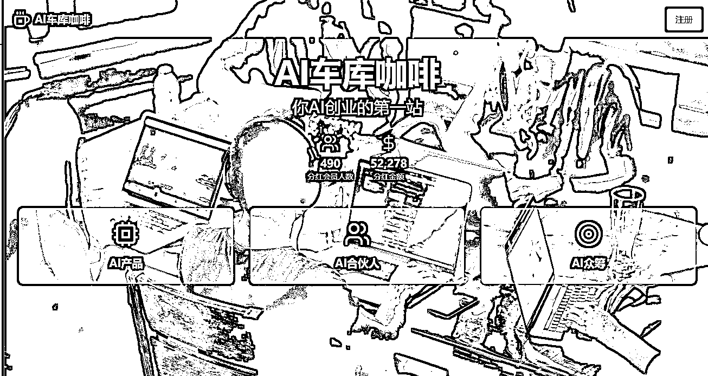
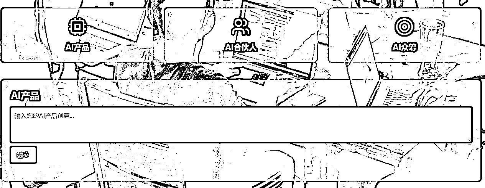
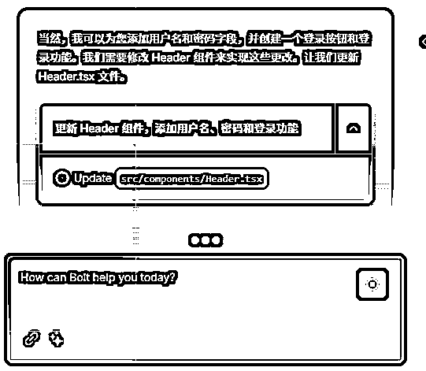
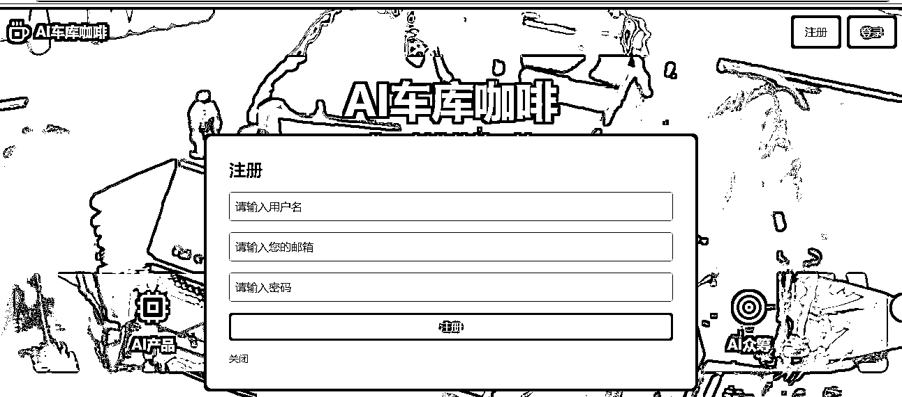
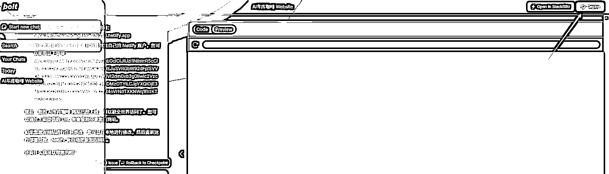

# 编程小白从 0 十分钟搭建网站实操教程

要是在过去，没有任何编程基础的人想独立搞一个网站，几乎是想都不敢想的事。但如今有了AI帮忙，这件事真的可以变得很简单。今天就来分享一套我自己跑通的全流程，手把手带你在十分钟内从零搭出一个网站。

工具方面，实测下来最顺手的是这两个：v0.dev 和 bolt.new。个人更推荐 bolt.new，因为它的免费额度用起来更划算，这次演示也是用它完成的。同类工具还有一些，比如 wopop.com、wegic.ai、manage.wix.com、Honstinger、squarespace.com、Dora AI、magic.hocoos.com、Framer AI，以及百度的智能门户AIPage。感兴趣的话可以都去试一下，看哪个更合自己的习惯。

下面直接进入实操环节。

第一步，打开网站并注册账号。

登录之后，会看到一个对话框。别急着直接输入，建议先把你的需求整理好，修改确认后再发给AI。这里以“AI车库咖啡”为例，可以把提示词写成这样：

网站名称要叫“AI车库咖啡”；背景图片希望有创业氛围；主页整体布局为——页面居中放“AI车库咖啡”大字，下方一行小字写着“你AI创业的第一站”；再往下是两行滚动数字，第一行展示分红会员人数，第二行展示分红金额；接着放三个功能块，分别为“AI产品”“AI合伙人”“AI众筹”。其中，“AI产品”点进去后可以输入文字内容，输入完成会滚动展示，并且支持在下方进行评价；“AI合伙人”点进去可以上传附件、发表自己的项目，还能寻找合作伙伴；“AI众筹”点进去则能发布自己的众筹项目，用户需要填写项目介绍、众筹金额和众筹产品。另外，页面左上角还要做一个注册功能，用邮箱注册就行，注册成功后提示可成为分红会员，参与众筹分红。

出来的效果非常惊艳。

二级页面也完全能用。

第三步，继续用提示词做精细化调整，把注册功能完善一下。

调整后的效果依然很赞。

第四步，点击右上角的“发布”按钮，整个网站就算正式上线了。

第五步，想接着修改时发现免费额度用完了，截图里可以看到具体的额度说明。

这个工具每天会送15万积分，一个月累计有100万积分。如果只是临时体验一下，可以等第二天再来。要是想用更多额度，付费套餐从20美元/月起步。

这里也放一个我做出来的示例网站，手机端同样能打开，大家可以直接体验：lighthearted-gelato-97e253.netlify.app

如果体验后觉得有意思、感兴趣的人多，完全可以把这件事继续做下去，当成一个小项目来迭代。

AI时代，最值钱的就是执行力。看到这里，别只是收藏了，赶紧动手试试吧。

另外，评论区也有人问这个网站能不能变现。作者给出的回答很实在：大概率是无法变现的，更多是用来练手，熟悉整个流程。