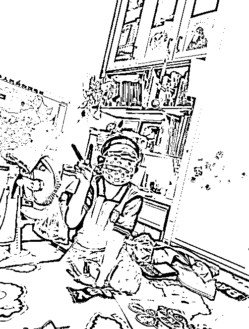

# 少儿 Ai 体验馆，卖知识版权，打通一座城“绘本馆”跟你合作
作者：龙哥

有段时间没输出长文了，最近陪孩子折腾了半年，攒了不少感悟，趁着热乎劲儿，赶紧记录下来分享给大家。

先声明一下，下面这些话只代表我个人的观察和判断，各家有各家的教育理念，不一定适合所有人，觉得有道理就听听，不认同也正常——路终归是自己走出来的，咱们评论区可以继续聊。

说真的，我现在对孩子的未来，反而没那么焦虑了。想通了以后，主打一个顺其自然。我不紧绷了，孩子反倒时不时给我点小惊喜。

AI带来的变化，注定是颠覆性的。往后高中会越来越难进，说白了就是不想让你太容易考上大学，底层总得有人干。但长远看，基层劳动力反而会越来越吃香。可眼下这几年，普通大学生毕业就等于失业。

孩子被题海压得喘不过气，什么生存本事都没学到，商业头脑为零，遇点困难就垮掉。为啥？天天补习班，没机会去户外摸爬滚打。就算挤进大学又怎样？AI最先替代的就是普通院校的毕业生。除非清北复交这类顶流，否则那层光环根本罩不住你。家里没矿、没资源，普通人读完大学出来，能分到的机会少得可怜。熬了十年苦读，满脑子只有书本概念，真正能在社会上立足的能力一样没有——这就是毕业即失业的根子。

看透这点后，我彻底放松了。与其硬卷，不如多培养孩子的多种生存手段，教他怎么应对困境，怎么把身体和心态练强。这些比单纯刷题重要一万倍。学习能力当然不能丢，该监督还得监督，什么年龄做什么事。孩子是不是读书的料，当爹妈的心里都有数，强行较劲，最后大人孩子都难受。

我家大宝今年七岁，上二年级，经常跟我说想赚钱。我就给她讲生意经背后那些门道，还真带她去摆过地摊，顺带教了怎么规避风险。现在对她来说，课本知识反而是顺手的事，重点在培养各种软实力。

后来我把平板里装了一堆AI应用，让她自己去感受那种神奇——比如她喜欢公主裙，我就让她用AI生成自己形象的国漫风照片；她爱画画，我就教她把画变成动画；她还能编个小故事，喂给AI做成完整短片，配上台词、音乐，从绘本到动画一步到位。反正手机管不住，那不如让屏幕变成创造工具。现在她早不刷短视频了，三天两头问我“爸爸，这个动画AI能不能做出来”，得到肯定答复后就自己跑去研究。

有天特别有趣，我把打印机连到她手机上，她随手用AI生成了一套“斗罗大陆小五”的换装图，打完就带到学校去“炫耀”了。下午接她放学的时候，她两眼放光，兴奋地跟我说：“爸！我想出个赚钱路子！一张AI小五一块钱，卖给我同学行不行？”我心里狂夸这孩子有商业头脑，但没直接夸她。我告诉她：冬天快到了，现在先别急着收钱，同学想打印就免费送，等夏天你在小区支个摊再收费——让身边围着一群小伙伴，你不也开心嘛。

借着这件事，我脑子里冒出一个项目——**“少儿AI体验馆”**。

核心就一句话：孩子爱玩手机拦不住？那就让他玩出价值。不需要自己开发软件，直接用现成的大厂AI应用，让孩子亲眼见识AI的魔法，练练写提示词的本事。我看大城市已经有人在做，三四五六线城市基本还是空白，机会不小。

更关键的思路是——**自己打磨一套教学体系**。这就是一个看得见摸得着的知识版权。拿这套体系去卖课、去开分馆，妥妥的能发财。AI工具多的是，我们只是站在巨人肩膀上，动点脑子把它们二次整合，就能形成一套方法论。

绘本馆每个学校门口都有，他们的盈利模式老套且收入有限。如果我们把教学体系和绘本馆合作，借助他们的场地和生源，用版权分成的模式，低成本就能打通一座城。躺着收版权费，想想都香。

这套体系什么样？怎么搭？其实我上面带孩子做的那些事，就是活生生的案例。你顺着捋一捋，再系统化梳理一遍，思路自然就有了。写到这里我真是越写越兴奋——我太爱这种赚钱方式了，毕竟卖了这么多年课。早在2019年我就靠教育版权产品做过一波，半年招商做到300万销售额。可惜当时技术握在合作方手里，最后闹掰了——他觉得他强，我觉得我牛，说到底谁都没格局。这事儿我遗憾了好几年，本想着自己也不是科班出身，哪来的自信做教育版权？

但现在，借着带娃的这半年实践，我好像摸着门道了。最近一直在琢磨系统的框架，已经有了初步雏形，等成熟了再跟大家拆解。

（完）