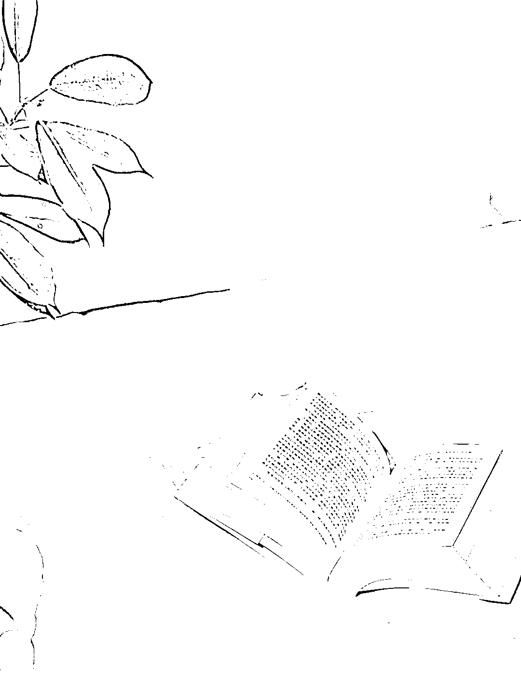

# 靠一张书桌，我形成了复利型赚钱思维
作者：龙哥

谁能想到，三年后让我实现多渠道变现的起点，竟然只是当初随手拍了几张书的照片。

那会儿刷📕，看到有人晒书单、晒读后感，我第一反应是：“就这？读书谁不会？”于是我也跟着做起了读书博主。坦白讲，最开始我连张像样的书桌都没有，拍摄背景要么是大白墙，要么是天台、阳台，甚至公园长椅——凡是能想到的地方，都成了我的“摄影棚”。

直到后来，我终于把阵地转移到了桌面，再慢慢扩展成整张书桌上的小场景。也是从那时起，我接到了人生中第一本出版社寄来的书，接着，文具、台灯、音响、挂画、香薰、笔记本、手表、耳机这些品牌方也陆续找上门来。

那一刻我才意识到，普通人是真的能靠自媒体撬开赚钱的新可能。而我做的每一件事，都在给自己铺设一条“越做越顺”的增强回路。一个账号、一个赛道，很快满足不了我膨胀的探索欲，我开始疯狂尝试更多方向。

于是，电商带货和家居赛道被我相继拿下。不得不说，这两步棋都踩在了红利期上。如今，读书、家居、无货源三个完全不同方向的变现闭环已经跑通，我也正在享受这些选择带来的回报。

先说家居赛道。我虽然不是最早入场的那批人，但也算赶上了早班车。要不是亲自进来，我根本想象不到家居赛道的变现能量能有多大——上万的冰箱说送就送，大几千的沙发、床垫、柜子也接了好几个，灯具、卫浴更是好谈到不行，甚至地板、美缝剂、油漆这种冷门品类都有人找来合作。

两年做下来，我家几乎被合作产品填满了。它们不仅带来了实打实的收入，也把生活品质拉高了一个档次。

再说电商赛道。它彻底改掉了我对“卖货”的偏见，逼着我去钻研销售和营销。那些曾经我瞧不上的能力，现在全变成了我做自媒体的附加技能。

而这一切的源头，不过是三年前我捡起了一本书。

有个学员跟我说，她也喜欢读书，希望把读过的书分享出去，顺便靠这个赚点钱，那就再好不过了。我很庆幸，我做到了，今后也想带着更多人做到。