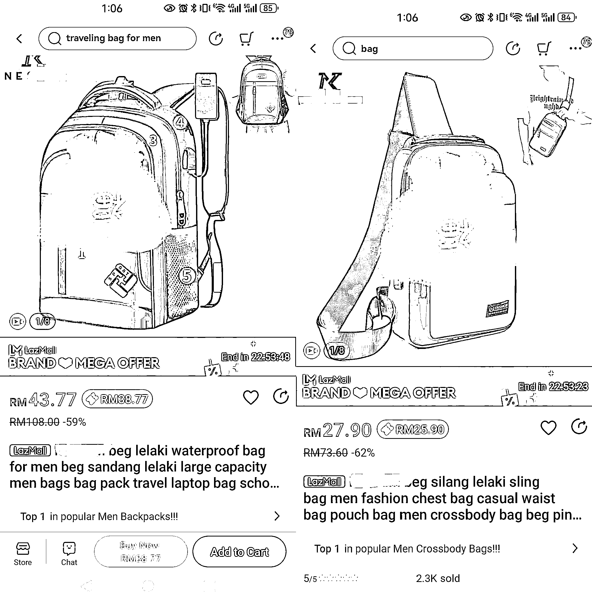
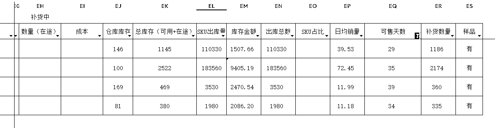
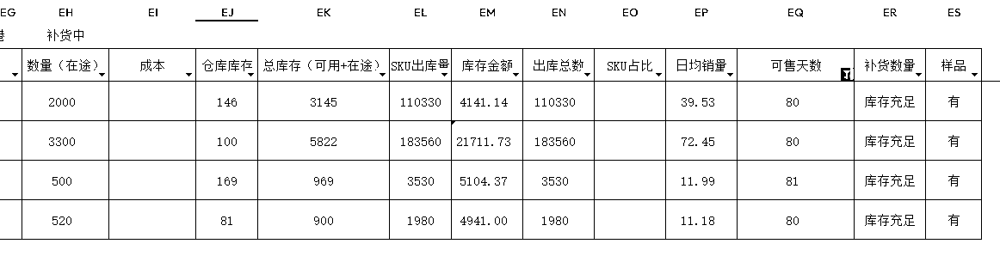
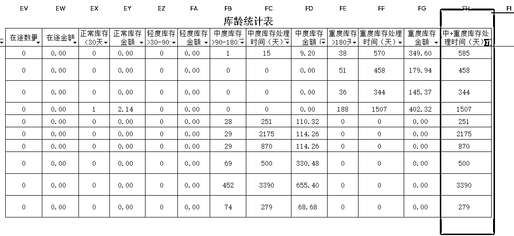
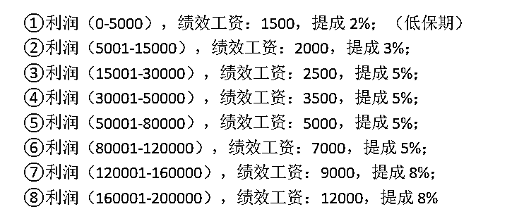
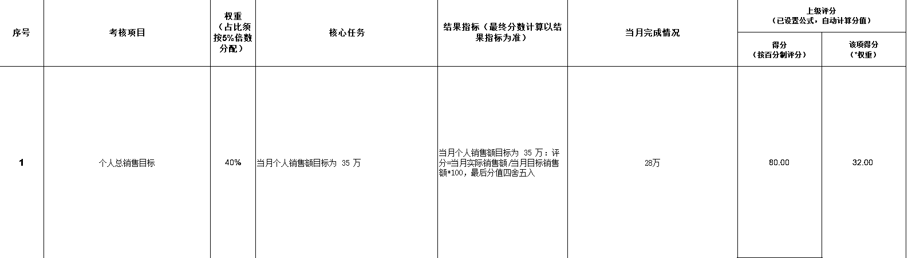
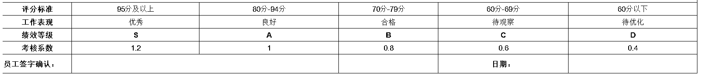

# 东南亚跨境市场的真实掘金逻辑：从0到1的TikTok爆店实战拆解

> 一个连续创业者的东南亚实战复盘：为什么新卖家都涌入这里？TikTok小店如何三周起量？

生财的圈友们，大家好。我是久成，干了5年跨境电商，在东南亚市场摸爬滚打到千万级体量，手里握着好几款类目第一的产品。这些年关于出海的话题越来越热，我自己也踩过不少坑、积累了不少心得，今天借这个机会好好和大家聊聊。

接下来这篇文章信息量很大，涵盖市场趋势、TikTok小店从零起步、本土化运营、库存管理、清仓打法以及团队建设，你可以先收藏，再慢慢消化。

## 一、我是谁？一段8年的连续创业历程

先做个自我介绍。我叫久成，从大一就开始倒腾生意，前前后后折腾了8年。

- **2016年**，大学里做了吉他工作室和自媒体写作工作室，带着近20个同学实现了月入过万；
- **2017年**，赶上微信淘客的风口，把公域流量玩到私域，做起了返利社群，让不少大学生早早体验到了赚钱的感觉；
- **2018年**，踩中抖音视频带货的第一波红利，一个人日出千单，单条视频单日佣金冲上3万+；
- **2019年**，攒下人生第一个一百万，22岁全款提了奥迪；
- **2020年**，成立了自己的东南亚跨境电商公司，团队20多人；
- **2021年**，All in Lazada本土无货源店群，开了400家店，日单量破3000，日利润冲上4万。然而年底平台大清洗，一夜亏了80多万；
- **2022年**，痛定思痛，不再跟平台对着干，转向本土备货，做Lazada精品模式；
- **2023年**，新增Shopee和TikTok板块，布局东南亚全域电商，美妆和箱包多款产品做到马来西亚站Top1，开始搭建自主品牌护城河；
- **2024年**，帮助国内品牌出海，把供应链优势进一步放大。

为什么一路能走到今天？就是靠“专注”二字。我们现在其中一个店铺，多款产品做到类目Top1，上榜产品不在少数。

## 二、为什么东南亚是新卖家的首选战场？

说到跨境电商，很多人第一反应是欧美：市场大、消费者有钱、赚的是美元欧元。而提起东南亚，总觉得它落后、分散、国家小人口少，跟欧美完全不在一个量级。

但奇怪的是，近几年大量新卖家偏偏把东南亚当成了出海的第一站。这背后的逻辑是什么？

### 1. 增速全球第一，潜力肉眼可见

东南亚电商市场从2010年开始加速，疫情更是把它推到一个新高度。根据eMarketer的数据，2023年全球零售电商增速排名中，东南亚以18.6%的增速拿下全球第一。全球增速最快的十个国家里，东南亚占了一半——菲律宾、印尼、马来西亚、泰国、越南全部上榜。到2029年，东南亚电商规模预计达到1912亿美元，年复合增长率10.42%。

欧美市场基本已经饱和，对新手越来越不友好。而高速增长的东南亚，恰恰是普通人的窗口期。

### 2. 中国基因的平台，对中国卖家太友好

Shopee、Lazada、TikTok小店，背后全是中国的资本，底层逻辑就是中国电商那套打法。你打开这些后台一看，界面和功能几乎就是国内电商平台的翻版。对于做过国内电商的卖家来说，上手难度直接降了一个等级。

### 3. 中国供应链，在东南亚有天然优势

东南亚的制造业普遍不强，本地工业产能跟不上，而中国是世界工厂，品类齐全、性价比高，当地人非常认中国货。这一进一出，优势太明显了。

### 4. 门槛低，启动资金少

跟欧美比起来，东南亚的仓储、人工、物流成本都低不少。做欧美你前期可能得准备一大笔钱去烧，做东南亚，门槛友好得多。

## 三、三大平台格局：TikTok的崛起有多猛？

东南亚的电商战场上，Shopee、Lazada、TikTok三分天下，但格局正在剧变。

- **Shopee**：2015年成立，腾讯系出身，只花4年就干掉了Lazada成为东南亚第一，巅峰时期母公司Sea市值一度超2000亿美元，风光无两。
- **Lazada**：2012年就成立了，虽然在和Shopee的多年较量中落了下风，但阿里始终把它当成海外布局的重要棋子，从2016年起平均每年注资超百亿。目前仍稳坐第二把交椅，但已感到寒意。
- **TikTok**：这才是真正的“当红炸子鸡”。2021年先进印尼试水，随后一年内开通泰国、新加坡、越南、菲律宾、马来西亚。2022年东南亚GMV做到44亿美元，翻了三倍；2023年直接把数字再翻4倍，干到163亿美元。

TikTok进场后，大量Shopee和Lazada的卖家蜂拥而至，想抢这波平台红利。而TikTok也诚意十足，早期不抽佣金，还给消费者补贴：免邮、优惠券、满减券、一分购，各种福利堆上去。

外媒甚至直言，TikTok的电商业务很快就要超过Lazada，成为东南亚第二。按照目前的势头，TikTok Shop想坐上头把交椅，也只是时间问题。

**为什么TikTok这么猛？**

因为它把国内抖音那套“货找人”的兴趣电商逻辑搬了过来。东南亚的消费者，很多还没经过传统电商的洗礼，直接被这套玩法给震撼住了。

更关键的是，TikTok在东南亚拥有庞大的用户底盘。截至2023年年中，月活用户高达3.25亿。而东南亚人口结构又非常年轻，30岁以下占比超过50%，这帮年轻人爱刷短视频、接受新事物快，看直播看得上头就顺手买了，转化路径非常自然。

从另一个角度看，这就是把国内抖音验证过的模式，在一个人口结构相似的市场上重新跑了一遍。

## 四、TikTok小店冷启动：三周打爆新店新品

我自己在东南亚经历了太多起伏：Lazada店群日入4万的巅峰，疫情发不出货的死店，一夜亏80多万的封店打击，测评就被封的无奈，选品测品无数次试错，以及多平台爆发时的狂喜。

TikTok小店一上线东南亚，我们立刻跟进。从联盟带货起步，做过无人直播赚了一波，试过半个无人直播，也做过全真人直播但产出为负。多种尝试之后，转向本土TK小店。最开始上架就能出单，后来竞争加剧，逼着我们不断学习、不断优化打法，最终打磨出一套冷启动流程，今天分享给大家。

### ① 先吃透TK算法的底层逻辑

在TK上，核心是不去追流量，而是“让流量来找我们”。这里有三条关键认知：

**第一，TK的算法“追强弃弱”——只有强者才能分到流量。**

从零开始做店，首先要做一个决定：你打算烧钱，还是烧货？

烧钱是投广告推流，问题是投产比不可控、有上限，并不是投得越多效果越好，而且对直播间和素材质量要求极高，产品价格和评分稍差就转化不动。烧钱最大的问题是**不确定性**。

烧货就不一样——说白了就是货损。原来卖10块的东西，拿来1块钱做福利送，送10个、20个、100个，只要产品质量过关，肯定能送出去。一件产品货值5块，送100件也就500块。普通人大多贪小便宜，这500块能换回来大量商品点击、转化率和快速增长的数据。

**我们选择烧货。** 通过送福利打爆数据，让“转化率”和“分钟成交GPM”冲到高位，然后告诉算法：我是这个品类里新冒出来的黑马，每7天都在增长，每轮增长超过20%。很快TK就会主动来“追”你，把更多公域流量分给你，而不是靠你去买流量。

**第二，算法就是机器学习——垃圾进，垃圾出。**

TK的算法一直在学习，无论短视频、直播还是商城流量，它都在不停地识别和优化。想获得精准流量，就得喂给它大量有效数据，让它快速锁定你要的目标用户。

做电商，不需要搞笑流量，也别想着拍个视频爆100万播放。我们要的是——哪怕只有两三千流量，其中有20%的人愿意停留并点击商品链接，这才是真正被算法识别为“电商标签”的用户。我们要做的是筛选掉一切不相关用户，让算法不断提升对我们用户的识别精度。

**第三，算法是统计学——你不是跟所有人赛马。**

TK不会把T1、T2、T3、T5不同层级的达人和店铺搅在一起比较。前期启动时，你的竞争对手不是行业Top，而是同级同类目的新店。

**每个阶段都必须想清楚：我在跟谁比？TK想要什么？我把什么数据做出来就能赢下这场流量赛马？**

### ② 理解店铺和主账号的关系

**店铺=数据中心**

很多中国卖家做TK小店只盯着投流，但投流会遇到瓶颈——广告账户本身也在做机器学习，如果我们的消耗效率和流量效率跑不赢别人，就再也放不出量。

所以我们的思路是：**以一个店铺作为数据中心，通过直播、短视频、商城、投流这四个流量入口，同时、稳定、均衡地把流量打开。**

这样构建出的流量架构会非常稳，不会因为单一渠道的波动而销量跳水。因为我们做的是“三角形流量架构”——直播、短视频、商城，三个点互相撑住这家店。

**主账号=流量标签**

主账号是重中之重。TK把店铺作为所有成交数据的中心，发货数据、质量分、服务分等等全部沉淀在里面，而这些分数直接影响到店铺和商品在商城和搜索中的展示排名。

店铺分数怎么做上去？核心就看两件事：**主账号的流量标签准不准，以及主账号绑定店铺的增长增速。增速比绝对销售额更重要！**

在TK上做生意，记住一句话：**平台要的是“追潮流”。**

所谓潮流，就是说你有店铺数据每周持续上升，卖的产品与平台用户的关系也处在上升阶段，商品卡浏览、点击率、转化率等各项数据都在往上走。平台会把流量推给正在上升中的店铺，而不是绝对销售额最大的那个。**所以我们要关注的是每个数据的增长速度，而不是销售额本身。**

只要增长速度跑赢大多数同级别商家，流量就会越来越精准、越来越多。

**网红达人=人群筛选器**

达人永远不会是店铺的主流量，但新店前期至关重要。因为达人给我们的链接是一个“反向筛选”的机制——通过海量达人的粉丝关系，用户可以从达人账号点进我们店铺，相当于把店铺标签的初始数据重新洗了一遍。

这个动作不会干扰主账号，但能直接影响店铺流量的精准度，还会间接带动商城搜索和自然流量的展现。

**所以达人营销，是开店第一天就必须做的事。**

**广告户=销售额放大器**

投流户也很关键，它是验证过销售额增量的放大器，可以把销售额放得很大。很多人遇到的问题是“广告户放不了量”，这个以后有机会单开一篇详细聊。

### ③ 冷启动前两周：三个流量主体的算法核心

冷启动期要同时兼顾三个流量主体的权重：

1. **店铺权重**——决定商城排名
2. **视频账号权重（主账号权重）**——决定视频初始流量级
3. **直播账号权重**

这三个主体是分开的，各有各的权重，但又不能孤立去做，必须同时增长。我管它叫**“直播视频商城三角流模型”**。

TK是非常结果导向的平台。新店评分是零，平台绝不会冒险把优质用户分给你——它不知道你会不会发货、货有没有问题、会不会卖假货。所以冷启动期拿到的流量一定是“垃圾流量”——也就是99%不太会买东西的人。

**这个阶段（尤其是前三周），平台主要考验的是你的“留人能力”，不是要求成交，而是看你能不能把推给你的“垃圾人”留下来。**

我们的三角流模型动作是这样的：

1. **直播端**：每天拉2小时时长，每10分钟做一次福利；
2. **短视频端**：每天做20条小视频去“撞广告”；
3. **达人端**：定向邀约达人。

逐个拆解：

**直播：福袋抽奖拉停留**

我们每10分钟放出一个商品，直播拉满2小时，总共送出12件客单价约15元的商品。这12件货的主要目的，就是把贪小便宜的人留在直播间，拉高停留时长和留存率。

另外一个极其关键的数据叫**商品点击率**。怎么拉高？我们设置了一个小机关：参与福袋需要留言“第3号链接有福利”。那些蹲福袋的人为了抽奖，会在直播间不断刷这条留言，等于帮我们做了“群体引导”，后进来的人看到留言就会去点3号链接。结果就是，**商品点击率被拉到了26%**。

这个数据在TK是非常漂亮的：

- 人均停留超过1分钟——说明内容有吸引力；
- 26%的人点了商品卡——说明商品性价比被认可，有可能成为爆款。

算法就会认为：这是一家专门打造超级爆品的潜力网红店。

**短视频：每天20条去撞广告**

操作方法不复杂：找一位外教模特录一条配音，然后混剪，再借助AI生成20条风格不同、钩子有差异的短视频，全部拿去跑广告测试。

每条视频配10-20个广告组，分散测试流量，避免同一批用户反复看到相同素材。找到跑得出量、投产可观的广告组，复制10份持续拓展流量。

视频内容上有两个忌讳：**不要急着讲解产品，一定要放大效果、直击痛点。** 前5秒是生死线，关键时刻也要引导用户点击商品卡查看详情，这样广告才跑得起来。

**达人：定向“偷”取同行资源**

前面说了，达人是反向链接。我们是怎么玩的？

核心思路：**去挖那些已经帮竞争对手出过单的达人。**

方法是用数据工具，找到同类目卖得最好的店铺，拉出近30天帮他带过货的达人名单，然后给出更有竞争力的佣金——对方给8%，我们就给15%，把达人直接“偷”过来。

**冷启动期的前两周，一定要耐得住寂寞。直播端和店铺数据端做的事情，核心就两个词：停留和点击。这两项一上来，流量就会逐渐转变成真正的电商流量，用户开始真正下单了。**

### ④ 测试期与打标期

下一个阶段是测试期和打标期。打标期就是算法愿意给店铺打上标签的时刻。

这里必须提醒一句：平台上烂店太多了，TK会先做一轮过滤。以英区为例，6万多家门店，真正能卖货的可能不到10%（6000家），而其中能卖得好的可能连600家都没有。所以前期每一步的数据表现，决定了你是留在牌桌上，还是被直接清洗出局。

## 写在最后

东南亚电商的这趟列车，正在加速前冲。增量依然存在，红利依然在，但机会只会留给那些理解平台算法、踏实做数据和敢烧货的人。

如果你正打算入场东南亚，希望这篇文章能帮你少踩一些坑，少走一些弯路。后续有机会，我会继续分享关于本土化运营、库存管理、滞销清仓以及团队管理的实操细节。

关注我，跨境路上，一起走。

在 TikTok 的电商逻辑里，时间不是用来试错的。平台手里有五万九千家左右的店铺要养，它不会把精力分散到每一家身上，而是会集中把八成以上的流量小心翼翼地喂给能变现的店铺。

所以冷启动阶段最致命的不是没曝光，而是被判定为烂店后直接被放弃。平台一旦不敢给你推流，你的起势就结束了。启动期要做的第一件事就是先攒数据，核心是让用户停下来、点进商品卡。商品卡的点击我们测试过各种打法，找网红来测是最稳的。等数据初步起来后就是打标，通常这个打标窗口大概在一周左右。

熬过前十天左右，账号会进入一个标签期。这个阶段很明显的一个信号是用户开始主动开口了，比如“这个东西拿出来给我看一下”。这就说明 TikTok 已经开始用带标签的用户来测你的转化了。

这时候平台的玩法很简单：同时把一千个流量分给两间直播间，看谁能把这批流量吃下来。评判标准不只是转化率，更关键的是 GPM，也就是用这一千个流量能产生多少销售额。GPM 越高的直播间，TikTok 会越觉得你靠谱，后续的流量就会越精准、越多，而且会持续放量。

**进入标签期后，唯一的目标就是转化率。**

要怎么做转化率？我们抓的是五分钟转化率。

做法是先用福袋把人拉住。我们会把一款原价十块的货瞬间打到一块钱，先用福袋把在线人数冲到两三百人，然后必须在五分钟内成交八到十单，把转化率立刻拉到5%左右。这个数值基本能超过同期大部分直播间，平台就会判断你这间直播间能成交，进而把更多电商属性的人群推进来。

流程是这样的：先来一次免费赠送，把几百人吸进来，马上接一波一块钱的快转化，大概牺牲十件货，成本也就三五十块。就这么一波，直播间里能留下一两百个有效人数。紧接着切主推品，主推品成交十到二十单，单价大概二十五块马币，就能产生两三百块的成交。重复这个动作，每次花二三十块的货，换来三五百块的销售额，投入产出大概能做到十倍，比直接买广告划算。

**我们直播间里从来不投广告，而是投货，用货的成本去算投产比。**

算投产比的思路贯穿全盘。与其花钱买展示，不如看这批货能换来多少零售额。投广告能做到1:8、1:10，也算赚钱。但货的成本一般是三到四折，投到1:2.5以上就能盈利，只要投产比能稳定在5以上，死命投货换销售额就很值。

达人同理，也是算投产比。给达人一个成本价的样品，核心问题是他能帮你带走几单零售价。算清楚这个数，投产比就是六倍、八倍还是十倍。我们现在样品的投产比能做到30倍，投一千块样品出去，达人带出三万块的货，这就是非常划算的逻辑。

### 第一个月后：放量期

一个月后店铺进入放量，这时的访客基本都是精准的电商人群，考验的就是供给能力了。

**必须保证新品持续上架，同时兼顾老客复购和新客转化，才能让流量一直有。**

这个阶段要做的是店铺排名。在商城流量里，排名权重决定曝光。我们会重点研究 shoptap，核心是 seller center 里的搜索关键词。把关键词埋进短视频和商品页里，搜到的概率就会上去。

怎么做到每天五千到一万的稳定销售额？靠的就是反向链接。

找一个头部网红发一条视频，可能播放三十万，实时成交只有三百块。但这不算亏，因为你触达了十万个带标签用户。只要用户在视频里停留超过五秒并点击商品链接，或者在视频上停留超过五秒，TikTok 就会在接下来七天持续追踪他，并把你的新视频定向推送给他。这就是反向链接。反向链接越多，商品卡的自然流量就越高。这个投入非常值得，我们一般用反向链接加 AD 组合起来做持续放量。

## 三、做东南亚必须坚持本土化

### 1. 本土化是必然趋势：依托优势，快速放量

TikTok、Shopee、Lazada 都同时存在跨境和本土两种模式。

跨境店是用国内执照注册，国内选品，空运到海外，一件代发也行。听起来门槛低，但流量小、时效慢、运费高，小白很难有好结果。

本土店是用当地主体注册，货备在海外仓，直接就近发货，通常两三天送达。因为平台扶持本地商业，流量更高；平台还有运费补贴和免邮，卖家不用承担运费。玩法多，天花板高，小白也容易出成绩。

同样一款产品，本土店海运大批量进仓，运费摊薄，售价低，两三天到货；跨境店单件空运，运费高，售价高，八九天到货。作为消费者你会怎么选？

本土店门槛更高，风险也更大，需要海外仓、仓储物流资源，还要把货压到国外。但竞争更小，回报更高。风浪越大，鱼越贵。21年我们就开始布局本土，靠流量大、时效快、运费低的优势，迅速打造多个百万级店铺。未来各大平台为了极致体验，一定会向本土化收敛，在可选的情况下没人愿意花更多时间和金钱买同样的东西。

### 2. 备货关键点：建立合理的库存补充体系

本土化意味着要把货放到国外，这一步最考验资金链。

我们发东南亚走海运，载货量大价格便宜，但时效慢，各国15到30天不等，海关查验还要更久。正因如此，库存补充体系必须提前建好。

**测款过程**
有海外仓的前提下，新品先测。第一批发多少要看类目和市场容量。马来西亚新品首批200到1000件比较常见，菲律宾会更大，400到2000件。适合中小卖家。大资本玩家会直接上柜，用极致价格快速压垮对手。

**常规过程**
备货量上来后，就会出现持续出单甚至爆单的产品，这时要补货。我们的核心是提高频率、按需定量。

提高频率：我们现在每周发两次海运。一是因为东南亚航线基本一周两班，二是分散风险，相当于鸡蛋放多个篮子，避免某一批次被查验导致断货。

按需定量：根据实时数据补。我们用的是加权日销量，7天平均日销量占50%，15天占30%，30天占20%。以前按月销量补货会错过突发爆款，因为产品可能前二十天平淡，后十天突然爆发，加权能更好地捕捉趋势。这个数据 ERP 或 WMS 都能导出。

**实操案例**

**补货时间节点：** 总库存即在库加在途，除以日均销量，得到可售天数。只要低于40天，表格会自动标红，提醒马上补。为什么是40天？国内供应商现货一般5天能到，海运保守算25天，需要30天，再预留10天应对意外或定制需求。

**补货数量：** 

在表里填补货数量，让总库存除以日均销量得到的可售天数大于80天。80天等于两次安全备货周期，这样前一批快耗完时后一批正好到货。配合每周两次的频率，能最大程度避免断货，也控制库存压力和滞销风险。

### 3. 轻中重度滞销库存的标准与处理

做跨境本土，滞销不可避免。选品失误、竞品增多、热度下滑都会导致库存沉淀。滞销不可怕，可怕的是放任不管。

**先定标准，用库龄说话。库龄从入仓第一天算起：**
正常库存：库龄小于30天
轻度库存：30天到90天
中度库存：90天到180天
重度库存：库龄大于180天

**对应处理：**
轻度库存：分析竞品，重新定价
中度库存：降价促销，保本即可
重度库存：再次降价亏本出清，东南亚只要选品不差，低价都能清掉

**定任务**
清理要纳入考核。运营不会主动清理滞销，因为会影响利润率还费精力。所以我们会下强制清理任务，每个运营每月有滞销产品清单和处理金额指标，纳入绩效考核，必须完成。

**实操**
我们重点处理中度和重度库存。用公式：中度库存数加重度库存数除以当前日销量，等于处理天数。如果这个天数超过90天，就列入下月清理清单。

如上图，一款滞销品有3390件，按目前速度不干预需要9年才能消化。清理滞销是长期工作，产品都有生命周期，要平常心对待，标准化流程处理。把被滞销锁住的资金释放出来，才能去备新品，创造更高利润。

## 四、众行致远，如何打造高效能团队

### 1. 招聘是团队搭建的关键

招聘要贯穿公司全周期。公司越小越难管理，氛围差、看不到希望。持续招聘能让员工感受到公司在扩张，团队在壮大，每个人都有机会当师傅、升职拿权。

招人也能让员工状态更好、能力提升，还能提前储备多店铺需要的人才。老板自己也能借面试了解行业动态，高薪发岗位，面足够多的优秀应聘者，就能把模式和运营方法搞透。

选人大于改造。性格很难改，招错人比带不动更致命。

建议：
尽量招有欲望的人，没有欲望的人没有战斗力。
运营优先招有潜力的本科小白，有学习能力，白纸好教，三个月就能上手，还更感恩公司。经验运营不一定好，半桶水很多，自我管理强、忠诚度低，还容易甩锅。
尽量招外地人。北上广深招本地人多是无欲无求，外地刚毕业想扎根的大学生战斗力更强。

### 2. 人性懒散，用绩效做飞轮

绩效本质是激励，目的让员工持续有动力为公司创造价值。

人性都想钱多事少离家近。用贪念牵引：求名、求利、求权。带员工看别墅、豪车，激发欲望。

好绩效的特点：
能引起兴趣，奖励要有吸引力
能驱动行为，目标在能力范围内可达
能拉开差距，差额大才有动力
能创造价值，拿奖要对应产出
能考核约束，用指标绑定行为

做电商，绩效怎么定最让人头疼？我拿自家运营岗的实际玩法举个例子，不一定适用所有人，但可以做个参考。

第一，把绩效这块蛋糕做大，把保底底薪压低。新来的运营前三个月不参与考核，算新手保护期。从第四个月开始，保底工资降到2300元，跟广州最低工资标准持平，绩效部分占比拉到最大。

第二，绩效工资要分阶梯设置。这套玩法本质上接近销售岗，毕竟运营也算销售的一种。我们是按运营所负责店铺产生的利润来划分绩效档次，每上一个台阶，收入立刻有明显提升。目标清晰，大家更有奔头。具体划分见下图：

第三，考核按月动态推进。主要考核四项：个人销售目标占40%、个人毛利目标占30%、清库存金额指标占10%、主管打分占20%。每月月初，运营主管要根据实际情况，给每位运营定当月销售目标、毛利目标、滞销品处理目标。要求必须比从前有进步，有一定难度，但通过努力能完成。目标先给我审核，最后落到每个人身上。

第四，用得分制来算最终绩效。当月实际完成值和既定目标做比值，再乘权重，就是这一项得分。比如一项销售目标定的是35万，实际只完成28万，那这项的得分是：28/35×100%×40%=32分。

其他项目也用同样方法算分，最后相加就是总分。总分旁边还配了一个考核系数，这个系数直接影响绩效工资的多少。

我们运营的薪资构成是：无责底薪2300元+绩效工资+提成+全勤200元+奖金补贴+社保等。举个例子，某运营当月产生8万利润，总分95以上，那么他的绩效工资就是7000×1.2=8400元，基本工资则是2300+8400+4000+200=14900元。再举一个，某运营当月只产生4千利润，总分不到60，绩效工资就是1500×0.4=600元，基本工资也就只有2300+600+80+200=3180元。

所以在我们的体系里，运营和运营之间的工资差距可以拉得很大。做得好的人，有足够的空间不断向上走，薪资越拿越高；做得差的人，公司会先给时间让他们学，但如果长期没起色，或者态度懒散、天天摸鱼，持续低工资自然会把人慢慢淘汰出局。

说完绩效，再聊团队骨干。老板精力有限，骨干才是团队的核心，把管理精力集中在少数骨干身上，管理好这些人，整个公司也就顺了。换句话说，把骨干抓住，就抓住了公司80%以上的价值。

那骨干怎么挖掘？先搞清楚骨干具备什么特点：

第一，骨干一定是自己人。这里的自己人不是亲戚朋友，而是他从心底认可你、在思想上向你靠拢，特别认同公司价值观，愿意站在公司角度看问题。

第二，骨干是团队的火车头，能带动氛围，凝聚人心，推动整个团队往前走。

第三，骨干是公司的方法库，能总结出一套可复制的方法论，快速复刻出一批人，搭出团队。如果一位员工只能自己单打独斗，却带不了人，那他只是个强兵，不是将才。

第四，骨干善于传递正能量，处理上下级问题时不消极，有负面情绪也不会传给下属，而是向上反馈，反馈时也不抱怨。他们很少抱怨，更多是去找问题根源，再给出解决方案。

第五，骨干能独当一面。你把任务甩给他，他便能给一个明确甚至超预期的结果。你不需要操心他的流程、他的计划，他自己就能把事情做成，而且结果漂亮，让你安心。

那到底怎么发掘骨干？

从工作思路里挖。工作思路最能看出一个人的知识层次和运用能力。平时看他交上来的工作报告、开会时提出的想法，就能看出苗头：一、他会不会站到全局看问题，不光想着自己，也想着别人甚至整个团队；二、有没有超前思维，能不能用前瞻眼光看待事情未来发展，提前调整；三、有没有创造性思维，能不能在关键问题上给出新颖又独到的建议；四、能不能系统性地思考问题，从头到尾想通透，然后总结出方法，拿出可执行的方案。

从突发事件里挖。突发状况在我们这行太常见了，比如店铺被投诉、主体被同行盗用、被举报侵权等等。这时候谁能主动站出来解决问题，谁就具备了骨干的核心素质——自我驱动力。一个能迎难而上、斗志满满的员工，心里一定装着大事。

从竞争环境里挖。竞争最能激发潜能，让人奋发向上。我们可以在团队里设置销售目标、毛利率等竞赛。观察员工的态度，有些人根本不愿竞争，这说明他对困难没有挑战欲，对自己能力也没信心，这种人很难成为骨干。相反，那些愿意展示自己、在竞争中把能力亮出来、最终脱颖而出的人，就是骨干的好苗子。

骨干不是培养出来的，是发掘出来的。有些人培养到头也只是60分，可有些人不用怎么培养就已经是80分。天生骨干的人，给点阳光就灿烂；平庸一点的人，给阳光反而还要遮阳伞。

人才天然就有实现自我价值的渴望，也有天生的自驱力。优秀的人，你给他一件事他能做好，给他十件事他也一样能做好，并不会因为任务多就垮掉。骨干一定具备同时处理多件事的能力。等公司有了好几个这样的骨干，老板反而是最轻松的人，业务和管理都会顺畅得多。