# 如何判断一个产品项目在海外的市场有多大、值不值得做

## (精华帖)(62 赞)如何分析产品-项目的海外市场体量与机会

作者： 希声

日期：2024-10-18

此前我在赚钱上分享过一篇 [快速分析一个产品在海外有多大市场？B 端和 C 端市场分析](https://articles.zsxq.com/id_nh64drgxukw8.html)*。*

看到龙哥的龙珠悬赏后，我觉得这套思路很匹配，稍作补充就更完整了。

于是有了现在这篇：

# 项目的摸底流程

下面是我让 chatgpt 起草后整理出来的一个实操调研框架。

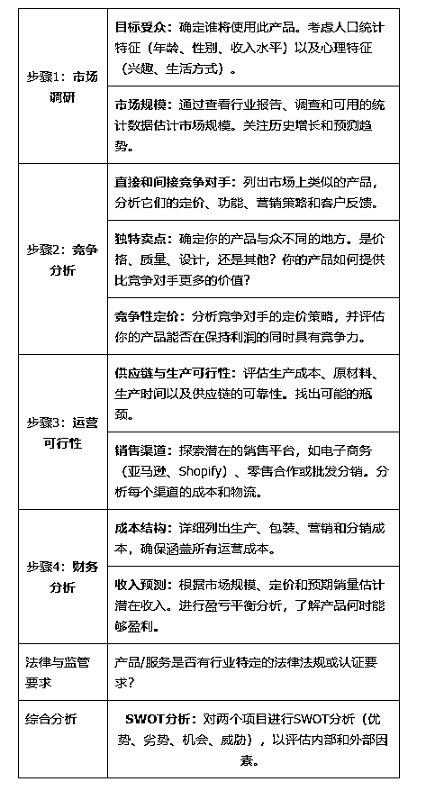

本文会用一到两个真实产品案例，演示如何组合工具来做轻量化的市场体量、竞品画像和卖点提炼。

## 一、目标客群摸底

若已经积累了一批客户，可以反向拆解来获取初步画像。

**Google Analytics**：只要有官网，Google Analytics 能给出访问者的年龄、性别、地域、兴趣等基础画像。

**社媒后台分析**：有相关产品的社媒账号时，各平台自带的洞察工具都会展示粉丝特征。

比如 tiktok 的分析页就是这样。

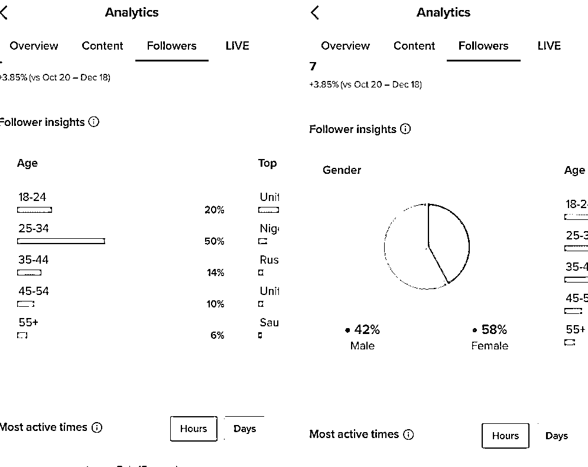

如果项目还在想法阶段。

可以先用这几种方式锁定客群：

1.团队内部头脑风暴。
2.对潜在用户做访谈。
3.阅读第三方行业报告。

常用报告库有 Statista、ibisworld

 images.zsxq.com/FuZzLcXZyuhUpgitvf6g41jiqPWS) images.zsxq.com/FuSkZYvWWuRt3lvpk1lv979xmrVm)

## 二、市场规模摸底

在我看来，市场规模主要靠两条线：

1.查行业调研报告。
2.做产品关键词需求调研。

报告网站前面已提过，主要就是 Statista、ibisworld。

优质报告里通常包含市场规模、用户画像等。

有的报告还会延伸到产品矩阵、社媒热度等维度。

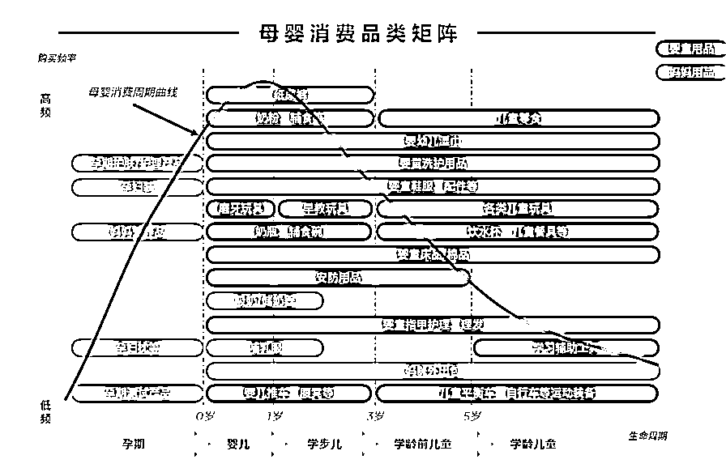

下面讲讲如何用关键词搜索量来间接估算市场大小。

假设目标产品是电子秤，更具体是菜市场里那种称重型货物的平台秤。

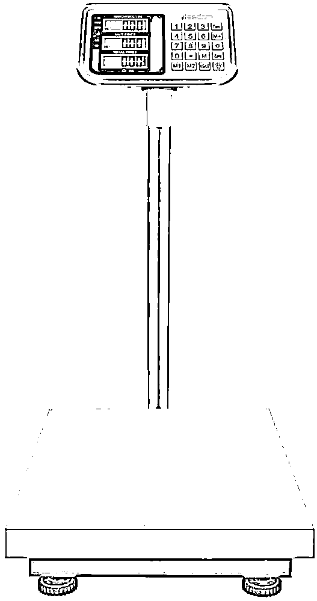

### 先确定产品的英文关键词

第一步要先把产品名字翻译成英文，否则没法用工具查。

有两种做法，第一是靠翻译软件，比如百度翻译。

第二是靠 AI 工具。

先试百度翻译，结果给出 Electronic scale。

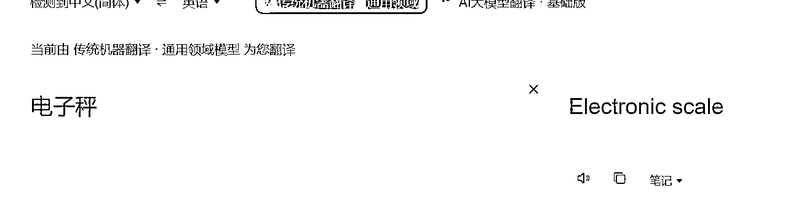

再用 AI 验证，我这里用 Google 的 gemini 做演示，chatgpt 或 claude 效果相近。

把产品图传上去，提示词写：

请告诉我图片里这个产品的具体英文名称是什么？

AI 回复是 digital platform scale。

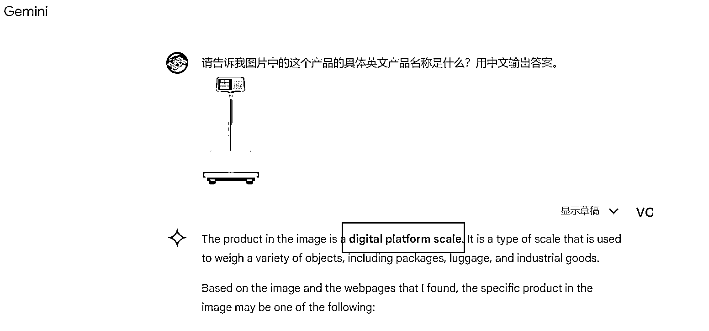

于是我们得到两个候选词：

electronic scale 和 digital platform scale。

### 关键词要不要用对

到底哪个词更准？

这是 B 端出海最容易踩的坑：关键词没找对。

举个例子，番薯。

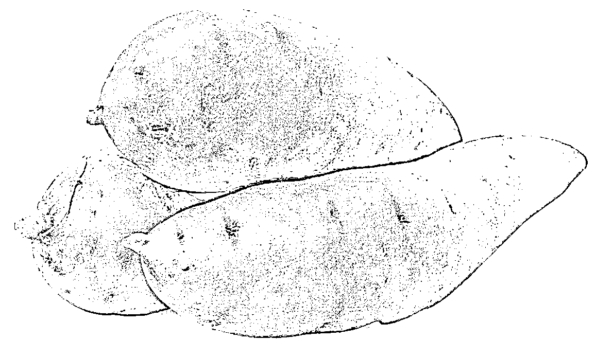

不同地区叫法不同，可能叫红薯、地瓜。

在日本叫薩摩芋 Satsuma-imo，在美国常叫甜薯 sweet potato。

词不对，后续所有调研都在做无用功。

我推荐用谷歌图片做交叉验证。

在谷歌图片搜索 electronic scale。

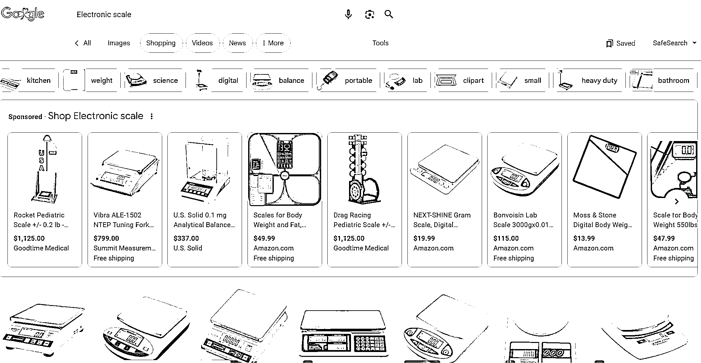

结果基本是小型台秤，和我们要找的体型不符。

再搜 digital platform scale。

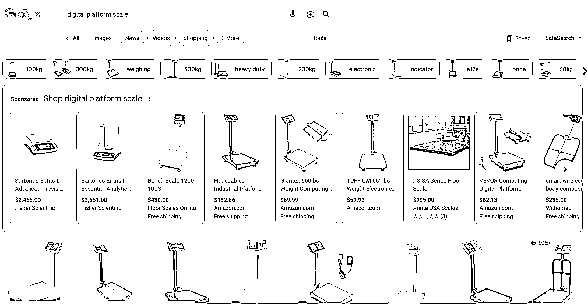

结果就很接近目标产品了。

为保险起见，还可以点开图片看下方标注的商品名，多看几个做交叉。

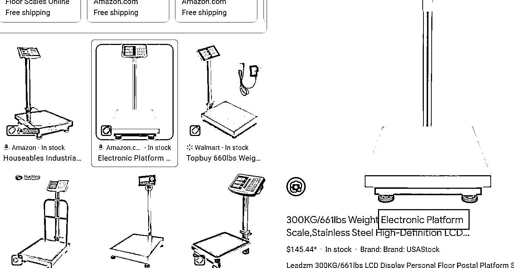

多点开几张后，还能发现 electronic platform scale 也常被使用。

目前锁定两个常用词：

digital platform scale
electronic platform scale

下一步用数据看目标市场更习惯搜哪个词，以及需求量大概多大。

### 用关键词工具看需求量

假设目标是美国市场。

底层逻辑是：谷歌上的关键词月均搜索量 ≈ 市场需求 ≈ 市场体量。

B 端用户最直觉的搜索入口仍是谷歌。

关键词工具很多，付费的有 semrush、ahrefs、kwfinder、Ubersuggest、AnswerThePublic、Moz 等，免费可用 Google Keyword Planner。

下面以 semrush 为例。

digital platform scale 的全球月均搜索约 440，美国约 90。

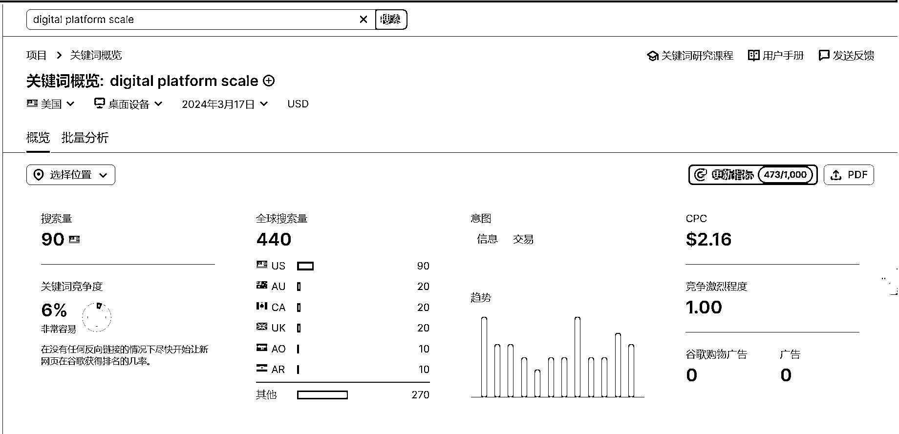

electronic platform scale 的全球月均约 420，美国约 20。

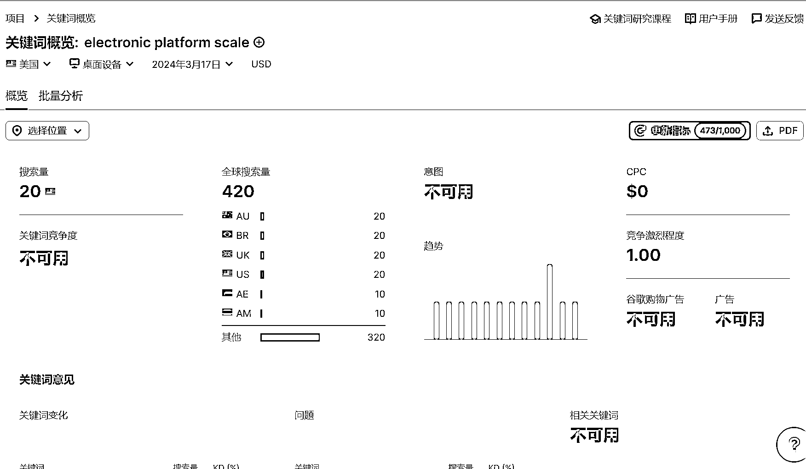

对比后，若主攻美国，优先词应为 digital platform scale。

semrush 还能做关键词扩展、意图分析等。

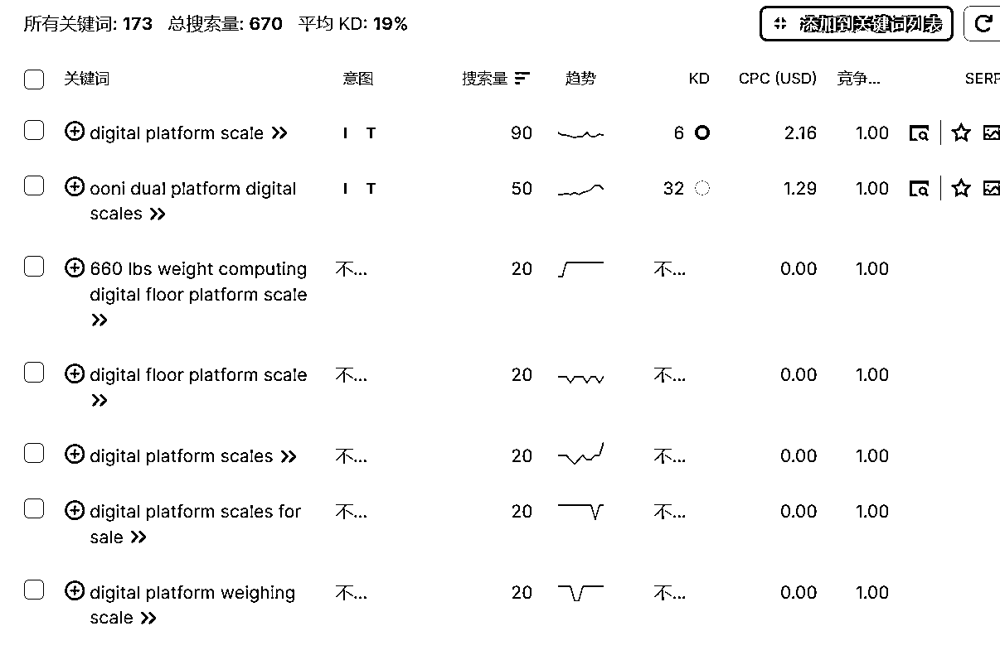

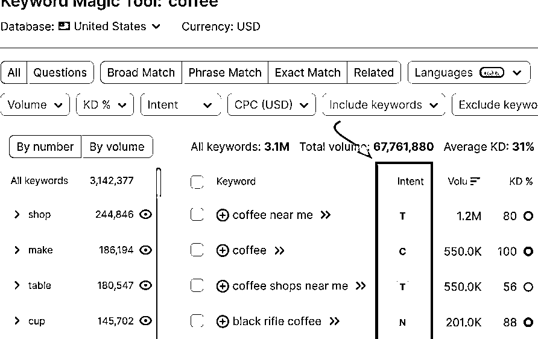

semrush 除了关键词，还能做竞品数据分析，后面会展开。

### 用谷歌趋势做二次判断

打开 trends.google.com/trends

输入两个词，地区选美国，时间选近五年。

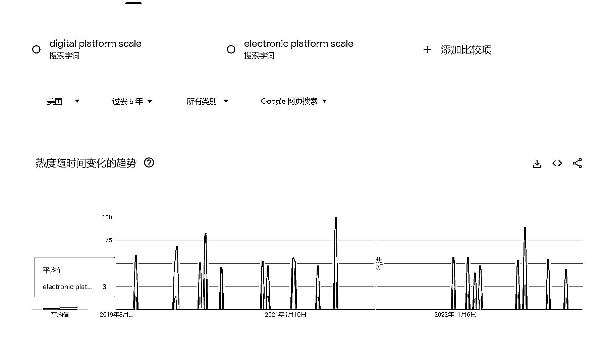

热度曲线非常接近，差距不大。

向下滚动可看各州的偏好差异。

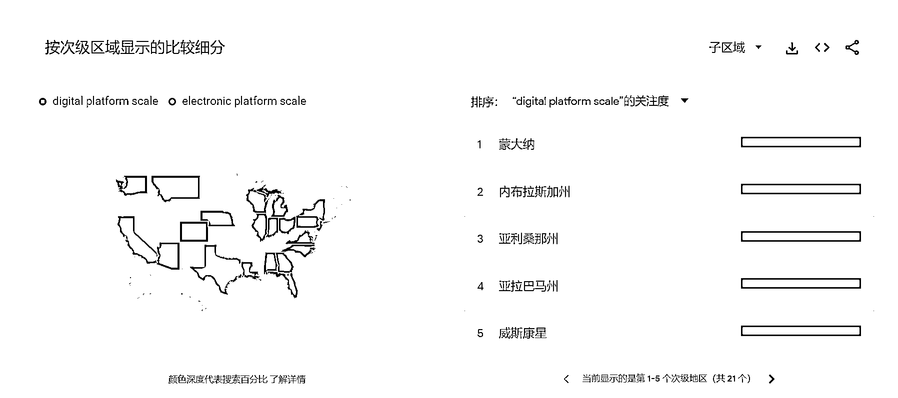

这对投放搜索广告很有参考价值，能按州精细化投放。

目前结论是：主词 digital platform scale，次词 electronic platform scale。

**注意：谷歌趋势给出的是相对热度占比，不是绝对搜索量。**

趋势页还能看到需求随季节、节假日的波动。

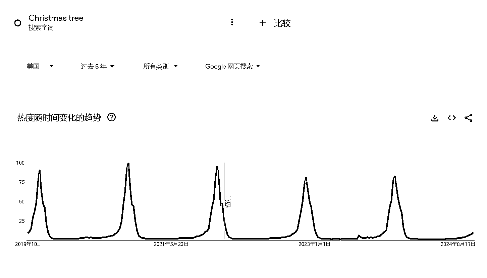

### B 端贸易市场的体量如何看

做 B2B 外贸，不能只看 C 端搜索。要用 B 端搜索词来验证。

打开二叔的 B 端关键词工具：

[[https://2uncle.com/google-search-ads-keywords-2b/]](https://2uncle.com/google-search-ads-keywords-2b/])([`2uncle.com/google-`](https://2uncle.com/google-) search-ads-keywords-2b)

输入 digital platform scale，会批量生成大量 B 端相关长尾词。

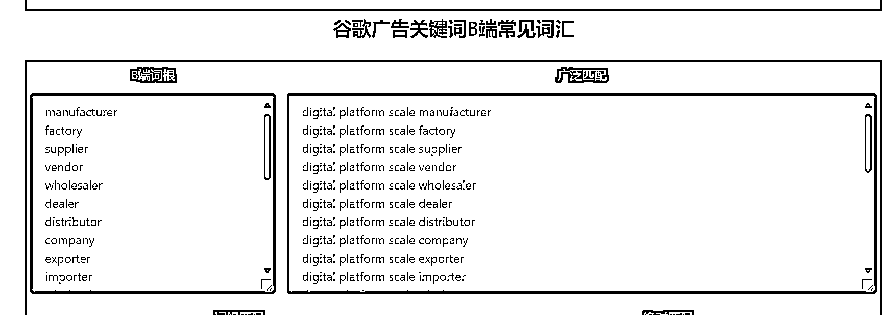

再用 semrush 逐个查搜索量。

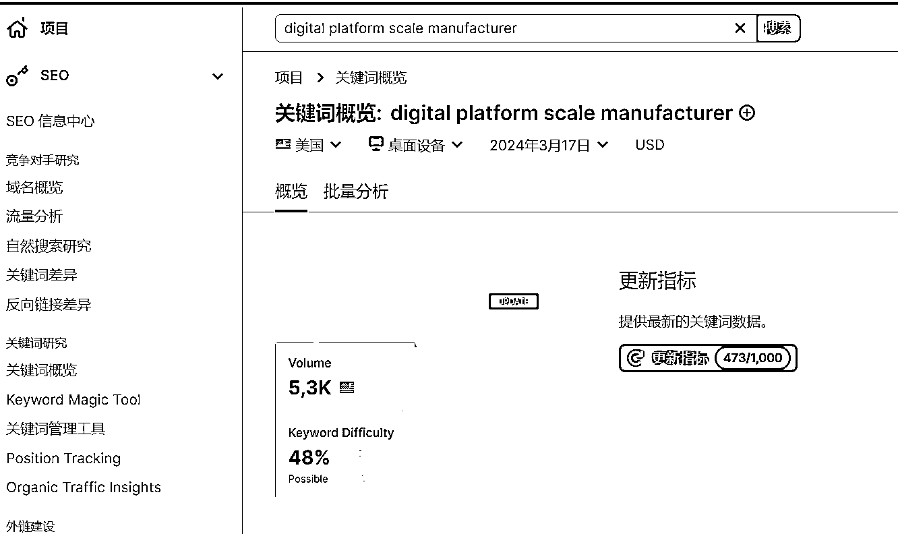

很多词搜索量太低，工具查不到数据。

### 查不到数据就等于没市场？

这是 B2B 外贸的常见误区。

B 端需求本身就不大，工具经常显示空白。

但这并不代表没有市场。但这并不代表没有市场。但这并不代表没有市场。

重要的事情说三遍。

原因在于第三方工具只能推算谷歌公开数据，并非全量，数据越小量越容易查不到。

所以工具更多用于横向对比。

这种情况下，最可靠的做法是看同行。

同行数量、做得如何，能真实反映市场。

## 三、竞品调研

### 怎么找到同行网站

打开：

[`www.brightlocal.com/local-search-results-

checker/`](https://www.brightlocal.com/local-search-results-checker)

该工具能模拟本地人视角查看谷歌搜索结果。

补充一个知识点：

用谷歌搜索时，有时看不到广告，不是没人投，而是谷歌识别到你在国内就不展示。

淘宝有千人千面，谷歌也有。想做本土化调研，需要伪装成本地 IP。

用这个工具就能模拟美国本地搜索。

输入关键词，选美国、语言，开始搜索。

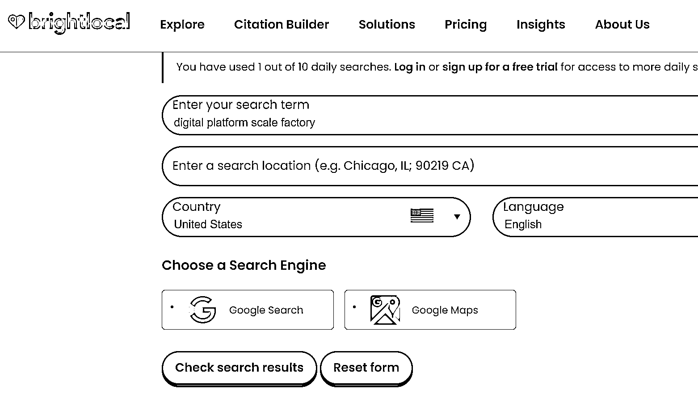

进入第一页。

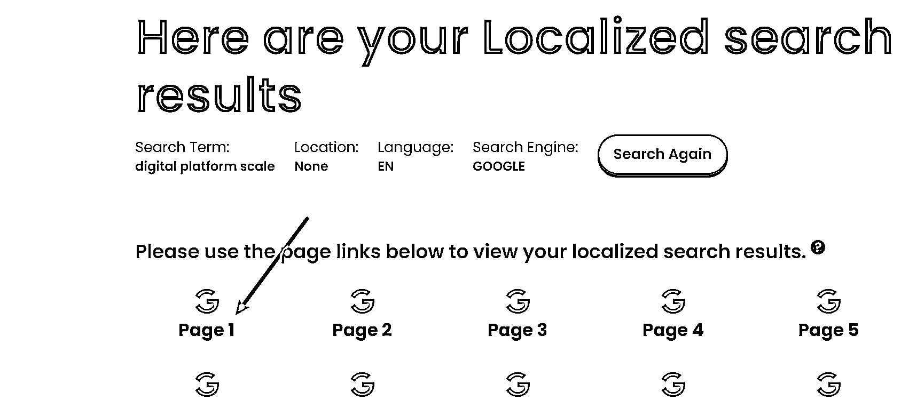

若看到大量 sponsored 标识，说明伪装成功。

第一页就能看到在投广告的商家，有人持续投放就说明市场有利润。

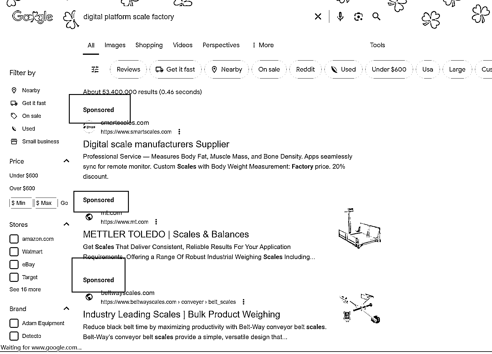

这些投广告的同行值得重点研究，他们愿意付费，业务大概率能盈利。

### 网站流量与数据拆解

把这些网址丢进 semrush 或 similarweb 查看详情。

semrush 能看自然流量、付费广告情况、核心市场、主推关键词、品牌声量、竞争对手等。

下面是 semrush 截图。

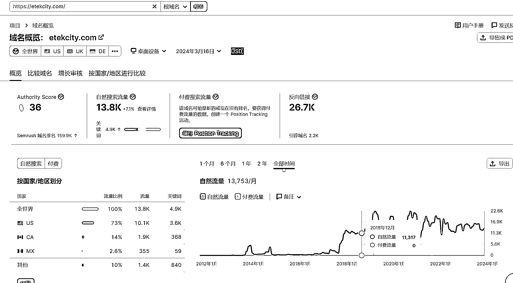

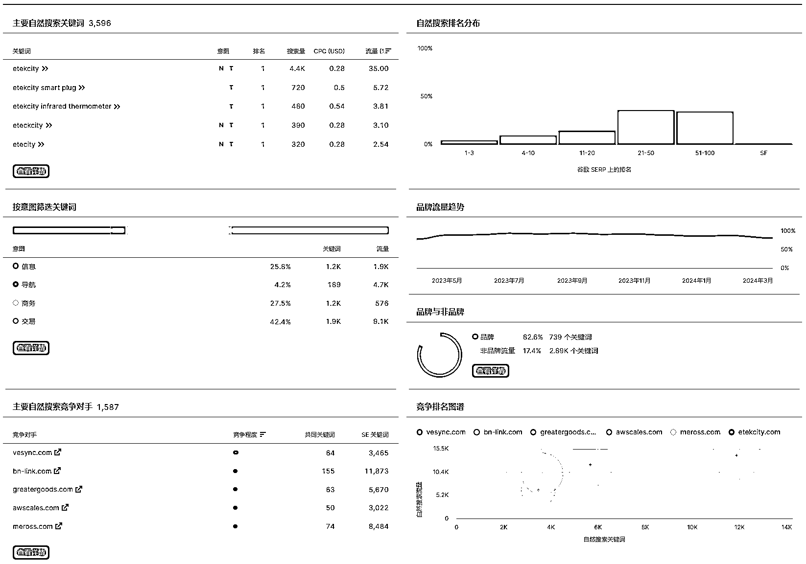

similarweb 在全站流量分析上更全面。

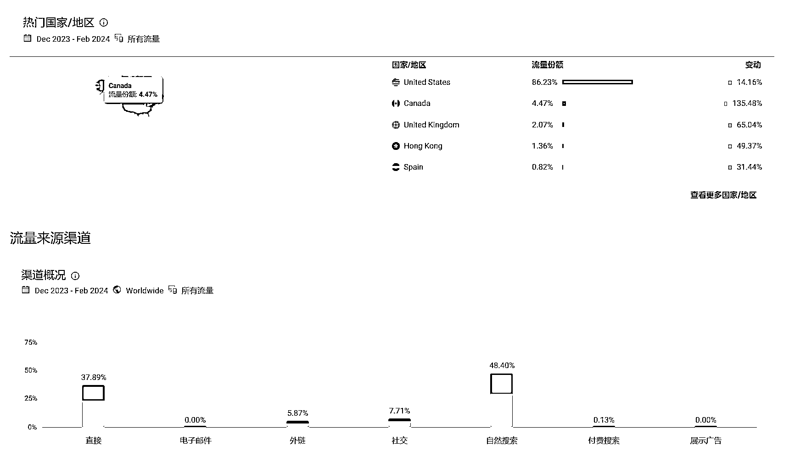

### 网站历史变化

网站时光机：[`web.archive.org/`](https://web.archive.org)

可以回溯页面样式演变，观察同行产品线、设计思路的变化，推测其策略调整。

### 网站搭建方式

可用插件识别。

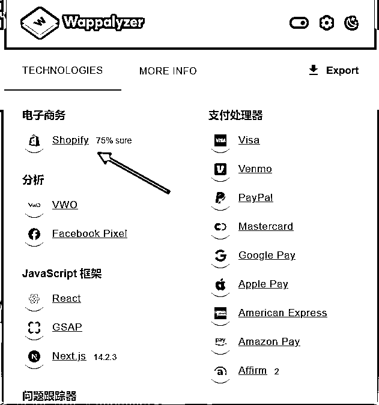

知道建站方式有好处，若是 Shopify，就能用专门的 Shopify 分析工具估算热销品和销量。

### 粗略推算 Shopify 订单量

一个小技巧：每天固定时间在同行 Shopify 站下单后取消，通过订单号递增差值来估算日单量。

### 竞品广告与社媒

查看谷歌广告：Spyfu 或 semrush。
查看 Facebook 广告：Facebook Ads Library，免费。
追踪社媒内容：BuzzSumo。

可快速找到关键词相关的爆款内容，用于监测竞品社媒动态。

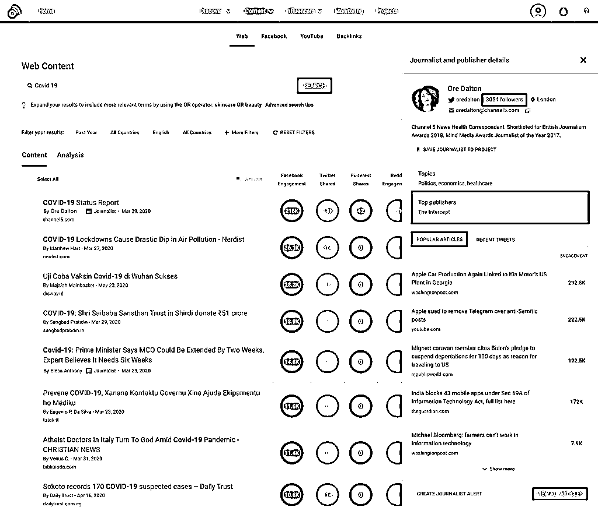

### 其他辅助手段

AI 搜索引擎或 AI 工具的高级功能也能直接做数据整理。

AI 能快速汇总大量报告和数据源。

比如 kimi 的探索功能。

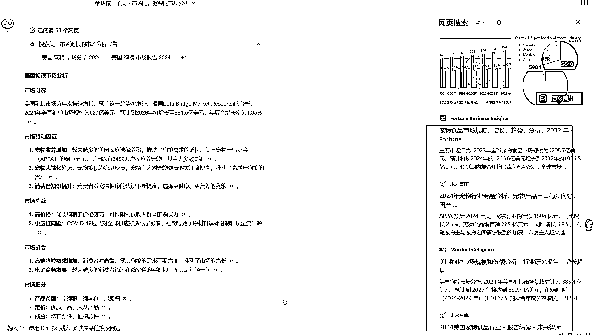

AI 总结不一定完美，但可以反向利用它来收集数据源。

### 如何找到利基型同行

如果能找到能力一般但赚钱、获流量的同行，直接对标就是弯道超车机会。

工具用 ahrefs。

登录 ahrefs，点击 content-explorer。

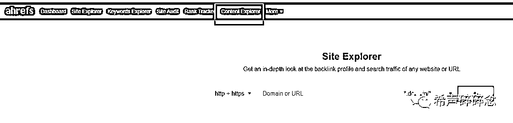

输入主关键词，选择 in title，搜索。

筛选语言，按目标市场选择，打开“Filter explicit results”。

点击 Add filter，按下图调整：

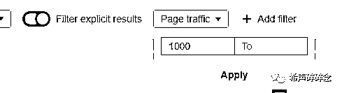

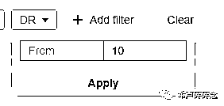

该筛选逻辑是：页面流量 > 1000，DR 值 < 10。

在做竞品分析或市场调研时，我们经常会用到各类SEO工具来评估一个网站的“权重”。不过要留心，像Ahrefs里看到的DR值，其实是它自家算法给网站打的评分；换成Moz，这个名字又变成了DA。不同工具算法各异，叫法不同，具体数值自然也有差异。所以，想要横向比较多个站点的权重，最靠谱的做法是固定用同一款工具去测，这样得到的数据才有可比性。

我们之所以设定这个权重范围，初衷很简单——找出那些权重不算亮眼、却依然能稳定获取自然流量的网站。当然，这个数值区间你完全可以根据自己的需求灵活调整。

锁定目标之后，再去拆解它们背后的逻辑：是关键词布局特别精准？还是外链积累扎实？又或者是产品本身足够有竞争力？

不过，同行的研究不能只盯着网站看。市场调研讲究一个全面覆盖。如果你是做电商的，那电商平台上的同行更是重点研究对象。这里可以借助各个平台专用的数据分析工具，比如亚马逊的卖家精灵、Shopee的知虾、Etsy的eRank等等，都能帮你摸清平台内的竞争态势。

至于卖点调研，最直观的途径依然是看同行。但比看同行更高阶的做法，是倾听消费者的真实声音。最简单的入口，就是去翻各大电商平台的评论区。像是亚马逊的评论分析插件TheReviewIndex，就能帮你快速提炼出用户反馈中的高频关键词。

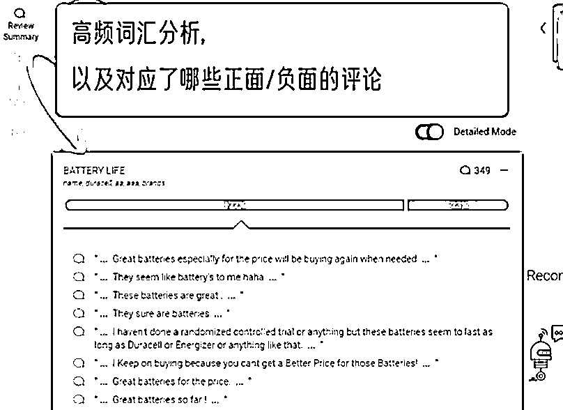

客户的差评=客户的痛点=产品的缺点=我们的机会

如果这篇内容对你有所启发，别忘了点个赞支持一下哦~