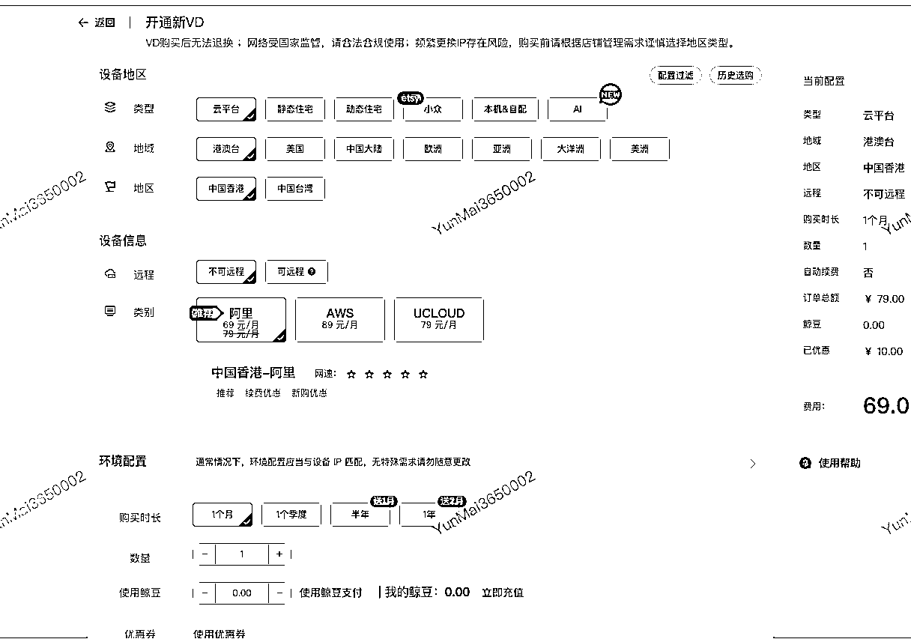
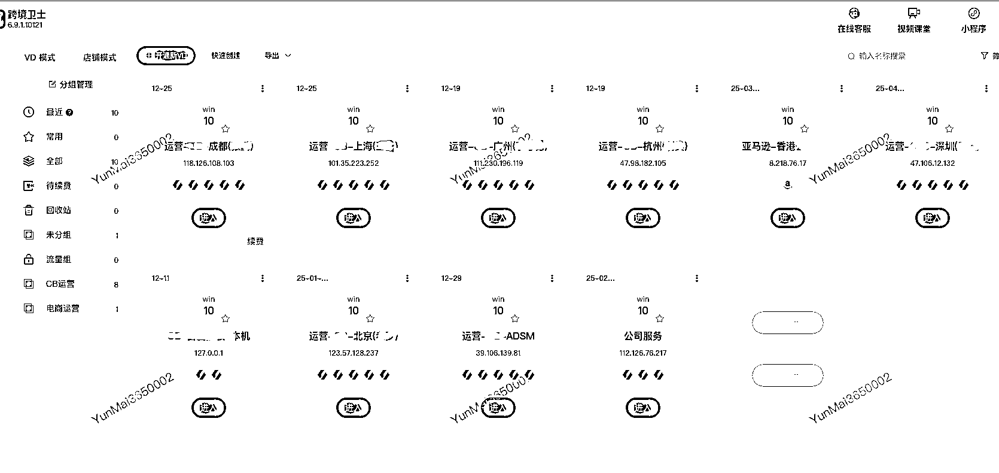
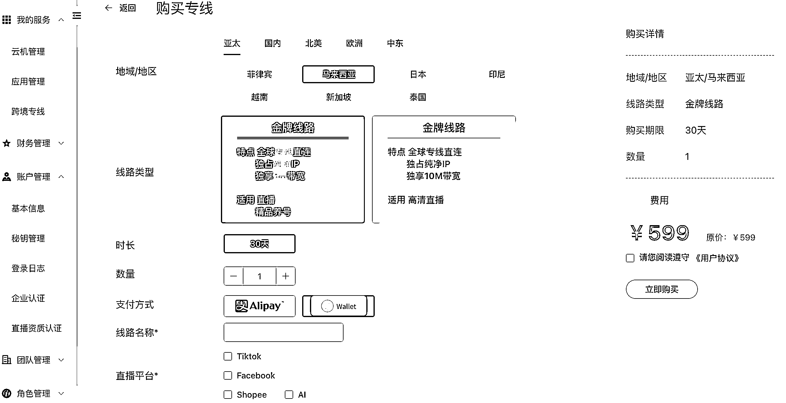

# 各平台账号矩阵运营交流「交作业#龙珠悬赏」
作者：龙哥

刚才在车上刷到消息，感觉正好对上号，就顺手记下来分享一下。文笔一般，大家将就看。

我习惯直接上干货，所以写的比较急。后面如果有大佬来补充，肯定会更精彩。

先简单交代一下我自己，按赚钱的模板抄一下。嗯，确实有点懒。

【赚钱昵称】李海滨

【所在地区】天津 河西区

【自我介绍】

MBTI 是 INIFJ，90 后互联网杂工。互联网和跨境电商相关经验接近十年，主做跨境出海的底层工具，比如出海浏览器、网络 IP 专线资源这块。

【能提供的资源】

1、跨境电商相关的网络资源，云服务器、代理 IP、海外的社媒账号等

2、社媒运营、Web3 方向的业务运营经验分享，以及多账号管理的方法

3、项目管理咨询、产品逻辑梳理、海外运营矩阵的交流

看下来大概能明白我的方向了，不是来砸广告的！不是来砸广告的！不是来砸广告的！强调三遍。我自己就是 SaaS 出海工具的从业者，同时也是真实用户，因为不了解业务根本做不好。我的工具是付费的，免费的往往最贵，这个道理不用多讲，没有免费午餐。

直接上干货。

**一、做跨境电商卖家的看这里：跨境卫士安全浏览器（[`www.kuajingvs.com`](https://dwz.cn/mf9qgdQA)）**

跨境电商说白了就是把国内的产品通过 Amazon、eBay、Lazada、Shopee、Shopify、Ozon 等海外平台卖到国外。国内的淘宝、京东、拼多多可以一台电脑开十几个店共用一个浏览器和网络，海外平台不行。风控和审查极严，这样操作几天甚至当天就被封。

因此很多卖家被迫走高成本路线，比如开十个亚马逊店就配十台电脑，十条独立网线、十个网关来做环境和网络隔离。设备和管理成本还没开始卖货就先把人拖垮了。

我们 2018 年就做了这款浏览器。集团本身做外贸三十多年，内部孵化团队切入跨境风口，既是卖家也是做 SaaS 的。卖家只要在一台电脑上装上跨境卫士，买一个 VD 环境加全球 IP，就能在一台机器上安全合规地管理多个平台的多个店铺，还自带出海加速，支持多人协同、异地办公。

购买开通 VD 环境及全球 ip

下面是我自己在用的界面截图

用法很简单，降本增效又安全。过去六年服务了近几百万店铺，十几万跨境卖家。

**二、想做出海生意的伙伴：ClonBrowser 指纹浏览器（[`www.clonbrowser.com/zh`](https://www.clonbrowser.net/?code=l1qUzv)）**

说大点，全球经济环境下，大家都想多赚点。第二个我自己在用的产品是我们的指纹浏览器 ClonBrowser，专门适配各种出海生意和多账号玩法。

我调研过出海赛道有四五十种，从场景来看，抓住三点就够了：远程、创作、成本。远程不只是线上化，是远程工作、生活、协同服务；创作是内容和品牌，各行各业的创造，甚至 AI 生成的内容；成本是时间、金钱等价值衡量。

基于这三点，ClonBrowser 在矩阵运营上的适配场景主要有：

1、各类海外社媒、游戏矩阵账号的运营管理：TikTok、Facebook、WhatsApp、X、Instagram、Discord、Telegram、Gmail 等

2、Web2 想往 Web3 迁移的工作室、项目方：Web3 性价比最高的指纹浏览器

3、传统 B2B、B2C 企业：推广垂类免费流量，获取精准询盘

核心是多账号矩阵运营。大多数人会问，为什么不用本地浏览器多开？表面能用，实际已经被记录。做的是长期生意，账号资产隔离和安全才是根本，不能存侥幸心理。

下面是我运营的截图，推广账号 800 多套，覆盖海外图文、问答、视频平台，以 TK 为例：  images.zsxq.com/FltSt7dLjcNTijbMpyJLgtZ66gD2)

用同步器同时操作，后续结合 RPA 自动化运营账号：

敏感信息已抹掉

 images.zsxq.com/Fmzci7Ow5HUECvUNQMfgGBWAAFea) images.zsxq.com/FhFvIxDK4pRagX5l48VgyC-AKk3G)

**三、网络资源需求：开鲸云（[`www.kaiwhale.com）`](https://www.kaiwhale.com）)**

这部分最直接，提供各种网络 IP、专线、AI 算力资源。合作方是全球各大运营商，也是我们自己的业务。

1、为什么要推？
市场太乱，资源良莠不齐，IP、节点、加速的质量参差不齐。出海安全合规和账号数据安全的前提下，我们把这块提炼出来，帮想用干净安全网络资源的伙伴省去筛选成本。网络资源的水很深，玩法很多，我们踩过的坑你们没必要再踩。我也是卖家，在当下环境下，谁都想多赚点美金、英镑、欧元囤粮，不想把时间耗在内卷的资源筛选上。

2、具体有什么？
干净卫生的全球 IP，覆盖各大厂商 images.zsxq.com/Fg2uDtiCkDB6KbUUrLOw97gz_htP)

适合 TikTok 直播的直播专线：市面上解决方案很多，流量卡、软路由、🪜工具等等。我们测试后筛选出 2-3 条优质线路，价格虽高但反馈很好。因为账号资产远比这些解决方案值钱，账号才是最值钱的！

有点乱有点杂，我自己也参与过赚钱和 Web3 的活动，发现很多人有出海想法但要花大量时间摸索。我之前就免费帮不少小伙伴解决软件网络问题，让他们回到赛道本身，而不是卡在工具上。

以上不是广告，是工具分享，恰好我就在做这个。如果有需要的朋友可以直接联系上面的客服，报我名字可以享受 VVVIP 服务和优惠。

第一次写，请多担待，希望能帮到大家，后续可以多交流。

我在天津，我叫海滨