# 龙珠悬赏：对新兴事物、全球趋势、热度方向的研究工具分享

今天想跟大家聊聊我一直在用的“新事物探测器”——一套帮我盯住全球趋势、挖掘潜在机会的研究工具。不是理论空谈，而是我亲身验证过的心法+实操，看完你也能直接上手。

先说说我为什么对“新兴事物”这么执着。我一直有个信念：真正的大机会，往往藏在新东西里。你看社群里讨论最多的公众号、小红书、视频号、闲鱼、抖音，说白了都是自媒体玩法，而自媒体本身就是十年前冒出来的“新兴事物”。我拿赚钱的行业页面随便搜了下，小红书出现52次、视频号42次、抖音51次、闲鱼19次、公众号14次——高频出现的背后，恰恰说明这些平台曾经承载了多少红利。

我本人是00后，老家在十八线小县城。2017年上大学时，周围人都在劝我报土木、机械这类当时看起来很热门的专业，我却选了软件工程。2021年毕业前，我在国家统计网站上看到应届生工资排行，计算机类专业以月薪8000排第一，而我当时拿到的offer是月薪2万。为什么？就是因为移动互联网那波大潮的余温，让我赶上了。这件事彻底坚定了我的想法：新东西里才有肉吃，成熟赛道只能喝汤。

“站在风口上，猪都能飞起来”——这话谁都听过。但我不奢求能精准预测下一个风口、下一次技术革命。只要我持续盯着新事物，等机会来临时有精力、有能力参与进去，就已经很好了。caoz老师说过一个观点：“一切皆概率”。每次关注、每次尝试，都在增加我们赢的概率，而人生只需要赢一次就够了。你看这两年AI多火，从账号倒卖到各种细分应用，多少人赚到了钱？这就是活生生的例子。

更宏观地看，高科技行业每隔大约15年就会有一次范式转移：1947年晶体管，1959年集成电路，1977年PC，1993年互联网，2007年移动互联网，2022年ChatGPT。每一次转移都带来生活方式巨变，也全是赚钱的机会。摩尔定律让算力成本指数下降，新东西的爆发速度只会越来越快。所以，研究新事物、全球趋势、热度方向，不是可选项，而是必选项。

接下来，直接上干货。下面这些工具都是我自己高频使用、且免费或付费但值得的，围绕的核心就一个：新兴事物、网站/应用热度、全球趋势。

**1. Google Trends（免费）**

网址：trends.google.gg/trends/

这个不用多介绍，就是看某个词、话题在全世界或特定地区的搜索热度变化，能看长期也能看短期，还能看相关查询。我的用法是：当发现一个有意思的东西，先拉它的趋势曲线，再点开相关查询，看人们到底在关心什么。比如AI这个词，从2023年到现在一直是超级热门，相关查询里全是大家关注的细分点——机会就藏在这些点里。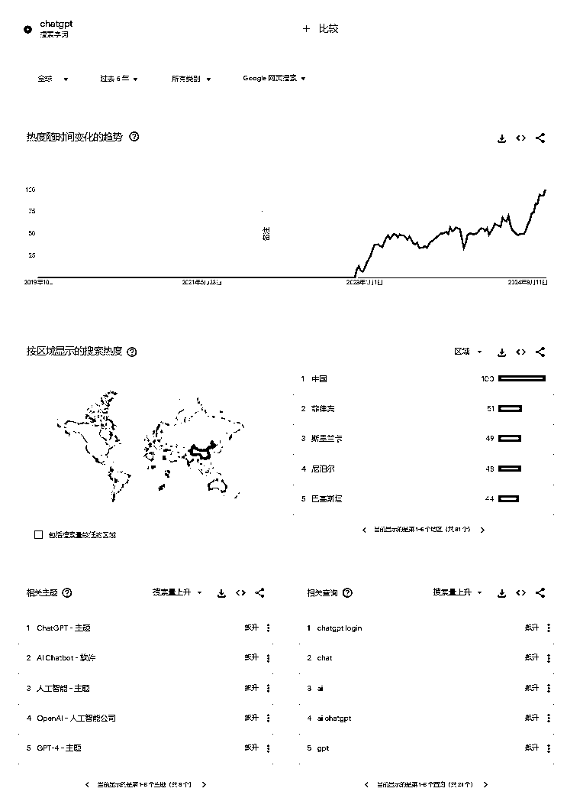

再比如“galgame”这个词，源自日本的二次元互动游戏。我在Trends里一看，热度主要集中在中国。带着好奇心往下搜，排在前面的问题是“为什么虚拟恋爱游戏在中国流行”“为什么美国人不玩galgame”。把这些内容读一遍，你对一个新事物的理解就从“听说过”变成了“有判断”。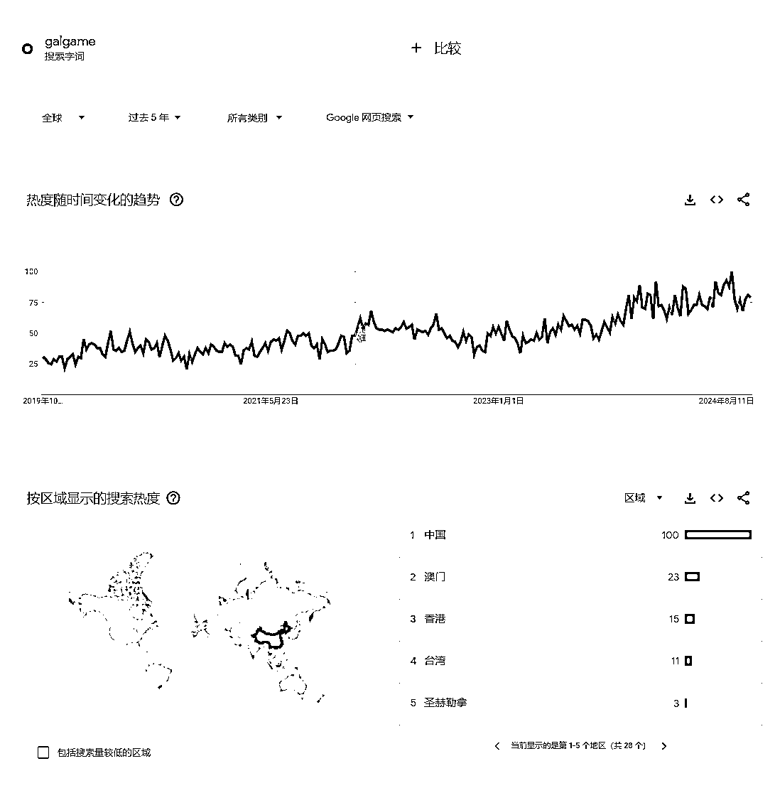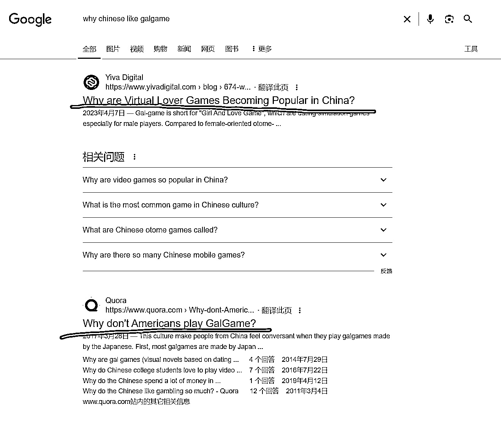

**2. GitHub Trending（免费）**

网址：github.com/trending

这是程序员的雷达，也是所有人的信息源。我常看周榜和月榜，国内外最近有什么热门开源项目，一下就能看到。比如全球月榜，排名前两位的都是AI相关项目——这就是风向标，也是信息。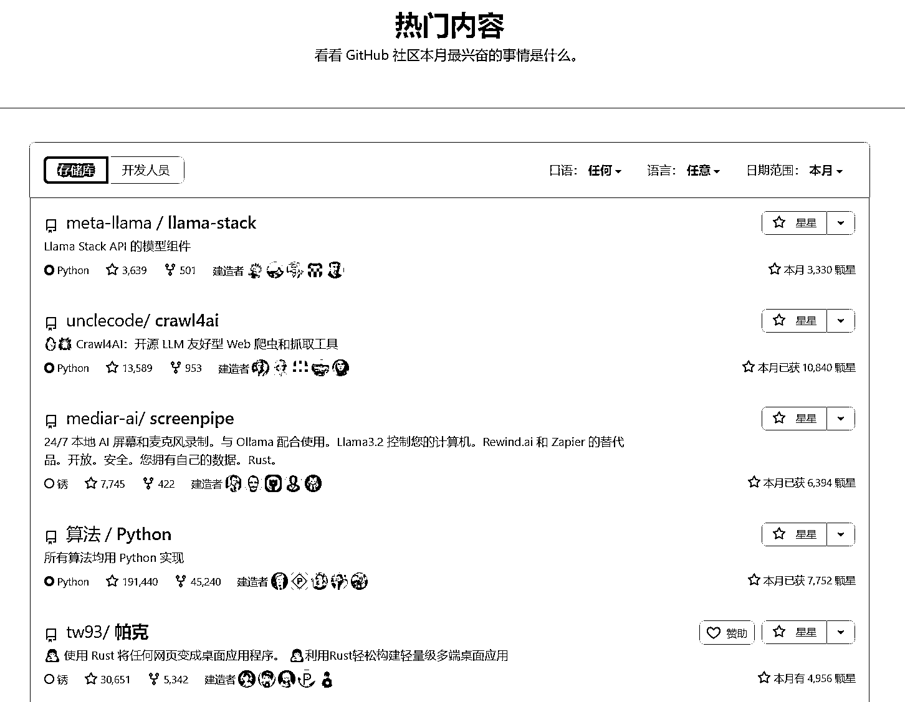

中文语言榜更有意思：有“科技爱好者周刊”，我每周必看，里面全是科技新闻、实用工具、招聘信息、优质文章；还有各种有趣的应用和小工具、免费的音乐播放器（我寻思着是不是能挂闲鱼当虚拟产品卖）、Linux学习资料等等。我的很多常用工具——PDF编辑器、B站视频下载、音频提取、练英语的网站——都是这么刷出来的。看得多了，就有了自己的信息渠道。我甚至用里面找到的网站模板，做了个专门收藏优质资源的个人网站。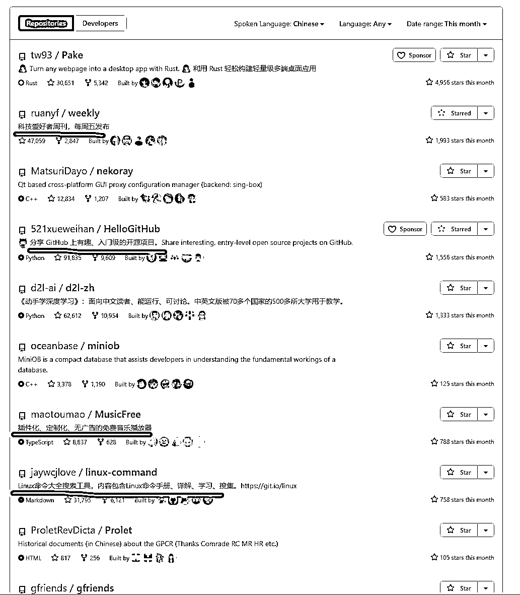

**3. X趋势（免费）**

网址：x.com/explore/tabs/trending

在X上直接看当前热门话题是什么，本质上就是看全球社交媒体在聊什么。当然，你也可以用各平台的API或趋势页面，去了解海内外自媒体内容。我这边因为特殊原因，显示的是日本趋势，点开第一条，就看到某明星饮料在那边挺火。这种信息差，有时就是商机。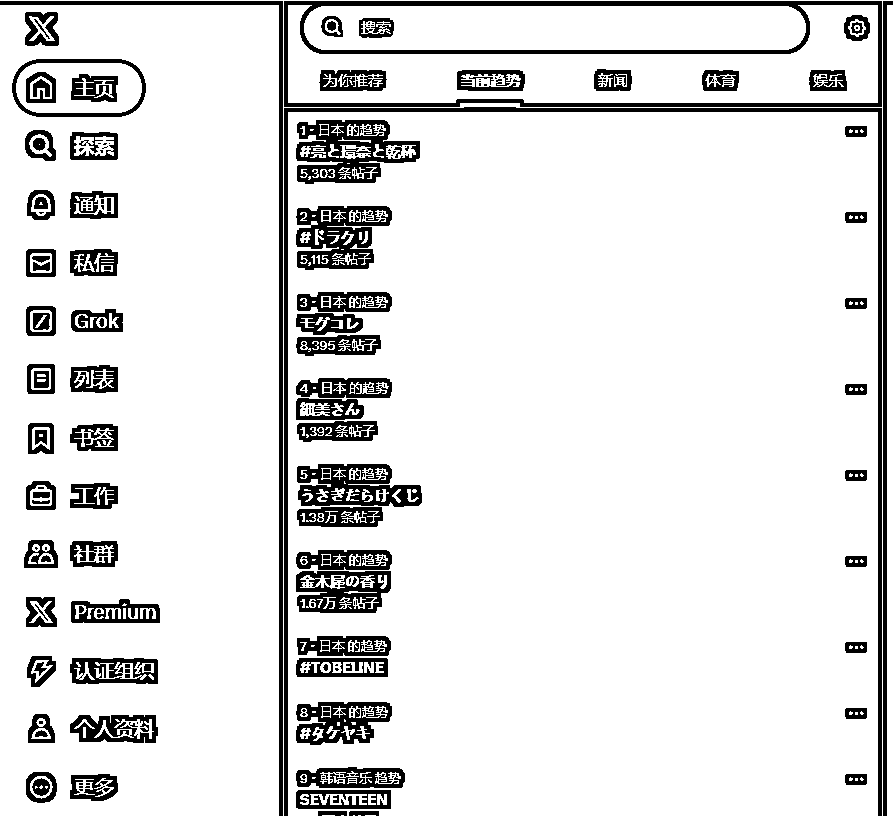

**4. SimilarWeb & Semrush（收费）**

网址：similarweb.com/zh 和 zh.semrush.com/projects/

这两个是网站/应用的流量分析神器，能看到受众画像、用户行为、流量来源、地区分布等数据。我通常搭配Google Trends用：看到一个好玩的网站，就丢进SimilarWeb里拆解，看是谁在访问、哪些内容最受欢迎。再顺着这些内容延伸搜索，背后就是用户需求，抓住细分需求就能赚钱。

举个例子：我平时爱喝鸡尾酒，又对AI感兴趣，就想“能不能用AI生成鸡尾酒配方”？然后找到了一个叫bargpt.app的网站。拿Semrush一查数据，发现这网站确实赚钱，而且关键词竞争难度不大，用AI辅助也不难做。正好我在做网站出海，干脆就打算从这方面入手，做个类似的站点。目前已经用Cursor做完了核心功能，细节还在打磨，等优化好了就能发布。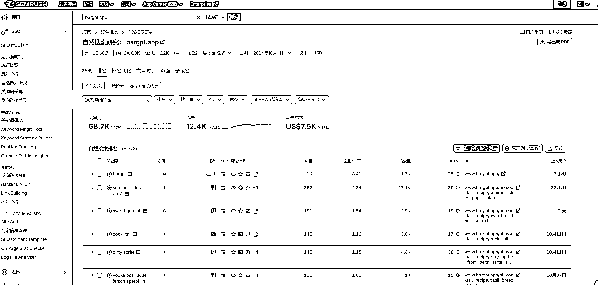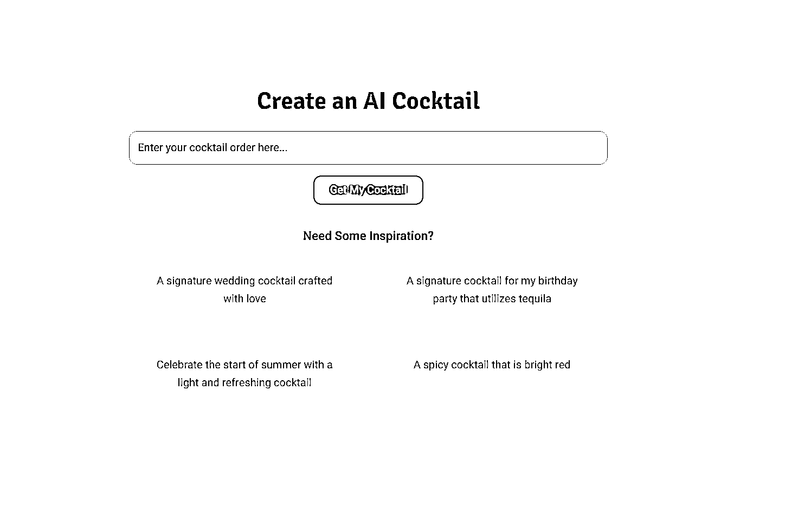

**5. 个人博客网站（免费）**

很多人忽略了个人博客的价值，其实里面常常藏着超优质的信息——我就靠它小赚过一笔。怎么发现这些博客？GitHub Trending里有一个“中文独立博客”列表，收录了大量优质个人站。另外，几乎所有博客都有友情链接，顺着一个个点下去，能挖出一大片。

我的实战案例：前段时间用AI需要绑定国外手机号，我就搜到了一个个人博客上的教程，详细介绍了便宜好用的eSIM卡渠道。我解决完自己的需求后，顺手在闲鱼发布了代购信息——成本不到20块的卡，卖50块，每天还真有人买。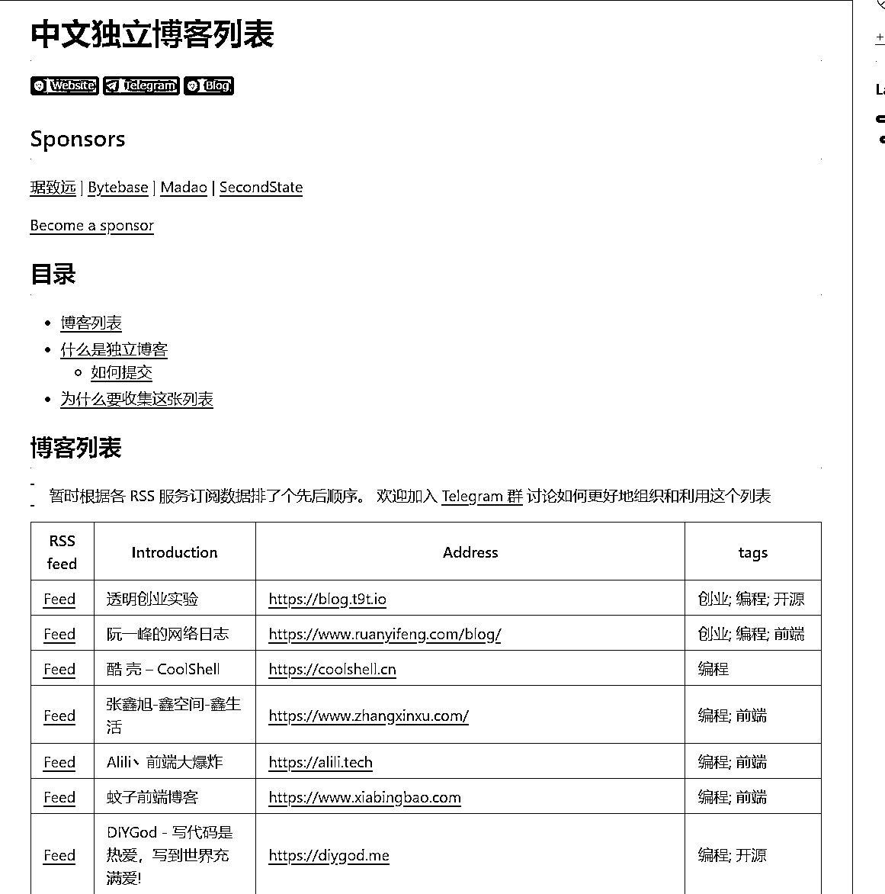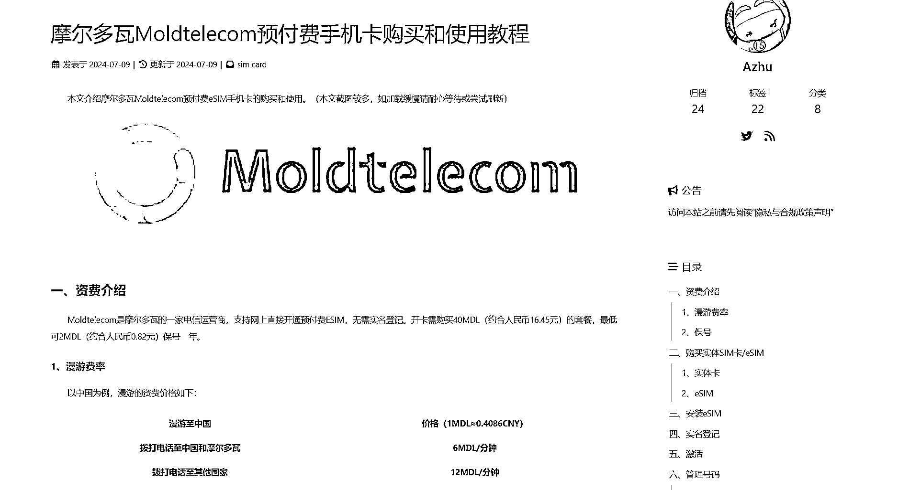

另一个用法是顺着友情链接挖出更多博客，信息量瞬间翻倍。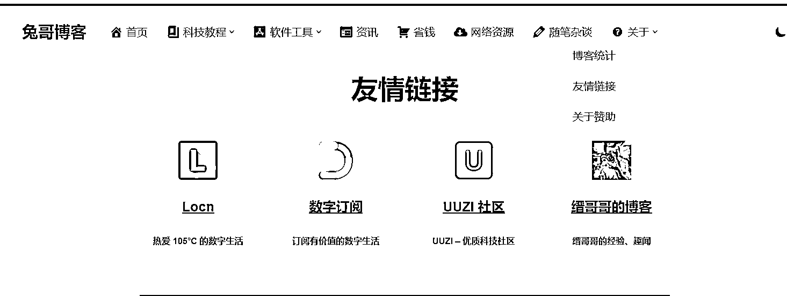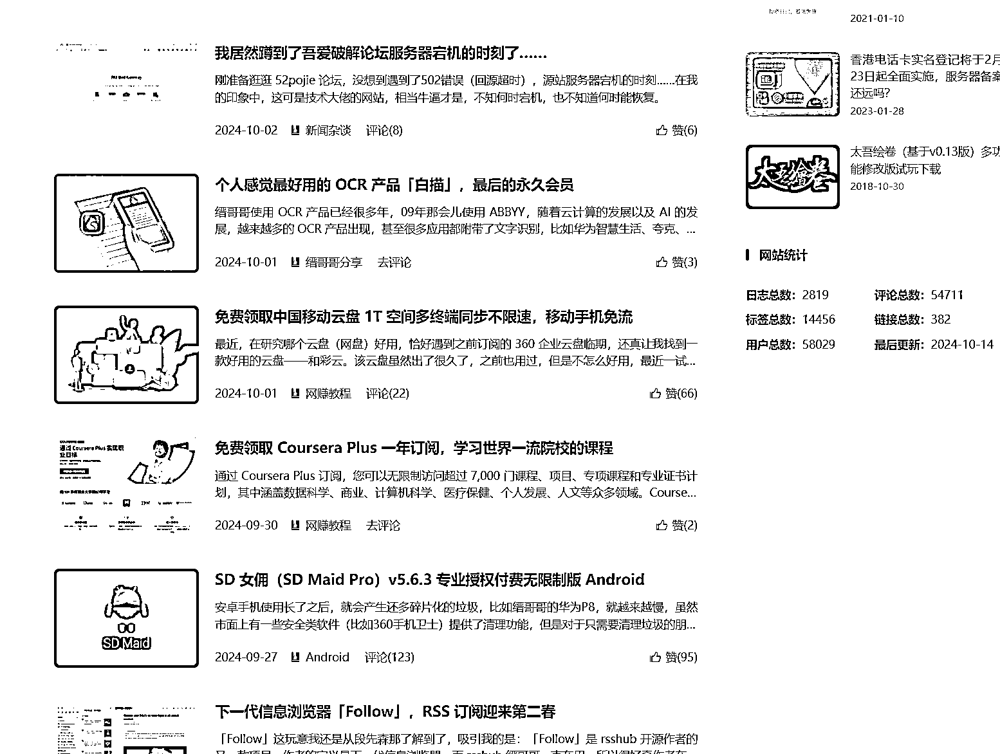

**6. 洞见研报（免费）**

网址：djyanbao.com/report/search

这是个行业研究报告平台，免费阅读和下载各种市场分析报告。当我想进入一个陌生领域，或者需要行业详细数据时，就去这里搜。比如赚钱航海有Web3交流，我就在洞见上搜相关报告，看国内外机构的研究结论，从中拿到关键数据。网站右上角还有“当前热门搜索”，也是发现新兴事物的一个入口。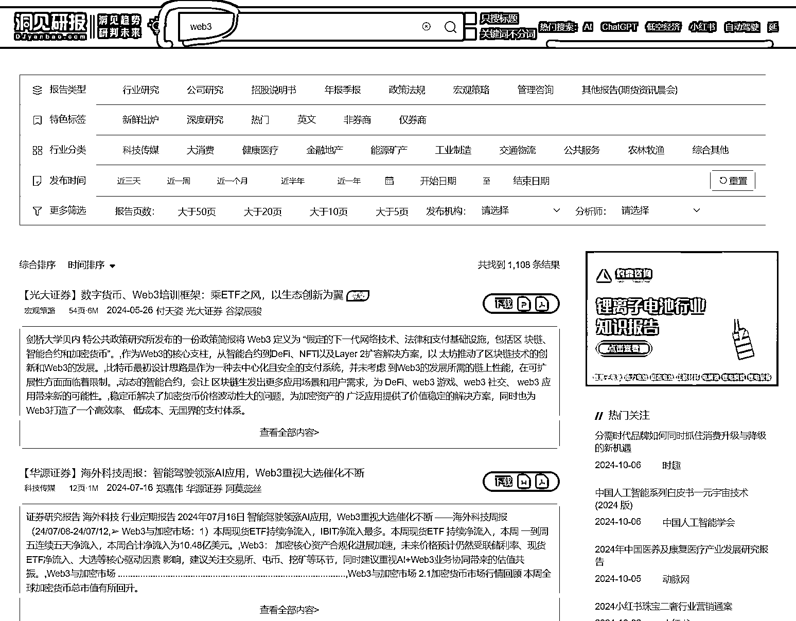

**7. Exploding Topics（免费）**

网址：djyanbao.com/report/search（原链接如此，实际是explodingtopics.com）

人的经历有限，不可能什么都知道。这个网站就是专门帮你发现“正在快速崛起”的话题。看到感兴趣的就记下来，搭配Google Trends、Semrush等工具深挖，或者换个形式搬到国内自媒体平台创作，都是不错的选择。

我试过：在网站上看到“spacegoods”这个话题，发现是一种主要在英国销售、多种营养补充剂产品。我去Google Trends一查，这词2022年5月才出现，属于很新的品类，主要受众在英国。那做外贸的、相关行业的朋友，是不是可以因地制宜跟一波？这可不就是新信息嘛。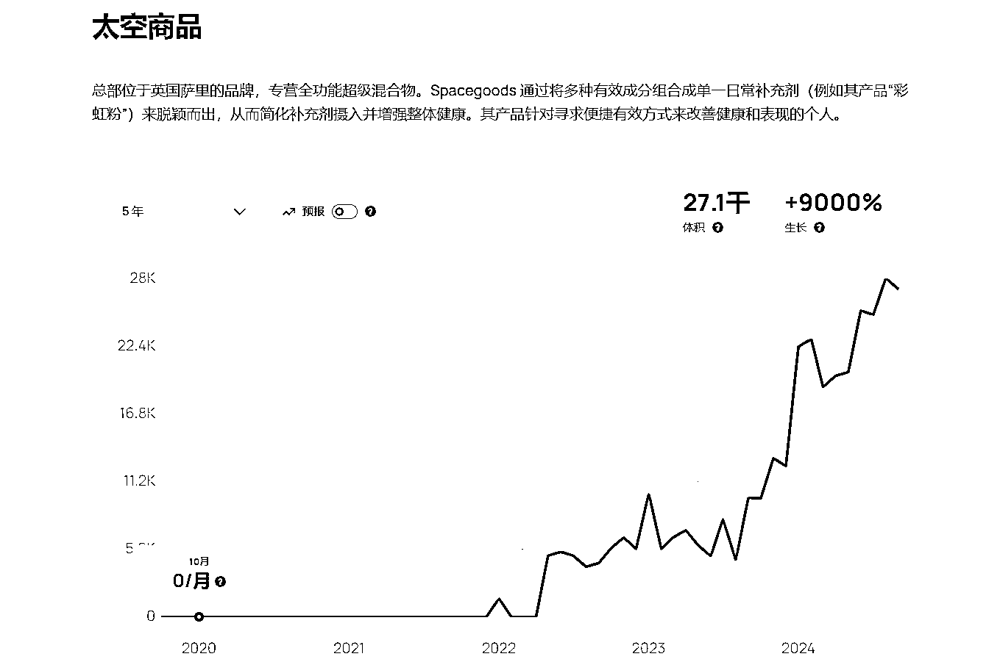

以上就是我日常追踪新事物、研究全球趋势的完整工具箱。重点不是工具本身，而是那颗“永远关注新东西”的心。机会不会主动找上门，但只要你持续盯着，总有一天能接住它。

#龙珠悬赏