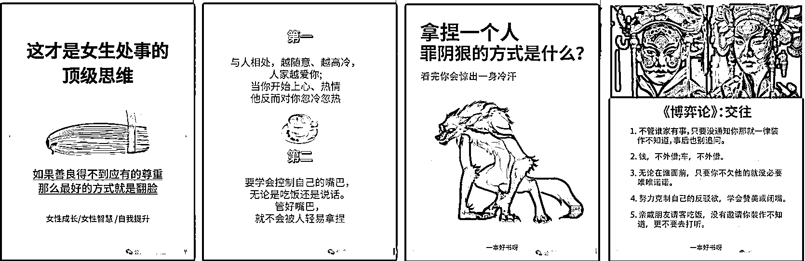
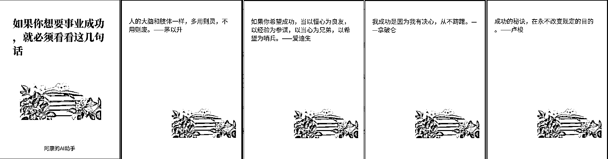

# 用 AI 结合 RPA 打通小绿书图卡的一键生成与自动上架，支持多号矩阵运营

## 精华分享 借助 AI+RPA 实现小绿书图片一键生成和自动发布，可矩阵，小白级工作流详细讲解，附：影刀脚本

作者：陈序员大康
日期：2024-09-29

最近刷小绿书刷到比较多，数据体量看起来确实在起来。我专门去看了下它的内容形态，发现不少走量的作品其实非常克制，没有做复杂的特效和排版，保持简洁干净也能拿到不错的展现。换句话说，这类内容很可能是在吃平台的新一轮流量红利。

我顺手就把我看到的这种简版样式拿来做成自动化，先跑通再迭代。毕竟我的习惯是先让流程跑起来，再根据实际反馈去优化内容策略。下面就是我现在跑通的初版效果：

群里不少刚入门自动化的小伙伴，用这套流程时经常卡在一个节点就过来求助。求助本身没问题，问题在于提问的点偏了，大多数人是想把流程拼起来，却没吃透整体的设计思路和衔接逻辑。

所以这次我会把搭建的思路从头梳理一遍，帮助完全的新手也能理解清楚每一环在做什么。

**整体链路怎么设计**

先拆解小绿书的构成：核心就是一个标题、一段简介文案，和若干张配图。标题和简介这类文本内容，用 Coze 的工作流完全可以自动完成。

但我查了微信开放平台的文档，目前并没有提供图文外的图片类素材直接发布能力。也就是说，图片的自动上架环节没办法靠纯工作流收尾，必须借助 RPA 模拟人工操作完成。

为了让工作流的输出能够被 RPA 顺利读取，我选用飞书表格作为中转站。完整的数据流向是这样的：

**启动 → 工作流生成稿件 → 写入飞书表格 → RPA 读取表格进行批量分发 → 结束**

这里要强调一点，本次方案在多号分发这块仍然复用「创作罐头」这套工具。如果你对这套方案还不熟悉，可以先补齐背景知识，参考我之前写的《借助 AI+RPA，打造公众号爆文完全自动化工具》。

下面进入实操拆解。

**第一部分 一键生成小绿书图文的工作流搭建**

工作流的源文件我已经放在社群团队里，社群成员可以直接复制使用。搭建方法就按下面步骤来。

**1. 搭建前的物料清单**

在动手前，先确认需要的组件都齐全：

① 负责撰写简介文案的大模型节点
② 负责输出正文内容的大模型节点。理论上可以合并，但我更倾向拆分，让每个模型只负责单一任务，稳定性更好
③ 负责生成封面视觉的子工作流
④ 负责生成内页视觉的子工作流
⑤ 负责生成主体配图的图片生成流
⑥ 负责把最终数据写入飞书的插件。这一块在之前的文章里已有讲解，没有提前部署的朋友务必先补上，这是整个中转的关键

为了阅读更顺畅，建议跳转飞书文档查看排版版：[`b121w2zgwyx.feishu.cn/docx/DFJrd1G1KozPCHxCNG7csGoLntb`](https://b121w2zgwyx.feishu.cn/docx/DFJrd1G1KozPCHxCNG7csGoLntb)

* * *

评论区：
嘉应岛主 : 期待来一个知乎带货文，我太讨厌写文案了[捂脸]
一栗米范 : 期待+1
彬୧😊૭ : 期待+1
陈序员大康 : 给我来个知乎带货经典案例
刘卡卡 : 牛的 感谢分享
墨鱼 : 第一个： 第二个：
云测评好物带货类的文章[`zhuanlan.zhihu.com/p/219702607?utm_psn=1823785963186429952`](https://zhuanlan.zhihu.com/p/219702607?utm_psn=1823785963186429952)[`zhuanlan.zhihu.com/p/377638776?utm_psn=1823786147333156865`](https://zhuanlan.zhihu.com/p/377638776?utm_psn=1823786147333156865)
刘成 : 这个太棒了
凉风 : 哭了，八爪鱼不支持苹果电脑