# 旺季冲量，TikTok Ads 如何止损提效的实操指南

## TikTok Ads 旺季实战放量宝典

作者： 梁小伟

日期：2024-10-08

大家好，我是梁小伟，外号皮皮。今天就把最近在高消耗账户里踩过的坑和打法一次性讲清楚。赚钱群里总有人反馈 TikTok 广告难做：预算烧得快，曝光很高，转化却上不去。浪费的不只是钱，更是团队对平台的信任。下面就拆解下，效果差的本质原因是什么，以及如何把空耗降下来。

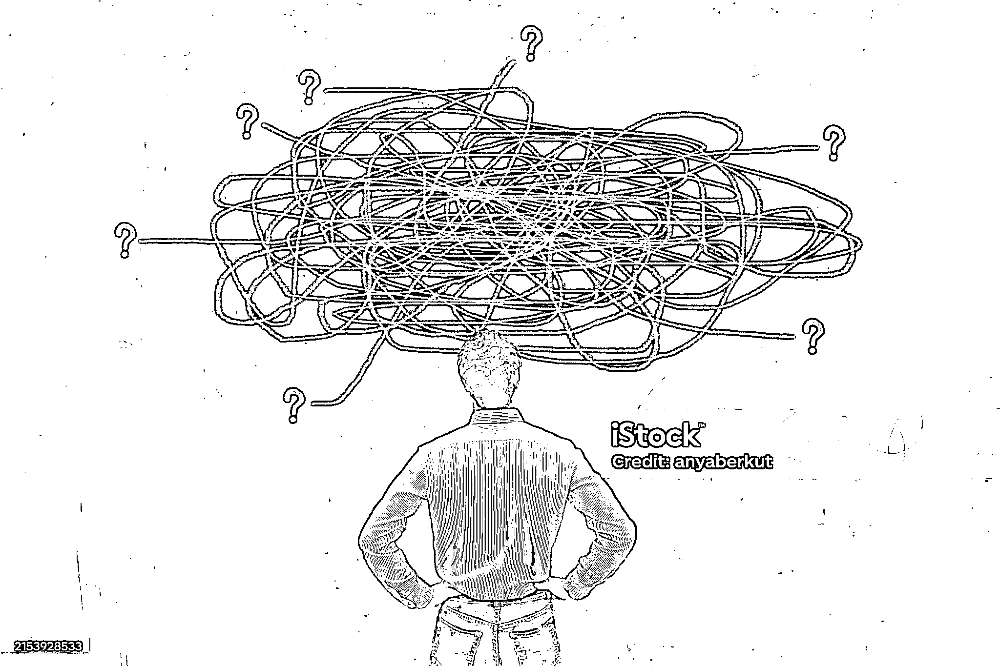

**平台机制与用户行为的底层逻辑**

#### 1.  **推送机制与兴趣电商的差异**

很多从 FB 转来的同学会吐槽 TikTok 转化难。原因很简单，TikTok 的投放逻辑跟 Facebook、Google 完全不是一个路数。它的核心是**兴趣电商** ，投放不只是看用户画像，更看广告本身的创意标签和内容属性。

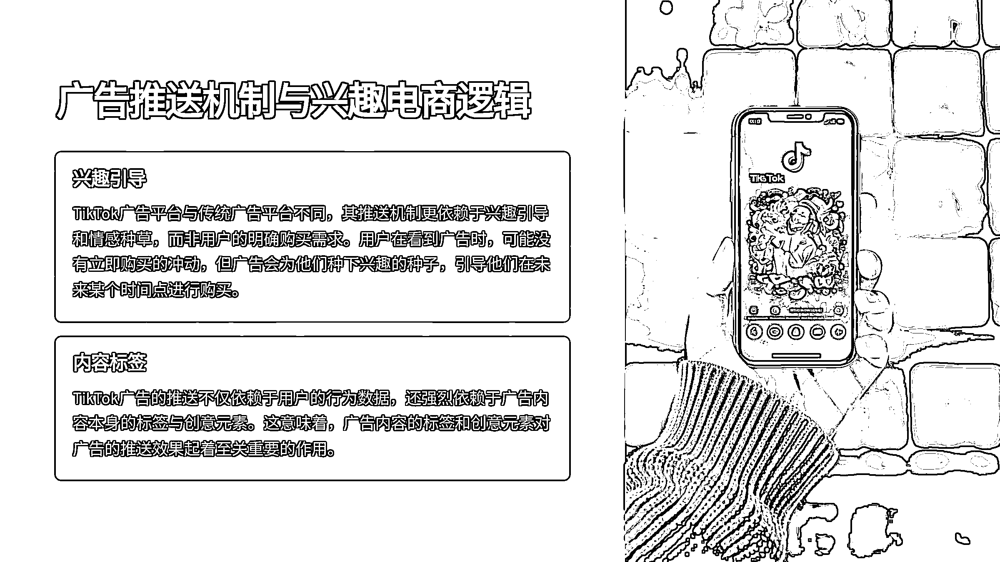

TikTok 并不是按用户明确的购买意图来分发广告，而是靠**兴趣触发和情绪种草** 来驱动。用户刷到时未必想买，但好的内容会先埋下一颗种子，促使用户在后续的触达中产生购买行为，甚至在站外完成转化。

#### 2.  **内容识别与标签打标机制**

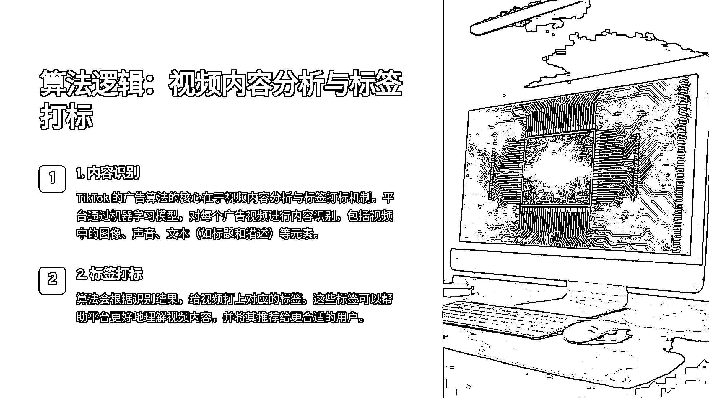

TikTok 的算法非常依赖**视频内容识别与标签打标** 。系统会用机器学习去解析视频里的画面、声音、标题、描述等信息，给广告打上对应的主题标签。

**问题：标签偏差导致流量错位**

素材的标签决定了它能触达谁。如果视频主题分散、无焦点，系统无法判定核心意图，就会把广告推给不匹配的人群，造成流量的大面积浪费。

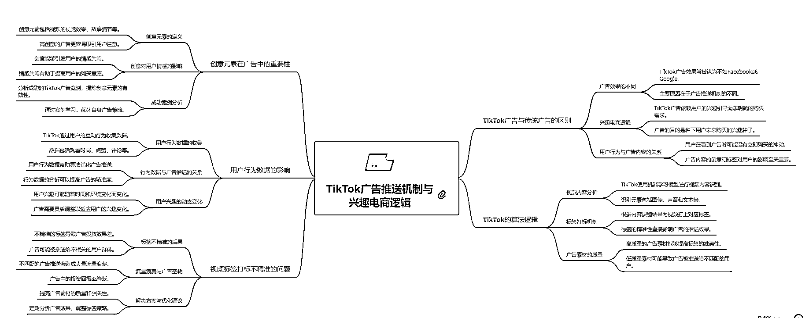

**标签与投放效果的关联** ：举个例子，一条卖科技产品的广告里混进了大量搞笑桥段或无关场景，算法很可能把它判定为搞笑内容，推送给爱看梗的用户。曝光很高，点击却很差，转化自然拉胯。

**  **

**对策：让标签更清晰、素材更聚焦**

**围绕核心卖点做减法** ：视频的每一帧、文案、标题都紧扣产品核心卖点，避免无关画面干扰系统识别。

**控制时长，提升信息密度** ：用户习惯快刷，15-30 秒是最佳区间。把最核心的价值点前置，让算法快速捕捉主题。

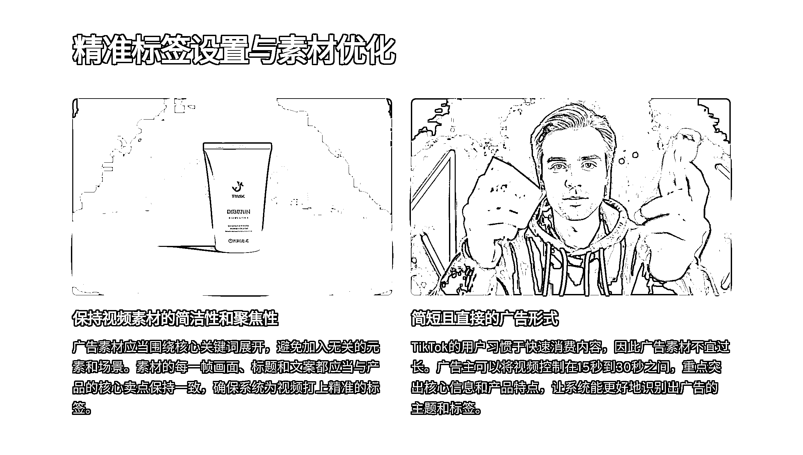

#### 3.  **行为驱动的推荐逻辑**

TikTok 的推荐本质是行为驱动。观看时长、点赞、评论、分享等互动信号都在不断训练模型，让系统判断用户偏好。可以说，你的受众既是客户，也是广告的评分官，这些行为直接决定了成本高低和广告好坏的判断。

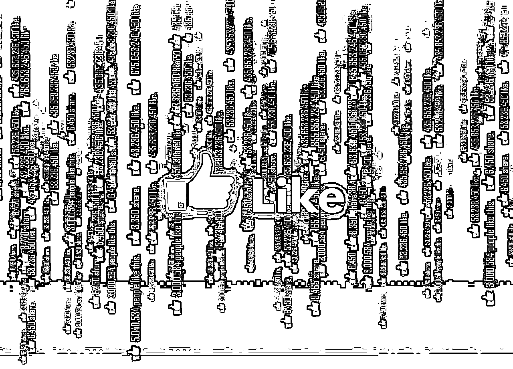

**问题 2：行为数据波动带来效果不稳**

TikTok 的投放高度依赖短期行为，这就导致广告表现波动很大。同一条素材，昨天还很好，今天就掉。往往是兴趣偏好迁移和系统人群调整造成的。

**典型的波动场景** ：前几日点击和转化都很理想，随后断崖式下滑。这不是素材突然变差，而是系统在不断探索新人群，碰到了边际兴趣较低的用户。

**对策：分批放量+复制扩量**

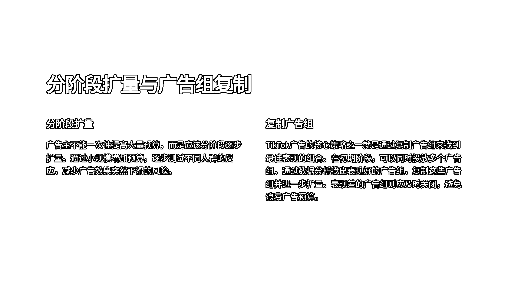

**预算要阶梯式递增** ：不要一次性加太多预算，先小步测试不同人群的承受度，降低掉量风险。

**用复制代替加价** ：复制表现好的广告组去放量，关闭持续不佳的组合。近期我的账户日消耗在 1000-1500 美金左右，每天能复制 150 组左右，6 条素材轮转。

我上周每天消耗 1000-1500 美金，复制了差不多每天 150 组,6 条素材

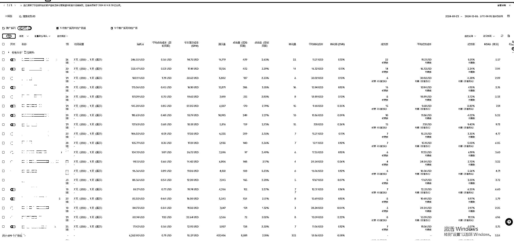

#### 4.  **帧抽取与打标的细节**

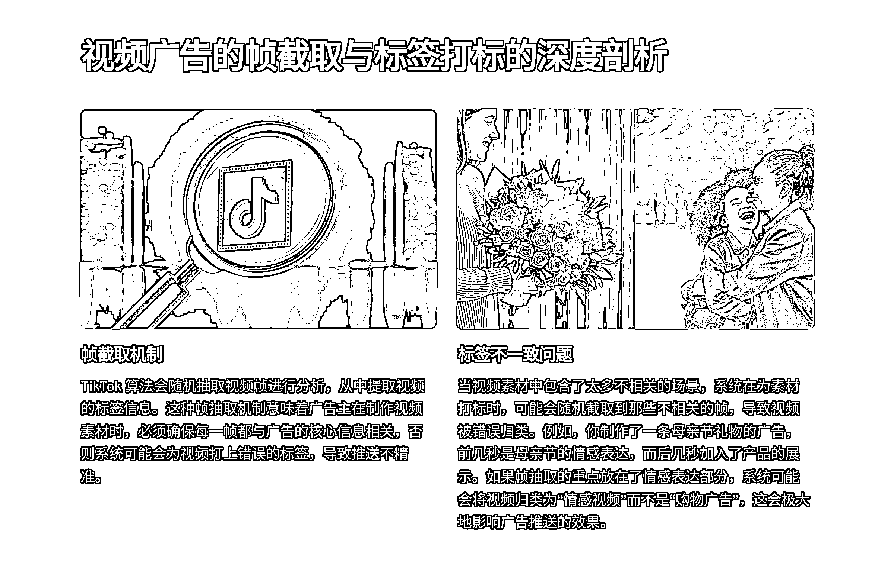

TikTok 在打标时会**随机截取视频帧进行解析** 。这意味着，视频里只要有一帧偏离主题，就可能被误判。素材制作时必须保证从头到尾的一致性。

大家可以多去皮皮看一下高消耗高播放的广告共性

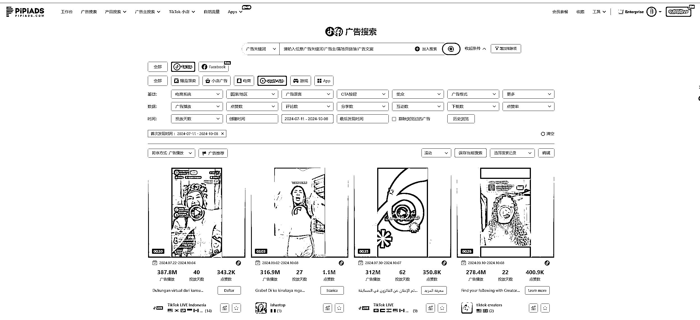

**问题 3：随机帧导致标签混乱**

视频前几秒情感铺垫，后几秒才出现产品。系统抽到情感帧，就可能把广告归类为情感内容而不是电商投放，直接影响分发质量。

**对策：保持全程标签一致**

**让每帧都服务主题** ：避免前后割裂，前三秒就要明确露出产品与卖点，让系统快速定性。

**图文双重加码** ：除了画面，配合标题、字幕、贴纸等文字信息，帮助算法二次确认内容主题。

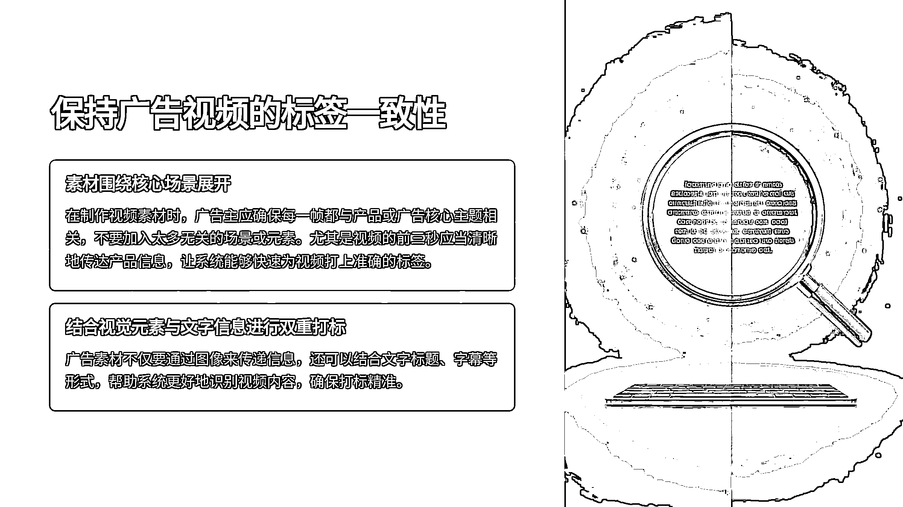

#### 5.  **内容推荐与个性化推送**

除了素材标签，系统还会结合用户的搜索记录、互动历史、观看时长等长期行为，做个性化推送。短期行为越强，匹配就越准。

### 第二部分：广告空耗的常见根源与解法

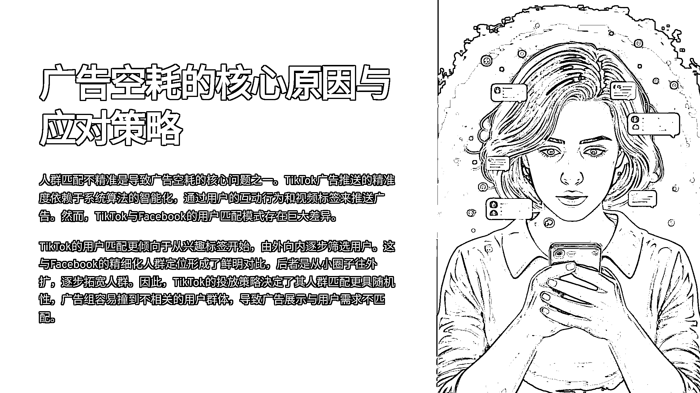

#### 1.  **人群匹配失准**

**人群错位** 是空耗的首因。TikTok 的匹配逻辑是从兴趣标签向外扩散，而 Facebook 则是从核心人群向外拓宽。两种路径不同，导致 TikTok 更容易撞到低相关人群。

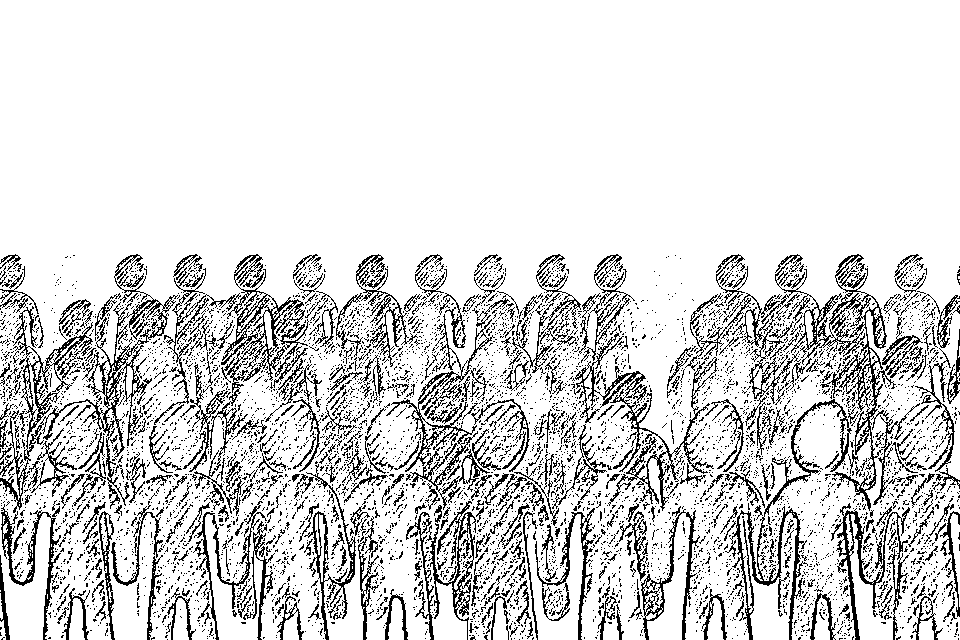

TikTok 的扩散是**由兴趣向外筛选** ，这就带来了随机性。很多广告主误以为兴趣包能自动精准，但实际上系统会不断尝试边缘兴趣，一旦素材或出价表现一般，就会把流量推给相关度更低的人群，曝光高、转化低。

大家看，同样的素材，cpm 不一样，点击点击率也不一样。

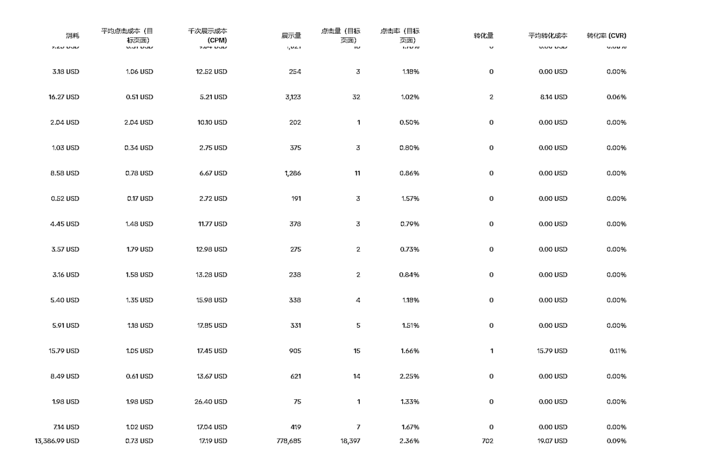

**对策：**

**素材标签要窄而深** ：把素材做得足够聚焦，让系统能准确定位核心兴趣人群。

**人群扩量要循序渐进** ：先在小范围内找准人群，再逐步提价放量，避免一次性扩散导致效果崩盘。

**多素材多人群并行测试** ：用 AB 测不同人群、不同场景，快速定位能买的人群。

#### 2.  **出价策略偏差：与 Facebook 不一样**

TikTok 的竞价远不如 Facebook 稳定。出价过高或过低都会让广告迅速失衡。出价直接决定展示频次和人群质量。

**问题：出价失误导致浪费**

很多账户出现**越加价效果越差** 的现象。因为高价会把广告推给已经对品类高度饱和的用户，他们早已在别处下单，剩余的是兴趣边缘人群。

**补充示例：**

**高价副作用** ：比如高客单科技品，出价冲上去后触达的是已完成购买或不具备购买意愿的人群，无效展示激增。

**低价的长线价值** ：适度低价反而能在精准人群里获得持续曝光，通过多次触达慢慢转化。

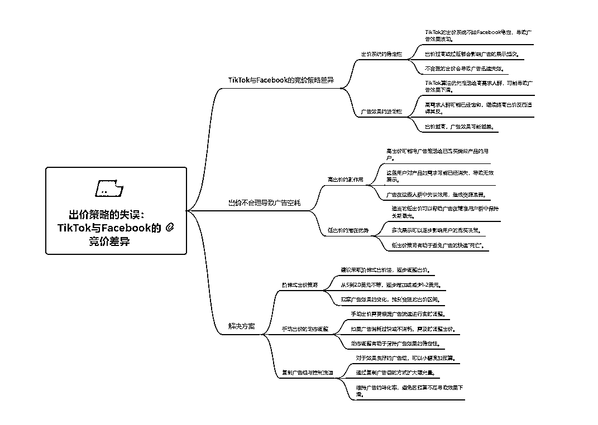

**对策：**

**阶梯式出价** ：从 5-20 美金区间起步，每次只调 1-2 美金，观察消耗与效果，找到最佳区间。

手动出价的情况，出价是动态调整的，除非他的流速合理正常。如果不消耗或者消耗快的情况，就要进行实时调整

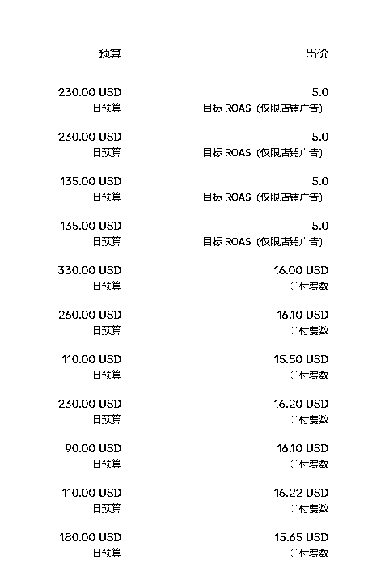

**用复制控流** ：效果好的组不直接加预算，而是复制新组保持流量稳定，避免学习期重置。

#### 3.  **CPM 飙高：竞争与质量的博弈**

**CPM 上涨** 几乎是旺季的通病，尤其在垂直赛道。根本原因是素材点击率不足，算法判定质量一般，竞价中自然被抬价。

**补充示例：**

**CPM 抬高的信号** ：CTR 过低、标签宽泛导致推送给不相关用户，互动差就推高成本。

**垂直类目的压力** ：科技、金融等赛道竞争激烈，多个广告主抢同一批用户，单次展示成本很容易破表。

例如商品卡广告这方面特别明显，商品卡流量精准，但受众始终有限，竞争激烈后成本增加。

从 15 美金涨到 20+美金的 cpm

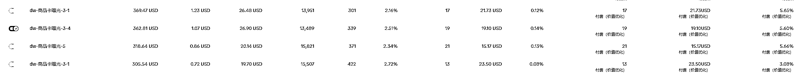

**对策：**

**提升 CTR 降 CPM** ：多版本素材测试，保留 CTR>2% 的版本，系统评分上去了 CPM 自然下来。

**分层测试** ：不同创意、不同钩子并行测试，用高点击素材拉低整体成本。

**避开红海词** ：在高竞争品类里找长尾、相关度高的切入点，降低直接对撞。

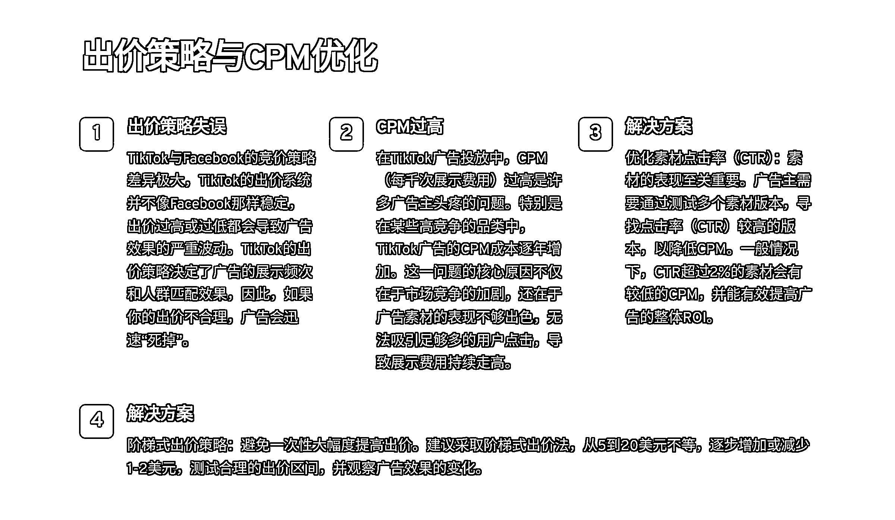

#### 4.  **素材频繁更换打断学习**

频繁换同质化素材是另一个隐形浪费。算法需要数据反馈来学习，换得太快学习期就没了。

**问题 4：换素材导致学习重置**

广告主为了追求新鲜感不断换素材，结果系统始终在学习，效果一直上不去。

**对策：**

1.  **给素材稳定窗口期** ：测出稳定素材后至少跑 1-2 周，同时并行测试新素材，避免断层式下跌。

2.  **迭代而非替换** ：采用“种草视频+收割商品图”组合，种草做兴趣心智，商品图做即时转化。

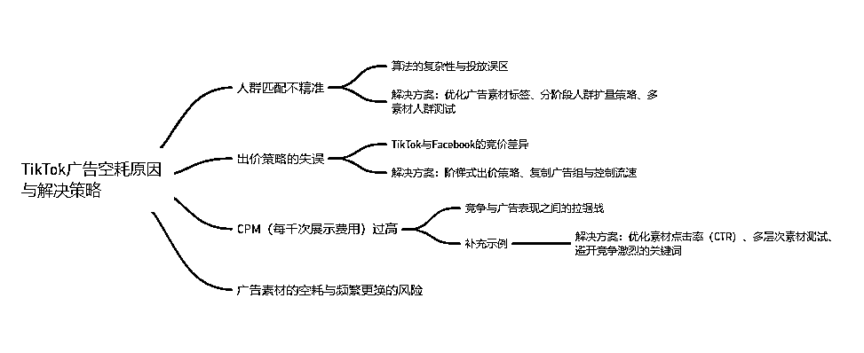

#### 5.  **视频与商品图的组合打法**

不要只靠视频。**商品图广告** 在 TikTok 上对有明确购买意向的用户收割能力更强。

**补充示例：**

**种草加收割** ：视频负责种草，商品图负责收割。用户看完视频产生兴趣后，商品图在关键节点出现，能显著提升下单率。

**对策：**

**双轨并行** ：视频种草+商品图收割同步投放。

建议：商品图广告比视频更好讲故事，只是大家都不知道，不可能每一个商品都拍视频。视频不可能每个商品都有大量素材去支撑销量，而商品图讲故事更简单，包括平台也会将商品图根据人群进行排序，适合复购，收割。

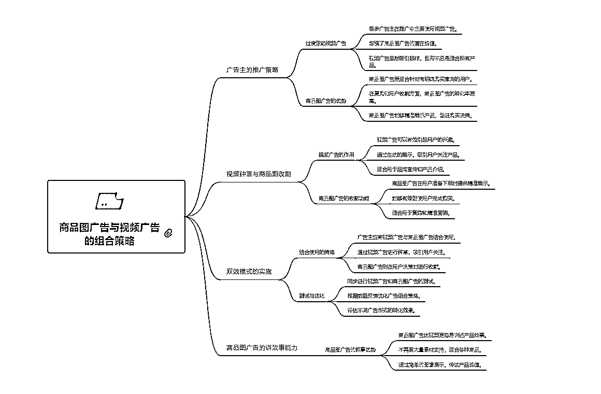

案例分析

广告主：lumorea.com

广告开始时间 - 广告结束时间: 2023.04.07 - 2024.10.08

总广告数: 1.2K 广告播放：2.1M

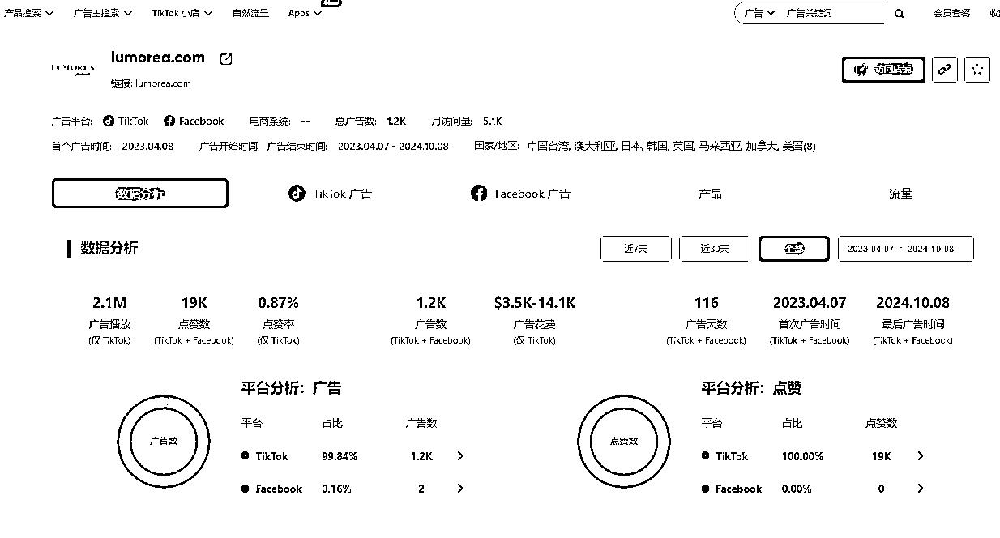

lumorea.com 复制 1200 条广告组，其实是同一个广告素材。

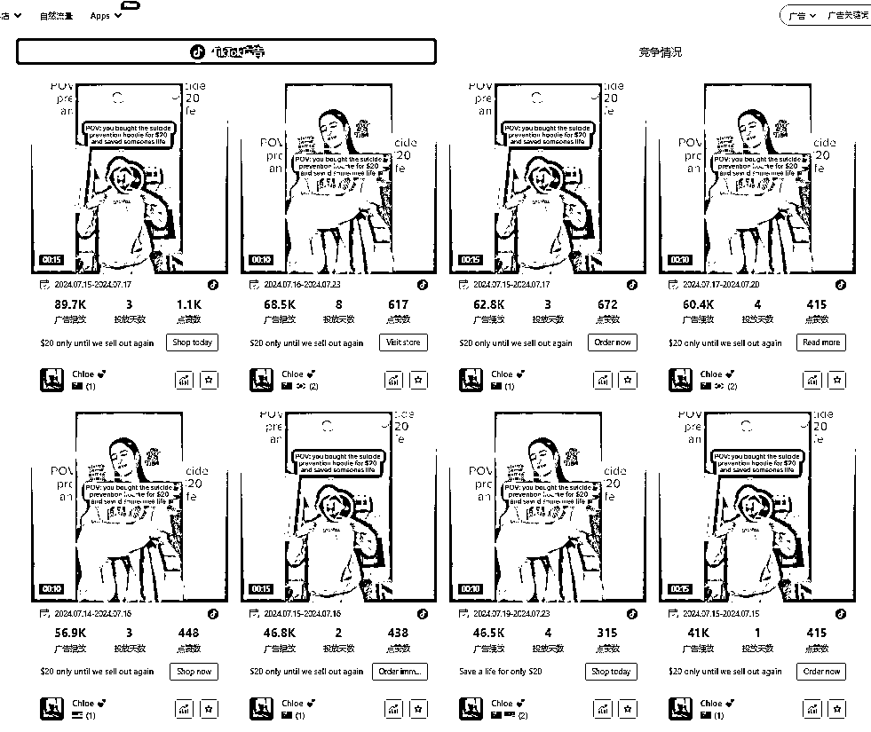

广告素材一：广告播放：89.7k

广告素材二：广告播放：**68.5K**

广告素材三：广告播放：32**K**

总结：标签不准、行为波动、出价错位是效果不佳的核心。优化素材清晰度、做好精准分层投放、视频与商品图协同作战，才能把空耗降到最低，让预算真正产生回报！

* * *

评论区：

暂无评论