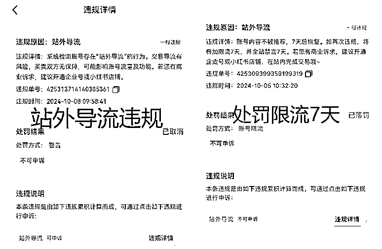
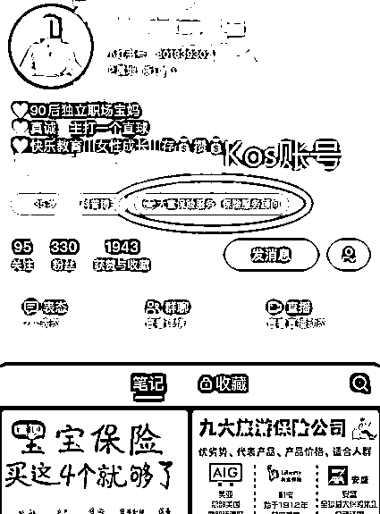
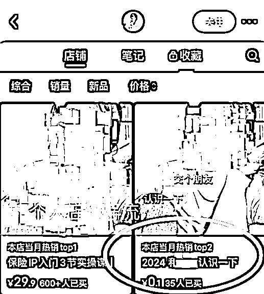

# 小红书私域导流频频违规？一份瑟瑟发抖的合规生存指南

小红书私域引流又踩雷？这份“保命”合规指南建议立即收藏

大家好，我是阿何，一个在保险行业做新媒体运营、每天活得小心翼翼的“求生型”打工人。

大概从九月中下旬开始，我和不少同行的小红书账号都陆续收到了“站外导流”的违规通知。第一次提醒往往只是限流七天，第二次就可能变成十四天……对一直靠小红书自然流量把客户引到私域成交的我们来说，这种打击几乎算是致命伤。

后来我跟同行聊了一圈，也向官方求证过，才发现这根本不是某个行业被单独针对，而是小红书全平台都在收紧对私信“导流”的管控——比如留微信号、留手机号之类。以前那种“让客户主动留下联系方式”的漏洞，现在也彻底堵死了。说白了，小红书的商业化时代真的来了。

如果你也正被这类违规问题折磨，希望这篇内容能给你一点方向。保险、咨询这类非标品，接下来到底怎么“安全导流”？企业蓝V号和个人号打法不太一样。

一、企业号：想解锁“私信白名单”，基本只有一条正路

目前唯一没有风险的正规途径，就是开通广告投放，也就是大家常说的“聚光投流”。没接触过的话，可以先了解几个基础问题。

聚光是什么？它是小红书官方的一站式广告投放平台，靠信息流、搜索排名、全站智投等方式，让内容去匹配更精准的客群，从而支持种草、卖货、收集客资、推广直播等营销目标。哪怕这些需求你暂时一个都用不上，光“解锁私信白名单”这个隐藏福利，也值得你认真考虑。

充值门槛大概是这样：
- 对接官方运营团队，有投手协助投放、优化和数据反馈：新客户1万元起，老客户（非第一次充值）5000元起；
- 不对接官方，完全自己操作：新客户3000元起；
- 走三方代理商/服务商充值：新客户2000元起。这条路要特别谨慎，务必核实机构资质，防止被骗。

那如果只充值、不消耗广告费，能解锁“私信白名单”吗？答案是不行。官方现在有规则：停止投放超过两天，这个功能就会被收回。按正常节奏，差不多每周要投三次左右。单次投放金额不能低于100元。所以，哪怕你只是想交“保护费”来解锁白名单，每个账号每个月的最低成本大概也要1200元。

个人号能投聚光吗？不能。聚光仅支持企业号。个人如果也想用，要么把账号升级成企业号，要么挂靠到一个蓝V主号下面，变成KOS号。

二、个人号：开个小店也可以是一种导流思路

说到底，导流无非是想拿到客户信息，方便站外联系。个人号其实可以通过开通店铺来实现这一点——因为客户下单时，会留下联系电话。

拿保险从业者举例，可以选“教育类目”，押金1000元。然后上架一个“0.1元交个朋友”或者“9.9元咨询费”之类的小商品，用这种方式把客户信息拿到手。

但请注意，就算开了店铺，私信客户照样不能导流，依然属于违规操作。开店不是什么“免死金牌”，它只是多给了一条获取线索的路径而已。

三、其他“野路子”靠不靠谱？

非官方玩法也很多：@小号、拉群、改小红书号、各种伪装套路……但这些方式风险都很大，我自己就经历过号被“炸”的情况。建议一边多备几个小号来测试平台风控，一边提高警惕——凡是涉及第三方的操作，都要小心被骗。

另外也有网友补充，说在同城地点的表态页面可以留微信号或二维码，会展示在主页方便引导查看。这类方法是否长期稳定还要打个问号，建议参考时自行判断。

至于各种“野路子”和黑科技，如果大家有兴趣，咱们下次再聊。