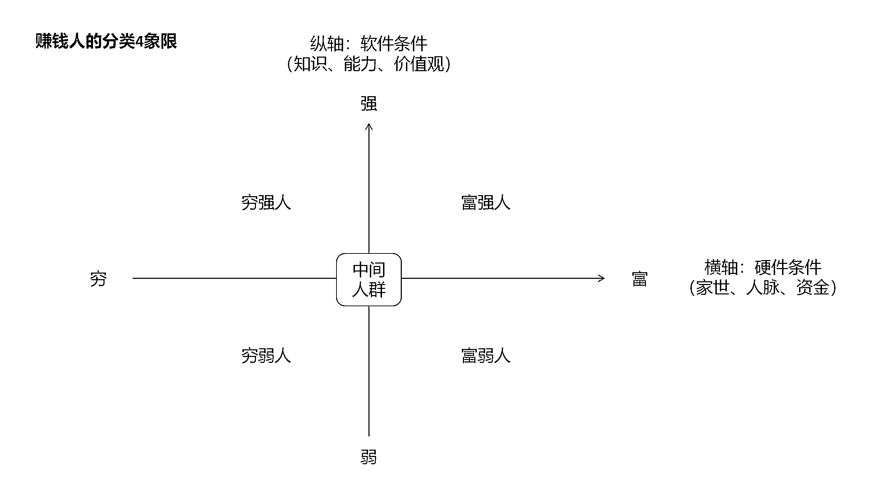

# 为什么赚钱线下活动需要暂停和调整？关于赚钱路上的五类人，对应的人做适合的事。
作者：龙哥

龙哥前几天发帖说，赚钱的线下聚会要暂停一段时间，优化好了再重新开放。作为一个待了五年的老圈友，我挺想聊聊背后的逻辑，也当是给自己练练思维。

先说一个分类思路。想在赚钱这行里找到自己的位置，可以用两个尺度来衡量：一个是手里的牌，一个是脑子里的货。

手里的牌，指的是出身背景、可用的人脉、能调动的资金。这些牌好的人，叫资源型；牌不好，叫草根型。

脑子里的货，指的是知识储备、办事能力、处事观念。货足的人，叫实力型；货少，叫待补型。

两个尺度叠起来，就能分出五种人：资源型实力型、草根型实力型、资源型待补型、草根型待补型，还有居中的人。

资源型实力型，比如那些家族传承了好几代还很有活力的核心人物，或者靠长期拼杀做到行业顶端的创业者。这类人牌多，货也足，三观也正。

草根型实力型，比如高估值创业公司的创立者、大项目的负责人、行业里的尖子。他们有本事、有心劲，但手里的牌还不够大，业务在扩张，圈子还在长。

草根型待补型，就是很多普通职员、打工人、小店主。货不够，牌也不多，观念也还在打磨。

资源型待补型，是那些家里条件好、底子厚的二代们。他们有牌，但货没跟上，观念离实力派也有距离。

居中的人，各项都普通，不偏不倚。

大家共同的念想，就是变成资源型实力型。

草根型待补型想往上走，要分两步。先走前半程，变成草根型实力型；再走后半程，跨到资源型实力型。

从草根型待补型升级为草根型实力型，要做三件事：一是多读书多刷干货，让脑中有货；二是下场真干，把本事练出来；三是校准观念，往强者靠拢。三件都做到，就升级了。

可草根型实力型要再进一步，卡点就在关系网。生意想扩张，不论找合伙人、组团队还是拉资金，都得靠圈子。而圈子需要花时间去织，所以一套高效的见面机制，能帮这类人省下不少时间。

资源型待补型容易掉进一个误区——误以为社交就是成长。他们有钱、没压力，加上从小耳濡目染，精通人情世故，在聚会里很被大家喜欢。大家觉得这类人又没功利心又有资源，强者愿意提携。可真正缺的是知识和本事。不补这些，就算认识再多能人，真要落地做事还是没结果。要是哪天变强了，手里已有的资源一大堆，根本不用到处找。

居中的人想变成资源型实力型，同样要走上提升货、练本事、正观念这条路。

已经站在顶端的人，任务变成了守成。守成有三处：一是做好保障，比如信托、保险、资产配置，万一生意出状况，日子还能过，还能翻身；二是看清大势，盯政策、盯科技前沿，别走错路；三是搭好体系，用规矩和人才培养，让生意自己有生命力。

这样一看就明白了：不同位置的人，当下该做的事完全不同。赚钱的线下交流之所以乱，问题就出在没把人分类。

聚会的核心价值是建立关系，而建立关系对草根型实力型来说，正是最有回报的事。其生意已经跑通了0到1，有知识有本事，观念也正。来参加聚会，愿意分享，也能换来实打实的收获——看到新机会、扩大团队、谈成合作。如果到场的人多数也是同类，反馈自然很好。

可这个社区里的大多数人，其实是草根型待补型。他们眼下最该补的是知识和能力，急着去社交，效果不大。自己手里能拿出的东西还不多，谈不上价值互换。要么生意还在从0到1的路上，要么只是某个环节上的一颗钉子。硬要“利用时间”去交换价值，很可能病急乱投医，交智商税；或者把聚会当成拉客入口，产品和服务又跟不上，于是出来一堆糟心事。

所以，线下交流应该主要面向草根型实力型来组织，这类人的相互交往才有劲。草根型待补型不是说不能去，但要心里明白：什么阶段干什么事，事半功倍。等自己从草根型待补型进化成草根型实力型，再进入这个圈子，就是水到渠成。

推而广之，赚钱的所有专栏，也该按人群分好重点事项。

草根型待补型适合做这些：刷干货，参加出海实战，把结果做出来，写复盘总结。

草根型实力型在此基础上，还要关注风向标。风向标短平快，碎片信息给不了系统知识，必须得判断力够强、生意的闭环够完整，才能从中嗅到新机会。所以风向标不适合认知还没建立起来的人，反而是实力派的好工具。

如果能把不同人群该做的事做成一个打分表——完成一项，记一分，每个月公开一次——既能推动大家行动，也能让大家快速了解彼此，还方便社区自己运转。

这个灵感来自一个跑了三十多年、有二十多万人的商业社区。我在里面待过五年，这类人就用这套打分表不断调整动作，社区自己管自己，特别有效。哪天有空，我挺想发篇长文深挖那个社区。

最后交代一下，我现在还在草根型待补型那层，做自媒体爆文。今天在翻素材时想到这茬，写了这篇，欢迎大家拍砖。

愿赚钱蓬勃向前。