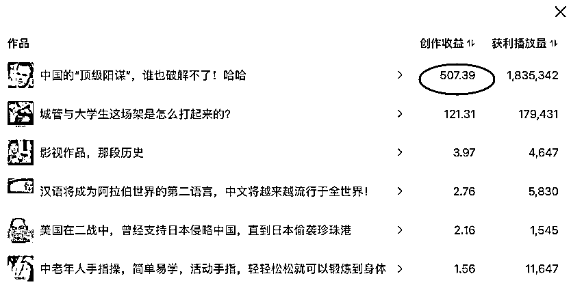
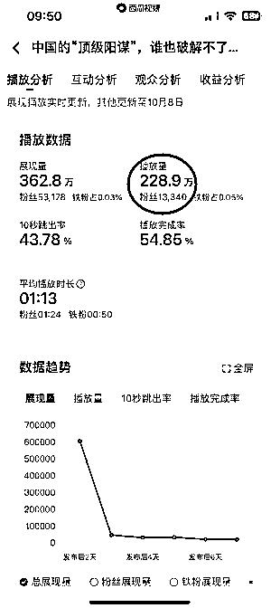
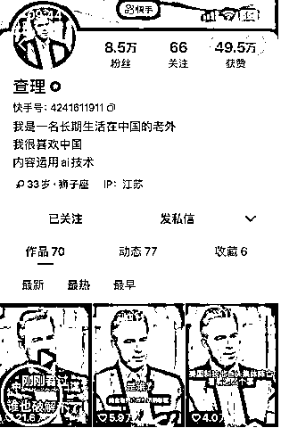
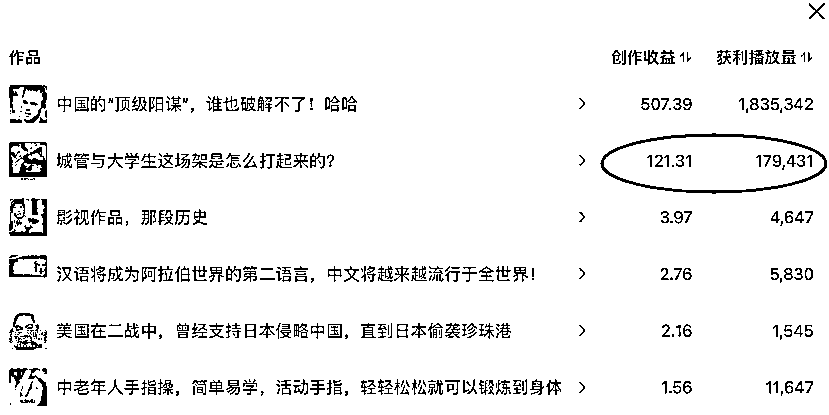
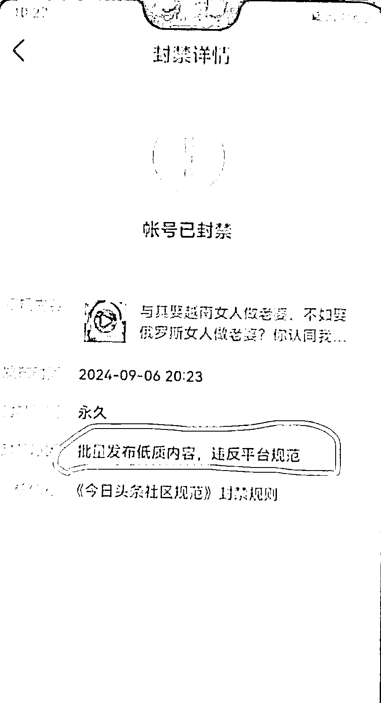
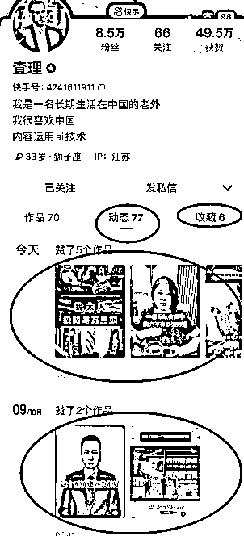

# 从快手搬运视频发到今日头条，一条视频赚了 507 块，这个项目如何才能做到月入过万？

最近刷到一个很野的搞钱路子：有人把快手视频搬到今日头条，单条视频赚了507元。听上去挺简单？但它能不能复制、放大到月入过万？我今天就把这个项目的完整拆解分享给大家。

故事的主人公是旭宏。他从快手搬运了一条视频发到头条，结果播放量冲到228万，后台收益显示507元（）。折算下来，每万次播放大约带来2.2元收益，比🛰️视频号创作分成计划每万次3-5元的单价要低一些（）。

这条视频怎么来的？他说是刷快手时看到的，来自一个叫“@查理”的数字人老外账号，口播的文案是非常早火过的那段“中国的顶级阳谋，谁也破解不了”（）。原视频在快手有21.6万点赞，按照他的头条视频4%的点赞率反推，原视频播放量大概在500万左右。他用🛰️小程序里的去水印工具把视频下载下来，再用剪映剪辑，前后不到5分钟，就发去了头条（）。

为什么能赚钱？说白了就是“搬运”：在快手已经验证过的爆款，搬到今日头条，给高度重叠的中老年用户再看一遍，结果大概率还是爆。旭宏还顺手把视频发到了视频号，因为视频号主流用户也是中老年人，能不能再爆，他会在评论区告诉大家。

那这个项目能月入过万吗？先算账。一条爆款赚500，下载、剪辑、发布只要5分钟，加上找素材也不超过10分钟。但如果想赚1万，需要20条爆款。爆率不可能100%。假设10条能爆1条，就得搬运200条，耗时2000分钟，约33个小时，接近一个全职打工人一周的工作时长。如果爆率降到1/20，就要搬400条，花66个小时，约两周。再低到1/40，就要搬800条，耗时一个月，刚好月入过万。还有一种情况：不用单条爆，只要40条加起来播放量到230万，收益也可能够500块，但这意味着平均每条要有6万播放，门槛同样不低。

另一个提高效率的方向是提高单价。旭宏那条爆款单价是2.2元/万次，但他账号里收益第二的视频单价是6.8元/万次，是这条的3倍（）。可惜的是，怎么系统性地提高单价，他还没摸清。

风险也要讲清楚。搬运可能涉及侵权、平台查重、批量发低质内容被判定违规，他的一个账号就已经因为这些问题被封了（）。好消息是头条每周都能提现，即使封号，最多损失一周的收益。但账号规模是个问题。如果想在爆率1/40的情况下月入过万，一天得发27条，一个正常账号一天发3-5条才安全，所以需要准备5-10台手机，差不多增加5000元成本。

综合来看，搬运视频做到月入过万不是不行，但有几道坎必须跨过：降低违规风险、提高爆率、提升选片和剪辑发布的批量效率。前两个旭宏有优化经验，第三个还在求高人指点。

先说降低违规。他目前是“一机一号一网络”：7部手机7个账号，只有一部连WiFi，其他全部用数据，并且把这些手机设置成“忘记”WiFi，防止自动连接。二手手机大概500块一部，手机卡月租10块左右。下载剪辑可以在一台电脑或手机完成，再用Landrop把成品传到其他6部手机里，注意传输时要连WiFi，传完立刻忘记，不然会被判批量操作。

选素材要避开“低质”。他被封的账号发过“与其娶越南人做老婆，不如娶俄罗斯人”这类博眼球内容，加上其他视频也有类似问题，直接被判“批量发布低质内容”。最稳的路是做“伪原创”：要么自己实拍，要么搞个数字人，模仿爆款口播。自媒体有个规律：火过的文案一定会再火。旭宏搬的那条，原作者其实就是拿早年的爆款文案，用数字人老外重新念了一遍，快手就有500万播放；另一条用混剪方式的同文案，点赞都到了53万，播放量大概率破千万（）。而@查理这个账号的收藏和动态里全是文案很棒的爆款视频，说明他也是靠刷爆款来囤文案（）。

关于提高爆率，核心是定位。头条、快手、视频号上人数最多的用户就是小城市的中老年人，他们爱看“正能量”内容，比如“厉害了我的国”“中国人强、外国人弱”这类，不仅流量大，还不容易踩规则红线。有了爆款之后，再顺着主题延伸，比如阳谋视频爆了，就去搜“中国还有哪些阳谋”，同题材的爆款会冒出来。

最后补充几个评论区里很有价值的信息：有圈友提醒，查重是个隐患，自己曾把🧣文案转成视频，100多块收益被取消；旭宏也说头条会有“视频文案重复度过高”的处罚，影响单条推荐，但一般不封号，如果是实拍或数字人，适当改几个字就能降低风险。还有人分享了去水印技巧：用浏览器扩展“猫抓”直接抓快手网页版视频。关于实名问题，也有人建议先不实名，用西瓜同步到头条，提现完注销再实名新号；被封的话可以找号商释放手机号，但手机最好刷机，避免设备标记。

总之，这个项目不是躺赚，但有清晰的放大逻辑。把违规风险和爆率控制住，批量效率提上去，月入过万甚至2-5万是有可能的。