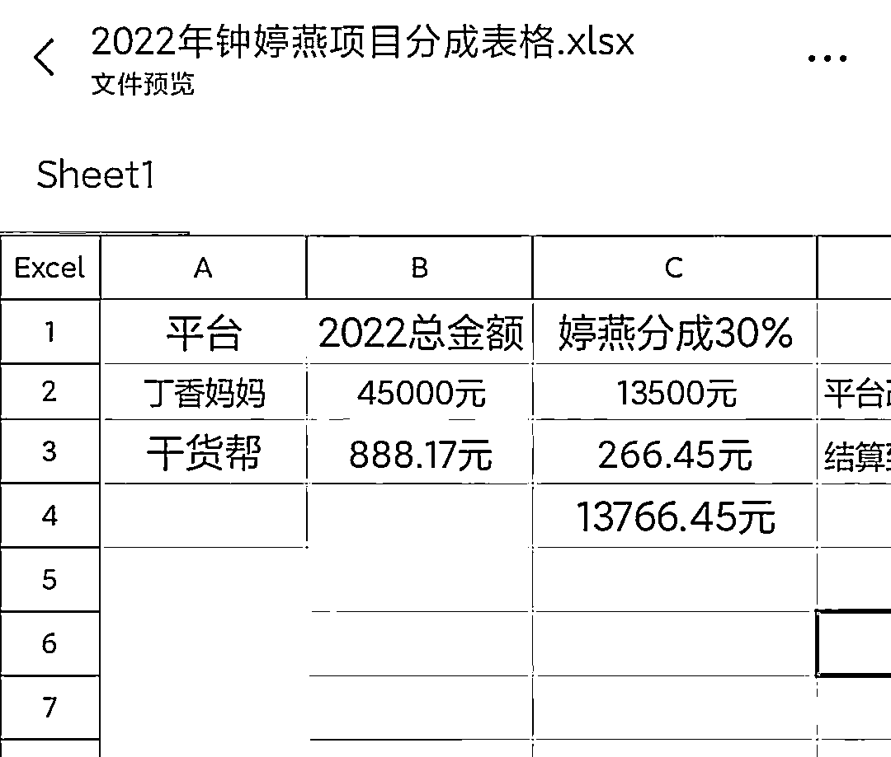
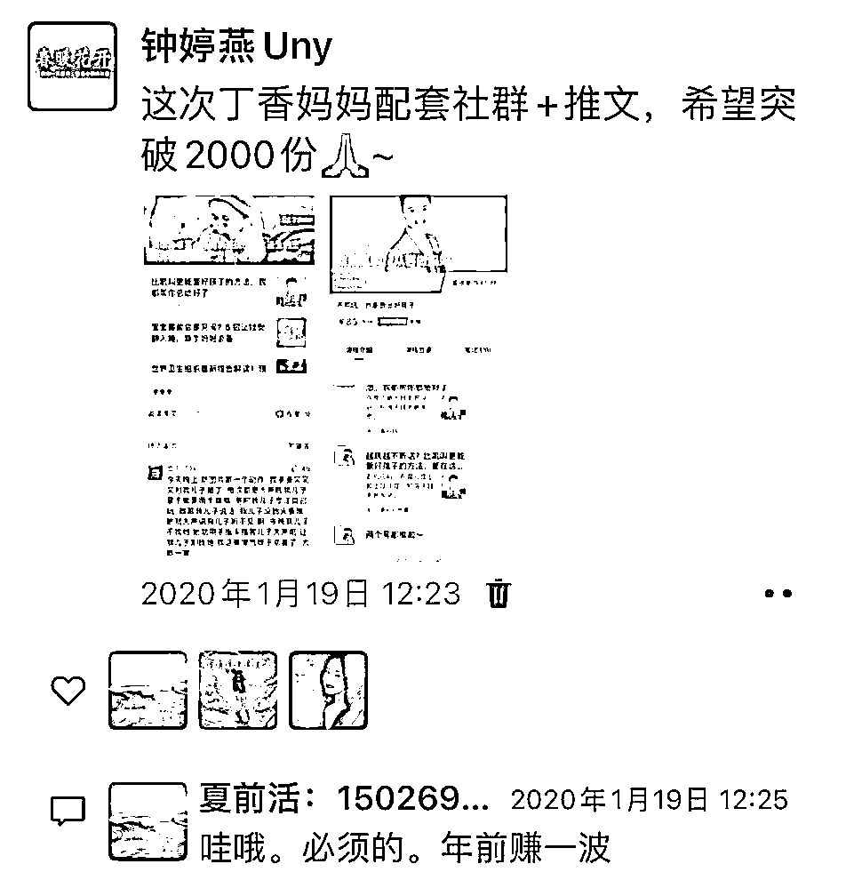
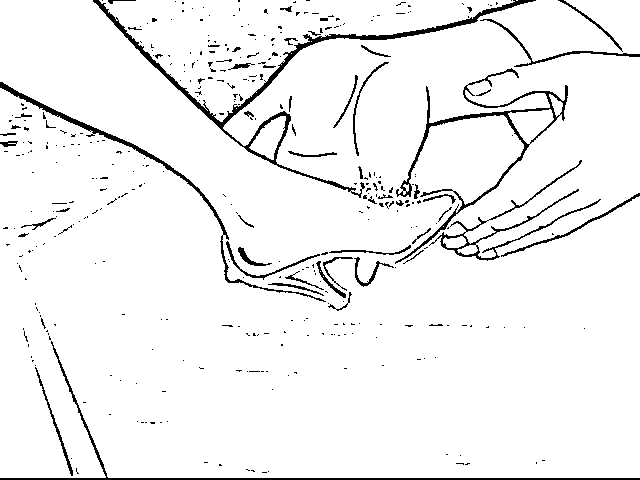
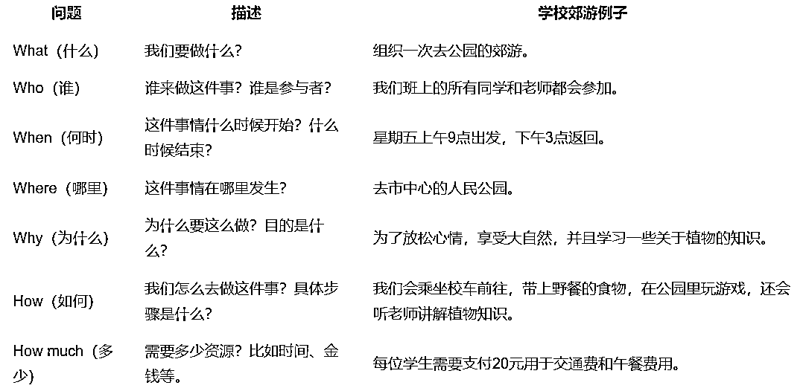
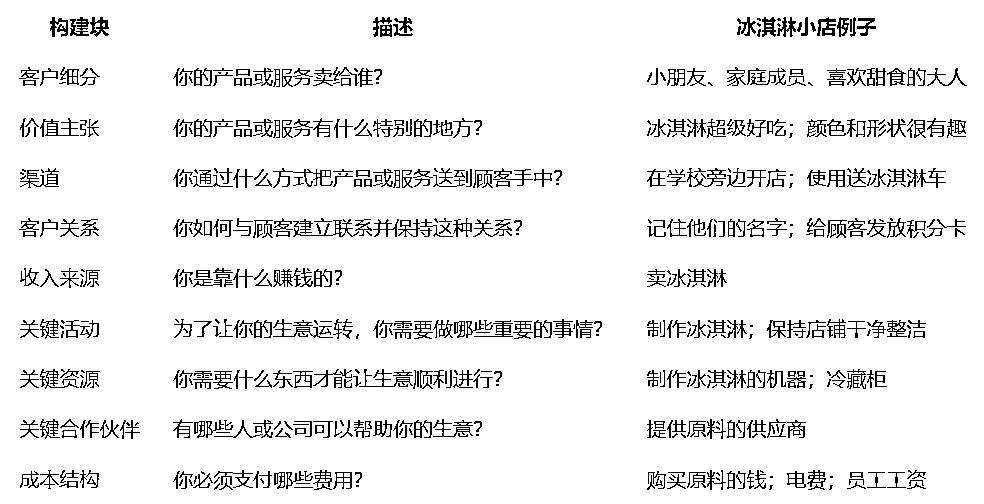
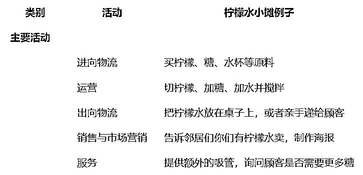
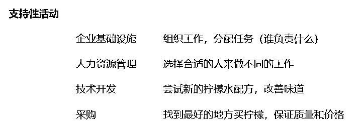
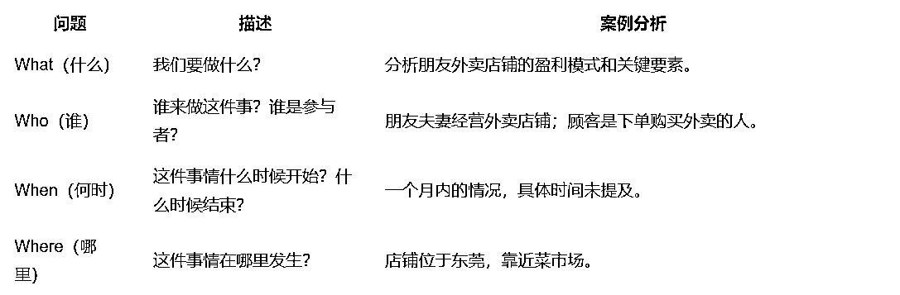
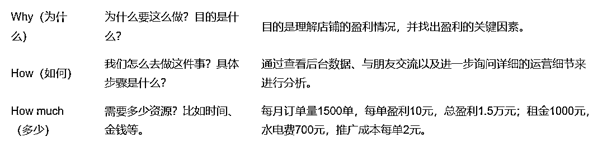

# 普通人想赚小钱和做到一些基本的成绩，是可以用几个方法去衡量！我更建议你遇事不决就追问 AI
作者：龙哥

**普通人赚小钱，别总想找捷径，先建立这套“嗅知行”逻辑**

经常有人问我：普通人怎么才能赚点小钱、做出点小成绩？我的答案是——遇到犹豫不决的事，可以多问问AI找找灵感；但真正能让你稳定吃到肉的，还得靠一套属于自己的赚钱底层逻辑。我给它起了个名字：嗅知行。

为什么这么说？我从2019年开始做自媒体，亲眼见过不少真正的风口。比如2019年的头条知识付费专栏、2020年的百度知识付费专栏，最早一批拿到版权资格的人，前三个月基本都能赚到钱。有个朋友靠着卖麻将课，一个月入10万。怎么做到的？说穿了就是“把课程挂到平台上就行”。可半年后如果不持续运营，收益直接砍半。到了今天，课程市场已经卷成红海，能赚到钱的，估计只有30%的上架方。

进入2024年，赚小钱的路子依然有。比如不断关注平台补贴项目；或者押注平台大力扶持、有前景的项目，像“闪购”，我预感美团能抢占很大市场；再比如平台漏下来的小虾米——芒果TV外包的综艺剪辑、IT公司分包出来的零散项目，这既是拼能力，也是拼资源。

那么，怎么构建自己的嗅知行赚钱逻辑？

先说“嗅”。所谓嗅，是通过听说、看现象，隐约感觉某个事情可能有机会，但你不确定。为什么不确定？因为你看到的只是冰山一角，看不到全貌。举个例子：隔壁小美在📕上分享带娃日常，做到5万粉丝，你觉得这事靠谱，脑子一热也想做，结果发现自己根本没法复制——因为你是单身，没有娃。你只看到别人“母婴博主月入过万”的成绩，却没看到人家成功的关键是“有个可爱又有表现力的宝宝”。而你很快发现，自己连娃都没有，于是冷静放弃。反过来，市面上那些“带你月入过万”的副业，你反而判断不了真假，就算真的，你也没把握自己能不能成。原因就是：每个人的认知、经验、能力和资源都不一样。所以，看到别人的结果，不要急着羡慕，把他为什么成功的条件列出来，和自己的情况对比，看自己是否有优势，或者能否追上。

接下来是“行”。做，就是行动。但行动的前提，是先“嗅”到机会，再“知”道逻辑。所以核心其实是“嗅”和“知”。

没想到第一道门槛竟然是“嗅”。这也解释了为什么龙哥盟会设置2000元的门槛费。物以类聚，人以群分，我们都待在自己的圈子里。想得到信息，就必须有信息源，就必须破圈，去接触不同圈子的人和事。破圈去哪里？怎么跟人打交道？这些都需要修炼，反正别太懒。你看恋爱结婚也一样，你得走出去才能认识人。天天躺在家等白马王子，现实吗？门都不出，谁认识你？灰姑娘还得靠仙女教母变出马车、礼服和水晶鞋去参加舞会，才能见到王子。连灰姑娘都懂得去破圈交际，何况我们普通人？

其实更关键的，是“知”。我们学习是为了什么？为了知道知识？为了使用知识？还是为了改变行为？都别想太复杂，回到主题：赚小钱靠什么？你得先搞清楚对方赚小钱的逻辑。@深圳刘宁培的商业分析工具就讲得很清楚，我建议重点掌握其中三个。

第一个，5W2H。它像一份问题清单，帮你看清一件事的关键要素：做什么？谁来做？什么时候开始、结束？在哪儿做？为什么做？怎么做、具体步骤？需要多少资源（时间、钱）？

第二个，商业模式画布。这是一页纸整理出的企业赚钱地图，把生意拆成九个模块：客户细分、价值主张、渠道、客户关系、收入来源、关键活动、关键资源、关键伙伴、成本结构。每个模块想清楚，价值如何创造和变现就一目了然。

第三个，波特价值链。它把企业内部分成主要活动和支持性活动，帮你看出哪些环节在创造价值。主要活动包括进向物流、运营、出向物流、销售市场和服务；支持性活动包括企业基础设施、人力资源、技术开发和采购。开个“柠檬水小摊”就能理解：进货、调柠檬水、送到顾客手中、打招呼、售后，每一环都能增值，加上财务管理、招人、改进配方、买原料这些支持环节，整个生意才能转起来。

理论有点多，没关系，我们直接来一个“简易版5W2H”实战。

先问WHY：你凭什么小赚？比如你朋友开沙拉店，你说他赚，怎么判断？你可能看了他外卖后台，一个月1500单，每单净赚10元，算下来月入1.5万。再深聊，发现他只做外卖，东莞铺面租金只要1000元，水电费700元，夫妻俩自己干，人力成本为0，外卖推广每单2元，食材成本每单8元。但这层还不够，再往下扒，用5W2H把盈利要素列出来：

订单量大——1500单是利润基础；租金便宜——1000元/月，固定成本低；食材新鲜又便宜——靠近菜市场，每单成本8元；没有雇人成本——夫妻店，零工资；推广成本低——每单2元，能换来稳定单量。

算笔账：总收入=1500×10=15000元；总成本=1000+700+3000=4700元；净利润=15000-4700=10300元。关键就三件事：高订单量、低成本结构、有效推广。

但你知道吗？同样这个店，月入2万的白领可能看不上，觉得“廉价劳动力有啥好做”，可二三线城市的人会觉得还不错。更有意思的是，广州一家“前任沙拉”也是这个模式，一个店长配两个兼职，开在五羊新城，一天就能出500单。惊呆了吧？因为你忽略了客源的计算——一线城市和二线城市的人流量不同，不同商业圈的客单价也完全不同。

再问YOU：凭什么你可以小赚？朋友会告诉你，只做外卖，重点是做好外卖运营。选在写字楼密集的地方，瞄准减肥和注重健康的人群，一线城市客单价能到26元，二线城市约20元。那你怎么做？

千万别直接下场，先打开美团大盘数据，看地区人流、分类餐饮的月订单量，分析客源和竞争格局。然后亲自去目标地段蹲点，跟附近商家聊聊。确认市场需求足够旺，再往下走。

接下来当然不是直接干。你需要了解本地生活运营、外卖运营；算清店铺一年租金、装修成本；预算好倒闭转让和折旧的风险；然后在脑子里模拟开店后会遇到的每一笔开支，确认自己能不能扛住风险。

最后，再问自己几个问题：我之所以能赚，是因为地理位置选对了？是因为沙拉有特色？是因为价格套餐实惠？是因为铺面租金和人力成本低？还是因为我足够努力，又有懂行的人带着？如果你能笃定地回答，再把这些问题拿去跟商业圈的长辈们聊一聊。如果几个朋友都一致认可，就可以行动了吗？不是。因为你还是餐饮行业的外行，靠运气太容易翻车。你真正擅长的是做沙拉餐、是店铺里的杂活。

所以，更好的第三条路是：做自己有把握、擅长的事，把不擅长的部分交给外部力量。2024年了，你可以找一个擅长外卖运营的人，用分成方式合作。你负责店长，招几个实习生做沙拉，各司其职。

这套思路不一定对每个人都有用，但我希望你能多看两遍，拿一个项目试着拆解分析。如果有什么想法，欢迎发在评论区，我们一起探讨。