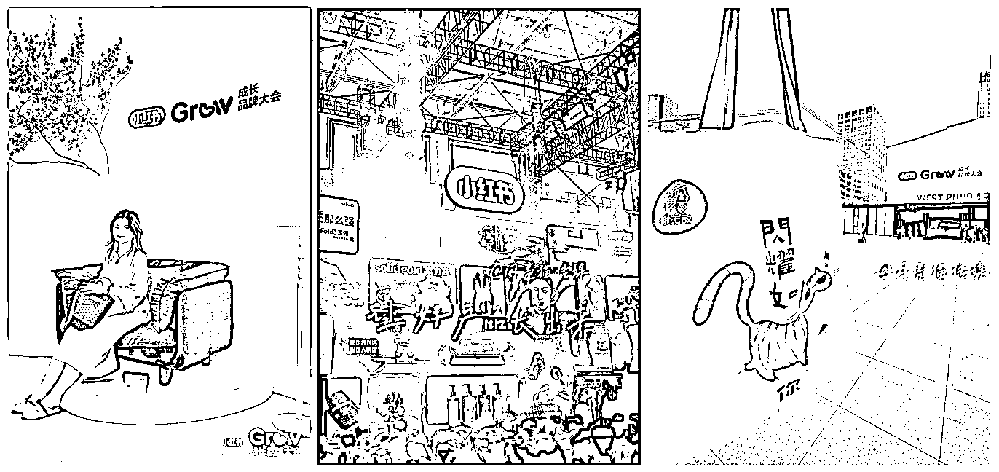
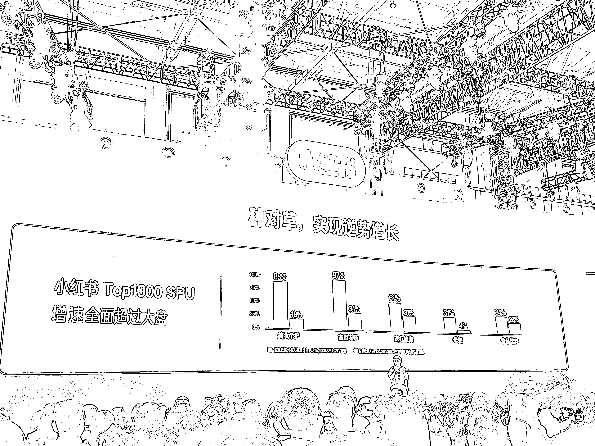
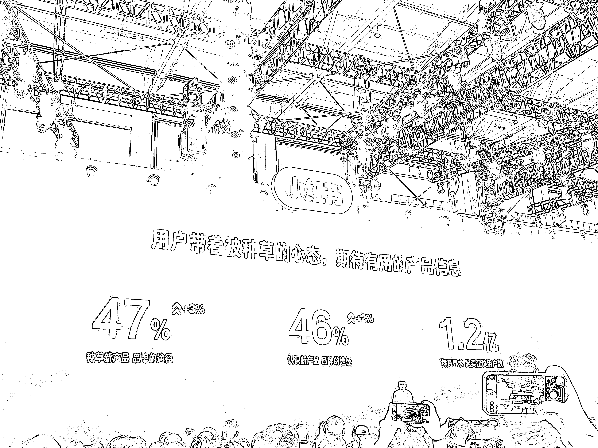
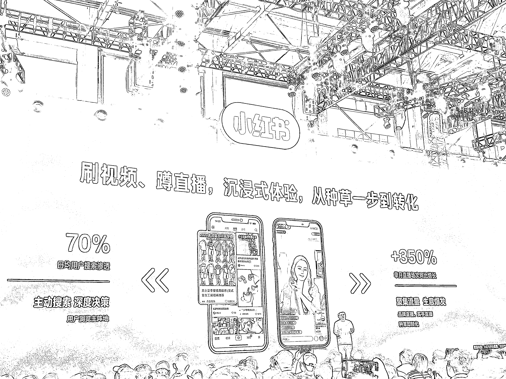
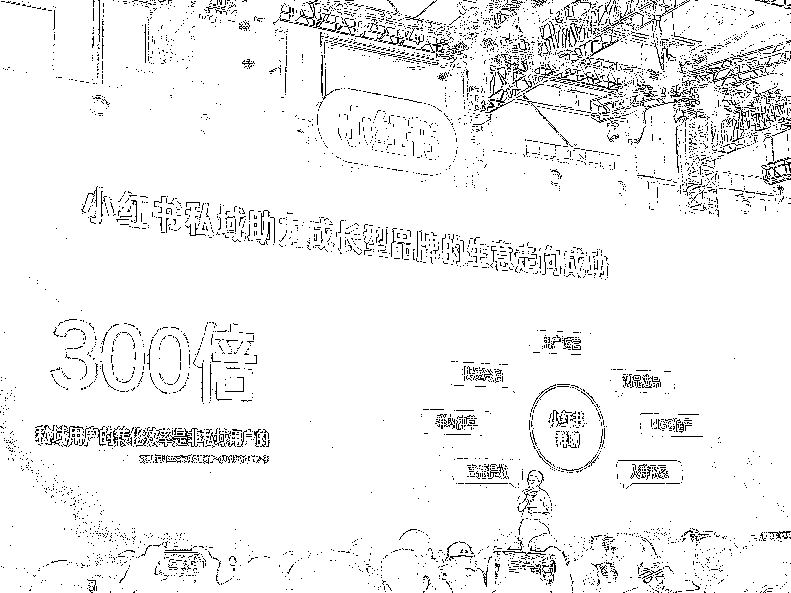
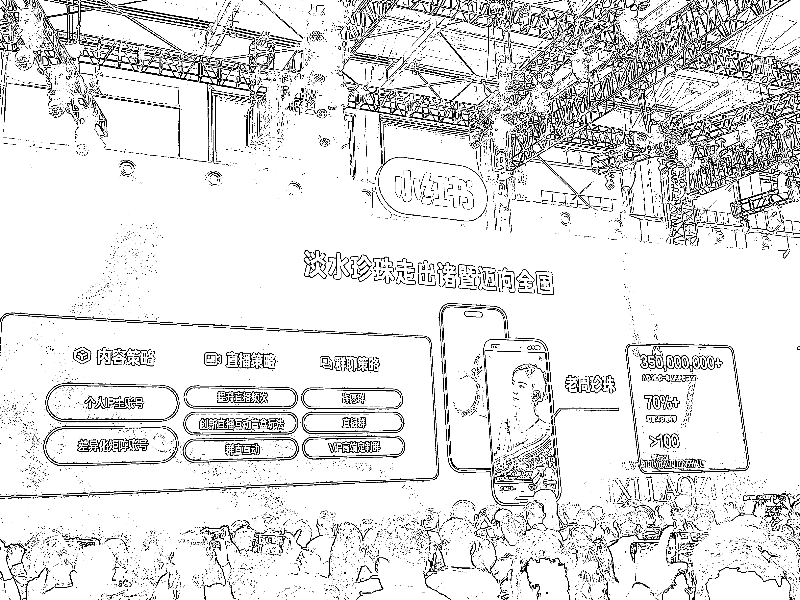
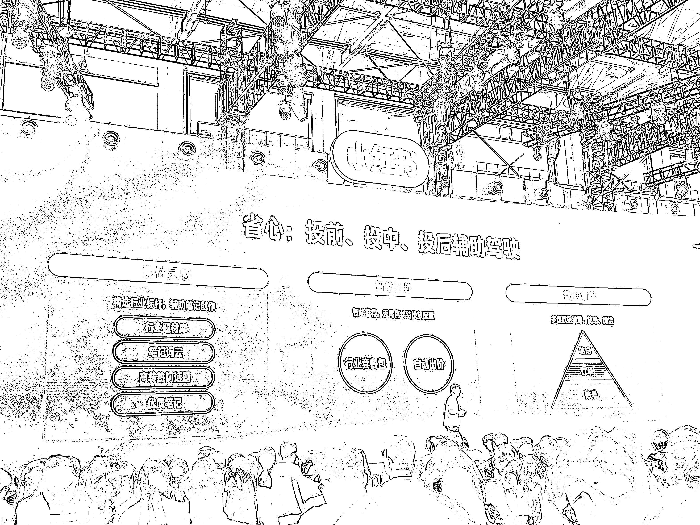
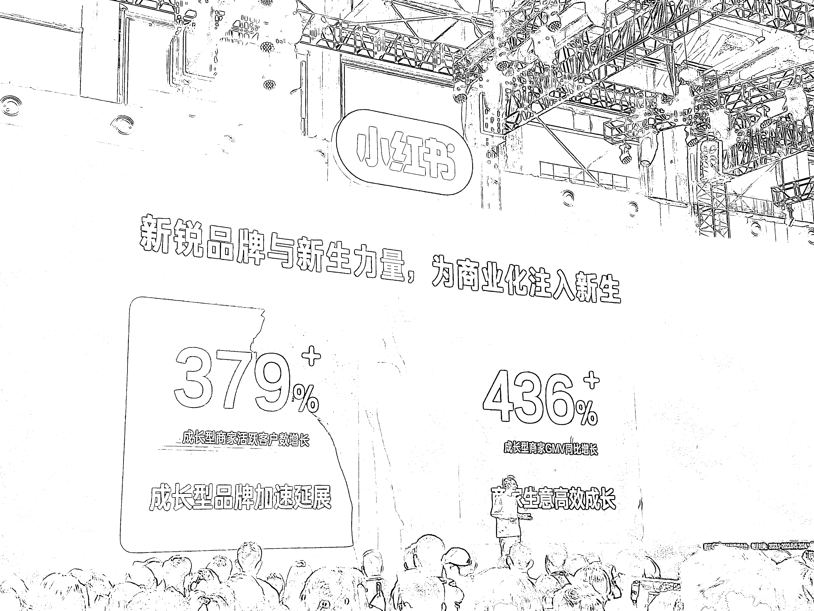
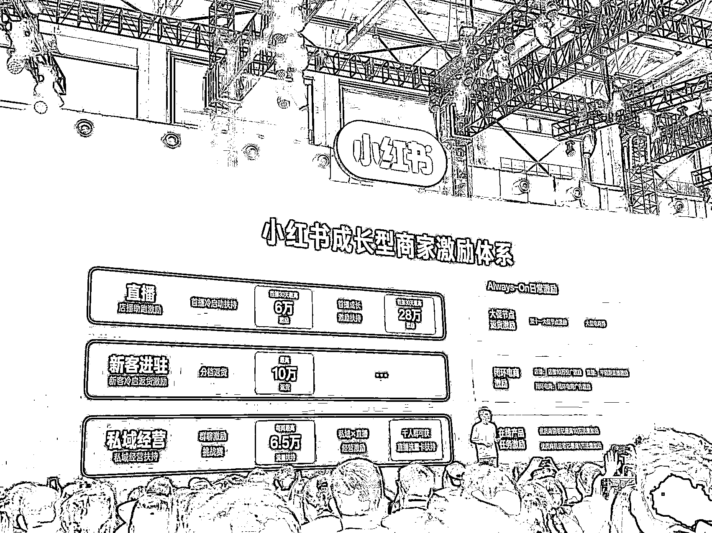
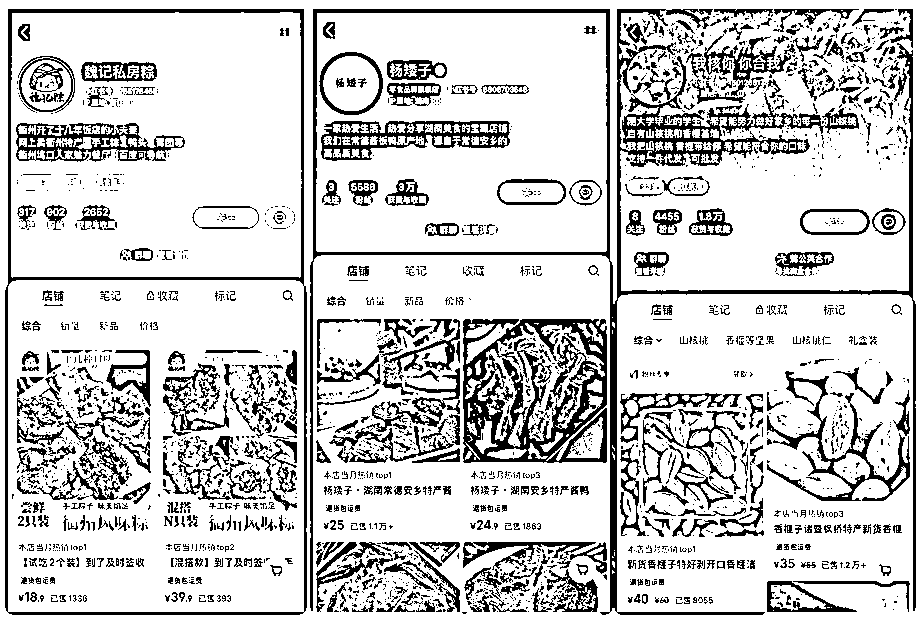

# 📕这场大会，藏着中小商家逆袭的答案？

赚钱的朋友们，我是龙哥，闪亮猫传媒的创始人。

前段时间刚参加完📕成长品牌大会，现场1000多位品牌主理人、老板齐聚一堂。整场听下来，最强烈的感受是：**📕，正在变成中小商家躲不开的新风口。**

官方这次把不同领域、不同体量、不同成长周期的小商家都请到了现场，还针对各自行业给出了流量趋势判断。今年明显能觉察到，平台向商家倾斜的流量变多了。对小商家来说，眼下入场📕绝对是利好，尤其是客单偏高的品类，受益会更直接。

## 一、平台为什么大张旗鼓办这场会？

先聊聊原因。从官方数据看，📕TOP1000 SPU里，有160个出自成长品牌，范围覆盖美妆个护、家电、医疗健康、母婴和食品饮料。其中美妆个护表现仅次于家用电器，说明用户一边爱美，一边对家电也有不小的需求。

这恰好印证，种草的价值能在品牌身上得到实实在在的放大，对运营策略和营销转化有明显的提升作用，帮成长品牌逆势崛起。因此，新锐品牌不妨以此作为突破口，借助内容快速穿透流量圈层，精准触达目标人群。

第二个原因，📕用户带着明确的“求建议”心态来到平台。据统计，每月在这里寻找购买建议的用户多达**1.2亿**。他们主动搜索、刷视频、蹲直播，沉浸式获取有效信息，对新品牌的包容度相当高。对成长品牌而言，用内容深度激发决策、提升转化，完全可行。官方数据显示，平台**日均搜索渗透率达到70%。**

另外，商家单月直播场次同比增长350%，说明除笔记种草外，直播正成为第二条增长链路。哪怕品牌知名度不高，也能靠反漏斗模型快速锁定精准人群，用优质内容叠加稳定直播频次，逐步建立信任、影响消费决策。总之，想快速拉升流量与转化，入局📕是当下明智之选。

## 二、成长品牌大会释放的四大趋势

### 1. 私域：转化效率是非私域的300倍

官方公布过一组4月企业专业号数据：**私域用户的转化效率，是非私域用户的300倍**。这提醒商家，千万别忽视私域运营。利用📕群聊，可以做测品选品、用户运营、快速冷启、群内种草、人群积累、直播提效、UGC促产。

一个典型样本是**@老周珍珠**，主理人靠私域完成快速成长，站内全年GMV超过3.5亿元。内容上做IP主账号加差异化矩阵号；直播上提高频次、玩出新花样、和群聊频繁互动；还借助许愿群、直播群、VIP高端定制群层层沉淀，复购率拉到70%。

细分赛道里，选品差异化是关键。最近实战营有位做饰品的实体店主，发现自己的独特优势，在选品和笔记内容上做出亮点差异，种草、成交、复购都实现翻倍以上增长。所以不管做哪个品类，群聊功能都值得好好用起来。

### 2. 聚光Lite：新手商家的投放利器

大会还发布了新运营工具——**聚光Lite**，对新手商家格外友好。

**省事**：门槛低，几乎全程托管，覆盖周期长。选目标（点赞收藏/主页浏览/私信开口）、选素材（从多篇笔记里任选）、选套餐（系统按行业自动匹配最优方案），手机上三步就能开跑。

**省心**：从投前素材灵感到智能计划再到数据复盘，一站式覆盖投前、投中、投后全流程。

**省钱**：既能保证跑量，又能控制成本。官方数据显示，摄影写真类品牌用聚光Lite，**冷启通过率达到94.1%**，投放成本下降38.7%。在私信转化上，开口成本砍半，获客量则翻了5倍。

工具升级后，成长品牌的选择空间明显变大。我常对实战营老板讲，在📕做品牌增量，核心是用心且坚持。聚光Lite只是转化环节的助推器，真正重要的是用好种草内容，持续吸引目标用户关注，再带动商品转化。

### 3. 全周期营销：拿捏住六个要素

想跑通全周期营销、提升商品转化，光用心做内容还不够，还得拿捏住**“品、号、店、群、直、广”**六个要素。

选品是第一步。好产品通常具备高颜值，或能精准解决某一细分需求。接着开通店铺，形成变现闭环，再打通企业号，建立用户信任。

社群则是销量转化的极致体验模块。在📕群聊里，既能做新品共创、收集一线用户反馈，也能靠“群内购”带动销量。而直播作为高效率成交场域，可随时在群里同步动态，帮商品更快冷启动。

### 4. 激励体系：百亿流量扶持成长商家

当下生意难做、利润变薄、获客变贵，认真经营品牌的人反而成了破局标杆。📕之所以成为中小商家增量首选，胜在低门槛、高效、长效。

去年，月销同比增长3.5倍的商家数超过500万，买手增长6.7倍；成长型商家的活跃客户数涨了379%，GMV涨幅达436%。这组数据说明，平台不仅助推生意增长，也让更多人涌入📕直播。

大会还宣布，围绕**店播助跑、新客入驻、私域运营**三个方向，给成长型商家百亿流量扶持，最高10万元广告返货。另有首播冷启动扶持、30天28万流量激励、群聊激励挑战赛等。投放策略上的选项，也明显丰富起来。

## 三、大有可为的五个高变现行业

结合官方对行业、流量趋势的分析，这里整理出5个高变现赛道。

### 1. 留学

留学赛道天然适配📕：用户年轻、高知、消费力强，客单价高，利润空间也非常可观。

**@路觅**靠优质内容吸引同频人群，挖到种子用户，再把产品定制化，精准锁定核心客群。这样一来，不仅用户能找到品牌，品牌也能精准找到用户，还能用用户反馈反哺产品迭代。加上专业号+人设号组合，按国家、校区、学校、专业分层做内容，迅速树立品牌形象、赢得信任。

### 2. 旅游

旅游赛道好做，靠的是平台属性：用户关注度高，更愿意为优质内容种草、买单。

**@海洋国旅**主打轻奢定制，近一年GMV超过5000万。它把内容方向重新定制，在打通目标人群的同时又向上触达顶奢人群，等于在📕做成了第二条生意曲线。这种高客单定制化服务，本身就有差异优势，找对平台做好推广，变现和转化自然来得快。

### 3. 线下实体转型电商

线下服装实体店的客单也不低。**@熠**从淘宝电商转战👸号，再到📕，一路寻找流量与曝光机会。在📕上靠精准话题快速找到兴趣人群，收获种子用户；用商品笔记提前预热，带动线下展会客流；多年实体口碑加走心内容，累计吸引几万用户关注。

双11做到破千万业绩，21年底还拿了📕三等奖，名次仅次于奔驰和雅诗兰黛。他不仅内容做得好、人群找得准，还用定制化服务加私信通提升客户触达概率，把转化效率最大化，实现品牌增量。高客单线下产品，很适合这种内容打法。

### 4. 家居家装

熟悉我的朋友知道，我本人就是实体家居出身，入局📕第一个月变现超10万，半年做到1000万+，一路摸索，才有了今天。

这次大会上，家居家装品牌**@格度**用独特品牌理念触达人群，深度种草抢占心智，单品SPU销售额破1000万。它不断传递品牌信息和理念，把产品沉淀的人群转为品牌需求人群，让人群成为品牌壁垒。家装客单价高，老板们真正要思考的，是怎样用📕放大品牌势能，这点非常关键。

### 5. 特产

今年普遍感觉赚钱难了，但📕像是个例外，尤其在差异化明显的赛道——**特产**。这个赛道成本不高、利润可观，还没有垫资压力。

我陪跑过几位做特产的老板，有一位靠卖特产10个月变现超30万。凭借对垂直细分品类的深耕，在📕上拿到了实打实的结果。从平台流量趋势看，官方正全力扶持店铺商家。大家不妨借力双11节点激励，把电商闭环做扎实。对中小商家来说，顺势行业大势、结合平台政策，才能挖掘更多变现可能。

最后说一句：在📕找到品牌的深度价值，打开生意的第二曲线。

评论区里，@更绪 直言没看懂聚光Lite的降本逻辑，觉得产品纯属鸡肋，像是团队在刷KPI。我的回应是：它就是给新手用的产品，原理类似全站智投。

* * *