# 闲鱼精细化运营，详解 11 个图片细节实战经验，帮你销量翻倍
作者：龙哥

在二手交易平台逛久了，你会发现一个规律：最先抓住视线的永远是那张主图。标题和价格都得往后排。主图选得好，点击和咨询自然涌来；主图敷衍，再好的货也难免沉寂。

线上成交的本质，就是靠画面与文字在几秒内赢得认可。视觉素材精准，相当于给曝光装上助推器；随手乱放，成交表现会立刻给出回应。

我是四年前开始做闲鱼副业的，单日最高净赚超过两千，后来我家六口人一同入行。今天不讲整套流程，也不重复那些网上的教程。我只拆解配图这一个维度，整理出11条亲测有效的细节。耐心读完，挑几条实践，会有收获。

01 媒体设置里的一个开关

在个人中心进入设置，找到媒体与上传相关选项，将上传时强制压缩画质的选项关掉。这个动作虽小，却决定买家看到的是清晰锐利的细节，还是模糊一片的“马赛克”。画质差距，直接影响第一印象。

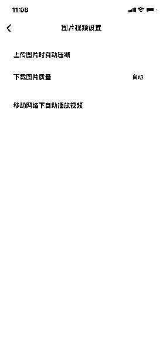

02 主图选竖向构图

翻看平台首页的推荐信息流，排版基本是两列瀑布流，能进入页面的主图几乎全是竖版，横版很难有位置。竖构图在手机屏幕上的显示面积更大，画面张力更强，也更容易被推荐机制选中。平台的曝光渠道主要是搜索和推荐位，主图选竖版，相当于提前占了位置。

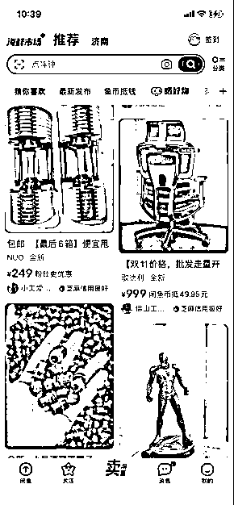

03 优先用实景，别用网络素材

平台算法和大多数用户，都更喜欢实景照；网上扒来的图虽然省事，但很容易看出破绽。如何获取实景？四条路径都可用：

- 各大购物App的晒单区，搜索同款商品，看购买者留下的照片，淘宝里买家晒出的图通常比拼夕夕的清晰度更好；
- 种草类内容社区，后面我会讲一个我用过的实例；
- 加供货商的联系方式，浏览他们日常分享的动态，熟络后直接开口要画面素材。团队有位同行曾用这个办法，挖到了意外惊喜：

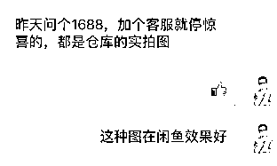

- 自费采购样品，到货后自行拍摄。这个方法成本最低，还能顺便验货、检查外包装和发货流程。低价商品买下直接拍，拍到足够素材后利用退换保障退回即可；批量采购金额较大的，先和对方商量好。我早前一次购入几千块样品，提前约定拍完全额退回。

04 图文要互相印证，才能建立信任与捡漏心态

先说一个反例：有人挂出一台流动售卖车，标题强调“全城仅此一台”，文案反复写“全新”“特价”，配图却是一张规格示意图。这种图文割裂的帖子，买家根本无从信任。如果自称源头直发，画面却全是网络素材；声称仅剩一台现车，怎么连张实物照都没有？逻辑立不住。

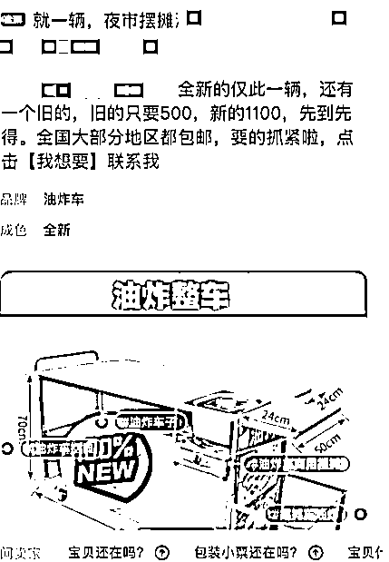

线上卖货，就是用画面和话术代替线下的面对面沟通。暂时不管平台给不给流量，先把能掌握的做好：让文字和画面配合，促成成交。关键要回应买家的两大诉求：信任感与捡漏心理。

许多经营者喜欢用“清仓甩卖”“仓库处理”这类诉苦式话术。想法没错，但配图跟不上就露馅。来看一组窗帘清仓的案例，画面是仓库里成堆的存货、忙碌的车间、凌乱的布料，这些素材和“清仓”的主题严丝合缝，比一张精致网图可信得多。

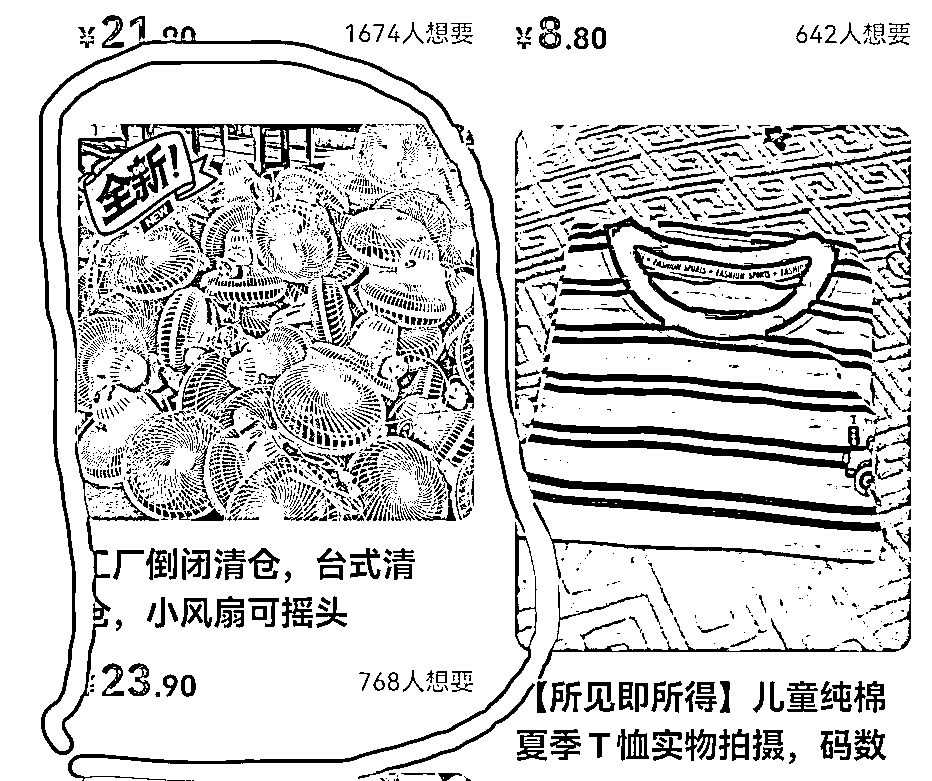

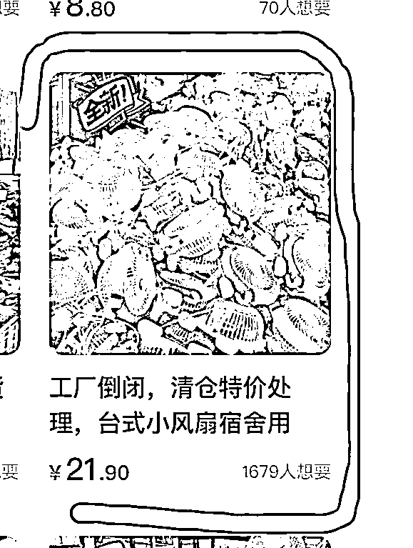

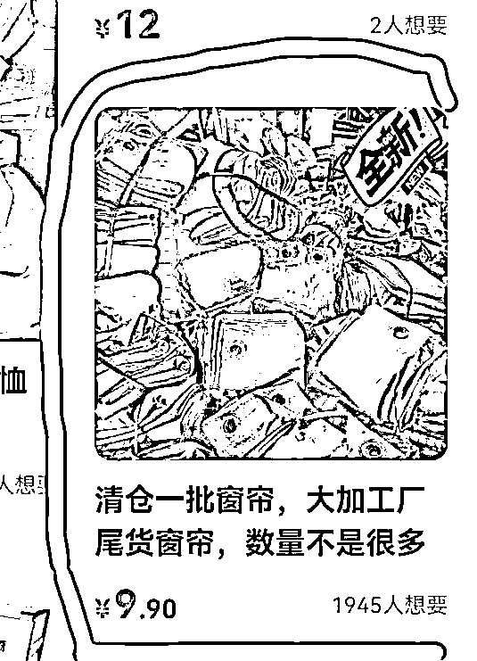

你可能会问，这些画面去哪找？其实公开渠道很多，比如拼夕夕上的工厂实拍、买家晒单，甚至生产车间里的画面也不难寻。

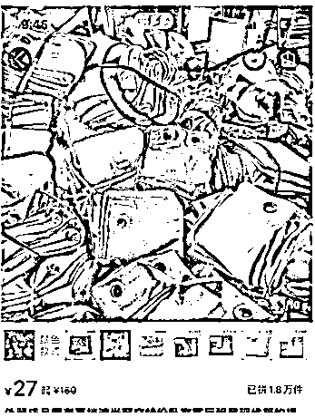

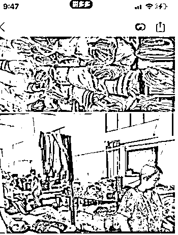

再随意看两张，这类图在购物网站上一抓一大把。

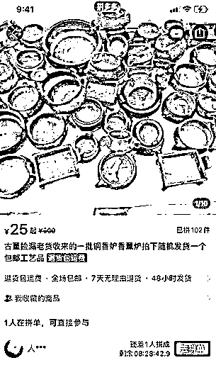

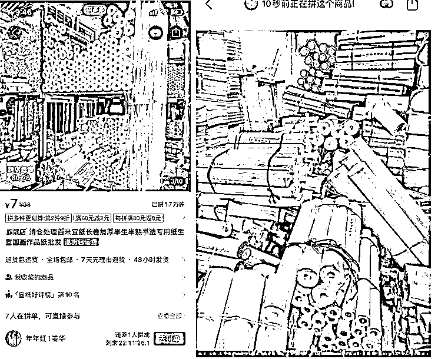

要找到这种带“库存感”的画面，可以用“商品名+场景词”的组合去全网检索，比如配上“清仓、特价、尾货、库存、批发、处理”等词，各大购物App、内容社区、搜索引擎都能用。另外，多加几位供货商，浏览他们的动态，往往能攒下不少素材，熟悉后直接问他们要也可以。

总之，无论用什么话术，都记得让文字与画面互相印证，别让它们各说各话。发布前站在买家角度重看一遍，如果连自己都产生了购买冲动，这条内容就过关了。这种图文互相印证，正是“人货场”合一的表现。

05 亲手掌镜的七条标准

如果决定自己掌镜，以下标准请记牢：

- 光线：选柔和的采光，太暗显得廉价，强光照会让色彩失真，窗边漫射光比较理想；
- 环境：画面保持整洁，杂物会分散注意力；
- 背景色：全片统一。绿草地适合户外感，木纹桌面显得温馨，深色绒布适合衬托高价藏品；
- 角度全面：正面、侧向、背面、全景、特写都要拍到。平台最多支持九张图，前四张放全貌，后几张放局部特写；
- 对焦清晰：模糊等于把顾客往外推；
- 适当提亮：修图软件里稍微调高亮度，让画面更清爽；
- 不要修太狠：美化过度导致实物与照片落差，售后麻烦会源源不断。

除了这些，还要多研究同行的主图。几位卖运动装备和五金工具的账号，主图构图就很有代表性，值得反复品味。

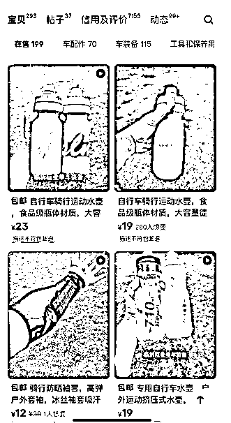

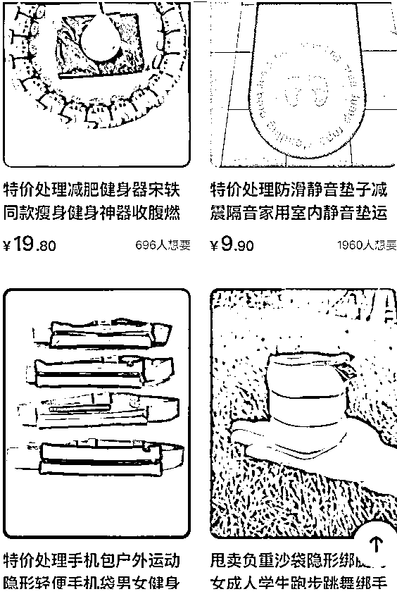

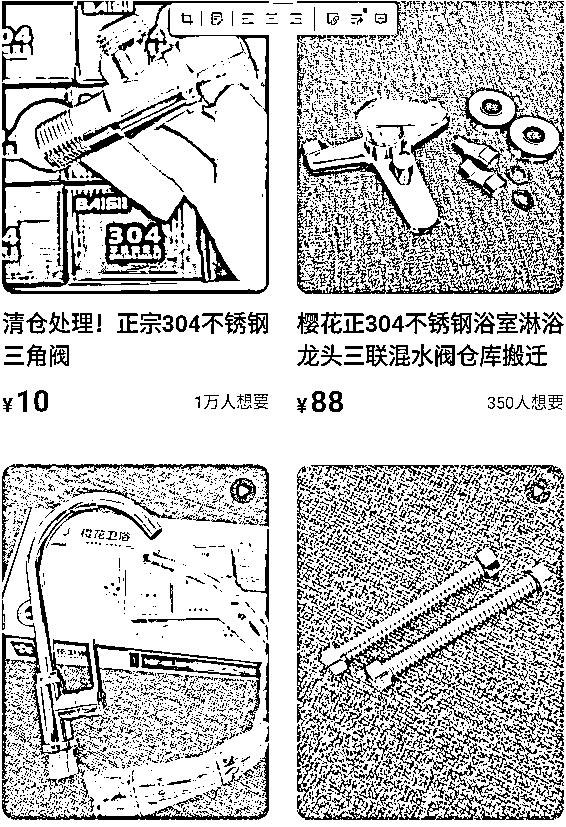

06 用对照画面突出优势

同框对照是一种含蓄的加分技巧。销售同款式衣服，将面料纹理、缝线、纽扣放在一起比较；卖电子产品，可以展示接口工艺的差异。切记：只对照商品本身，绝不露出对方的品牌或店铺名，不为拉踩，只为衬托自己。

07 实景氛围是最好的销售员

同样是卖散养鸡，一只站在山坡草地上，另一只躺在超市托盘里，哪一种更能打动人？答案显然。

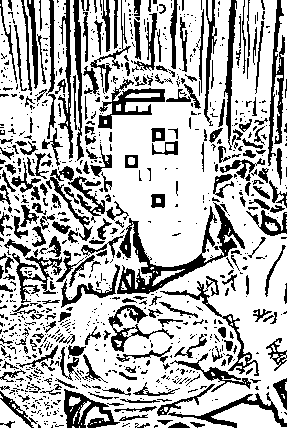

卖红枣时，配上果园里现摘的画面，比单独拍一袋果子诱人得多。

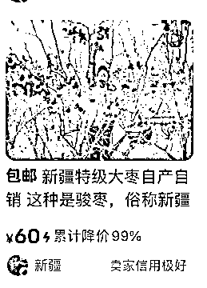

各类商品均有对应的实景画面：日用清洁品演示用前用后的差别，补漏材料拍施工过程，蜂蜜给出蜂场里的画面，渔具配一张大鱼上钩的瞬间，窗帘放进生产车间……场景本身就是最有力的话术。

08 把卖点写进主图

手写体大字能显著提高主图的点击率。把“亏本清”“最后十件”“破损包赔”这类核心卖点放在主图上，字要大，数量要克制，一眼就能看清，别弄成花哨的弹幕。

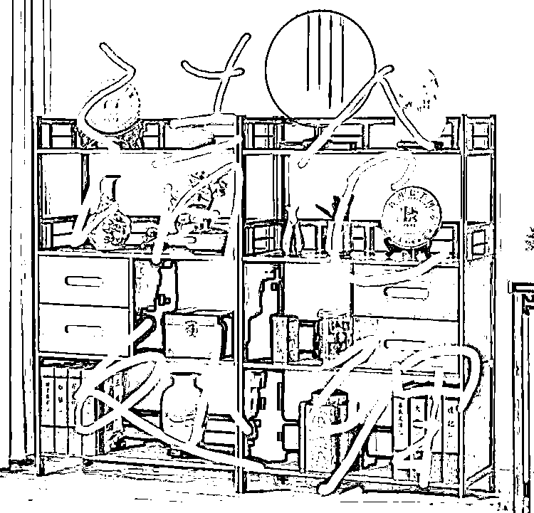

09 发布前检查小图效果

竖版上下留白多，如果主体占比过小，在信息流小图里就会显得很弱。发布前，先将主图传上去，在列表里看一眼小图效果，确认商品居中、够大、完整。相同的原图，经过适当裁切，观感可能完全不同。

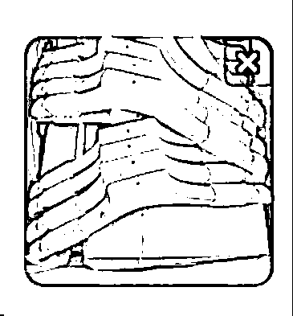

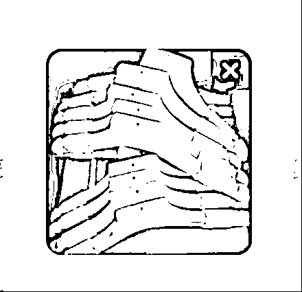

10 集中囤图，提高效率

与其每次发链接临时翻素材，不如集中处理一批。早前我帮一家海参店铺铺货，供货方只给出部分资料，单品特写、成堆货品、加工场景、渔船出海、渔村环境都需要自行解决。我花一下午时间，把几个内容平台上的相关画面挨个搜了一遍，可用的画面全部保存下来，一次囤了两百来张。按每天发三个链接、每个链接五张图计算，这批素材够用两周左右。集中收集、统一筛选、分批使用，远比随用随找省时间。

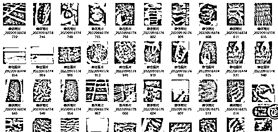

11 给原创画面加上水印

亲手掌镜的成果最怕被同行顺手牵羊。盗图一多，系统很可能判定内容重复，影响曝光。所以水印要打在画面正中央，放在四角则常被切掉。同时保留原始文件，将来万一有版权纠纷，这就是最硬的凭证。

以上11条，件件都是闲鱼运营里的实战场，看起来都是小事，却决定了你能走多远。把一个小项目做得足够深入，比追逐多少新风口都重要。深耕下去，任何不起眼的生意都可能带来几万甚至几十万回报，还能沉淀成个人品牌，持续增值。

最后借王兴的一句感言收尾：这世上不存在神话，只有一些简单的规律——价格低者胜虚高，品质优者胜粗制，认真者胜草率，耐心者胜急躁，勤勉者胜懈怠，守信者胜失信。愿大家在这条路上，用心、沉住气、多下笨功夫，把闲鱼经营做成真本事。

