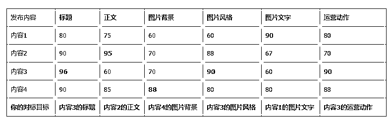

# ('账号流量数据不佳，很有可能是拆解不到位', (2, 21))

最近后台收到不少朋友吐槽，说闲鱼账号发出去的东西没什么水花，流量惨淡。聊了一圈我发现，大家的问题未必出在平台身上，很多时候是“对标拆解”这步没做到位。

拆解不是随便刷刷同行的页面、看一眼就完事。关键是你要带着脑子去分析，把颗粒度拉得足够细。拿闲鱼来说，我自己踩过坑，也积累了一些心得，分享给你。

**先看数据层**

打开一个对标商品，首先留意浏览量和“我想要”的比例。这个数据合理吗？如果好得离谱，有没有可能是刷出来的？其次看发布时间——有些商品发布时间很新，数据却不怎么样，但搜索排名偏偏靠前。这会不会是平台的某种规律？如果是，是不是意味着你想获得曝光，就得保持每天多发几次商品的节奏？最后是价格，低价不一定就有人点，高价如果透着一股专业感，同样能勾起点击的欲望。关键在于，你要搞清楚用户到底为什么点进来。

**再看内容层**

主图和文案永远是重头戏。

主图方面，背景是可爱插画、纯色、聊天截图还是商务风？图片比例是 1:1 还是 4:3？如果发 4:3 的图，文字会不会被 1:1 的裁剪框切掉？色彩是走清爽浅色、沉稳暗色，还是高饱和撞色？图上如果有字，字体是书法手写体还是普通黑体？字占整张图的比例有多大——是不是字大的图天然更容易吸引人点？字的颜色和背景反差不明显、看不清？这些都是值得逐个打分的细节。

文案方面，标题里的关键词很有意思。同行的标题里藏着哪些高流量搜索词？他们是有意选的，还是随手抄来的？更重要的是，你有没有自己去搜一搜、验证一下，找出更猛的关键词去改良他们的标题？做到“先抄后超”，这才是真正有效的借力。

正文也别糊弄。细分的搜索关键词有没有铺够？你自己看完这段文案，有没有按下“我想要”的冲动？如果有，是哪个数字或者哪个词戳中了你——比如“写过 500 份 PPT”、又或者“不满意支持退款”？你有没有把出现过的搜索词删掉重复项、集中保存起来，日积月累后从同行中提炼精华，重新排列组合成更有吸引力的文案？

评论区同样藏有信息。看看是被同行刷屏还是真实用户留言多。如果你连着刷到好几个同行留言的商品，突然冒出一个用户留言特别多的商品，你就要警觉——这很可能是个异常值，里面可能有值得深挖的玩法。

**拆解的核心：可视化**

拆解这件事，不能凭感觉。你得把每一个对标商品的具体特点，提炼成一目了然的表格，逐行给每项指标打分。比如这样（以下数字只是示例，实际根据情况自行评估）：

每新增一行数据，就重新过一遍所有维度，把这份刻意练习坚持下去，很多共性和规律自然就会浮现出来。

为什么一定强调可视化？因为不做整理和记录，你的模仿大概率会走样。脑子里想的是 A，做出来却成了 B，落地后差距远比自己想象中要大。这也是很多人反复拆解却毫无进展的根本原因。

说到底，低水平重复 30 次，每次都是 60 分，没什么意义。不如放慢脚步，每次只进步一点点，从 60 分一步一步迭代到 80 分、90 分，这才是肉眼可见的成长。

这个过程确实不轻松，但你要知道：越早经历这种磨炼，你就越早真正长本事。

