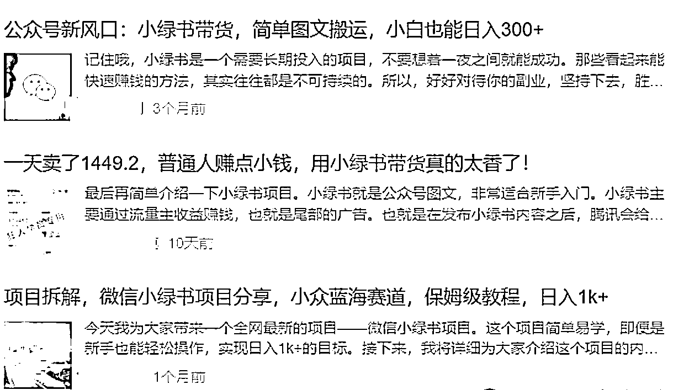
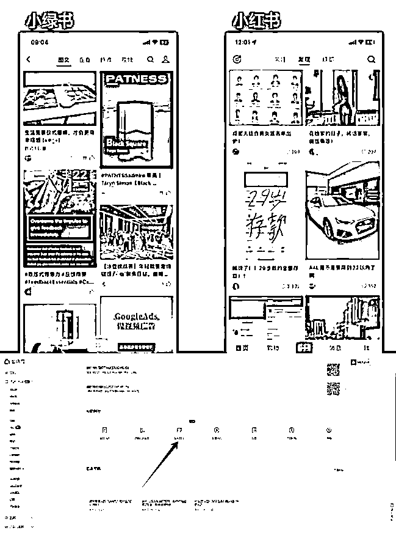
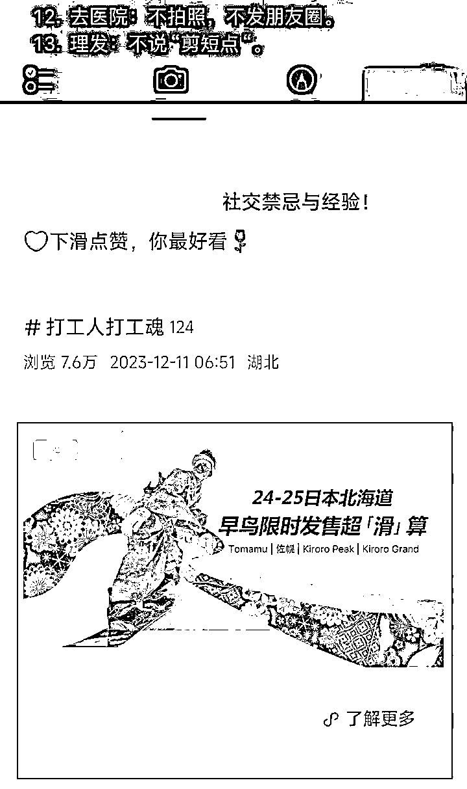
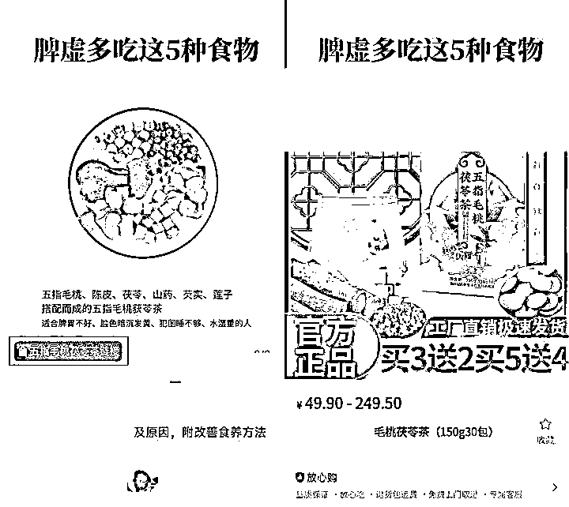
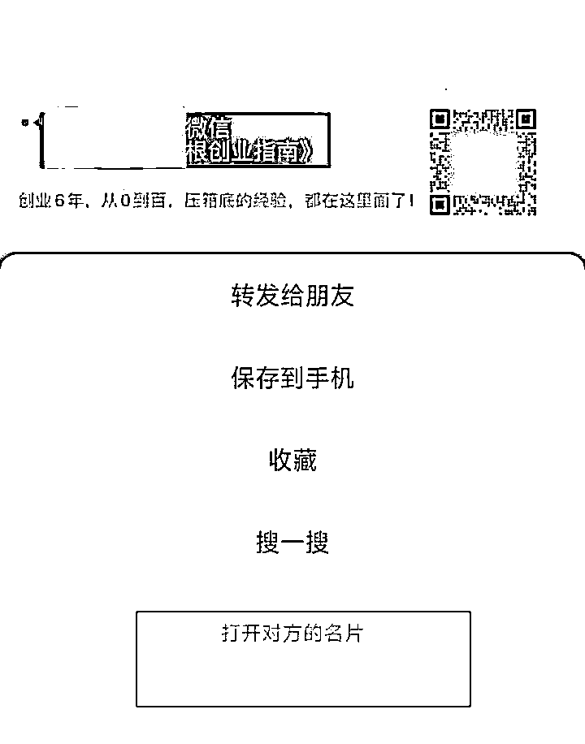

# ('小绿书：公众号图片消息功能的热度与变现探讨', (2, 23))

最近不管是微信群还是公众号，总能看到“小绿书”刷屏，满屏都是“有手就行”“日入几百上千”的帖子。说实话我有点懵：这功能之前一直不温不火，怎么突然就成香饽饽了？难道腾讯又悄悄放了大招？还是真有什么我不知道的新玩法？

**小绿书到底是个啥**

有人可能以为“小绿书”是什么新平台，其实它就是公众号早就上线的图片消息功能。这个功能一年前就有了，最近才被大家翻出来炒热。因为页面排版跟小红书很像，网友就给它起了这个外号。用起来也不用多注册平台，直接在公众号后台发布就行。

**小绿书怎么赚钱**

一，开通流量主。粉丝到500以后，进公众号后台，找“广告与服务-流量主”就能申请。广告会出现在图文底部，按曝光和点击结算，一般万次阅读收益在10到50元之间。

二，图文带货。满100粉就能开通，发图时插入返佣商品，图片上会出现购买入口，用户点了就能下单，赚佣金。

三，导流私域。小绿书对引流的限制比较松，图片里可以直接放二维码，读者长按就能识别，把粉丝导到个人号或社群里，再在私域做转化。

讲真，上面这些但凡看过“小绿书”的人基本都清楚。那有没有更进阶的玩法？我花了几小时把全网相关内容翻了一遍，结果挺失望：有价值的干货几乎没看到。标题一个比一个猛，什么“日入300+”“日入1000+”，点进去全是流水账，没啥新东西。

其实小绿书的底层逻辑就是公众号爆文逻辑。你把图文发出来，内容够好，算法就会推给更多人，运气好就成了爆款，然后赚流量分成或带货佣金。只不过跟公众号长文比，小绿书用图片表达，门槛低很多。具体做法也不复杂：找对标案例，照着模仿，持续更新，有条件就搞矩阵号。

但操作门槛低，不等于赚钱轻松。这跟做小红书一个道理——发图谁都会，可大多数人发出去根本没什么流量。想跑出爆款，还是得靠经验、审美和一点运气。项目逻辑没毛病，可指望它躺着赚钱，真没那么容易。

小绿书得用心做，才有爆的可能，才有机会拿到结果。如果你小红书玩得明白，那很适合来做小绿书；要是小红书本来就没做出美感、流量也一般，小绿书大概率也翻不出什么浪。给新手的建议：别上头，别乱交学费。真想试，就先找几个爆款当对标，自己发几条感受一下。

评论区里也有意思：有朋友早就在关注并测试了几篇，确实拿到了流量，但转化率一般，判断这波小绿书的商业化机会可能更利好90后、00后。还有人在问：带货挂商品非要开通微信小店吗？不能挂视频号橱窗？答：能挂橱窗，我挂的就是橱窗。还有人表示已经准备研究自动化操作了。

