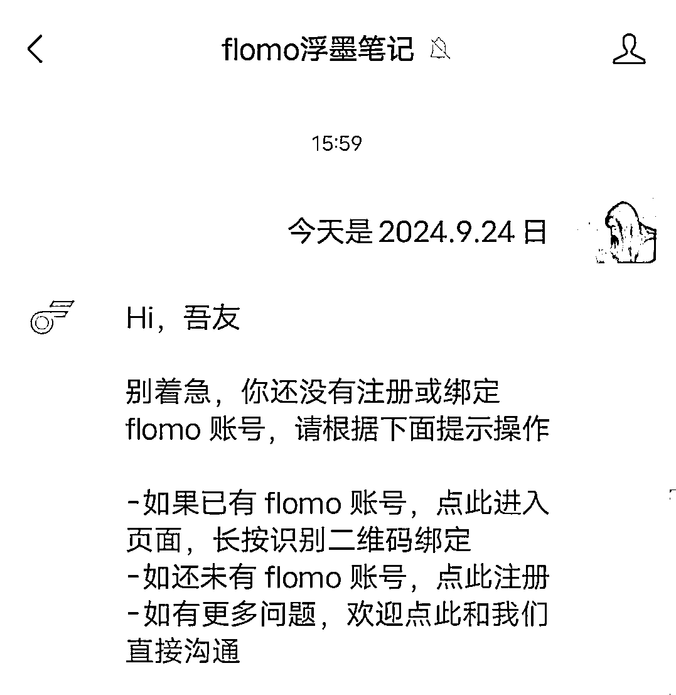
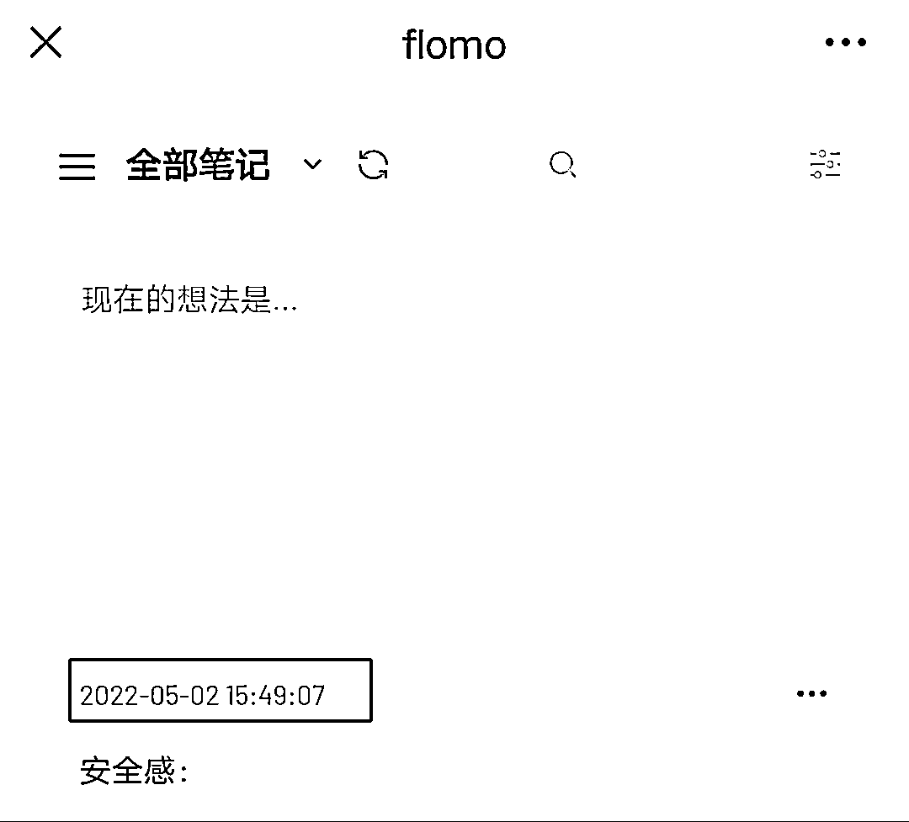
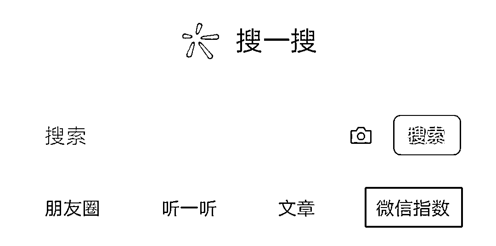
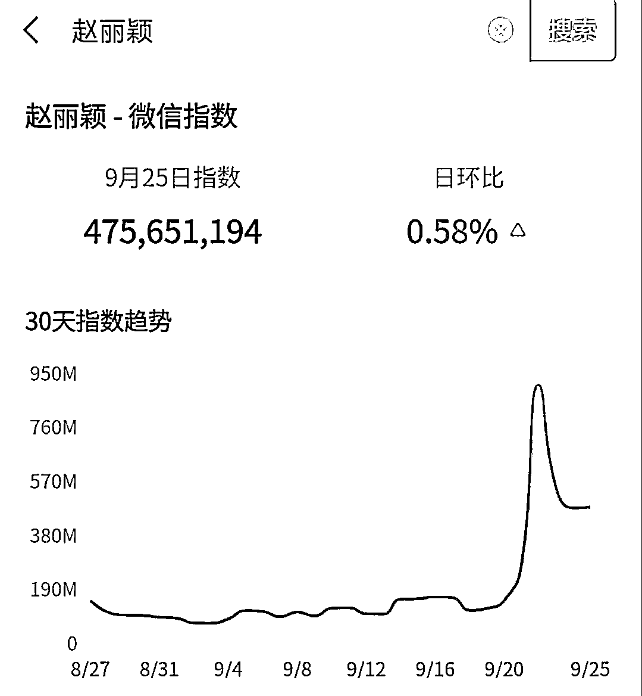

# 新手做自媒体内容卡壳？这7款辅写利器我长期在用
作者：龙哥

最近有读者私信我：

“写稿总是一团乱，感觉效率很低，也拿不到让人想点开的表达，有没有靠谱的辅助手段？”

确实有，而且数量不少。我自己从月入三千一路写到年入七位数，这条路走了不少弯路，总结出7个真正能把效率和质感一起拉起来的工具。最后一个冷门但好用，很多人都没碰过，先收藏再说。

**01 文件防丢：石墨文档**

以前有一次熬夜赶完长文，电脑直接蓝屏，内容全蒸发，当时真的想砸键盘。后来转用石墨文档就安定多了。它是云端协作型编辑器，保存是实时的。断网时会弹出提示框，可选择先存本地，恢复联网后自动合并回云端。界面干净，操作不拖沓，很符合我对高效的要求。

**02 金句检索：句子控**

开头收不住，收尾没力气，是很多写作者的通病。句子控这个小工具就是用来补位的。里面按风格收纳了大量现成表达，从清新散文到毒舌犀利都有。平时划拉几下找灵感，看到合适的一句直接借鉴改写，文章质感会明显不一样。

**03 灵感收纳：flomo浮墨笔记**

灵感最怕来得快去得也快。我一直让学员做一个随手记库，flomo非常适合这个定位。它走的是极简高速路线，打开就能写，任何细碎想法、待办、片段都能瞬间留下。核心在于它的标签体系，分类后检索非常快，用时就能定位。

怎么上手？

直接🛰️搜索“flomo”官方号，关注后就能在对话框里和它交互。

还没注册的小伙伴，先用免费版开一个号，把心里的点子丢进对话框里就行。

我自己的旧记录到现在还能找得到，真的很安心。

**04 素材沉淀：纸条**

素材匮乏会让写作变得干瘪。纸条可以看作一个移动的素材仓，涵盖美文、名言、案例等多种类型。每天刷个几分钟，既能攒点子，也能潜移默化提高语言功底，前提是要有意识地练习。

**05 热点判断：🛰️指数**

写作时很容易凭感觉判断话题热度，结果一发出去没动静。🛰️官方推出的指数工具能提供更客观的参考。输入关键词，就能看到它在🛰️生态内的搜索趋势和波动情况，便于判断是否值得跟进。用它来校准选题，不至于偏离读者兴趣。

举例：

**06 免版权图源：Pexels**

“图文结合”几乎是标配，可合适的配图往往更难找。百度图库版权风险高，自拍又不一定好看。Pexels的图库资源质量稳定，题材丰富，且完全免费商用，能省去大量找图和法务顾虑。

**07 动图制作：一个木函**

动图能让推文更活泼，但搜来搜去总差点意思。完全可以自己做。推荐“一个木函”中的GIF合成功能，把几张静态图拼接成动图，还能加字幕、滤镜等装饰。操作简单，我自己产出推文时经常用它点缀。

整理一下这7个方向：

- 资料保存：石墨文档
- 表达库：句子控
- 靈感归档：flomo浮墨笔记
- 素材池：纸条
- 话题热度：🛰️指数
- 配图来源：Pexels
- 动图合成：一个木函

觉得实用就点个赞，我继续更新。

另外，我关于做号的思路拆成了5个专题，有兴趣可以翻阅：

【系列2：策略线】坦白局——推文爆款是否还有空间？文章见：[【坦白局】：毕业1年，通过👸号爆文项目赚到7位数，👸号爆文还值得做吗？](https://t.zsxq.com/GjvBy)

【系列3：数据线】精华还是水帖？用数据说话：04届大二助理，一年从小白到平均3天一更10w+...文章见：[《精华or水帖？用事实说话：0...》](https://t.zsxq.com/003Ug)

【系列4：赛道线】24年8月，哪些小众赛道还能做？文章见：[https://t.zsxq.com/p8XG3](https://t.zsxq.com/p8XG3)

【系列5：提示词线】热点稍纵即逝，如何用AI快速产出文案？文章见：[https://t.zsxq.com/ohtwt](https://t.zsxq.com/ohtwt)

评论区大家都在说“刚需”“已收藏”，感谢互动。

