# TikTok 橱窗封号潮过后，莫名爆单，妈妈~我可以吃猪脚饭了。
作者：龙哥

9月14日平台搞了一场大清洗，搞橱窗的多多少少都尝到了苦头。我们也没能幸免，五个号直接被封，心里那个痛啊。

那段日子，我们的账号一直很稳，日常发的内容全是自己实拍，混剪这类操作从来不让团队碰。所以一开始我完全想不通，后来翻来覆去地复盘，觉得问题很可能出在实名认证的信息上。网上有人甩锅给内容风控，但我的看法不同：我们的内容根本没踩线，规则也都门儿清。像那些双屏、游戏、情感类的号，活得好好的。

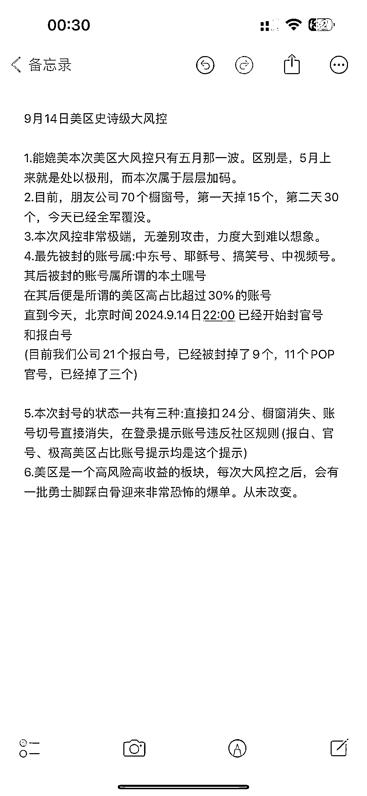

看数据趋势：15号之前平平无奇，16号开始抬头，19号明显冲了一波。

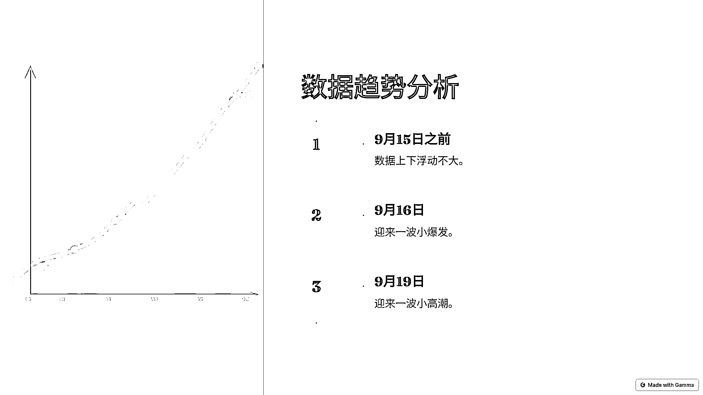

这家新店从0做到100单，时间只花了两个月。

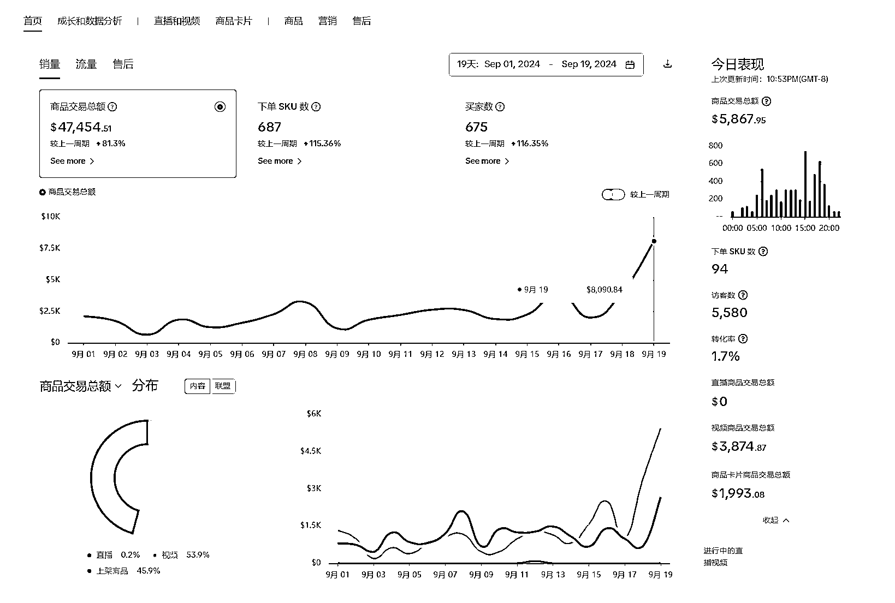

再看这周的账号概况：

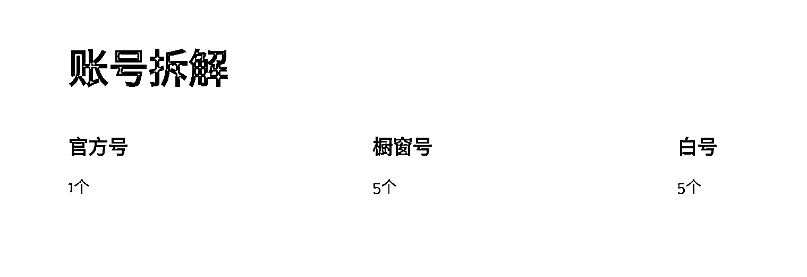

具体数字是这样的：

流量构成：

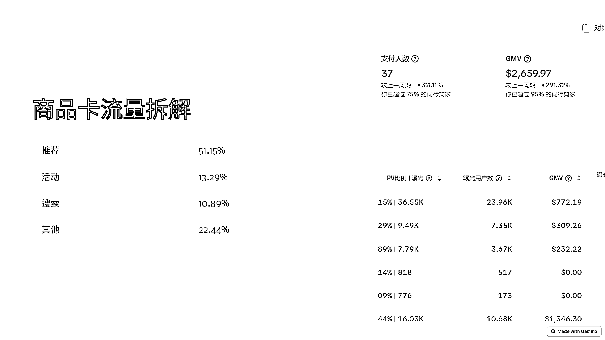

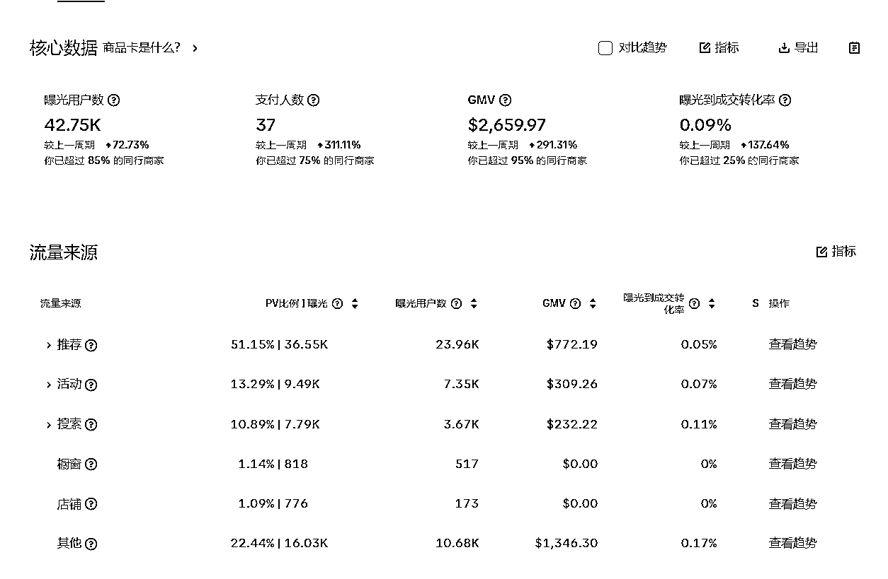

达人这块，今天一共11个达人在带，其中5个还是自己的号。

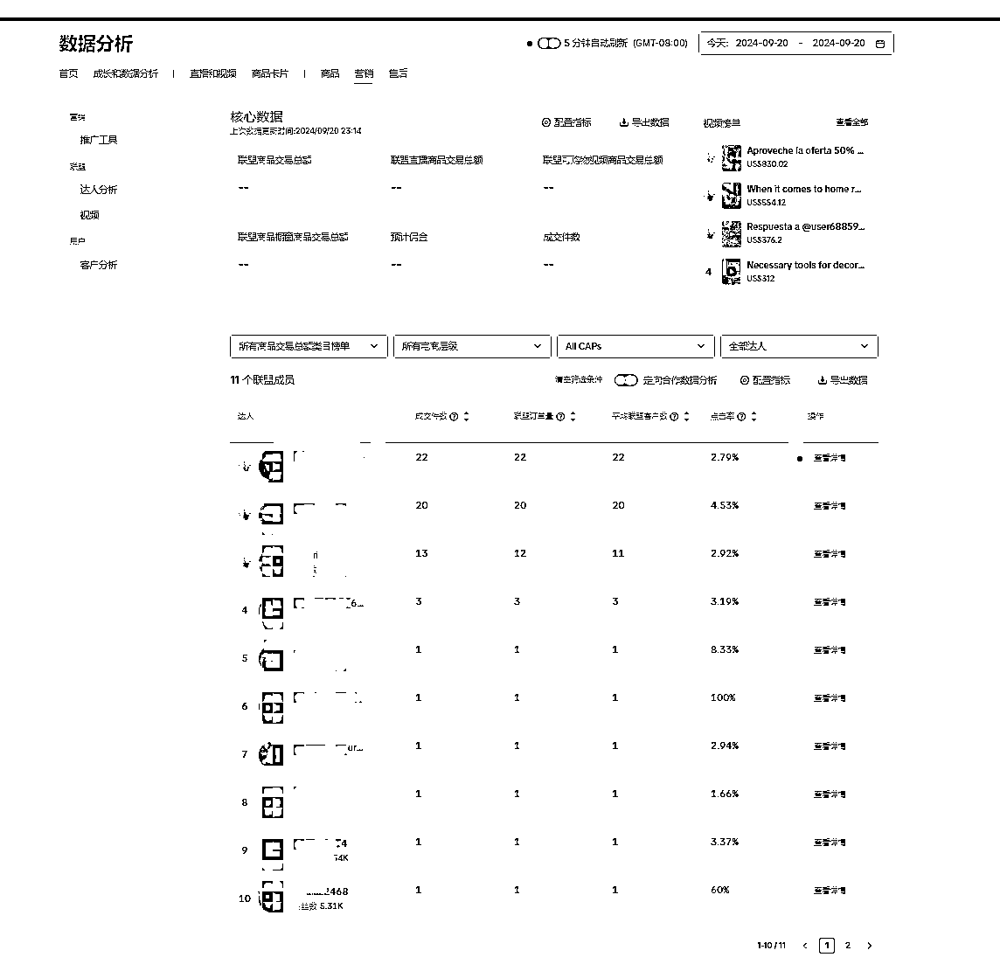

广告这块，这两周每天拿300的配额来带动商品卡和自然流量，加起来花了5000美金，ROAS 3.51，保本线1.9。

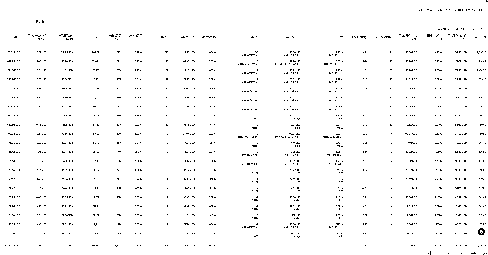

接下来聊聊我们碰到的突发情况和一些实操细节。

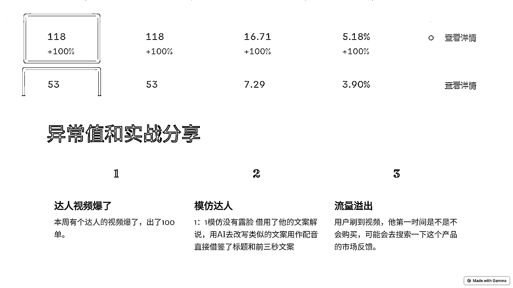

先说突发情况：这周有位达人的视频突然爆了，一口气出了118单。我们自己的账号也出了53单。

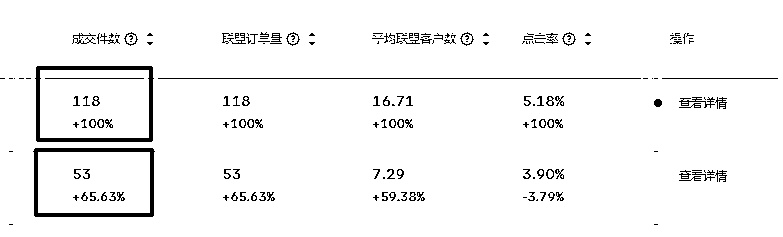

那53单的来历很简单：我照着那位达人的视频架构1比1复刻，不露脸，配音用AI把他的解说词改了一遍，标题的写法、前三秒的开场，我都直接套用。结果他118单，我53单，差距没那么难看。

这条视频的成绩就是这样。

还有个心理要讲清楚：大多数人看到视频后不会立刻出手，而是先去搜一搜这个产品的口碑。于是，一位用户搜了产品名xxx。

这一搜，我铺出去的橱窗内容全都蹦出来了。他又懒得返回去找最初那个作者，随手往下刷了刷，选了一个觉得不错的视频就下单了。巧的是，那个橱窗正好是我运营的。得，又变成我的自然流量了。

再说细一些：你在选鞋子的时候，下方会推荐相关产品。

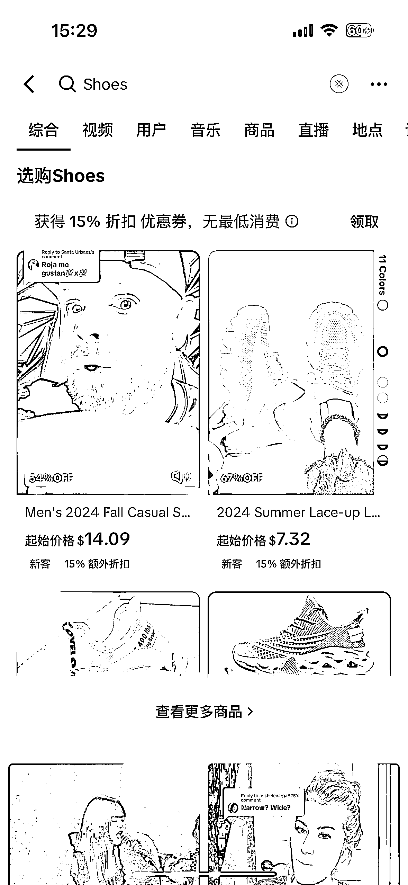

进去看视频，系统会展示一个广告推广位，外加一个自然展示位。这两个位置，恰好我都占了。

意外不？

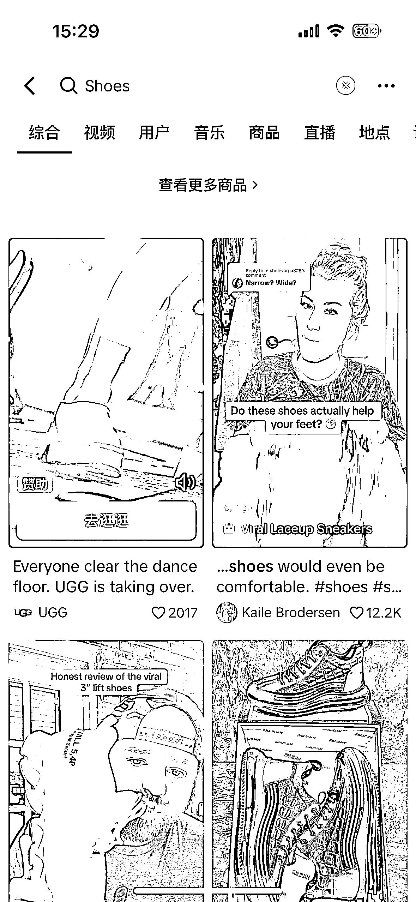

这背后是啥逻辑呢？做流量就一定有外溢。一条视频火了，无论是自己拍的，还是达人拍的，甚至是路人偶然录的，总有一批人当场转化，另一批人则会顺着内容去看别的东西——有人去搜关键词，有人翻其他作品，有人跑进商城继续逛。再往大了说，也可能跑去别家平台比价，或者用搜索引擎再查一查。

想接住这些外溢流量，第一要在多个平台布点，第二要把站内的承接做足。

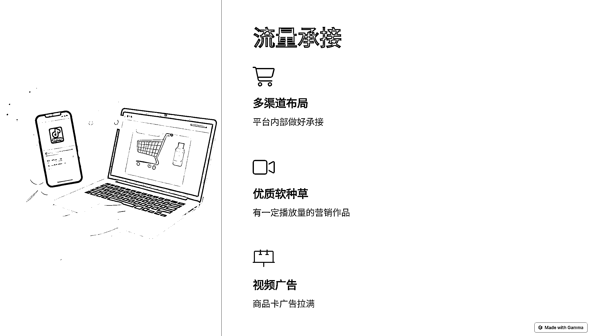

怎么承接？一手准备质量过硬、播放量说得过去的种草视频和营销内容，另一手把视频付费推广和商品卡的资源都拉满。

这套方法算是一个实操模板，我日常就是这么干的：

第一步，先找创意源头。我会去皮皮翻同品类的爆款广告，凡是播放量超过10万的，都把脚本扒下来，仿拍成自然流内容发出去。

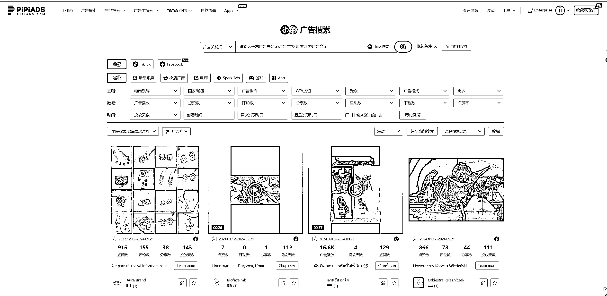

如果这个品类素材太少？那就去别的品类找，刷到能用的，同样换脚本拍一遍，发自然流。

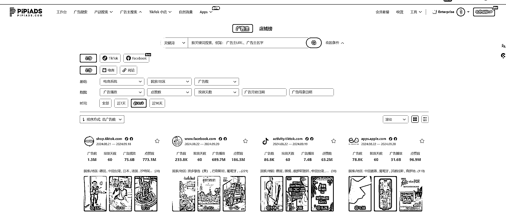

把有潜力的内容放量：24小时内播放破了2000，或者才几百播放就出单的视频，直接拿钱投流。每条先扔20到50美金。看到转化好就加预算，转化不好就当是给自然流做了助推。

第二步，研究自然流和达人端的视频案例。参考上面的方法，找到能模仿的对象就模仿，能放大的就放大。我还会用TikStar查一下对标账号，看他们最近一周的达人和视频表现，照着复刻。

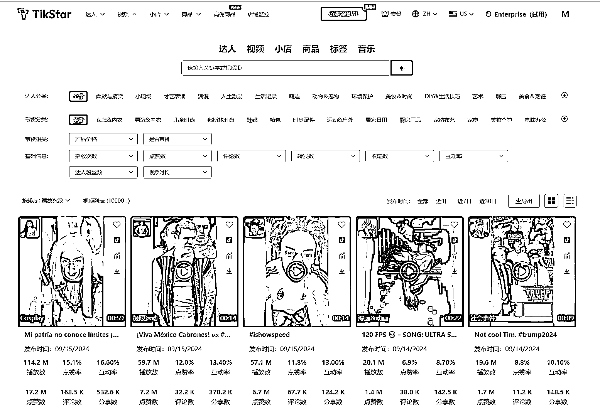

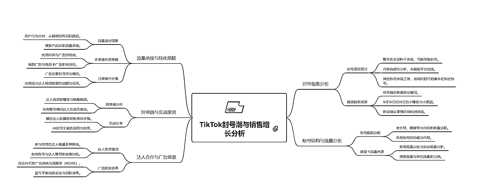

最后总结一下：平台变化很快，想走得久，先得守住规矩，再谈持续调整。账号认证、内容发布、广告投放，这些环节都不能越线。同时要多注意流量变化、达人玩法和投放素材的新风向，随时调整自己的策略。把合规当成底盘，把迭代当成习惯，这样才能在波动中稳住增长。

