# TikTok vs Facebook：广告界的“侦探”与“艺术家”，谁更懂用户？
作者：龙哥

在流量为王的时代，广告投放早已不是一场单纯看转化率的数字游戏。它更像是在用户心智中反复埋下线索、引导决策的暗战。今天我们不聊那些满大街都能搜到的结论，而是从底层逻辑切入，看看在流量外溢和用户代际迁移的大背景下，广告主如何在这两大平台之间游刃有余。

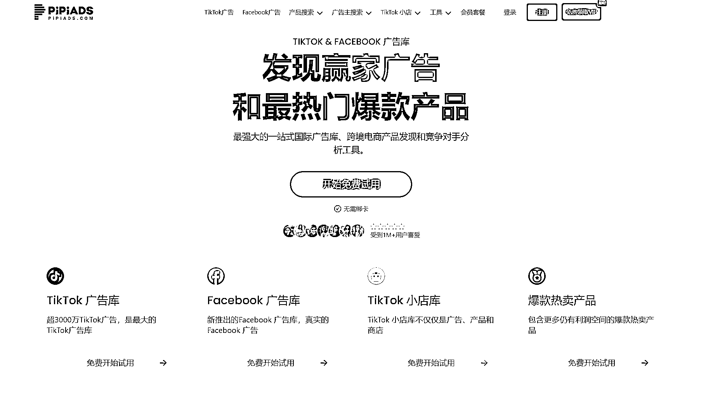

## 一、归因背后的真相：精确追踪 vs 模糊种草

把广告归因比作破案，Facebook绝对是装备精良的侦探。从你点击广告的那一刻起，它的每一步都能被记录，甚至通过Cookie之类的小工具，捕捉你在其他平台上的动向。比如你刚看过一款咖啡机广告，过几天脸书就给你推同品牌促销，还不忘暗示你该添置咖啡豆了。这种无孔不入的追踪，真的让人防不胜防。

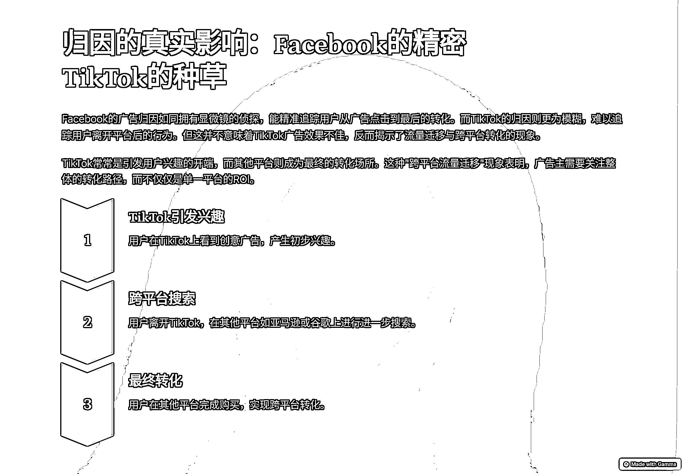

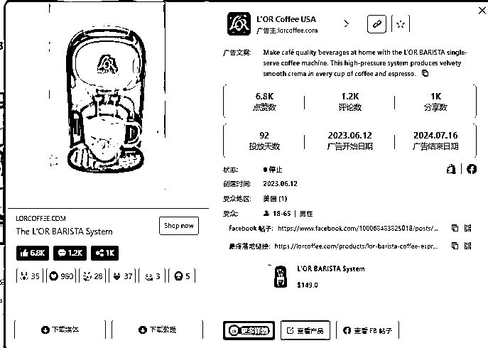

相比之下，TikTok的归因相当“随性”。它只能看到站内的点击与互动，用户跳出App后的行为基本是一片盲区。很多人因此觉得TikTok广告效果不如Facebook，但事实并非如此。TikTok的模糊归因，恰好折射出互联网世界里一个常被忽略的现象：流量跨平台迁移。

比如，你在TikTok刷到一个有创意的家居产品广告，可能当场没买，但记住了它，之后去亚马逊或谷歌搜索，最终在某个电商平台下单。这不是广告失效，而是用户的跨平台行为链条在起作用。TikTok点燃兴趣，其他平台完成收割。

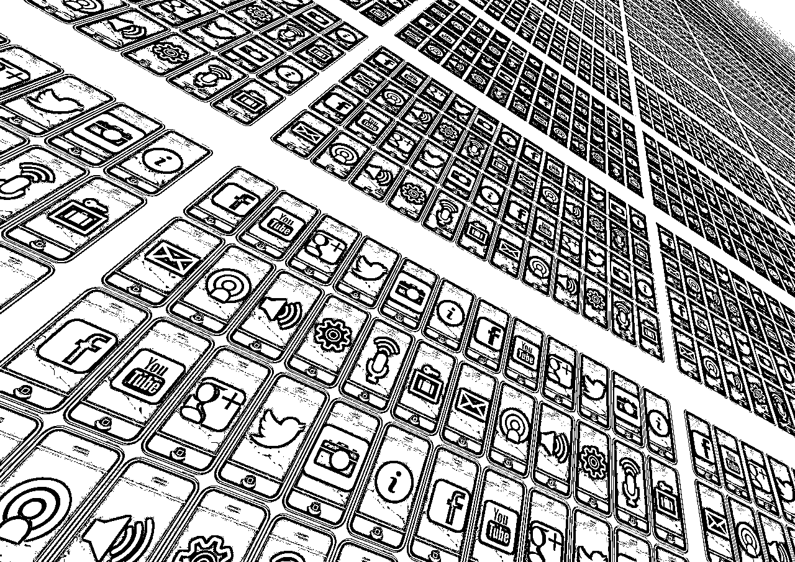

不少品牌方发现，TikTok上互动热闹，但最终订单常常发生在站外。这背后就是典型的流量外泄。一个创意广告让你记住了品牌，几天后你在别的平台完成了购买。TikTok是诱发兴趣的起点，其他平台则成了成交的主场。

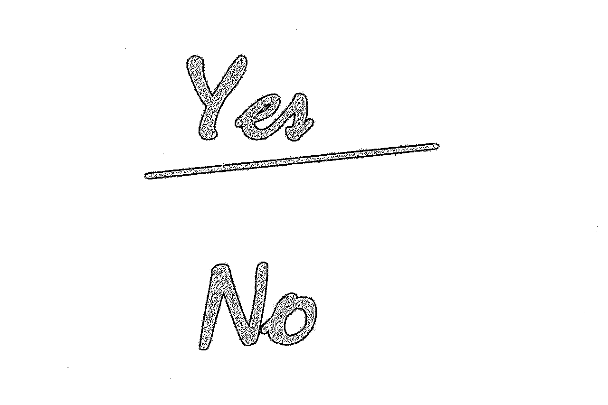

所以，聪明的广告主不能只看单平台ROI，而要看整条转化路径。TikTok负责让用户产生欲望，Facebook负责用精细追踪让欲望落地。真正要做的，是打通各平台的数据孤岛，让每一分广告预算都花得值。

## 二、投放逻辑：数据精算 vs 情绪触发

### 精准算法 vs.兴趣触发

Facebook的算法像一个“读心者”，基于长期积累的用户画像和行为数据，把广告精准推到那些已有明确需求的人面前。而且这种需求往往稳定可预测。假设你钟爱咖啡，这个平台不仅会向你推荐各类咖啡机，还会把马克杯、咖啡豆一股脑儿送进你的信息流。甚至你刚冒出想喝咖啡的念头，广告就已经候着了。在电子产品、保险等高决策门槛的品类，Facebook能带来稳定的投放效果。

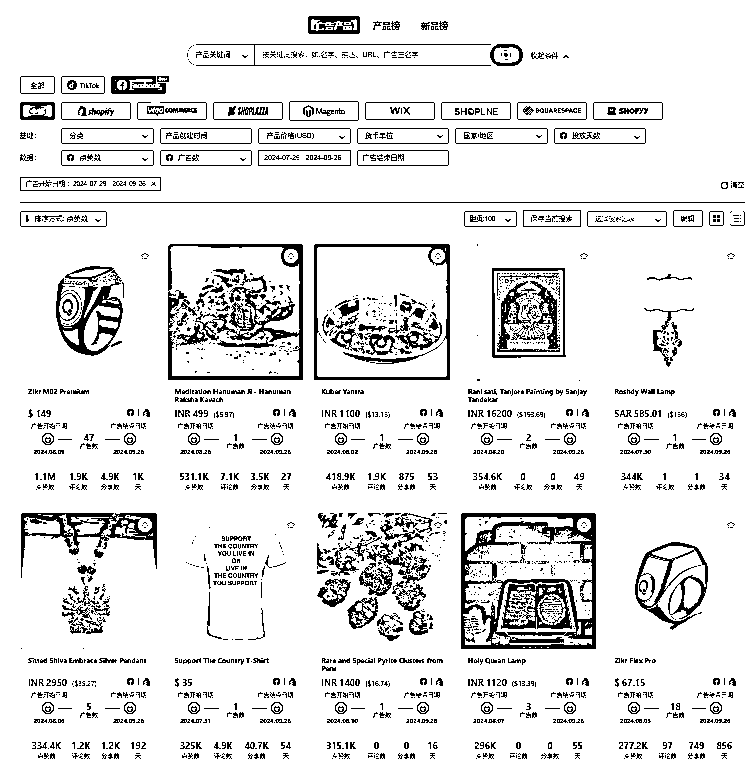

TikTok的玩法完全反过来。它捕捉的是“瞬间兴趣”，并不关心用户有没有长期需求，而是抓住当下的情绪波动。一条搞笑视频可能就让你冲动点击。很多爆款创意广告，靠的不是需求牵引，而是趣味性和创造力的瞬时刺激。你本来没什么购买计划，但广告恰好戳中了你的笑点或好奇心，于是你就点了进去。

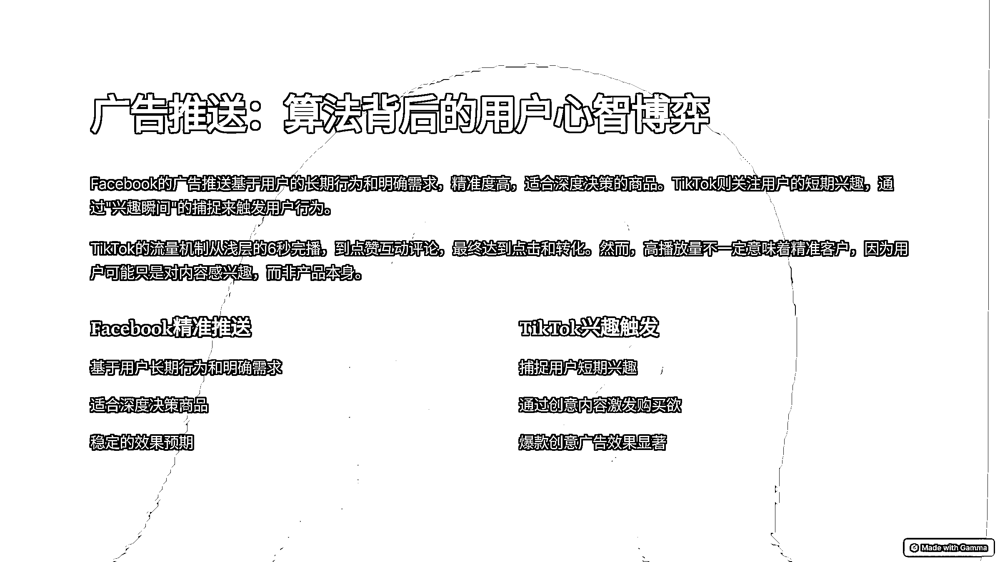

嘿嘿，这里得纠正一个常见误区。

为什么有些自然流视频播放量几十万，成交却寥寥无几？

因为TikTok的流量池是分层级的。最浅层是6秒完播，然后依次是点赞、评论、互动，最后才轮到点击和转化。你用黄金三秒留人，或者用抓人的文案引导评论，播放量固然上来了，但吸来的未必是精准客户。

就像每天刷炒股视频的人，可能并不炒股，只是感兴趣；天天看宠物视频的人，家里未必有宠物，只是喜欢看。

如今信息噪声无处不在。Facebook用数据不断校准精度，TikTok用算法不断创造意外。广告主的任务不是无脑投放，而是理解两种平台背后的心智博弈。Facebook负责找出那些早已有购买意愿的人，TikTok负责凭空唤起你的购买冲动。两者不是非此即彼，而是可以互补，让你在精准营销与情感共鸣之间进退自如。

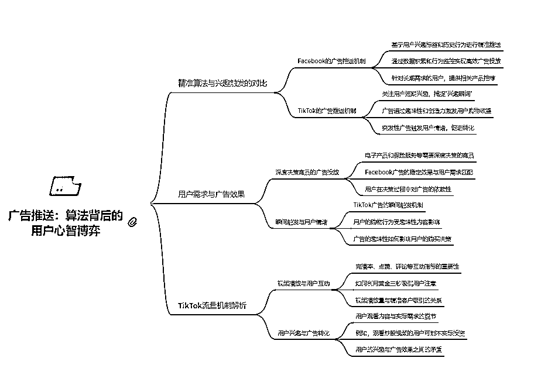

## 三、用户迁移：成熟理性派 vs 社交驱动派

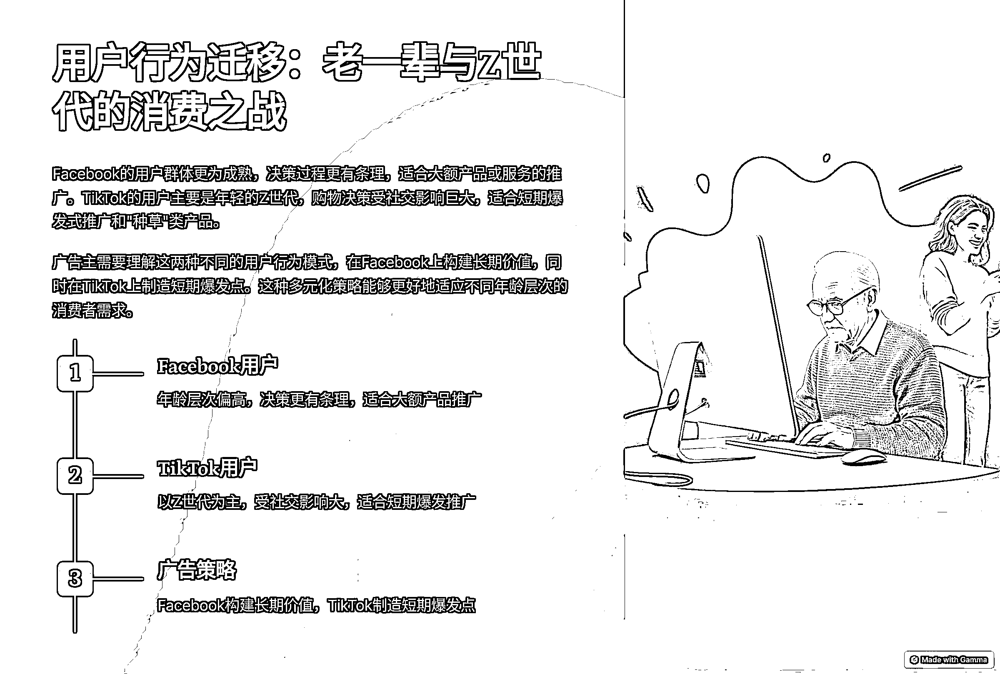

如果把时间拨回五年前，Facebook几乎霸占了所有广告预算，大家言必称精细化营销。如今，TikTok迅速成为年轻品牌的聚集地，尤其在快消、时尚、娱乐等领域。这种变化的根源，是用户群体的大规模迁移。

Facebook的用户偏成熟，年龄层更高，决策路径理性、有条理。他们愿意花时间对比产品、搜集信息，对大家电、汽车、金融等大额消费尤其谨慎。TikTok的核心用户则是Z世代，购物决策深受社交环境影响。一条热门视频、朋友点赞、评论区热议，就能迅速点燃购买欲。这也是为什么许多品牌在TikTok做短期爆发式推广，尤其适合需要“种草”的产品。

我们不能再用旧时代的转化思维去衡量新兴平台。广告主可以把TikTok当作品牌引爆和社会裂变的放大器，而不是单纯的成交机器。要赢下这场消费之战，既要在Facebook上深耕长期信任，也要在TikTok上制造短促的兴奋点。

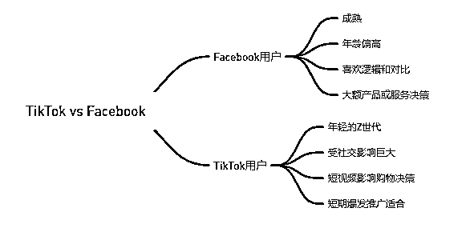

## 四、流量外泄之后：如何接住TikTok的隐形流量？

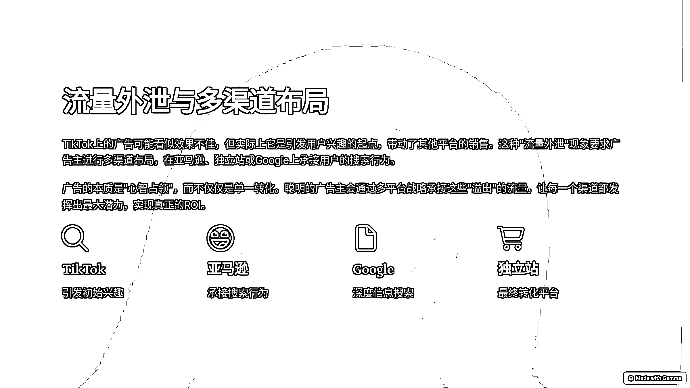

最容易被忽视的一点，正是流量外泄。你在TikTok投了广告，用户没有立刻买单，但品牌印象留在了脑子里。几天后，他们在亚马逊或其他平台搜到你的产品，最终下单。从报表上看，TikTok没有贡献转化，但实际上是它开启了整个购买链路。

广告主不能只盯着TikTok的后台数据。真正的回报来自多渠道协同。当TikTok用户对你产生认知后，你需要确保在亚马逊、独立站、Google等阵地能承接他们的搜索和购买行为。否则，你可能会误判TikTok无效，却不知道它一直在为你输送潜在客户。

广告的核心从来不是一次成交，而是先在用户心里占一个位置。TikTok的广告也许表面效果“虚”，但它往往是带动其他平台销售的引擎。聪明的广告主会用多平台策略接住这些外溢流量，让每个渠道都发挥出自己的杠杆效应。

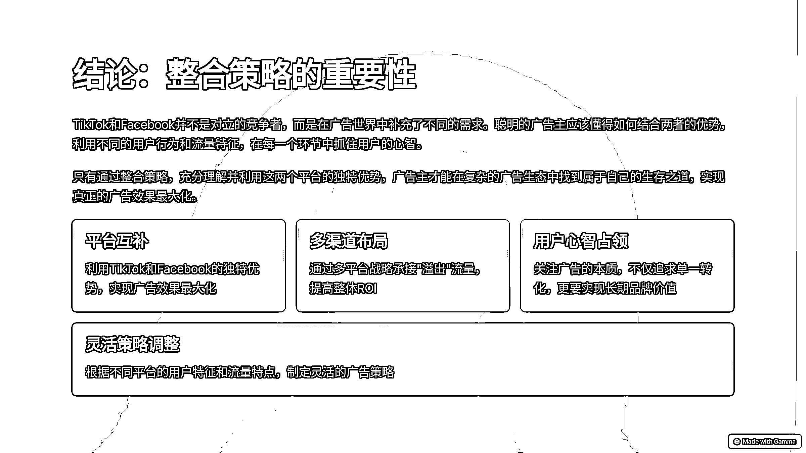

* * *

评论区：

追梦人~ : 伟哥，链接一下；

V;13043933311

* * *