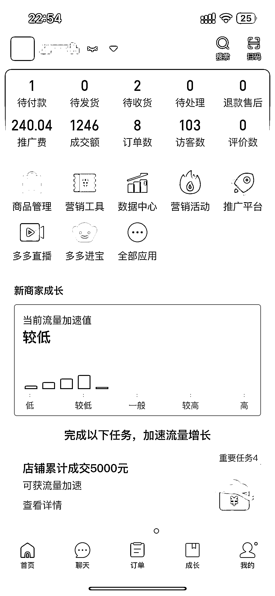

# 新手小白如何运营好拼多多流量赋能 AI 写作

### 拼多多流量+AI写作，小白怎么玩？我两个月做到月入两万的心得

有圈友问我，纯新手做AI写作，在拼多多上怎么搞流量？说实话，我也刚入行两个月，现在的收入已经能稳定在2万以上，平时还会琢磨各平台的流量玩法。因为自己淋过雨，所以特别想给还在找路的小白撑把伞。

先交代下背景：我叫志恒，以前是货架电商的店群操盘手，现在专注做AI写作变现。这两个月最大的感受就是，流量的获取对于新人来说简直是第一大难题。所以我把这段时间摸索出来的经验认真整理了一遍，分享出来，希望能帮大家少走点弯路。

这篇文章的篇幅不短，我索性把完整内容都放进了飞书文档，想细看的朋友直接点链接就好：

不少圈友在评论区问了几个比较多的问题，我也借这个机会统一作答：

关于怎么链接——上面的飞书文档就是了，直接打开看。

关于拼多多仅退款风险——我目前还没碰到过。我分析这跟我把报价调高有关系，价格一高，很多容易出幺蛾子的客户就被过滤掉了。再加上我还设置了快捷回复，但凡遇到涉及违规词或者让我觉得不靠谱的单子，我都选择不接。宁可不做这笔生意，也别给自己埋雷。

以上是我个人的一些经验，不一定适合所有人，但希望至少能给你一些参考。

