# 使用coze做一个生成节日配图工作流，含详细拆解过程
作者：龙哥

大家好，我是龙哥。今天给大家带来一份加餐分享：用Coze打造一个“节日配图生成工作流”，同时聊聊当程序员接到一个需求时，脑子里到底在想什么。

很多时候，我们脑子里有个想法，却不知道从哪开始；看着Coze里各种功能，也不知道怎么把它们串起来。希望通过这次拆解，能帮大家理清思路。前几天正好是中秋，我原本想专门做个中秋配图流程，但节日一过就没了兴致，于是转念一想：为什么不干脆做一个通用的“节日配图工作流”？以后任何节日都能用。本文用到的工具全部来自《9月航海 | Coze-打造AI私人提效助理 | 实战手册》，你跟着我一起做也能跑通。完整的流程图和详细提示词放在文末，需要的话可以自取。

主要涉及模块有：图像流、工作流、画板、大模型、图像生成。

先说一个原则：设计先行，编码在后。说白了就是，先想清楚，再动手。

我先定义了输入和输出。输入很简单：节日名称，比如中秋、国庆。输出是一张节日配图。我构想的成品是：一张节日氛围的底图，上方是祝福语，比如“中秋快乐”，下方是一首五言绝句。

这是我预想的效果图：

Ps：我的审美真的一般，如果你觉得配图效果很烂，你是对的。但请记住，这次的重点不是构图，学会之后你可以自己改。

如果是你，你会怎么实现它？不妨先花半分钟想一想。

根据输出效果，我把它拆成了四个问题：

1. 底图怎么得到？
2. 祝福语怎么得到？
3. 五言绝句怎么得到？
4. 最后怎么合成一张图？

先解决底图。底图可以用“图像生成”功能，但图像生成需要Prompt。Prompt从哪来？配图和诗句应当匹配，所以可以用诗句来做Prompt，但直接丢诗句给AI有点别扭，那就再加一个大模型节点，把诗句转成AI好理解的绘画提示词。

这样就有了第一个小流程：输入诗句 → 大模型（生成Prompt） → 图像生成 → 底图。

那诗句又怎么来？这个简单，让大模型写诗就行：输入节日 → 大模型 → 诗句。

祝福语也一样：输入节日 → 大模型 → 祝福语。

最后怎么组合？请出Coze里最让人“上头”的功能：画板。

问题拆完了，画个草图总结一下：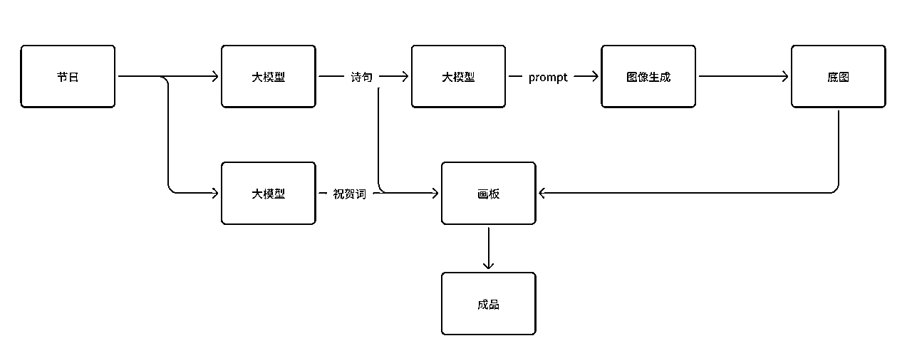

进入实践环节。由于大模型节点在工作流里，图像生成在图像流里，所以需要把流程图切开。红色框框内是图像流部分，外面的是工作流部分。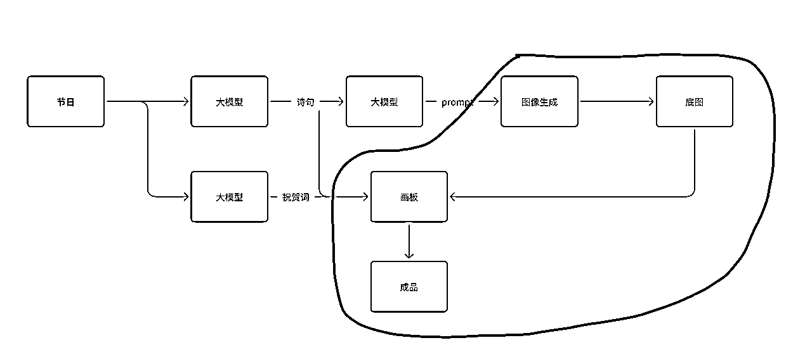

从图里也能看出，图像流需要三个参数：祝福语、诗句、Prompt。我先创建一个图像流，按流程把节点摆好，暂时不管参数。这里我额外加了一个“提示词优化”节点，它会把输入的Prompt转成英文短语。

图像流的节点排好之后长这样：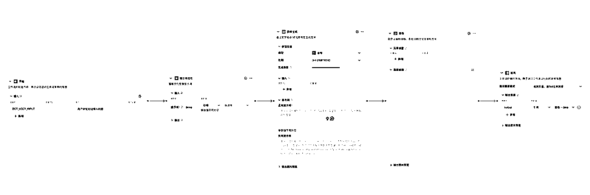

接下来先做画板，因为画板是最终成品，先做它就能确定最终需要哪些参数。我建了一个3:4的画板，也就是宽1080、高1440：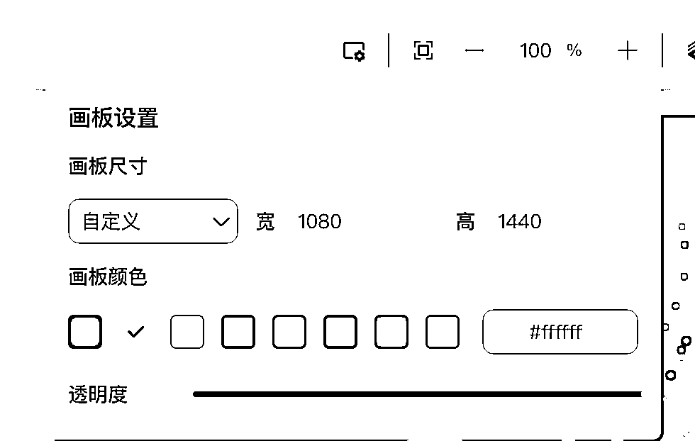

这里遇到的第一个问题：引用图片是正方形，而画板是长方形，得让图片铺满整个画板。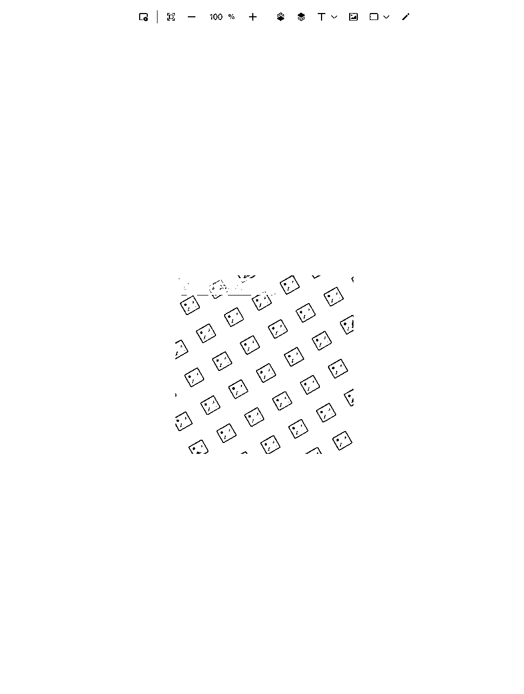

解决办法是，先随便生成一张3:4的图片作为预览图，可以用任意图像生成节点来生成：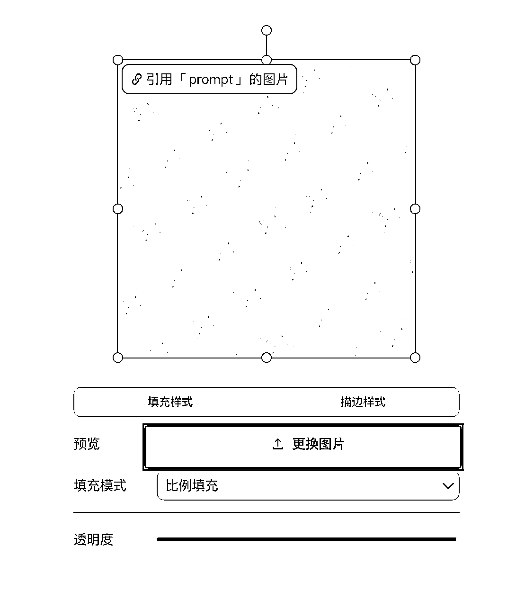

然后把图片上下左右四个中心点拉到最边缘：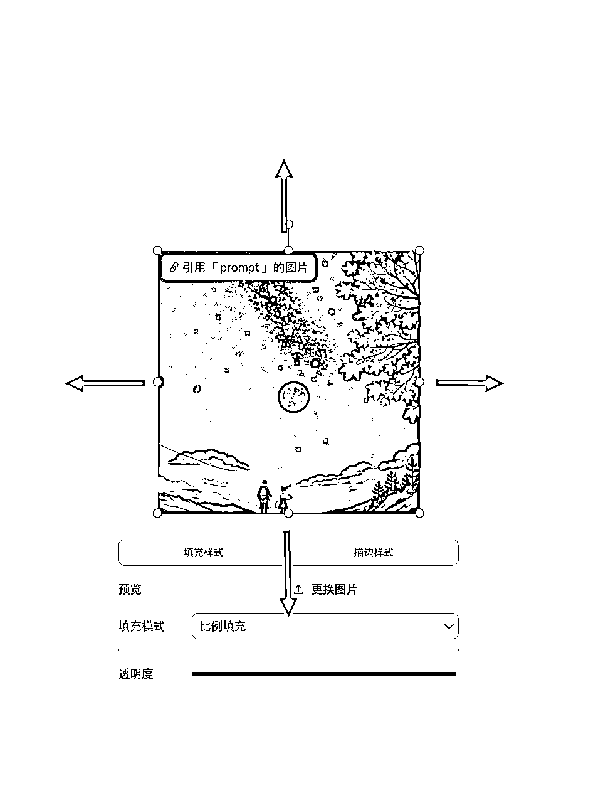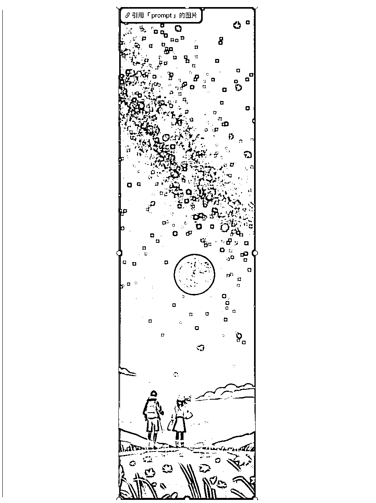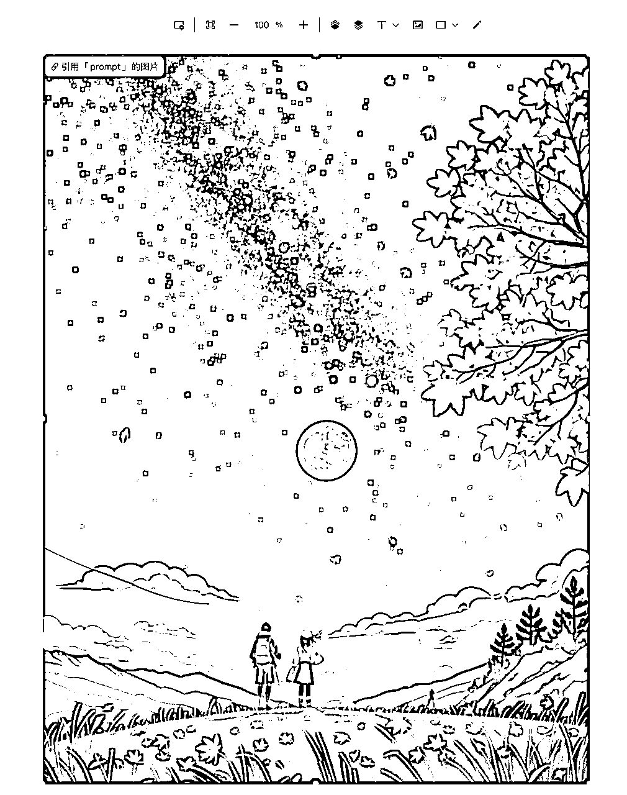

这样图片就铺满整个画布了。

接着配祝福语。祝福语有长有短，怎么保证它始终居中？只要选择“多行文本（默认格式）”，把宽度拉满，文字选居中就行。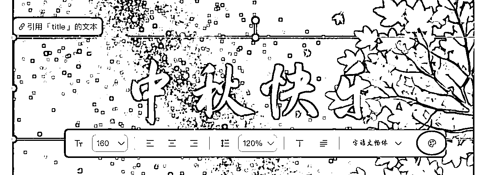

字体颜色和透明度，我选了白色、透明度90（就是红色圈住的按钮）：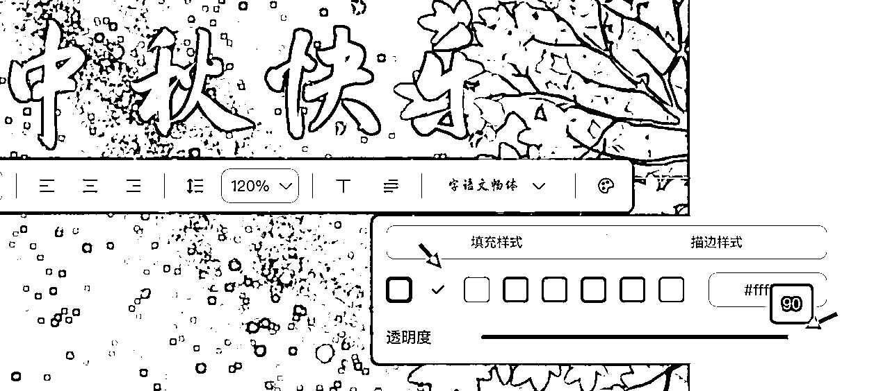

由于Coze的文本框不识别换行符，为了让诗句能一半在上、一半在下，必须把诗句拆成两个参数：content_upper 和 content_lower。配置方式跟祝福语一样，字号48。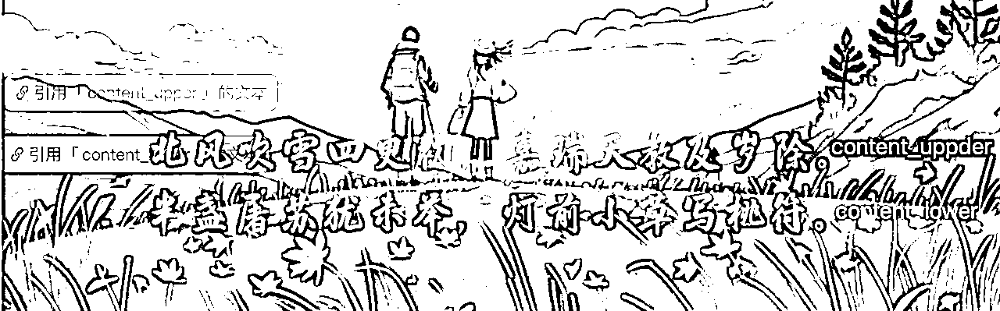

整个画板最麻烦的部分，到这里就配好了。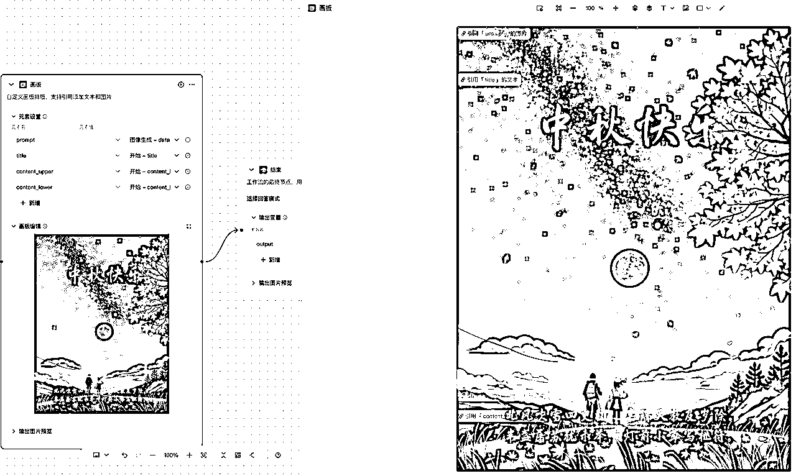

再把其他几个节点稍微配置一下，整个图像流就完成了。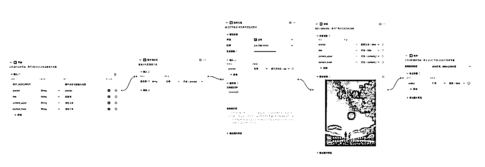

试运行一下，能跑通就发布。

接着做工作流部分。工作流的难点主要在提示词编写。同样，先创建工作流，按之前草图把节点串好，加入刚做好的图像流。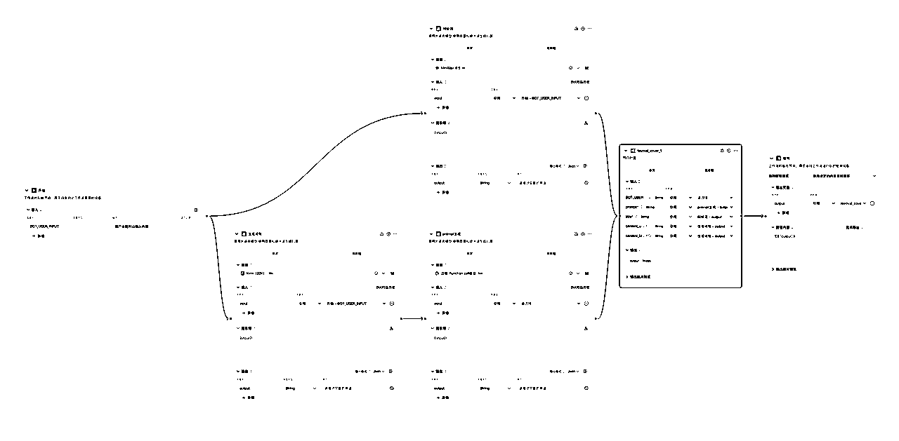

这里遇到第一个难题：图像流需要诗句的上半句和下半句，而我预想生成诗句的节点是输出整首诗。解决方式有两种：一是用代码把诗切成上下两半；二是让大模型输出时就以上下句的格式返回。本着能不多写代码就尽量不写代码的原则，我选了第二种，也就是让大模型按特定格式（比如JSON）输出。

方案定了，就该写系统提示词了。不会写提示词？没关系，提示词也可以让大模型帮你写。

下面展示我这个“半吊子”是怎么一步步和AI对线的。

第一轮，我让它帮我设计一个“输入节日、输出五言绝句”的系统提示词。AI给了一版基础提示词，我把它放进“人设与回复”里开始测试。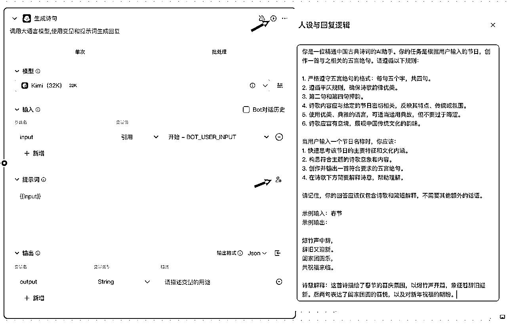

测试后发现了几个问题：

- 它总是自己创作，但我更希望优先引用历史名人的诗句；
- 它会输出诗意解释，这启发我，可以顺便让它同步生成AI绘画的提示词；
- 输出内容没法直接给下一个节点用，需要固定格式。

第二轮，我补充要求：如果历史上有这个节日的五言绝句，就随机挑一首，并输出作者和诗名；没有的话再自己创作，作者写“佚名”；同时把诗句转化为适合AI绘画的描述；所有内容以JSON格式输出，只输出JSON，方便后续解析。AI按这些要求更新了提示词。

但我实际测试时发现，它还是偏爱自己写，比如输入“清明”这种名篇很多的节日，也倾向于创作。于是第三轮，我强调：优先查找历史上相关的著名五言绝句，综合考虑诗人知名度（杜牧、王维、李白等）、文学史地位、与节日主题的契合度等因素；找不到合适的才进行创作。同时增加 is_historical 字段，标记是否为历史诗作。示例中，清明返回的是杜牧的《清明》。

后来又发现生成的诗句里有换行符，我不想要换行符。第四轮，我明确要求：诗句连在一起，不包含换行符。再后来，为了让画板能分别放置上下两句，最终JSON里改成了 content_upper（上两句）和 content_lower（下两句）两个字段。

最终版提示词的核心规则大致是：根据输入节日，优先匹配历史上著名的五言绝句，并输出结构化JSON，字段包括 holiday、poem_title、author、content_upper、content_lower、explanation、image_prompt、is_historical；没有合适历史诗作时再创作，作者写“佚名”。这个JSON可以直接喂给后面的节点，方便解析和使用。

到这里，所有节点终于串起来了：输入节日 → 大模型生成诗句和祝福语 → 大模型把诗句转成绘画提示词 → 图像流生成底图 → 画板组合祝福语和诗句 → 输出一张节日配图。

整个过程并不复杂，关键就是：先拆解，再动手；遇到问题，就和AI反复沟通打磨提示词。如果你也想试，记得从“设计先行”开始。更完整的细节和最终提示词，文末都能找到。

以上就是我这次的分享，希望能给你带来一些灵感，我们下次见。

每逢节日，想发一张有格调的祝福图，却总卡在配图和文案上？今天分享一个 Coze 实操技巧：用一套自动化工作流，让 AI 根据节日自动写诗、生成绘画提示词、套上贺卡模板，最后输出成品。全程不用写代码，只要会复制提示词就行。

整个项目分成三块：图像流负责做卡片底板，工作流负责调度 AI，最后绑到 Bot 上供调用。

## 一、图像流：先铺好卡片底子

新建一个图像流，把画板比例调成 1080:1440（3:4）。画板上放三个多行文本位：
- 标题：字语文畅体，160号，白色，透明度90
- 上两句诗：字语文畅体，48号，白色，透明度90
- 下两句诗：同上

这个模板做出来后，后面工作流只需把文字往里填即可。

## 二、工作流：三个 AI 节点各司其职

先按下面的结构把工作流连起来：

### 1. 识别节点
用户输入的东西五花八门，所以第一站先让 AI 判断这是哪个节日。提示词里要强调：只输出节日名，不要解释。比如收到“八月十五”，它直接回“中秋”。

### 2. 诗句节点
这一步是关键。给模型立几条规矩：
- 优先找历史上写这个节日的名诗，尤其五言绝句，像杜牧、王维、李白这类大诗人的优先；
- 如果没有合适的，再自己写；
- 不管是历史作品还是原创，内容都要紧扣节日主题；
- 禁止出现“国庆”“国旗”等词（Coze 里这算限定词，能避开就避开）。

模型需要返回 JSON，里面带上 `content_upper`（上半句）、`content_lower`（下半句）和 `image_prompt`（绘画提示词）。比如清明：

```json
{
  "content_upper": "清明时节雨纷纷，路上行人欲断魂。",
  "content_lower": "借问酒家何处有，牧童遥指杏花村。",
  "image_prompt": "细雨蒙蒙的清明乡间小路，行人撑伞，远处杏花村庄，既有春天的生气又有淡淡的哀思。"
}
```

这样一来，绘画提示词也由 AI 一并生成，之前单独设置的“prompt 生成”节点就可以删掉了，直接改成输出多个字段就行。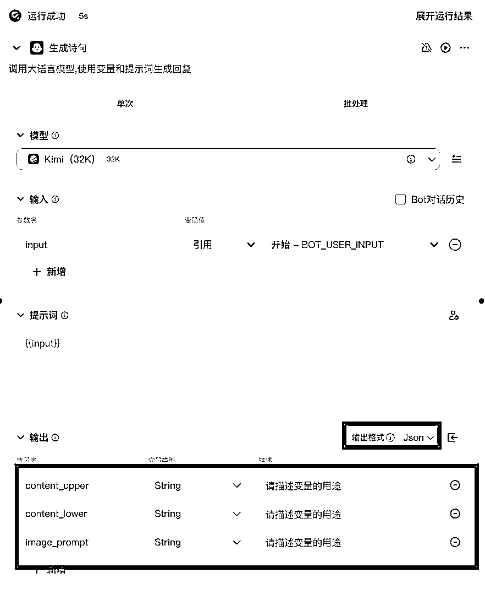 Coze 还提供了一个便利功能：从提示词里复制 JSON 文本，直接导入数据结构，省去手工建字段的麻烦。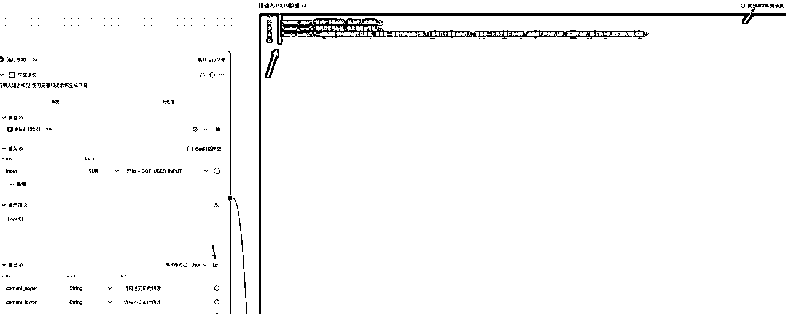

### 3. 问候语节点
这个节点根据节日性质决定祝福语：喜庆类返回“快乐”，祭奠类返回“安康”，国庆则写“十一快乐”（因为“国庆”在 Coze 是敏感词）。比如中秋快乐、端午安康。

## 三、串联与发布

把识别、诗句、问候语三个节点首尾相连，再让工作流调用前面建好的图像流，把文字填进去，最后从结束节点输出。整体结构就是上面那张图。点试运行，输入“清明”“端午”试试，没问题就发布。

## 四、绑定 Bot

在 Coze 里创建一个 Bot，模式选“单 Agent”，然后在资源区添加刚做好的工作流：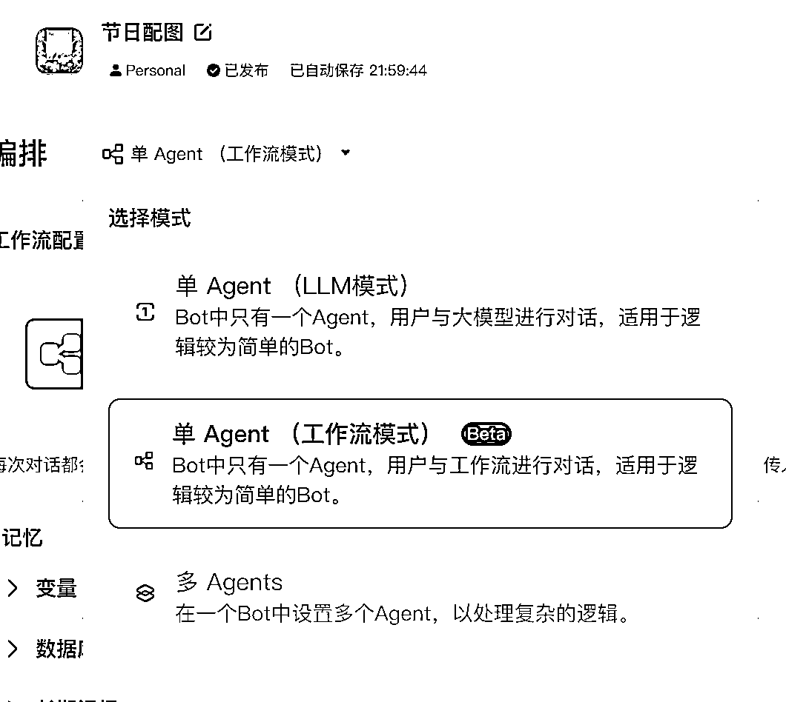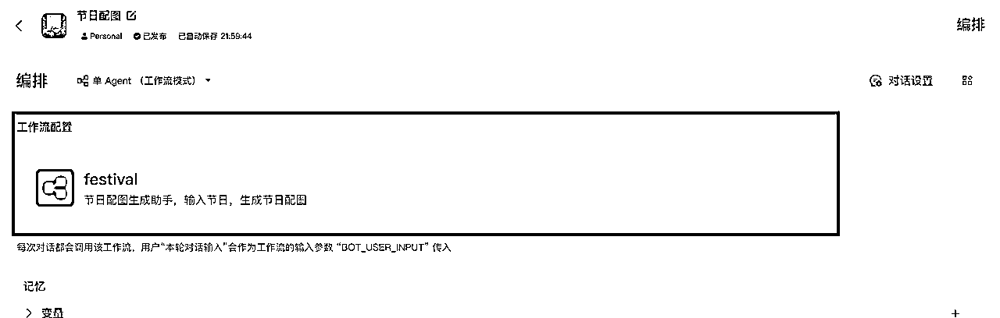

绑定后就能直接聊天试玩了，输入节日名称，自动出图加祝词。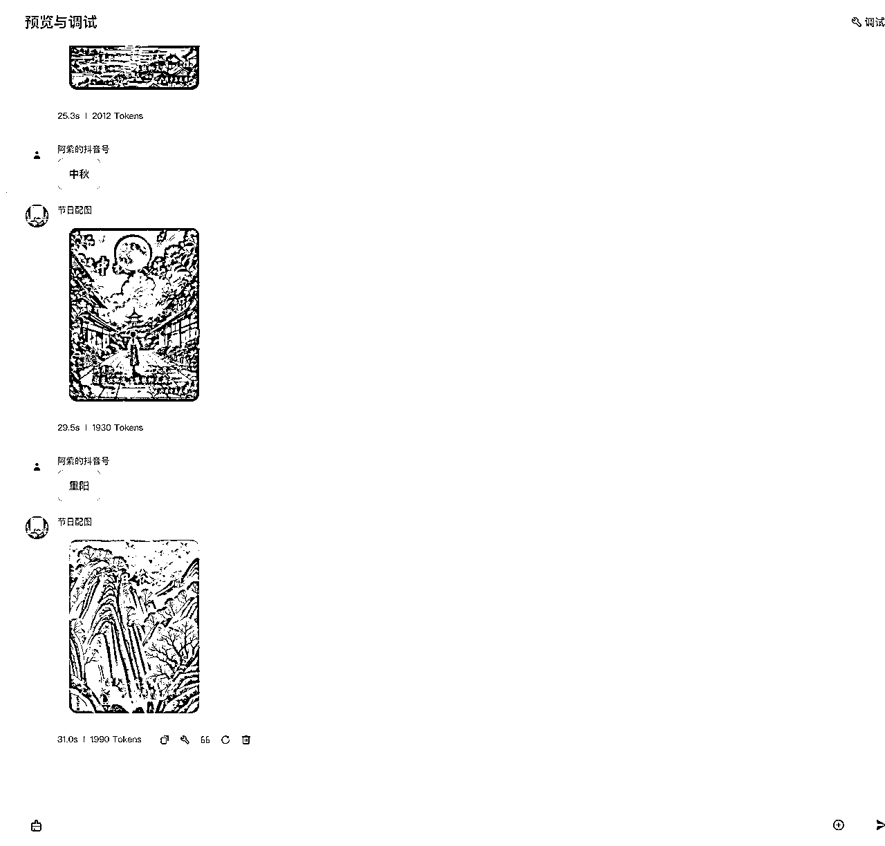

## 五、快速复现版

下面把可复现的配置完整列出来，方便你直接照抄。

图像流整体图和画板设置：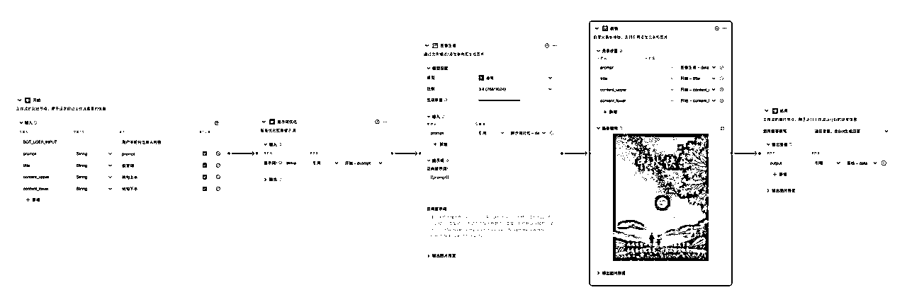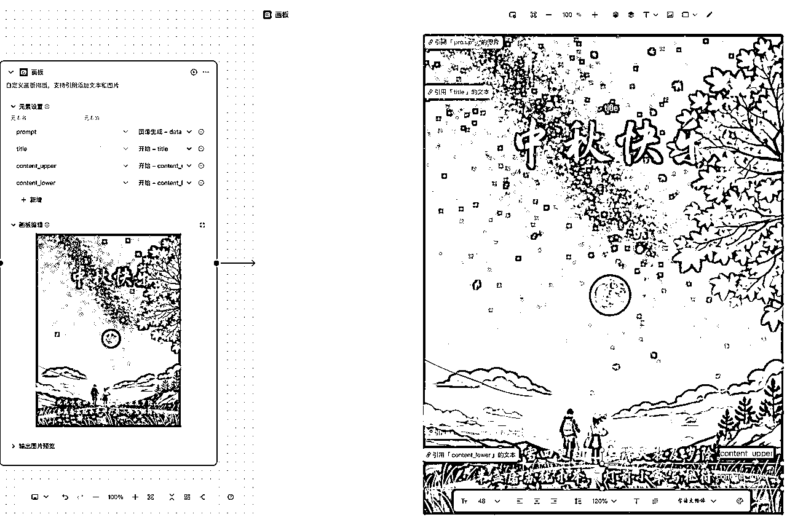

工作流整体图：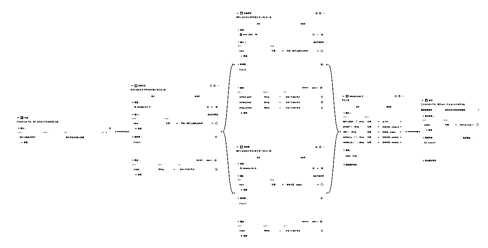

各节点提示词如下：

- 识别节日节点：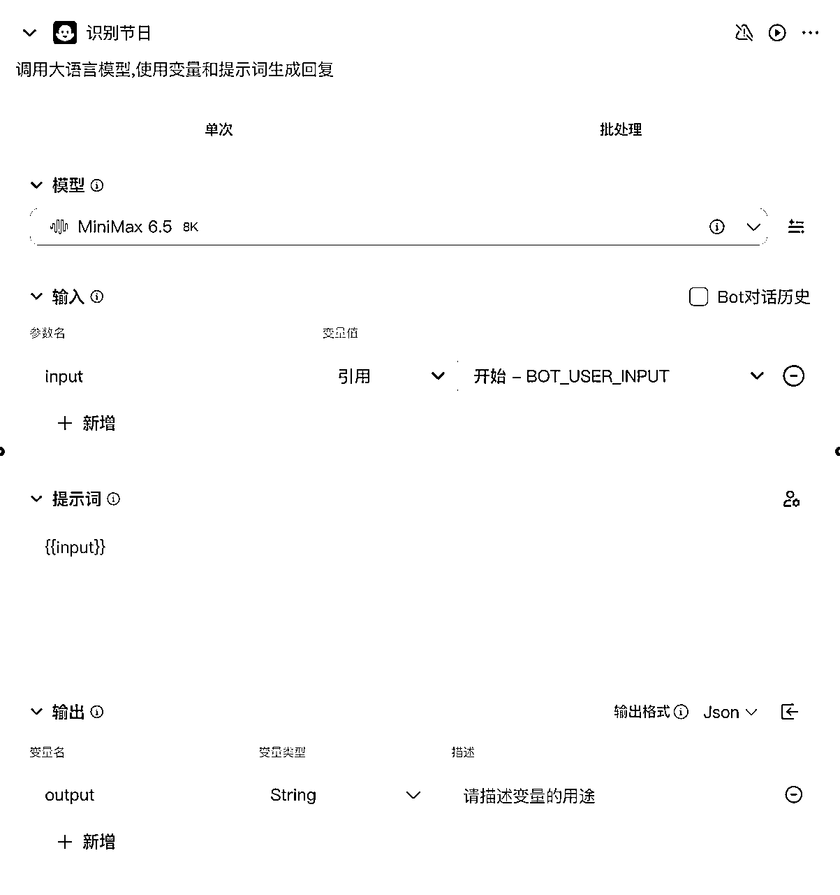  
  系统提示词：你是一位精通中国节日的AI助手，根据用户输入判断最可能的中国节日，只输出节日名，不解释。

- 生成诗句节点：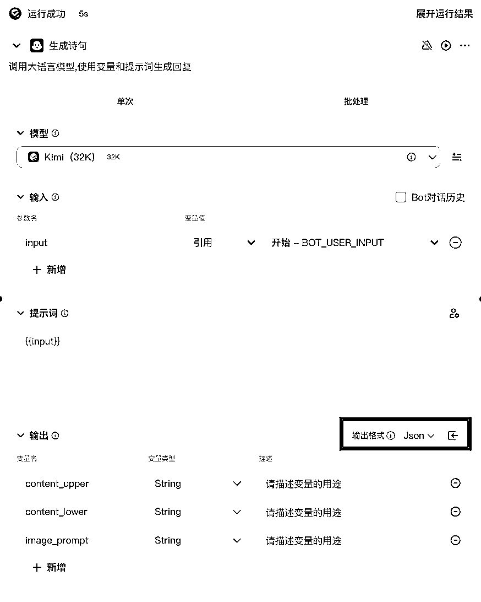  
  系统提示词：你是精通古典诗词的AI助手，优先提供历史上关于该节日的著名五言绝句，若无合适作品再自行创作。输出JSON，字段包括content_upper、content_lower、image_prompt，且不能出现国庆、国旗等关键词。示例见上文清明JSON。

- 问候词节点：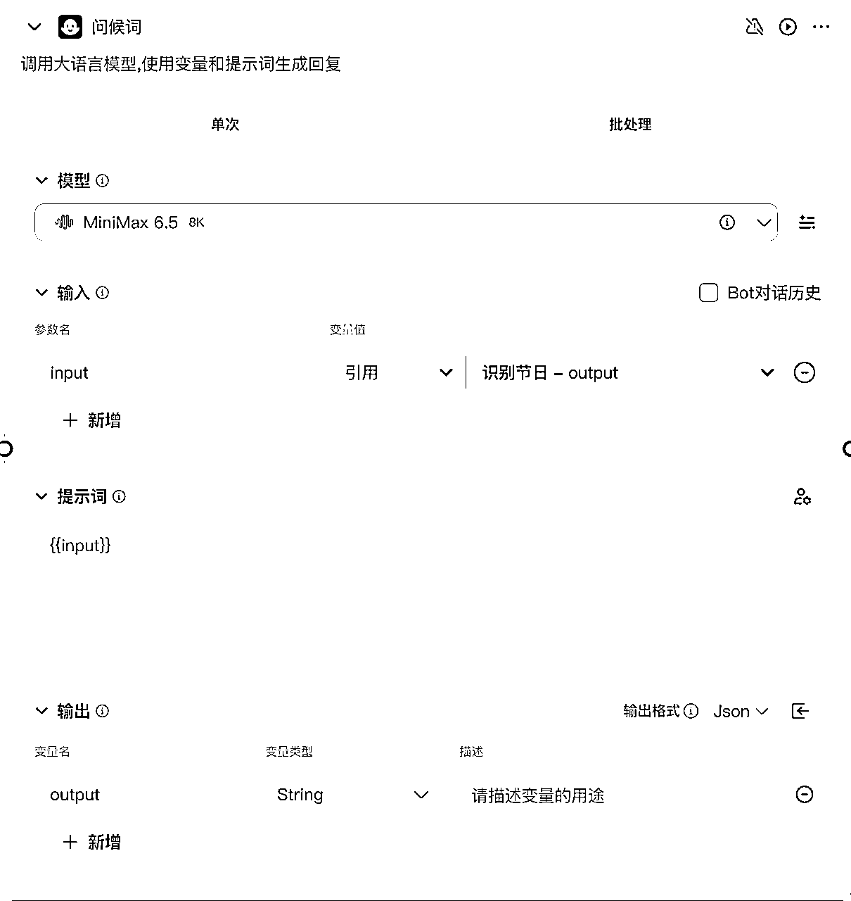  
  系统提示词：根据节日类型输出祝福语，喜庆类说“快乐”，祭奠类说“安康”，国庆节输出“十一快乐”。

- 图像流节点：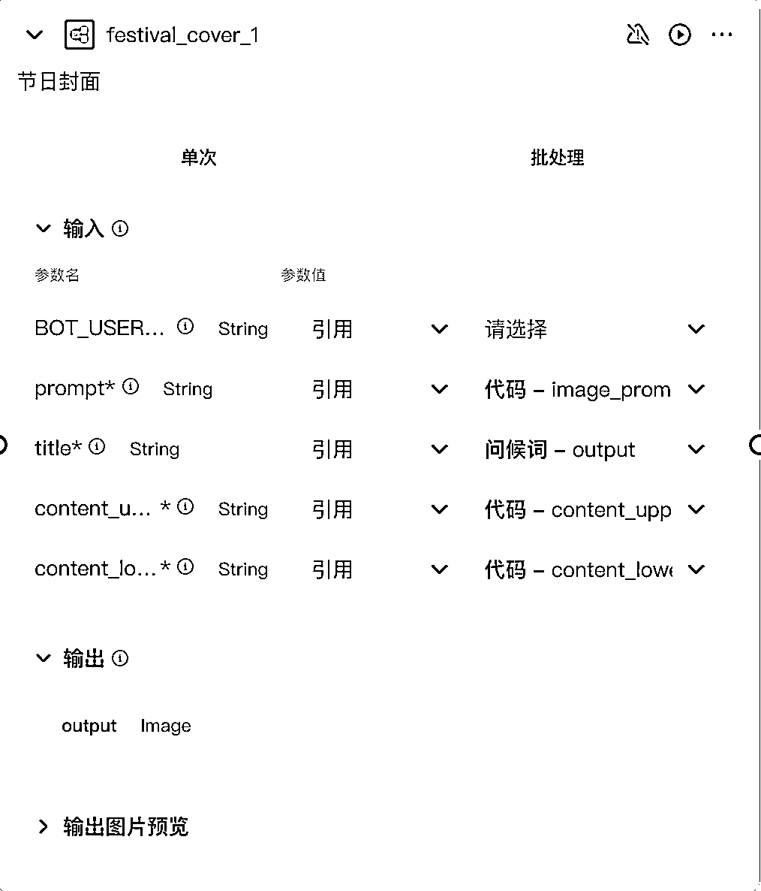  
  连接第一步创建的图像流，把诗句和问候词作为参数传给画板上的文本层。

- 结束节点：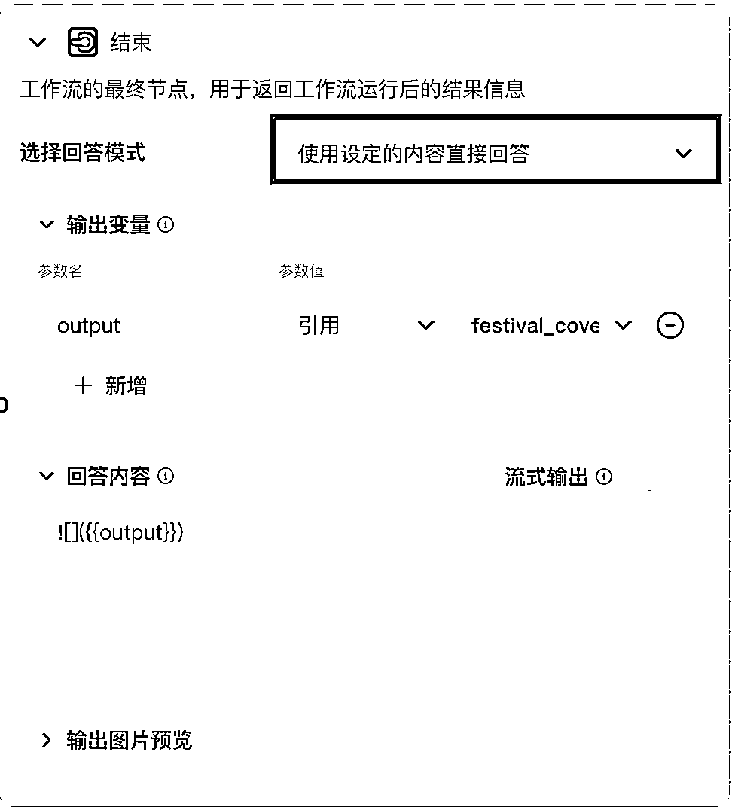  
  输出方式参考这里：```

```

配置完成后，一个自动识别节日、生成诗句、绘制卡片、写出祝词的工作流就正式完工了。快去 Coze 复刻一个吧！

完！