# 如何提高小绿书爆文出单概率？

我叫安七。离开校园刚满一年，我在做AI写作辅助自媒体的内容变现，年收入已到七位数。眼下，我把精力放在🛰️生态的图文卖货项目上。这篇是给社群写的第一篇复盘。

9月27日，和一位负责项目孵化的前辈聊到这种玩法。两天后团队开始试水，10月4日正式组建突击小组。到10月12日，我接触这个领域刚半个月，动手实操只有8天。团队里成绩最好的是位新加入的女生：她只花两天，就通过多条带购买链接的图文卖出50多件货，成交额超过1700元。

这段时间，我回答了几百位学员的问题，也翻了上千篇对标笔记，逐渐看清一个规律：卖得动、容易火的图文，往往有几个共同点。

封面能一眼抓住人，题目自带吸引力，内容有实用价值也有情绪温度，挂的产品贴合用户需求且不贵，整体版式干净舒服。

先说封面。读者决定点开一篇笔记前，能看到的只有图和题目。这类图文又是图片置顶、文字排在下方的格式，封面自然是第一道门。

前辈润宇曾总结过🛰️花很大力气推广图文卖货时的几个判断，我印象深刻：

第一，这种模式靠数量对冲概率，多试总会有中的。第二，封面必须反复优化。每个账号在当下的机制下，通常能获得一两百次初始展示，但展示量不等于浏览。封面做得敷衍，再多的展示也会浪费。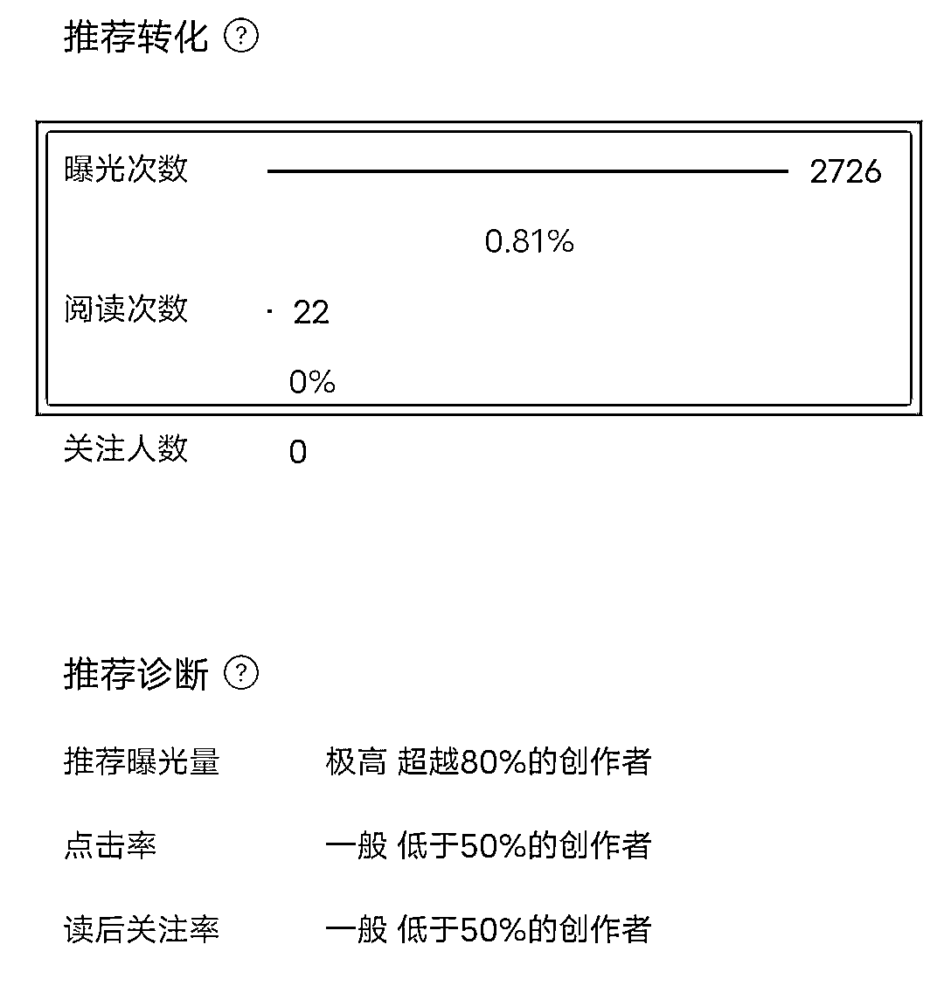我自己就吃过亏：有一篇获得了2000多次展示，却只有22个人点进来，问题就是封面不清晰。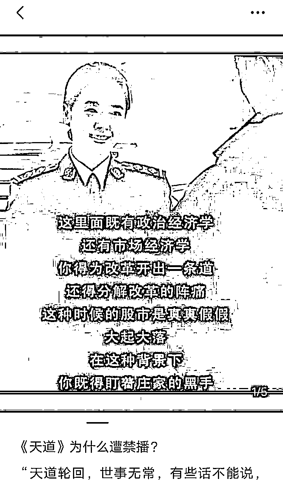

第三，读完比例非常重要。凡做过内容的人都知道，读完比例影响推荐。这类图文本身很短，最好把读完比例做到40%-50%以上。诀窍是控制长度：如果只用一张封面，文字保持在10-500字之间，最多别超过800字。它不是长篇大论，写太长没人愿意看完。我们测试时还发现，有的人每隔两三段就插一张产品图，想提高成交，结果适得其反。

第四，读者在页面上逗留的时长也很关键。数据好的笔记，人均阅读时长往往超过60秒。有个小技巧：在封面和后续画面右下角加一句引导滑动的话，能让人一直往下翻。

发布后，重点看互动。别家图文平台这类数据是公开的，🛰️这边还没有完全放开，但可以参考这个权重：评论最重要，然后依次是分享、点赞、在看。

题目分七种，都是应验过的高点击模板。

资料整理型：把方法打包，给人“收藏了就能用”的感觉。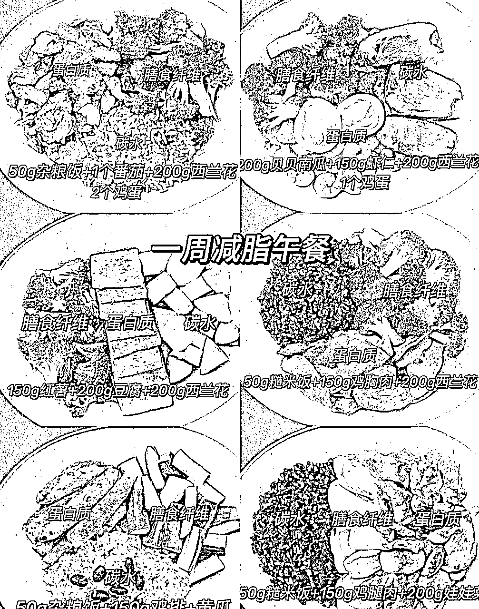比如把一周的减脂菜单做成可直接照做的合集。

勾起好奇型：制造悬念，让人忍不住点开。例如“我发明的拌饭，邻居吃完居然红了眼眶”。

直面烦恼型：把读者正在烦的事直接摆出来。例如“正在拖累专注力的几个习惯，你占了几条？”

省时便利型：强调省时省力。例如“5分钟做好孩子的早餐”。

利益相关型：把不读的损失或读了的好处写清楚。例如“黄气重的女生要知道的18个常识，删掉就亏了”。

意外反转型：打破预期。例如“我妈随便买的小东西，居然把我的脸养好了”。

背书型：借助知名人物的推荐，快速建立信任。例如“某位名嘴推荐的记笔记方法”。

正文要兼顾价值和情绪，不能只堆道理，也不能只会煽情。我的固定骨架是：开头用一句点睛的话、一个共同烦恼或一段故事；中间给实实在在的步骤；结尾用亲身体会做分享，再自然提到产品能帮读者解决什么。

我昨天还拆过一篇热度很高的笔记，浏览量到了9.3万。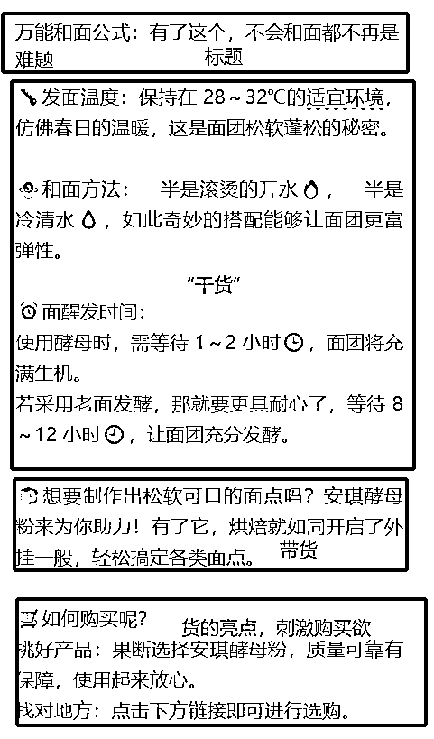本想继续拆解，却发现许多走红笔记明显出自AI之手，有的连不对版的信息都没清理就发出来了，照样有人看。这说明窗口期还在，应该趁早多铺内容。

怎么用AI写正文？一个简单办法是：找一篇同类平台上的爆款内容，把原文复制给AI，告诉它“换一种语气重写这段，并加上合适的emoji和分段”。当时我把这段提示词发给一个免费大模型，生成效果在下面：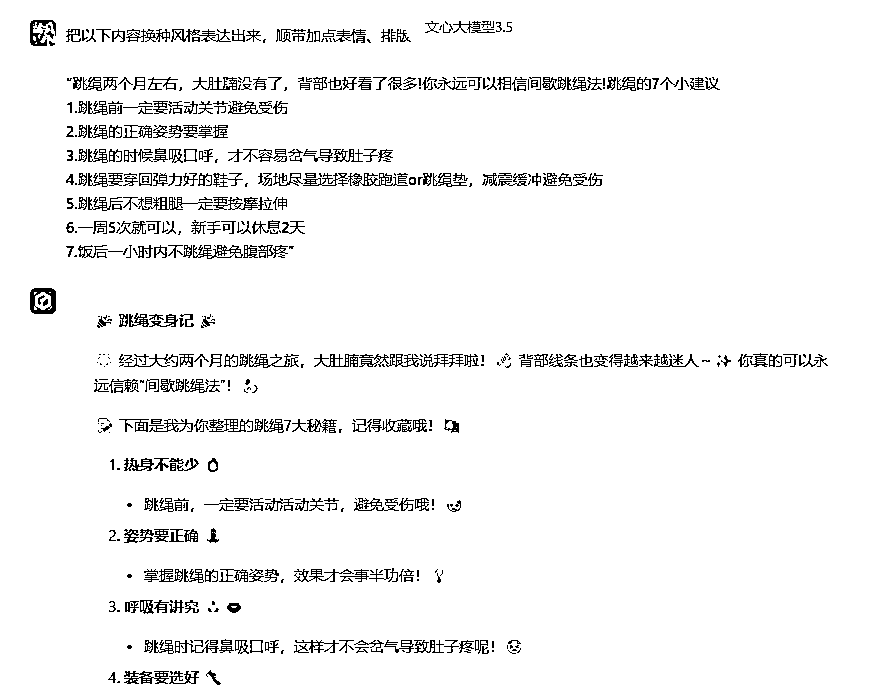

我自己更常写的提示词，是围绕具体产品展开。拿跳绳举例，我会要求AI写一篇种草跳绳的短文，从想瘦腿、瘦腰这类烦恼切入，控制在600字上下，然后补充几条：开头要能引发共鸣；语气像朋友聊天；建议要具体、能照着做；最好带数字；结尾用我的亲测感受引导下单；不说空话，要让人看完觉得“这正是我需要的”。生成结果如下：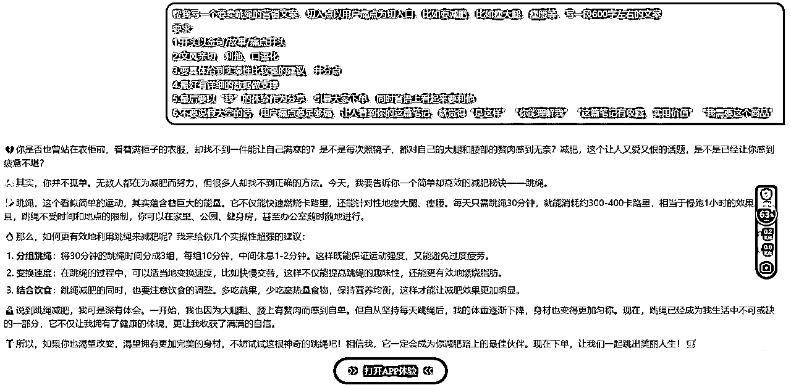

写提示词真正的要点有三个：角色预设、字数上限、细节标准。角色可以给两三个，比如“你是做了十年软文营销的专家，很懂读者内心，能把道理讲得通俗”。字数不要超过800字，太少没内容，太多伤读完比例。细节标准要根据货品调整，最好列出语言、风格、是否举例等五项以上。

选什么货品，直接决定能不能成交。我们试了一阵子后，总结出三个好卖条件：

一是和内容强相关。有位队友写的是跳绳减肥，封面也不错，但他挂的是“学生用跳绳”，目标受众根本不对。看这类内容的人想要的是成人款，换了之后单量很可能立刻改观。不能把毫不相干的东西硬凑在一起。

二是能触发立刻想买的需求。像跳绳、招财摆件这类，用户看到会觉得现在就要用，所以下单很快。常有人问我为何不做书籍生意，原因在于书的替代渠道太多，可以换平台比价，也能找到不用花钱的数字版；同时，🛰️图文卖货的用户画像还不清晰，长辈们刷到书往往无感，反而容易被日用品和食品打动。

三是价格要讨喜。定价不到一百元最好卖，这点身边的同行验证过，我们的数据也支持。

这类笔记目前还无法调整字体、颜色和粗细，但版式也可以用心做：分段上，电脑每段一两行，手机每段两三行，最多四行，太长会显得密不透风。可以在关键处加emoji，不知道加什么就交给AI。重点内容用【】框出来。做到这三样，观感会很舒服。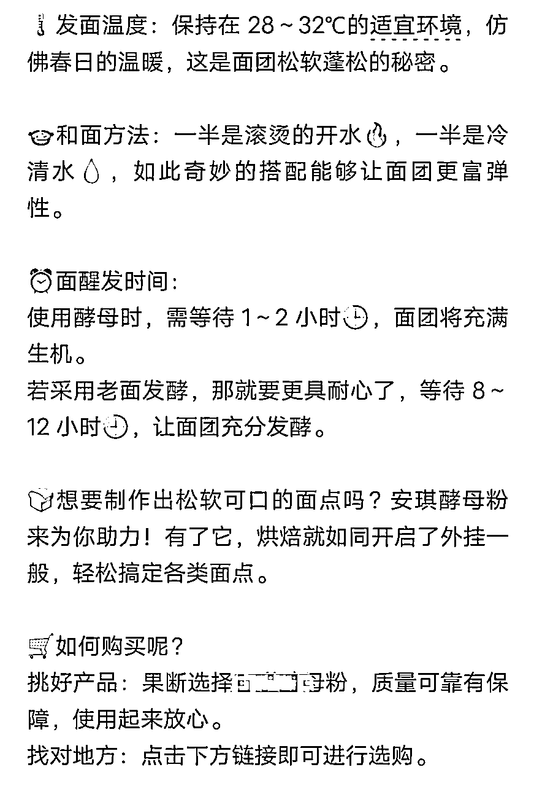

刚入行的人常会掉进八个坑，我遇到最多的疑问如下。

为何有的内容只显示“图片分享”？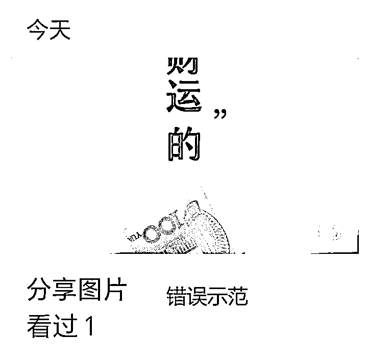 多半是因为题目没填，比例也不对。在移动端用官方软件进入图文发布，自己补上题目和文字就好了。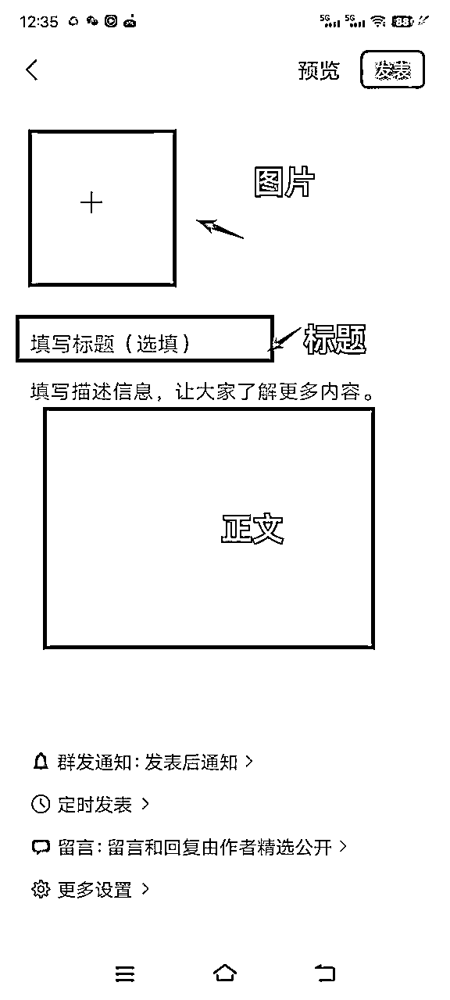

配图一定要用产品原图吗？不是。这个模式不是在线货架，用户先被内容打动，才顺手点链接。所以画面要多参考别人拍得好的实拍，去掉水印并让画质更清楚；或者去别的平台找同一类目的热门笔记，学它的构图，别直接放商品原图。

我的账号怎么没有变成卖货货架，反而注册成了店铺？想做达人卖货，正确路径是：先开货架，再去商品库选品，不用去注册店铺。去创作后台的卖货页面看一眼，正常状态是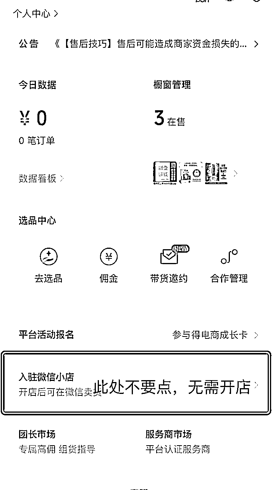，如果不小心点到了开店，页面会变成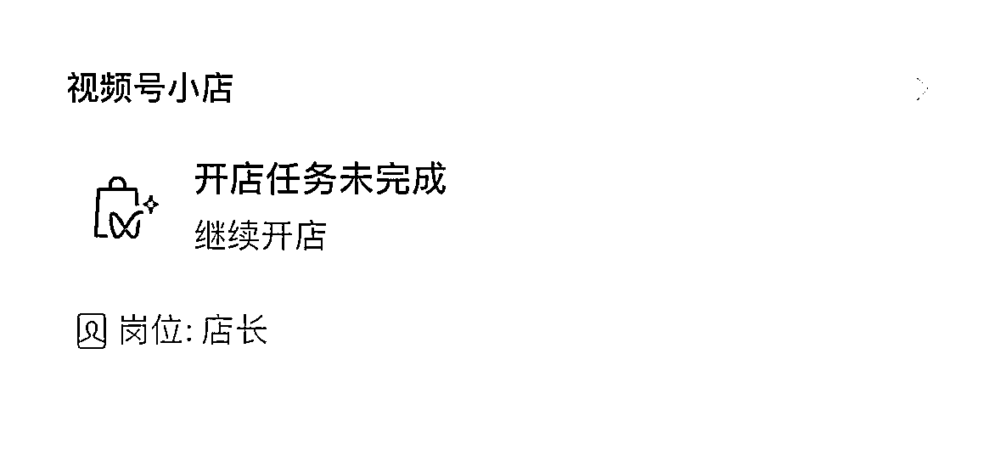或。开店反而麻烦：要准备货源和各类许可，很多类目还要额外资质，而且开店后没法再用达人方式带货架里的货。已经开了也别急，把店铺流程停掉或注销，也可以联系客服解决。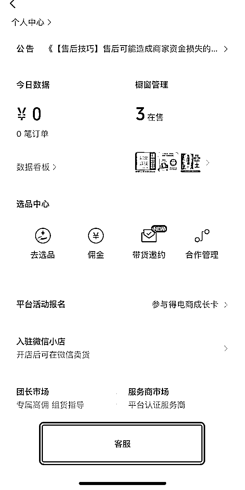

移动端找不到挂货入口？把输入光标放到文字区域中部，点页面里的加号按钮，检查是否存在“产品”入口。没有的话就用电脑：先打开电脑端的图文创作后台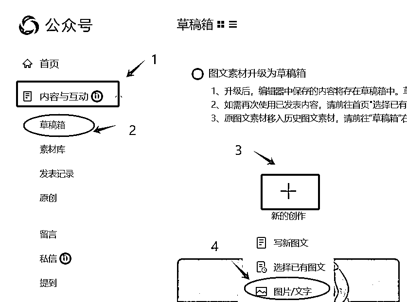，把图片和题目传上去，再点选“小店”类型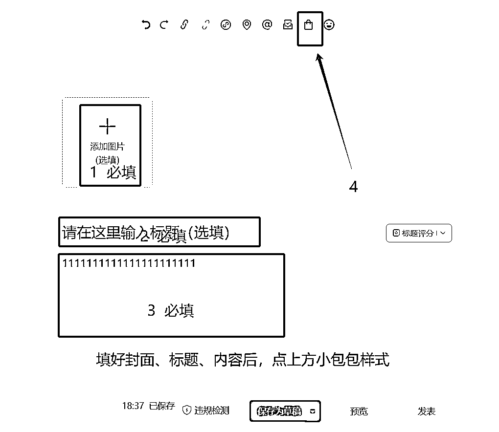，就能挂货了。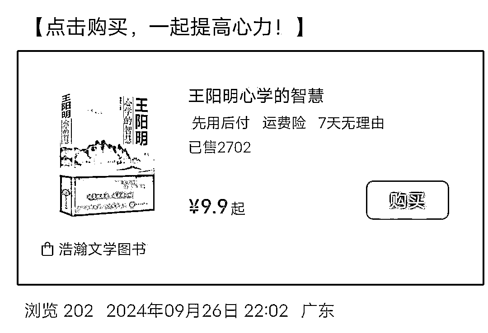

内容发出去后要不要到处拉人？不必，等系统按兴趣推给读者就行，起量需要一点耐心。

内容写多长最稳？最好不超过800字，10-600字都可以。

日更频率怎么定？平台不设上限，保底每天一篇，多数人每天更新一到五篇。我们手头的账号平均每天发二十篇上下，想更快起量就多铺。

内容无人问津怎么办？先从自己身上找答案：更新了几篇？每篇都按要求完成了吗？有没有坚持足够久？指望着发出去就爆，不适合这个玩法，多数业余项目都是如此。有些内容两三天就有反应，有些则要熬一个多月才见到阅读。长期没人看的内容，多半是题目照抄、正文连自己都讲不明白、画面看着像广告。要拆解热门作品，别自己憋原创。重要的话再说两遍：拆解热门作品，别自己憋原创；拆解热门作品，别自己憋原创。

最后想认真说声感谢。先谢那位带项目的前辈，他知道我在做内容，便把🛰️图文卖货的玩法告诉我，让我没有生生错过。也谢这个社群，在这里才能较早接触到这类机会。

还要谢谢几位一直无私分享的同行，有人负责提供行业情报，有人负责给我操作细节；也谢谢两位朋友在关键时刻站出来帮忙。最后谢谢背后出资的人，没有他一次次催进度，我们很容易放松，也就不会有现在的小成绩。

感谢所有给过我帮助的人。