# 沉浸式写风向标一段时间，我的一些分享和启发

最近沉浸式研究风向标，收获挺大，忍不住来聊聊自己的体会。

起因是认识了老彭（标王），在他的影响下，我也开始尝试写风向标，想锻炼自己对信息的敏感度。这周大概发了二三十条，中了四条。

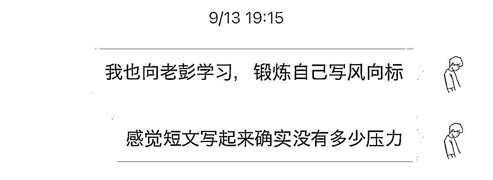
没想到还有官方运营主动加我微信，给了不少认可。

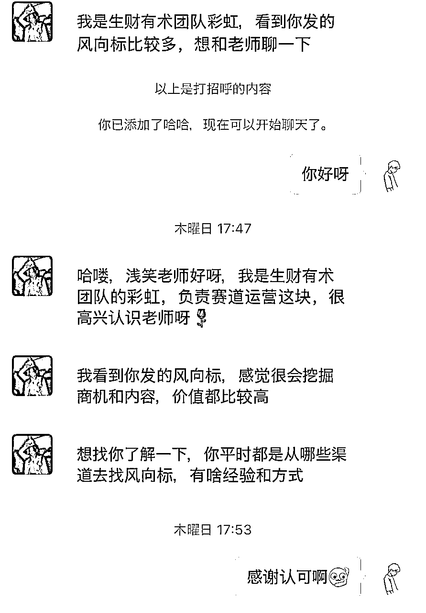
后来又加了坤汀，同样夸我的标不错。这种正反馈，让我越写越有劲。

结合自己的发布经历，再看了一圈赚钱航海的风向标挖掘手册，我整理了一些心得，分享给大家。

**先说一个笨办法：从已经中标的内容里找感觉。**  
我会把之前中标的帖子，挑感兴趣的翻一遍，只记最触动我的那个点。有启发的就转发到微信的单人群，方便回看；风向标手册也置顶，随时翻。

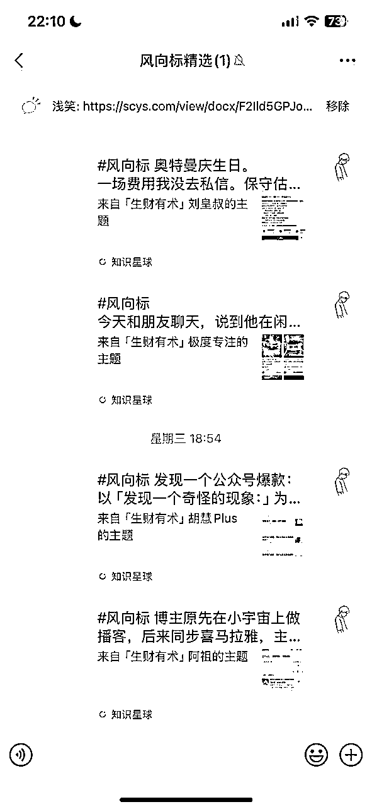
看帖子时我会琢磨：这个标解决了什么需求？产品有什么独特之处？流量是怎么搞的？变现又有哪些亮点？

**评论区其实是个宝藏，尤其是带问号、感叹号的那些。**  
需求往往就藏在用户的问题里。想要更系统，就拿关键词后面依次加上26个字母去搜索，多换几轮，能看到完全不一样的世界。

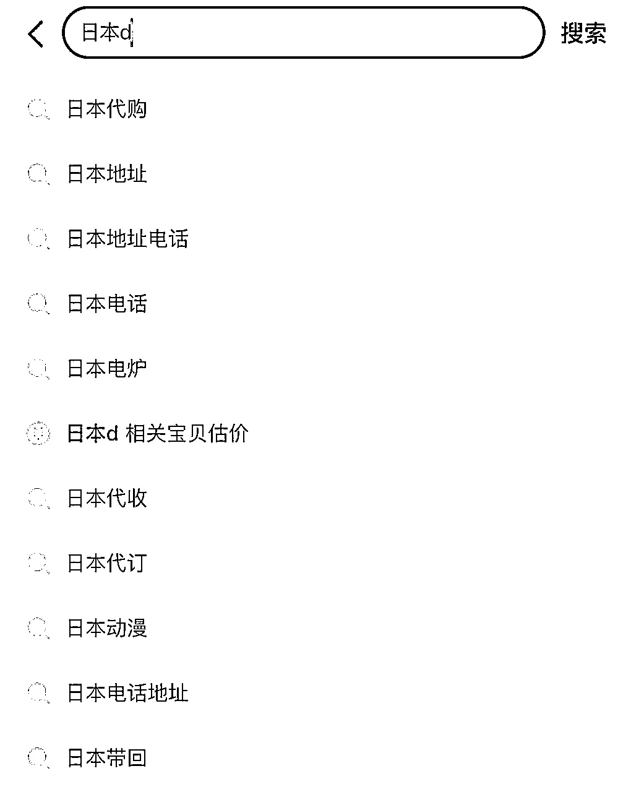
很多人把流量理解成水，觉得它能覆盖整个圈层。但现实更像一堆大小不一的钢珠——社会圈层早就被打散了，大钢珠盖不住所有角落，留下大量缝隙，等小钢珠去填。每个缝隙背后都是一类人、一类需求，而每个需求，就是一个风向标。

**差异化永远是关键词。**  
如果一个产品能满足别人没满足的需求，那它就更有竞争力。刷视频、刷笔记的时候，我会刻意关注那些播放量很高、但账号粉丝不多的内容——所谓“低粉爆款”，就是典型的异常值。

我常用的工具有：抖音热点宝（免费）、灰豚数据、蝉妈妈、千瓜等。这些平台的日卡在闲鱼或淘宝上很便宜，一天内集中搜完所有想查的东西，思路反而更清晰。月卡就算了吧，又贵又容易让人拖延。

看到突然百万播放的内容，别划走，这就是异常值，背后往往是新需求。

**在中标的帖子里，我还会反复看人家的需求挖掘部分。** 把一个需求挖出来，迁移到另一个场景里，可能就变成一门新生意。

官方其实把各平台的中标贴都整理好了——小红书、微信、抖音的都有。一口气看完，很容易触类旁通。

**从产品/服务出发挖风向标，可以问这几个问题**（来自@星辰）：
- 谁是目标用户？
- 目标用户用这个产品是为了解决什么问题？
- 他们通常在哪里聚集？
- 现在卖家是怎么销售的？
- 产品成本大概多少？
- 产品的上下游是什么？
- 有没有关联业务？

**虚拟产品又该怎么挖？**（来自@黄岛主）
- 批量抓课程、资料，通过数据分析找到值得做的虚拟品
- 看近期热门领域，有没有相关的虚拟资料需求
- 想找工具站或App，就关注排行榜网站，留意近期数据不错的产品
- 整理行业通用词根，用5118之类的关键词工具做扩展搜索，需求会更清晰

还有一个选蓝海产品的方法（来自@刘小排）：稳定流量加产品很差。什么叫稳定流量？就是你任何时候去看，它都不温不火。产品很差的意思是——它比你能力范围内能做到的还要差。差是相对你来说的，这种反差里通常藏着机会。

**从流量出发，可以关注三种异常值：**
- 低粉爆款
- 突然百万+播放的内容
- 短时间内涨粉特别快的账号

这三种都值得拆解。

**从变现出发，也有三个方向：**
- 销量高的项目：卖得多，说明市场大
- 高客单价的项目：成本不高的话，单件利润就高
- 高投放ROI的项目：ROI=投放带来的销售额/投放费用，大于1就说明赚钱。如果人家在投，而且投得狠，大概率是能算得过账的

**再补充一些常用工具，这些基本来自风向标航海手册：**

抖音/快手：
- 蝉妈妈：找达人、爆品、直播间、品牌小店。官网m.chanmama.com，闲鱼日卡9元，挺划算
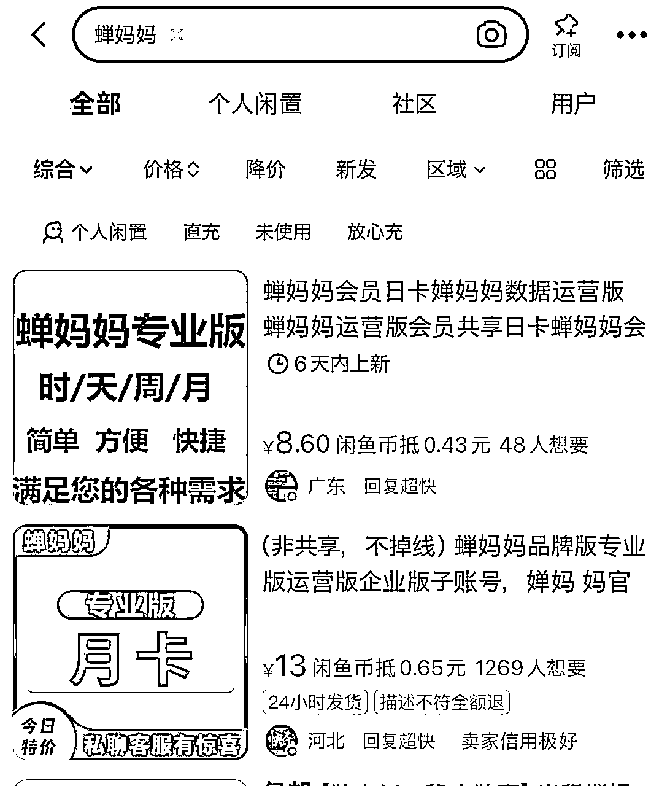
- 抖查查：看直播榜、达人涨粉榜、热销商品、飙升视频。www.douchacha.com
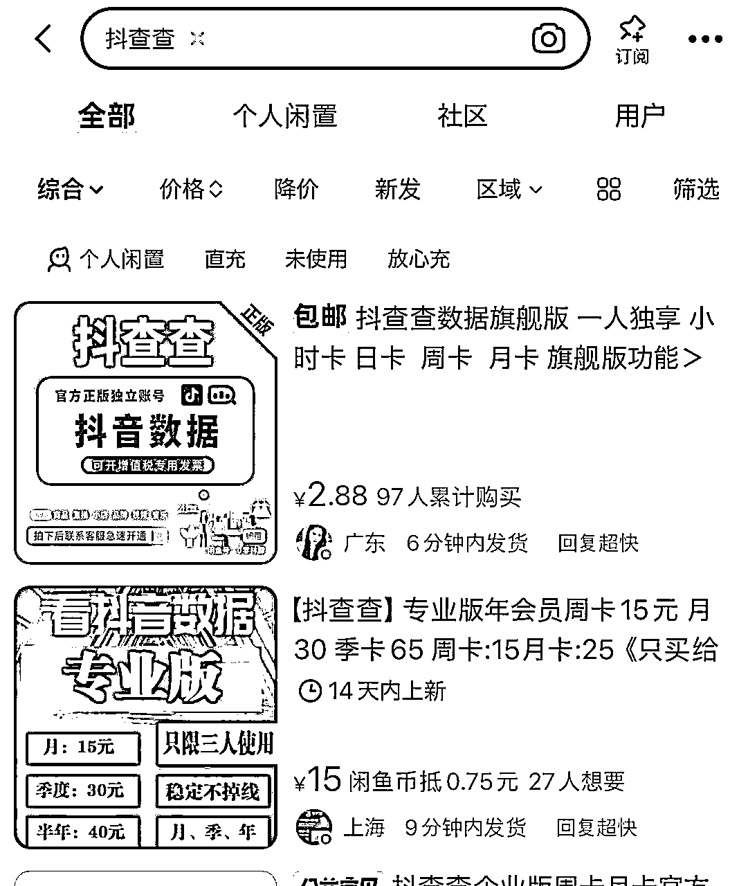
- 考古加：找达人、商品、直播、小店、品牌、视频、关键词，还有各种榜单。m.kaogujia.com
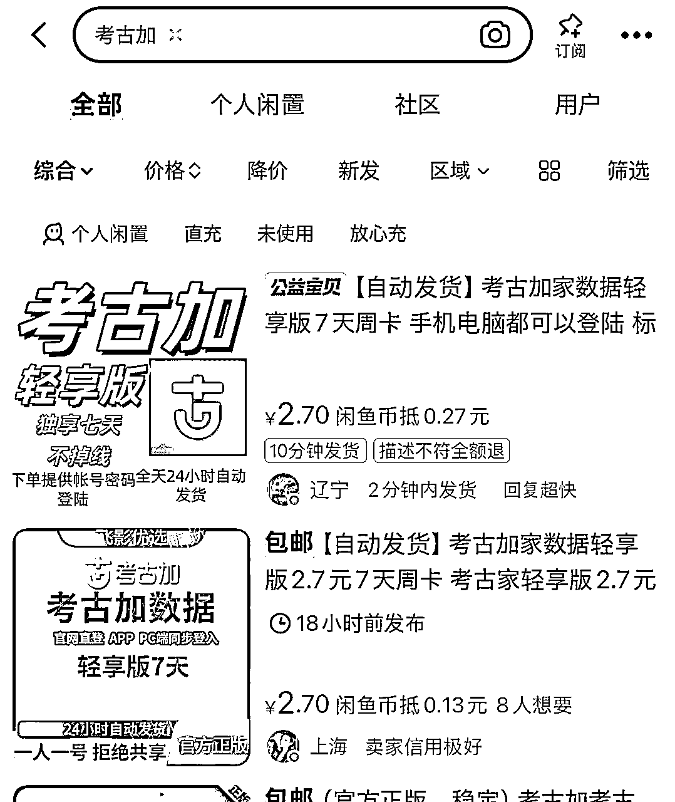
- 巨量百应：抖音官方的商品分享管理平台，能管橱窗、直播间，还能分析自己的交易数据。免费，但只对达人、MCN、小店联盟商家、合作商家、电商平台开放。

小红书：
- 蝉小红：博主榜、笔记榜、品牌榜、热搜词。www.chanxiaohong.com
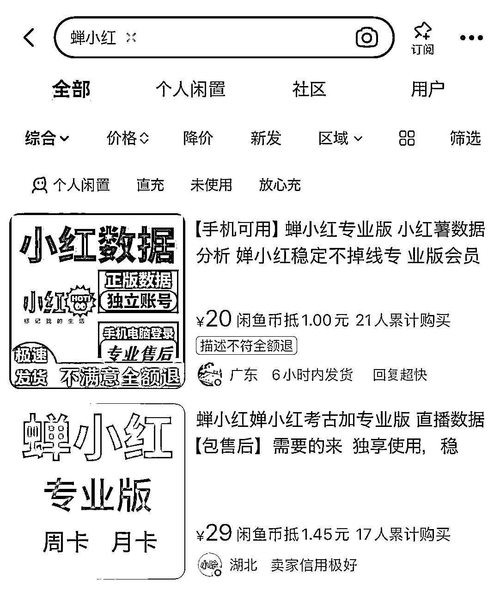
- 千瓜数据：商品、达人挖掘与分析，热门内容查找。www.qian-gua.com
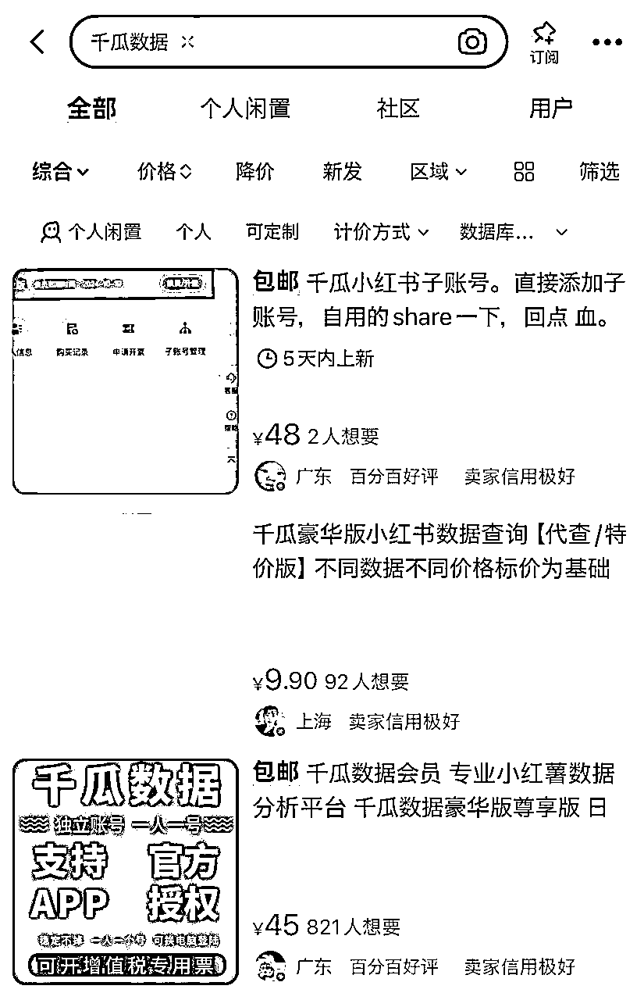

视频号：
- 新视：找视频号、看榜单、分析直播和商品。xs.newrank.cn
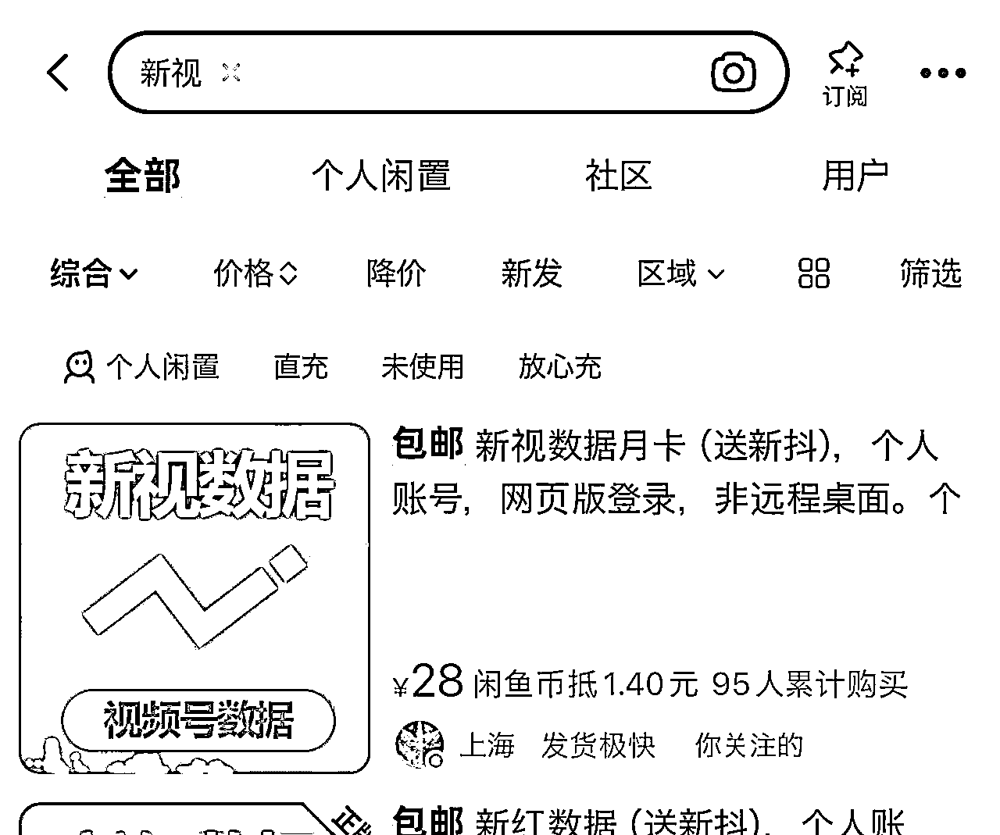
- 友望数据：视频号榜单、直播带货榜，可分析视频和达人。www.youwant.cn
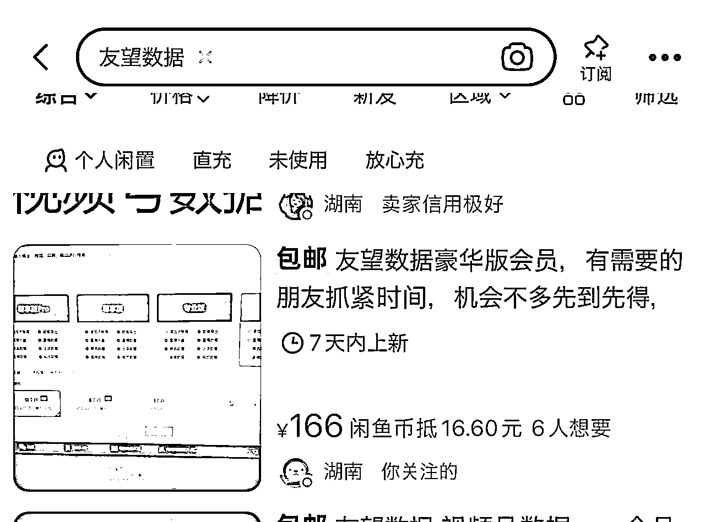

淘宝：
- 生意参谋：看店铺数据、搜索人气、点击量、转化率，还有选词助手等。sycm.taobao.com

B站：
- 火烧云数据：分析大盘流量、UP主、带货榜。www.hsydata.com
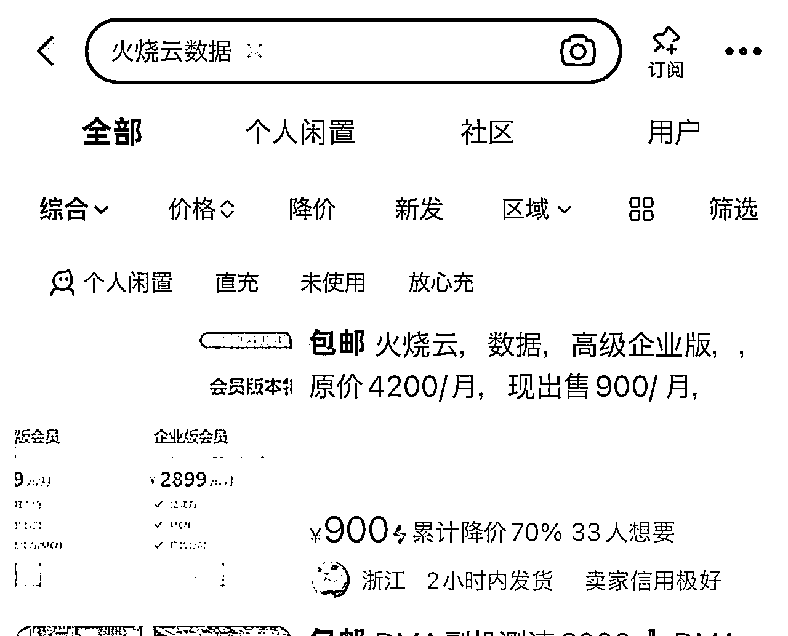

App榜单：
- 蝉大师：查苹果、安卓所有App的排名、下载量等。app.chandashi.com
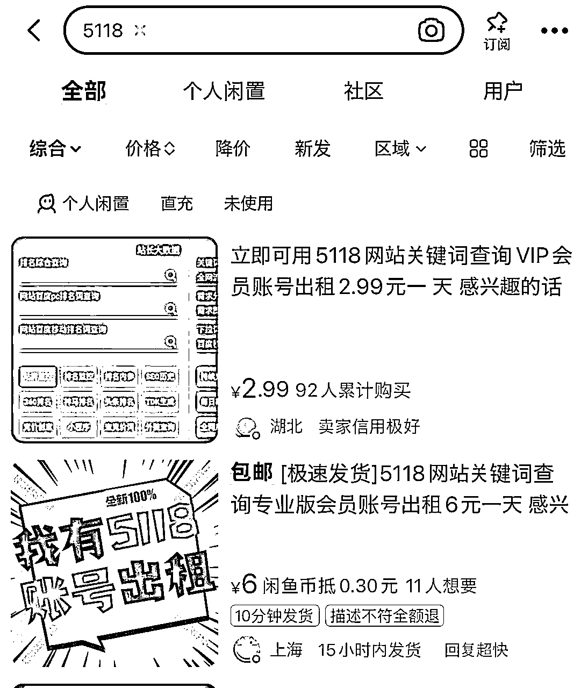
- 5118：行业词库、SEO数据，查热门词很有用。www.5118.com

**关于写风向标的节奏，V先生有个观点我很认同——从最小阻力开始。** 哪怕先在别人中标的帖子下发个评论，写写自己最有启发的一点，写着写着感觉就来了。刚开始写不好很正常，多写几条自然就顺了。

平时看到不错的标，也可以试着用AI软件拆一拆。比如“在小红书卖宠物”，把平台换成抖音、把“卖”换成别的需求、让ChatGPT想想宠物还有哪些类似业务——一个点就能发散出很多面。

节假日不能发标的时候，灵感也不能丢。我会先记在flomo里，连图片一起存，等开放了再复制到星球里。

没中标的帖子也别扔，很可能是没挖到最关键的那个点。回头再深挖几层，说不定能翻出更有价值的东西。

**另外，多关注500万互联网人之外的圈子。** 那才是真实世界。试着代入不同人群——二次元、老年人、失业者、老师、小卖部老板……不同人群的烦恼，就是不同的风向标。

手机里多装些软件，多搜搜、多试试。看到广告别下意识划走，点进去看看它玩的什么套路——有广告的地方，就有风向标。

我还专门拿一个小号来加人：打广告的加，留了微信号的加，就算没留，我也去问一句“有没有微信”。能加上的都加上，加不上的想办法也加上。这个小号，以后会特别值钱。

最后，分享一下龙哥大大的思路：如果是他，他会怎么找赚钱机会？

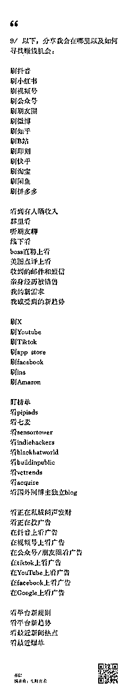

真心建议大家狠狠关注风向标。有人甚至说：精华贴可以不看，但风向标一定要看（狗头）。

不只要看，更要动手写。哪怕不擅长，写多了，商业认知和判断力一定会慢慢变强。

而且，多写还会有更多曝光，会有更多圈友认识你。表达本身就会带来机会，好运气往往就藏在主动分享里。

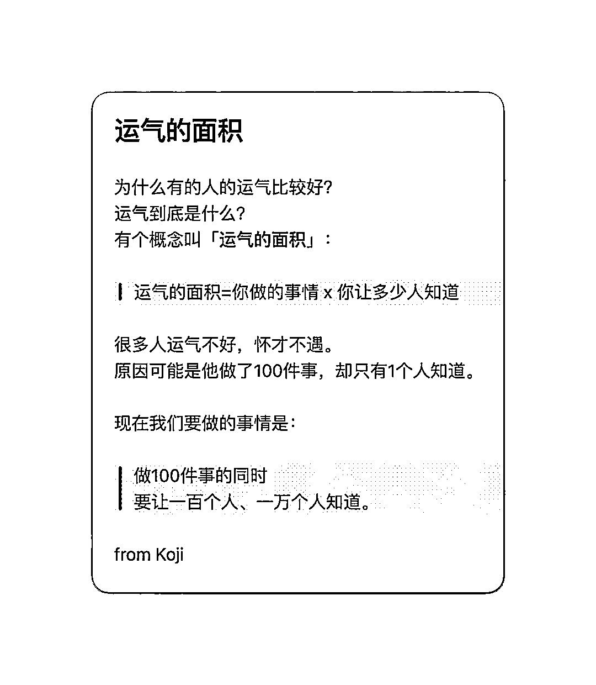
来写风向标吧，百利而无一害，真的。