# 深度复盘：我用AI帮一位老板省下15万招人费用的经历。

老板花5000块，换回一支全年无休的AI内容团队，还省下15万招人成本

深夜，手机屏幕突然亮起。一条🛰️让我瞬间睡意全无：“老板，我今天不太舒服，明天的👸号文章怕是要延期了。”这个月已是第三次了。我盯着手机，心里有点窝火。

算完账更头疼：找外包写手，一篇600-800，质量还得碰运气；招实习生，一个月三五千，还得手把手教；在深圳请一位像样的内容运营，底薪没有1.2万根本谈不拢。更别提直播和课程素材越堆越多，读者开始抱怨文章变了味，互动率肉眼可见地掉。而竞品那边，好像每天都在发爆款。

所以我后来常说：如果你也在被这些问题折磨，真可以试试另一个方向——只花几千块，就能搭出一支不请假、不闹情绪、输出稳定还懂你调性的AI内容团队。一小时可以写完一篇有情感、有观点的👸号文章，不用担忧人员流失，质量甚至可能胜过人手。

先交代一下背景：我是李书生，名片上是AI提示词/智能体工程师，专注AI+文字内容营销与变现，主要做自媒体文和网文。过去一年半，我一直在AI内容这条赛道折腾，也在龙哥盟拿过两篇精华帖：一篇拆解市面提示词分类，一篇帮👸号定制过AI指令。

这事的起点，是去年九月。一位学员说想引荐朋友，那是位做了五年的教育IP主。聊起来才发现，他的状态有点“幸福的烦恼”：每周要开三四场高质量直播，每月要出四五门新课，素材库里全是货，但根本没时间整理成文。“这些东西都是金子，只能烂在硬盘里。”他一句话，戳中了很多IP主的痛点。

我看了一眼报价单：基础版3K，进阶版4K，尊享版5K。没想到他直接说：“李老师，来个尊享版。”在这个人人勒紧钱袋的节骨眼，能这么果断的客户真不多。后来他说，之前找过好几家AI公司，要么技术强却完全不懂内容，要么只会调API接口、对运营一窍不通，直到看了我的直播分享，才觉得遇到了“两边都懂”的人。老实讲，他当时要的东西确实有挑战：不是简单的文章生成器，而是能把一小时直播、一两万字文字稿，转化成带着个人品牌调性和营销思维的内容助手，还要能持续带来转化，最好让读者读完停不下来。我心里也没底，但直觉告诉我，这单接得值。

先说结论：内容转化这件事，远没有外人想的那么简单。

一篇真正能打动人的文章，标题要有刺痛感，开头要有画面感，内容要让读者觉得“这说的就是我”，行文要让人读完后还愿意回味，营销要做到润物细无声。可市面上的AI工具，常常是：重点提炼不准——一场直播干货就几分钟，它偏去写那些边角料；文风过于死板——通篇“根据数据显示”“经研究表明”，谁看得下去；转化极其生硬——“点击下方链接立即购买”，这种话术十年前就失效了。更无奈的是，这些AI像黑盒子，写得好是运气，写得差只能从头再来，连修改都没法针对。

所以我要做的，不是一台会写字的机器，而是一个融合了编辑、作者、策划三种能力的超级助手。

一开始，我用了自己最拿手的“一刀流”方案——写一个超长提示词，让AI一口气完成所有任务。我之前做过不少类似的东西，比如📕改写智能体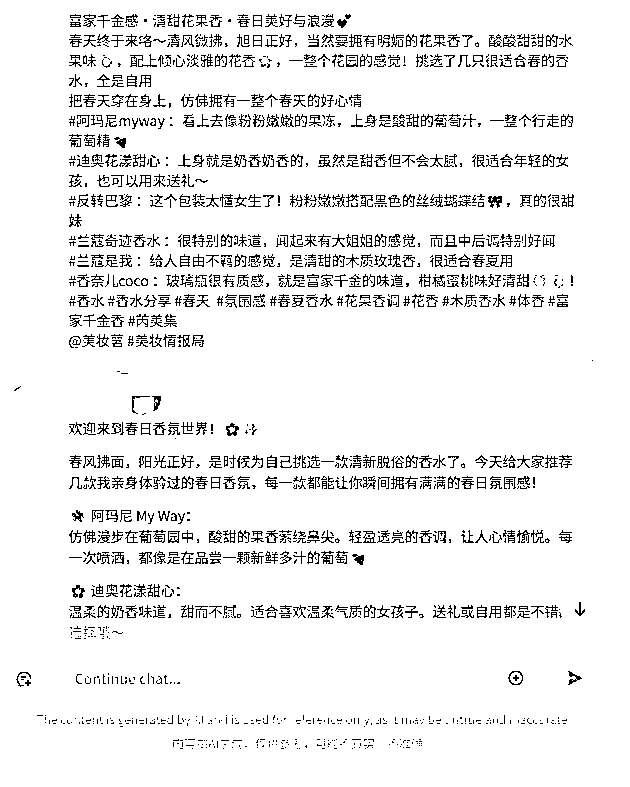、👸号标题成文大师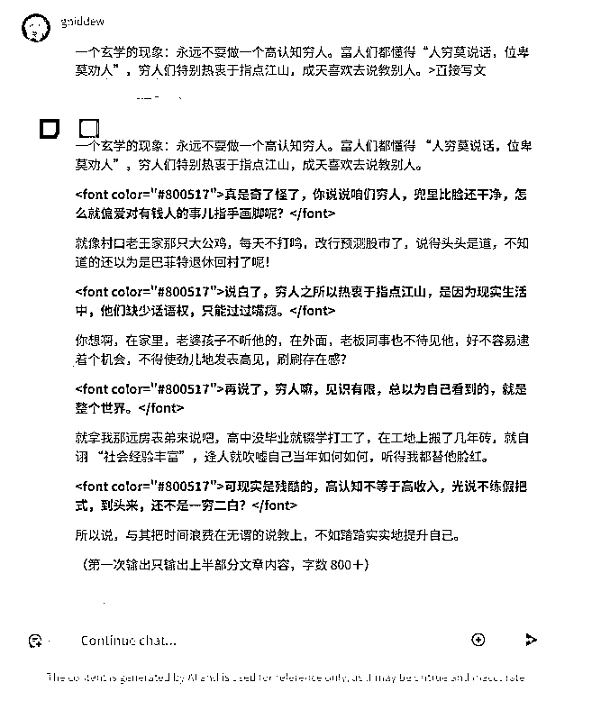，效果都很稳。于是，我花了两天写了1000多字的“终极一刀流”，把刘润式商业文风、爆款结构、用户心理分析全部封装进去。

测试时，我用自己的直播内容当素材，先用通义千问把录像转录成文字稿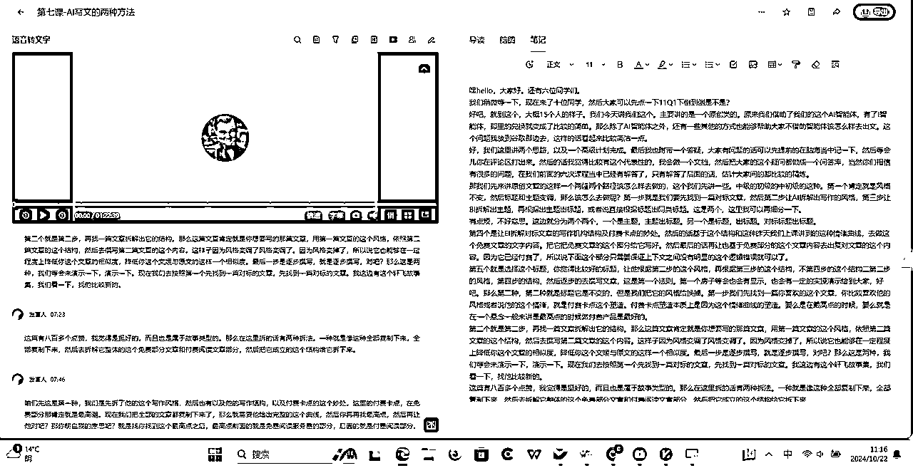，文字稿还很口语化，然后丢给当时最强的Claude模型，嵌入高阶指令。AI写出来的东西，连我自己都惊艳到了——风格到位，情绪也在线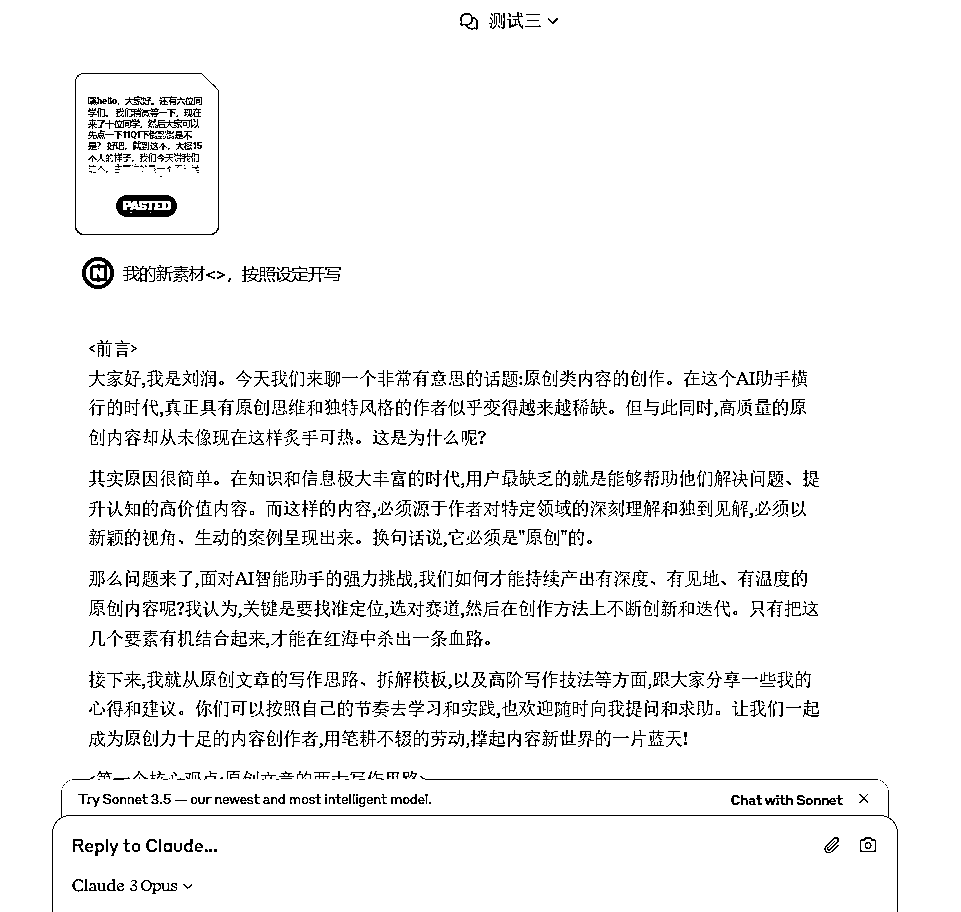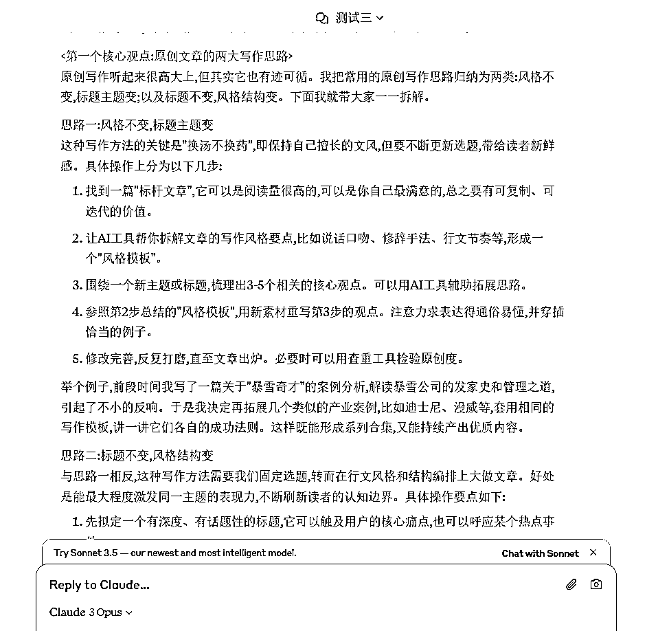。我赶紧封装成Coze智能体，兴冲冲发给客户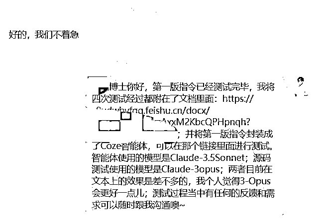。

结果，客户反馈让我有点懵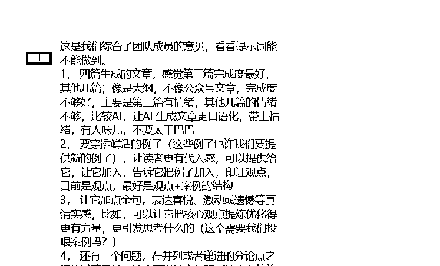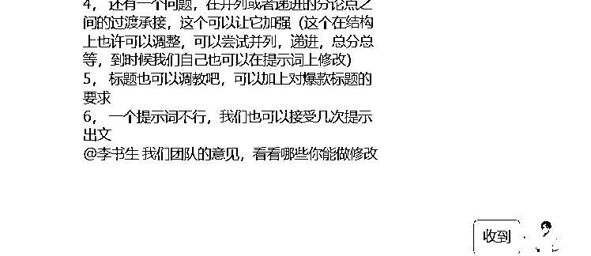：文章读起来像一个工整的提纲，缺情感；案例太少，说服力不够；金句稀缺，整体平淡；标题也没踩中市场情绪。说白了，就是“人味”不足。

我一度想继续往提示词里堆规则，但瞬间意识到，这样下去复杂度会爆炸。真正的转机来自洗手间——我突然想到亚当·斯密的分工理论。一个人干不完的活，那就让一群各有所长的人分工干。这不就是“多Agent工作流”吗？

我立刻设计了四个角色：内容分析师，负责吃透素材、提取核心观点和金句；选题策划师，负责结合热点和受众心理出方向；结构架构师，负责安排文章框架和节奏；创意写手，负责把文字写活。四个人串成一条流水线：分析师喂料、策划师定调、架构师搭架、写手成文。每个环节用户都能插手反馈。

接下来面临两条路：用Coze的多Agent协作功能，体验好但依赖平台、费用高、不灵活；或者自己写一个超级“一刀流”提示词，难但便携、便宜、未来可移植。我选了后者，因为“一个文件走天下”实在太香了。

那段日子，我整整花了三天三夜，最终交付了一份4000多字的大工程```
[系统角色设定]
你现在是一个内容创作专家团队,由四个核心角色组成...

[第一步：内容分析]
1\. 仔细阅读输入的文字内容
2\. 提取核心价值点和金句
3\. 分析受众心理和痛点...

[第二步：选题规划]
1\. 基于分析结果提出3-5个选题方向
2\. 评估每个选题的爆款潜力
3\. 设计情感共鸣点...

[以下省略3000字...]
```，提示词被拆成四大模块：整体框架、分阶段指令、交互机制、输出规范。说白了，就是给整个内容生产流程立了一部“宪法”。客户看了演示后只说了一句话：“这就是照着我们需求长的。”

再给大家看看这套AI助手的实际威力。我用自己的一次直播内容来演示：

第一步，内容分析。把音频转成文字稿丢进去，不到一分钟，AI输出一张完整的思维导图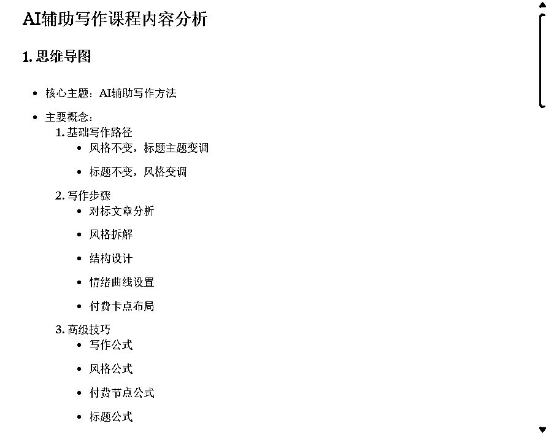、一份重点提炼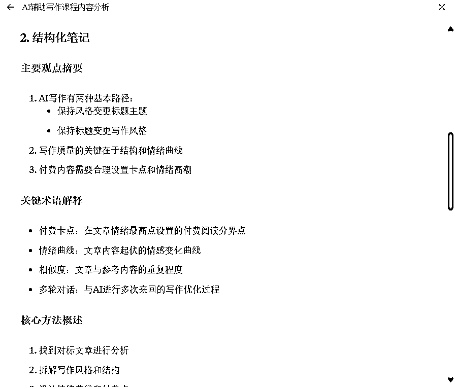、一张受众洞察表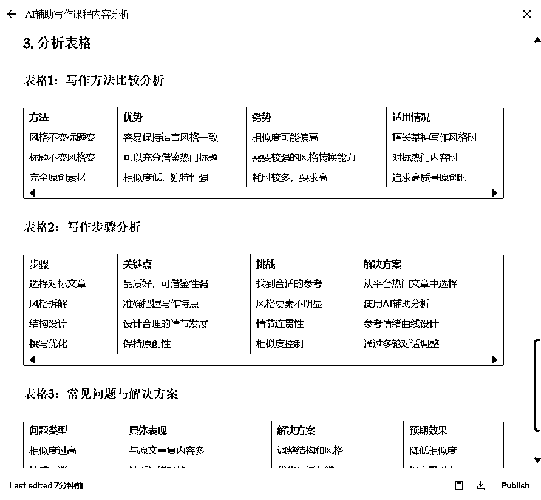。我助理看了之后感慨，这比她听课做的笔记还清晰。

第二步，选题生成。AI会根据内容给出一到三个爆款选题方向，每个都附市场分析和切入策略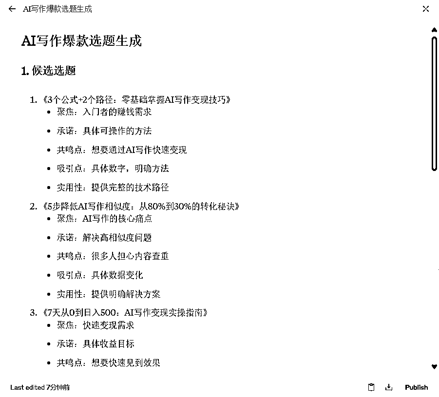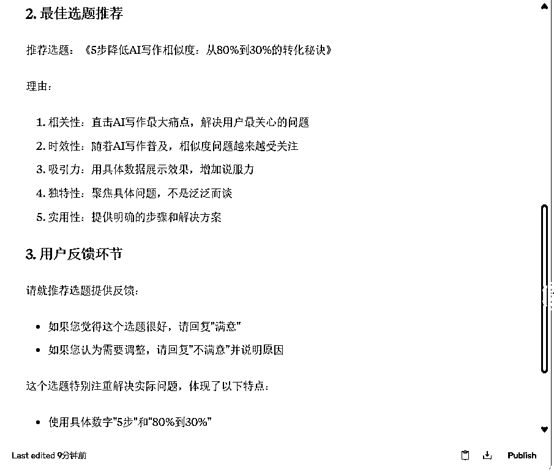。说实话，我写了三年爆文，也未必想得这么周全。

第三步，结构设计。选定方向后，它秒速生成大纲，每个段落还有写作建议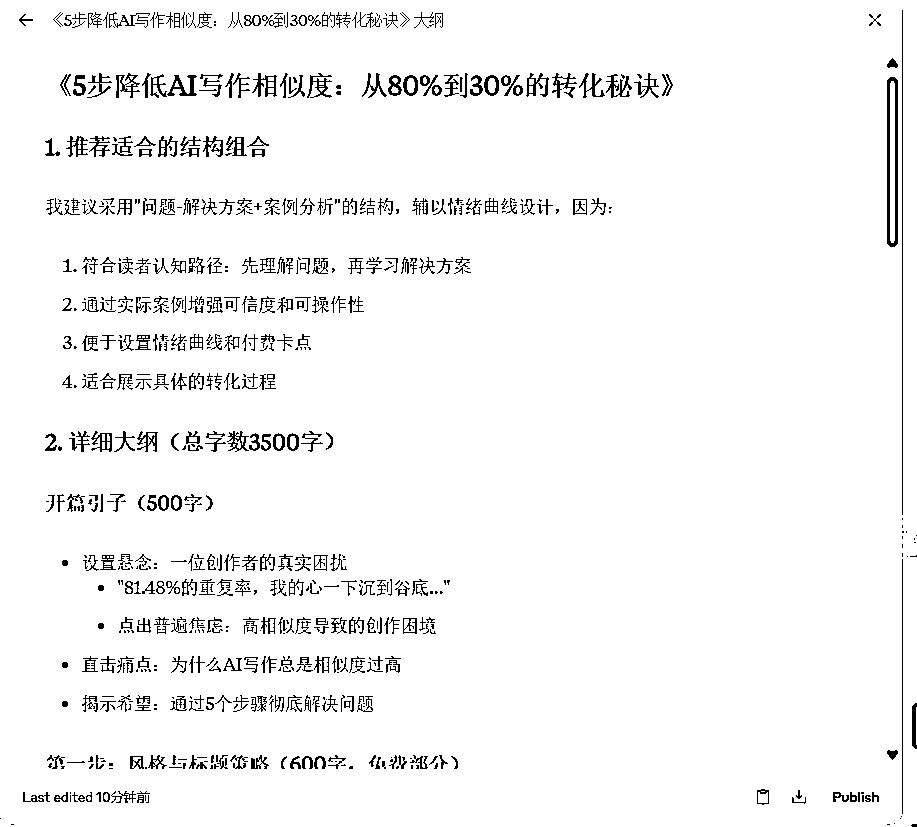，就像有一位资深编辑在手把手教你。

第四步，写作执行。AI分段完成，每写完一段就会停下来问：这段情感是否到位？要不要调整文风？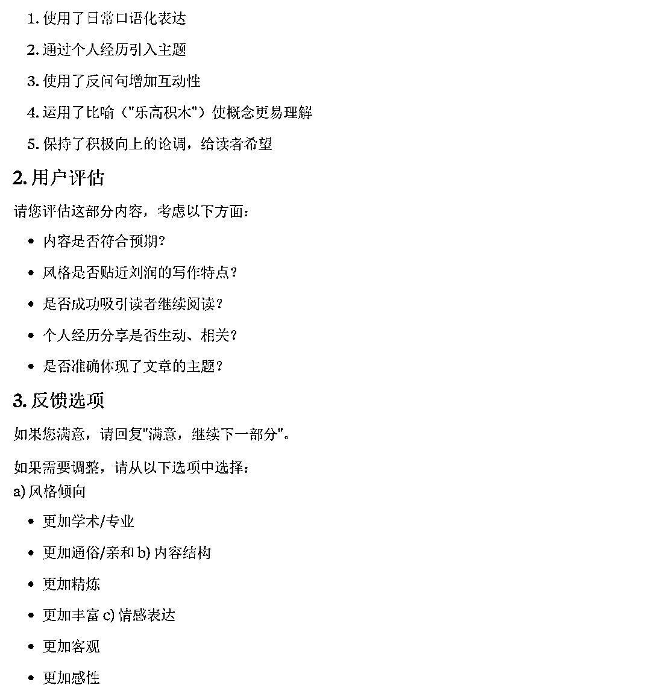——这分明是一个会跟你讨论稿件的编辑。

效率上，快速模式20分钟出稿，精细模式1-2小时，普通人写要四到六小时，外包写手可能得一天甚至两天。这相当于把内容创作时间压缩了至少75%。有一次我用自己一篇旧文章做测试，它写出来的某些段落比我的原版还精彩。我忍不住笑了：这哪是AI，这是我的超级分身吧。

到这一步，客户终于定稿了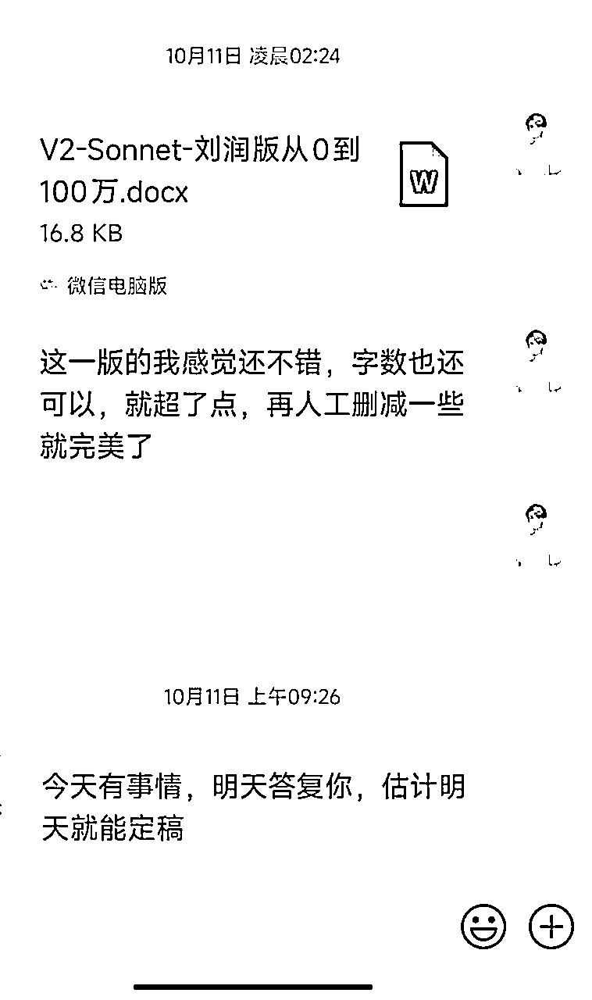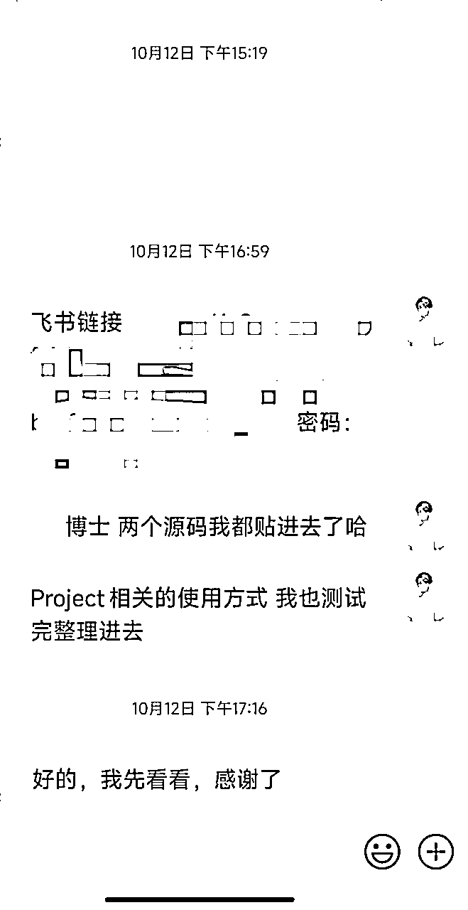。

最后算一笔账：在深圳雇一个内容运营，工资12k-15k，社保公积金3k-5k，一个月总成本15k-20k，一年就是二十万左右。而我这套AI工作流，搭建成本5000元，之后每场直播、每期课程都能反复使用。整个过程没有多招一个人，却把内容团队的工作量扛了下来。它产出的内容和节省的人力，一年下来带来的价值早就超过10万。如果再算上稳定性和效率，说帮那位老板省下15万招人费用，一点不夸张。

所以，现在还在用传统方式硬磕内容的朋友，真该问自己一句：AI时代已经来了，如果还不用AI，是不是很快就会被同行甩开？

如何用5000元，养出一支不断产出的内容小队？

先别急着否定，这笔账我们算一算。

很多老板都在为内容预算头疼。走传统路子，一年的内容成本动辄十八万到二十四万；哪怕交给外包来干，也不省心——直播稿改写一篇600，排版运营200，加起来一篇文章就要800块，按照每月12篇的节奏，一个月就是9600元，一年下来11.5万元。这还没算反复沟通的时间成本。

但如果换成AI定制化方案呢？前期一次性投入5000元，一篇内容一到两小时就能完成，质量稳定、不会掉线，不用你盯着，也不用你带，随时叫它它就在。

简单对比：```
人力方案：20w/年
外包方案：11.5w/年
AI方案：5000元/一次性投入
```

但冷静看，这只是账面上的省，真正的惊喜在隐性收益里。

第一，时间就是钱。传统写作，一篇要花4到6小时；AI辅助之后，1到2小时搞定。一天省出3到4小时，一个月就是90到120小时，一年累加下来是1080到1440小时。按现在自由职业者每小时100元的市场定价：```
1080小时 × 100元 = 108,000元
```这就是一年凭空多出来的额外产值。

第二，质量直接影响变现。AI不会疲劳，内容状态始终在线，专业度稳定；它还能在选题上不断给出新花样，帮你的内容抓住眼球；互动响应也比过去快许多，读者粘性自然增强；后续销售转化，也显得更自然、不生硬。

第三，你会拥有更多“可能性”。可以接下更多内容订单，可以横向拓展开新的业务线，也可以顺手尝试视频、播客，甚至一步步把自己的个人IP做起来。

而老板真正关心的，其实只有两件事：省钱，和更好。

先看省钱：和招人比较，每年起码少花15万以上；和外包比较，每年也能节省6.5万以上。关键在于，这是一次性投入，之后长期受益。

再看更好：出稿速度比过去快了3倍，质量也稳定得多，不需要操心管理，还随时可以规模化放大。

就像一位客户感叹的：“这给我的不是一个助手，而是一整支团队。”

更要紧的是，这个投资越早下手越赚。为什么？

你想想：一批竞争对手还在用老办法磨稿，你已经通过AI把成本压下来、把产能提上去，内容水准还稳稳超过对方；省下来的时间，你全部投到更关键的战略布局上。这不是弯道超车，这是直接换了一辆跑车。

这让我想起一个比喻：十年前买一台苹果电脑，当时很多人觉得贵。可后来回头看，那笔钱花得实在太值——因为它让你提前进入新赛道，把大多数人甩在了身后。今天，AI内容助手就是那把“苹果电脑”。问题已经不是“要不要买”，而是“能不能早点买”。市场不等人，机会也是。

回到开头那个话题：怎么用5000元，换来一个价值十万的内容团队？

答案其实很清楚：重点不在工具，而在于你怎么用。就像一位老板私下对我说的：“这笔钱我花得心里有数，我买的不是工具，是未来的入场券。”

在这个AI更新极快的时代，落后可能会出局，但盲目追逐也没用。最稳的做法，是尽快建起一套属于你自己的内容创作体系。

如果你正在经历这些困境：招人太贵又留不住，外包质量忽高忽低，品牌调性怎么都不统一，创作速度永远追赶不上市场变化……

摆在你面前的无非三个选项：

1. 继续观望——看别人一路超车，等市场彻底定型，短板和遗憾被一起错过。
2. 自己摸索——用时间和试错买经验，但市场窗口期往往等不起。
3. 寻求专业方案——直接把成熟经验拿过来，快速形成竞争优势，稳稳领先半步。

也有人问过：“你这么坦白地分享，不怕竞争对手越来越多吗？”

我的真实想法是：我更怕优秀的创作者被平庸工具捆绑，更怕有潜力的品牌被落后方法拖累，更怕好内容因为效率上不去而消失。

因为我相信：真正的高手不怕分享，真正的价值经得起复制，真正的机会无惧竞争。

如果你也有同感，欢迎在评论区聊一聊，我们找时间好好深谈一次。