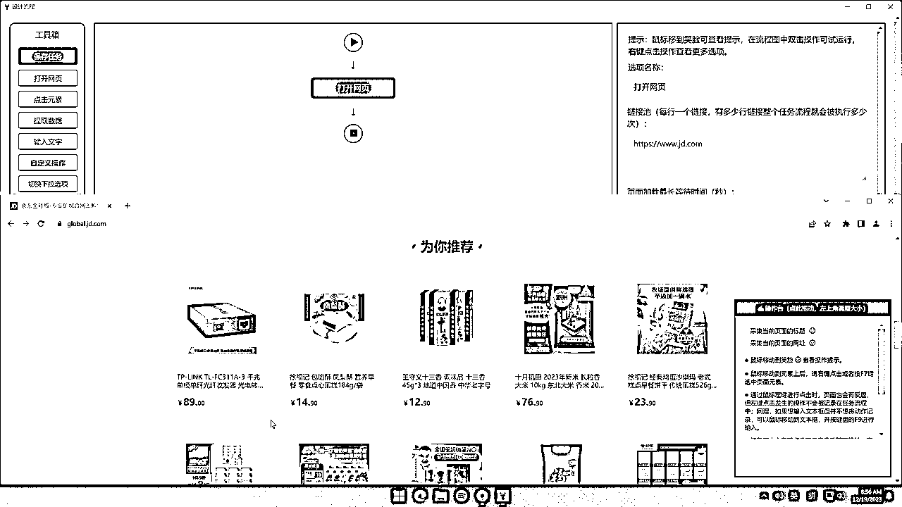
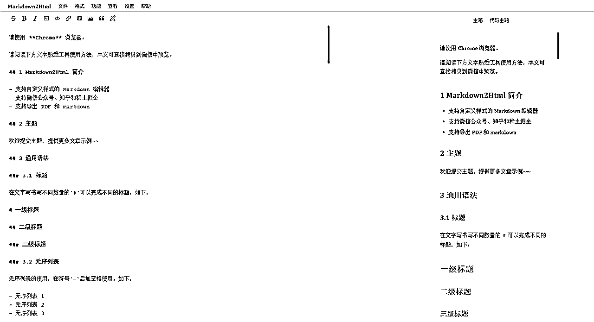

# 效率工具集10/100

效率工具推荐又来了！这次带来 10 个精选软件，每一个都亲测好用，绝对能帮你在办公、学习和日常信息处理上省下大把时间。

1. PDF 骑缝章工具 PDFQFZ——免费开源，轻松搞定盖章难题

给 PDF 盖骑缝章总是很麻烦？这款小巧工具能帮你轻松解决。你只需选择好目标 PDF 文件或整个文件夹，指定保存位置，再导入完整的印章图片，工具就会根据页数自动随机分割。接着调整印章大小、骑缝位置等参数，点击“盖章”，稍等片刻就能得到盖好章的成品文件。无需付费，开源可下，操作非常简单。

2. Simple Allow Copy——网页文字复制神器

每次在百度文库、CSDN 上想复制点内容，结果不是要求登录就是要会员，真的让人头疼。有了 Simple Allow Copy 这个浏览器插件，你不需要注册任何账号，也不需要开通 VIP，就能直接复制网页上的任何文字。省下繁琐步骤，效率直接翻倍，学习和办公都更顺畅！

安装方式：
Chrome 版：【点击安装】
Edge 版：【点击安装】

3. PDFgear——100% 免费的 PDF 全能工具

PDFgear 支持阅读、编辑、转换、合并以及跨设备签名，功能相当全面。最关键的是，它完全免费，而且无需注册，下载完就能用。

【点击下载】

4. EasySpider——可视化爬虫工具，零代码也能采集数据

EasySpider 是一款图形化界面的爬虫软件，不需要你有什么编程基础，直接在网页上选好要抓取的内容，再按提示框一步步操作，就能完成爬虫任务的设计与执行。它既能做可视化浏览器自动化，也能进行数据采集；同时支持命令行模式，方便嵌入到其他系统里。无论你是做测试还是搞数据，它都能帮上大忙。

开源地址：【点击前往】

5. 任推帮——网赚拉新聚合平台

如果你在做网赚项目，任推帮算是一个比较集中的拉新渠道，里面涵盖了网盘拉新、信用卡拉新、号卡分销、应用拉新等各种类型。个人或团队都可以参与。友情提醒：注册时自己直接去官方注册就好，别轻信别人给的邀请码，我自己也不会在这里分享任何邀请码，注意安全⚠️

6. 飞书剪存——一键保存网页，干净又高效

这个插件真的巨好用。看到喜欢的网页内容，点一下“飞书剪存”就能把正文存进自己的飞书云文档，不用再手动复制粘贴。它还特别聪明，能自动去掉网页里那些悬浮广告和嵌入广告，给你一个清爽的阅读体验。保存的内容还能在飞书云文档里打标签、分类整理，需要的时候也可以一键分享给别人，或者直接导出为 PDF。直接在插件商店搜“飞书剪存”就能添加。

7. WeChatVideoDownloader 2.0.0——微信视频号下载器

微信视频号的视频想存下来？这款 2.0.0 版本的下载器支持解密和下载，具体食用方法和下载地址都给你准备好了。

下载地址：【点此获取】

8. 微信👸号一键排版神器（免费）

排版太花时间？这个免费工具可以帮你一键搞定👸号文章排版，适合经常写👸号的朋友。

食用地址：【点击使用】

9. iShot——macOS 最强截图录屏工具

iShot 几乎能把截图和录屏相关的功能都包圆了：基础截图、长截图、多窗口截图、延迟截图、注释、贴图、取色、录屏等等，功能非常丰富。无论你是普通用户还是重度需求，它都能满足你。macOS 用户强烈建议试试。

下载地址：【点此进入】

10. 压轴推荐——RSSHub，信息获取的终极方案

在信息爆炸的时代，我们总是被各种信息流被动投喂，刷了半天，真正有用的没多少。RSSHub 是一个开源、简单易用且易于扩展的 RSS 生成器。你可以根据自己的兴趣板块，把优质信息源聚合起来，集中到 RSS 阅读器里查看订阅内容。这样一来，就不用到处翻找，只关注自己想看的东西，时间精力都省下来了。

