# 借助AI+RPA实现小绿书图片一键生成自动发布，可矩阵（小白级详细讲解，附：影刀脚本）

最近小绿书的风头挺大，我特意去刷了一圈。发现很多账号的图文形式非常简单，甚至谈不上精致，但数据却不错。按照我的直觉，这大概率又是一波流量红利。仔细看了下小绿书的几种常见展现形式：

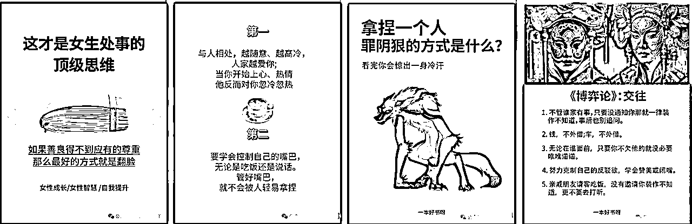

看到这么简单的玩法，我第一反应就是——赶紧自动化！先跑起来再说，内容后面慢慢调。这是我目前用脚本一键生成的成品效果：

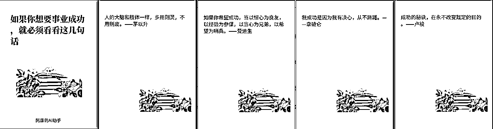

老规矩，先看演示。

不过，很多刚接触工作流的朋友在拿去用时，特别喜欢卡住就问，问得还都是“怎么搭”的问题，而不是“为什么这么搭”。说白了，大家只想着把节点连起来，却没搞懂背后的原理。所以这篇我会把搭建思路拆开揉碎，新手也能跟上。

# 整体功能思路

小绿书的构成很简单：标题、简介、多张图片。标题和简介，完全可以用Coze工作流自动生成。但我翻了🛰️的接口文档，发现官方暂时没有提供“图片形式”的发布接口，所以自动发布只能交给RPA去模拟操作，没法像之前发图文那样一个工作流全包。

为了让工作流产出内容能和RPA无缝对接，我选择飞书表格作为中间媒介。于是整体流程就是：

开始 → 工作流生成内容 → 写入飞书表格 → RPA读取表格并批量发布 → 结束

这里多说一句：多账号发布依然沿用“创作罐头”的玩法，还不清楚的朋友，建议先补一下那篇基础文章。

下面是具体搭建过程。

# 一、一键生成小绿书图片工作流

工作流源码已经发到社群了，群成员可以直接去复制。我这里重点讲搭建思路。

## 1、搭建前的准备

先拆解一下整个工作流需要什么：

① 一个大模型节点：负责写简介；
② 一个大模型节点：负责写正文（其实一个模型也能全包，但我习惯一个节点只干一件事，复杂了容易不稳定）；
③ 一个封面图制作工作流；
④ 一个内容图制作工作流；
⑤ 一个主体图片生成图像流；
⑥ 一个写入飞书的插件（上一篇文章有详细说明，没做插件的先去补课，这一点很重要）。

## 2、主体图像流的搭建

为什么先搭它？因为我想把布局做得简单点——只生成一张主体配图，再用纯色背景拼出图文效果。图像流的节点长这样：

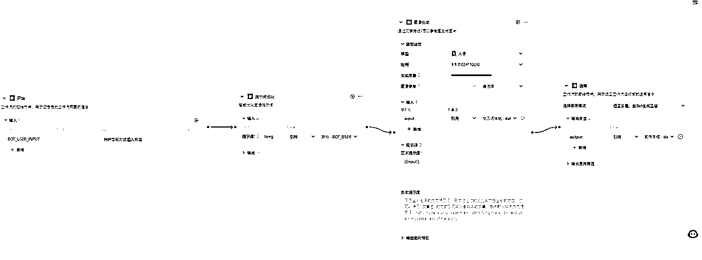

节点不多，照着拖出来就行，这里不展开讲了。

## 3、封面制作工作流的搭建

先看封面上需要什么元素：

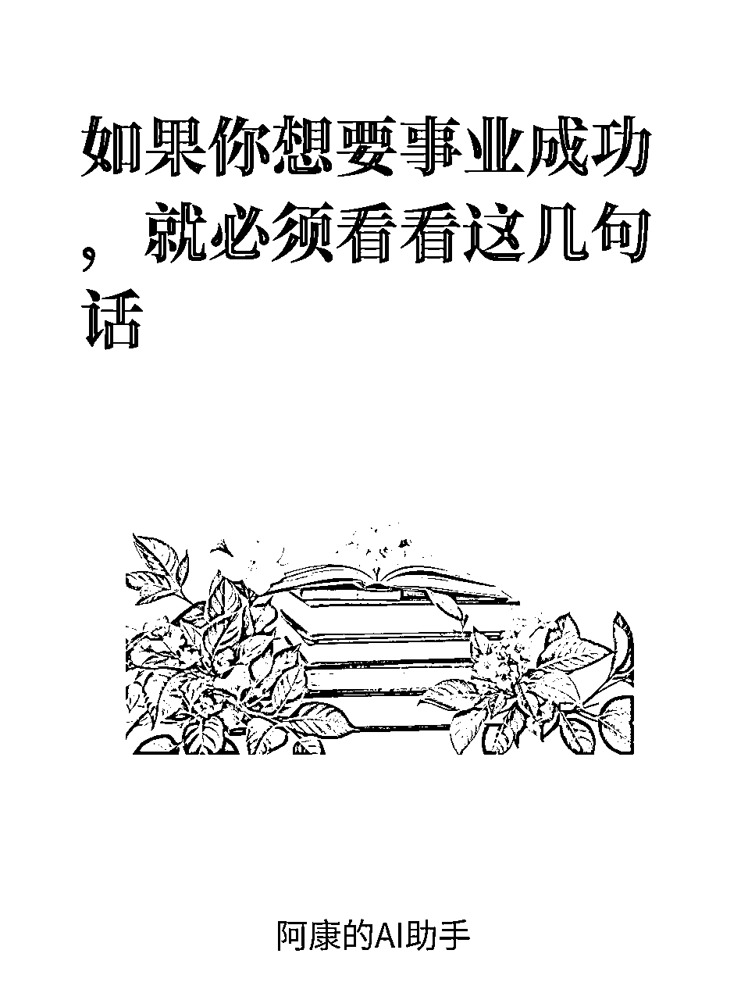

主要包括：封面标题、主体图片、👸号名称。

所以这个工作流的输入就是这三样。开始节点设置如下：

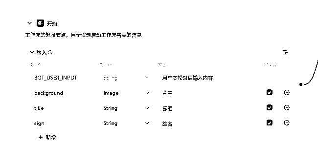

主体图片是用AI生成的，比如这一张：


如果直接把整张图怼进背景里，会显得很生硬。所以第二步得把主体抠出来，节点如下：

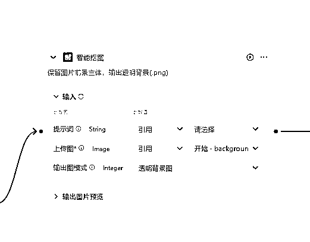

然后第三步，用画板节点把标题、抠出来的主体、👸号名称拼到一起：

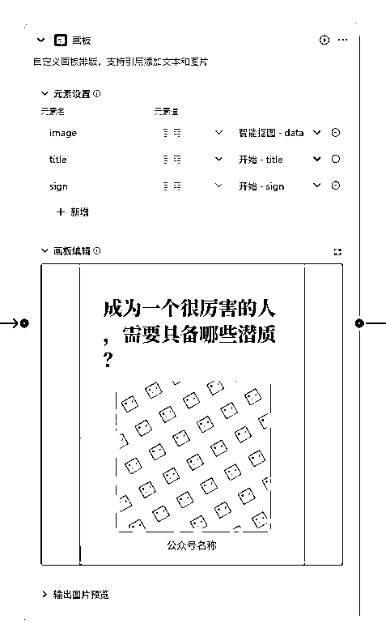

具体排版可以根据自己的审美去调。整个工作流长这样，记得试运行并发布：

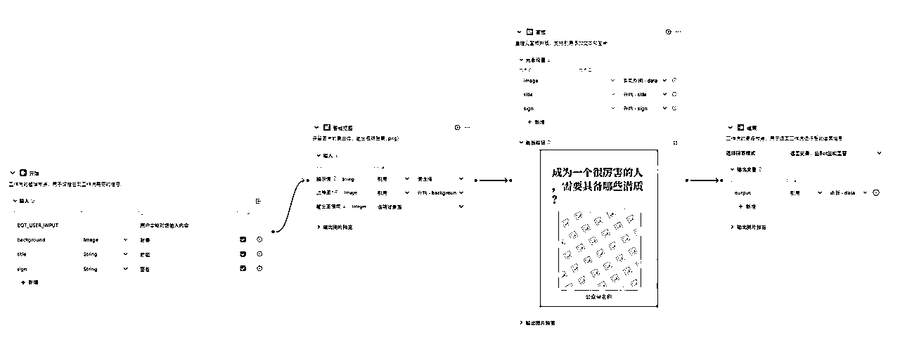

## 4、内容图制作工作流

做法和封面几乎一样，只是开始节点传入的参数不同。同样要试运行和发布：

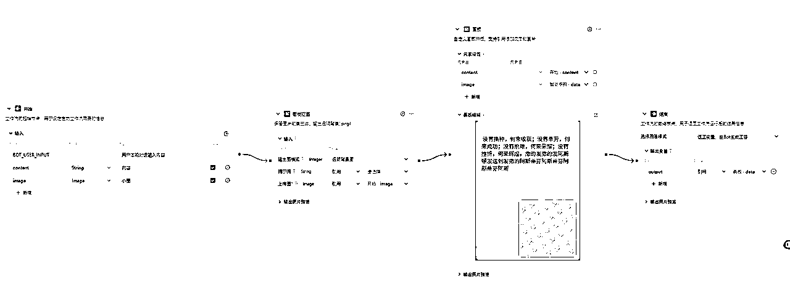

## 5、一键生成主工作流

### ①、创建按格式创作内容的大模型

用它来生成内容。大模型需要接收一个标题输入，而封面还需要👸号名称，所以前两个节点长这样：

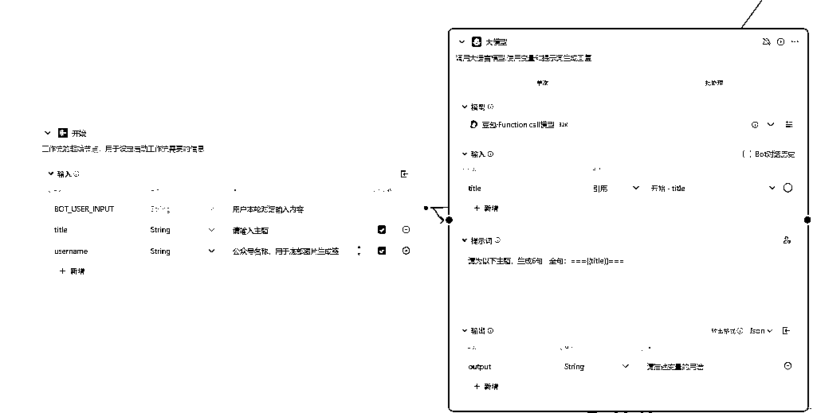

创作内容的提示词我先给个基础版，大家一定得按自己内容去优化，这里只是示例：

```
# Role: 名人名著金句摘抄大师

## Profile:
- Author: konger
- Version: 1.0
- Language: 中文
- Description: 作为名人名著金句摘抄大师，你能够根据用户提供的主题，精准地摘抄出符合特定特点的金句。

### Skill:
1\. 熟悉各类名人名著。
2\. 能够根据主题快速定位并摘抄金句。
3\. 理解并识别金句的普遍性、深刻性、简洁性等特点。
4\. 确保金句的出处准确无误。
金句有如下特点：
普遍性：句子表达的是人类普遍的情感或经验。
深刻性：句子具有深层的内涵和意义。
简洁性：句子简短而有力，易于理解和记忆。
文学性：运用修辞手法，如比喻、象征，增强表达效果。
情感共鸣：能够触动人心，引起情感上的共鸣。
哲理性：包含对生活、人性等方面的深刻见解。
社会批判：反映对社会现象的批判或讽刺。
道德指导：提供道德上的指导或建议。
现实主义：反映现实生活，揭示社会的真实面貌。
跨时代性：超越时代限制，对不同时代的读者都有启发。
示例：
1.我们的心是一座宝库，一下子倒空了，就会破产。一个人把情感统统拿了出来，就像把钱统统花光了一样得不到人家原谅。《高老头》
2.释放无限光明的是人心，制造无边黑暗的也是人心，光明和黑暗交织着，厮杀着，这就是我们为之眷恋而又万般无奈的人世间。——雨果（法国）
3.生活总是让我们遍体鳞伤，但到后来，那些受伤的地方一定会变成我们最强壮的地方。——海明威（美国）
4.黑夜无论怎样悠长，白昼总会到来。——莎士比亚（英国）
5.聪明人的特点有三：一是劝别人做的事自己去做；二是决不去做违背自然界的事；三是容忍周围人们的弱点——托尔斯泰（俄国）
6.勿以善小而不为，勿以恶小而为之。惟贤惟德，可以服人。——罗贯中《三国演义》
7.人间不会有单纯的快乐，快乐总夹杂着烦恼和忧虑，人间也没有永远。——杨绛《我们仨》

## Goals:
1\. 根据用户指定的主题摘抄金句。
2\. 确保摘抄的金句符合所列特点。
3\. 确保金句的出处准确，不捏造来源。

## Constrains:
1\. 必须确保金句的出处准确。
2\. 不能随意捏造金句的来源。
3\. 金句必须来源于某本书或某个名人之口。

## OutputFormat:
1\. 金句需符合用户指定的主题和特点。
2\. 金句与金句之间请用“|”符号分隔
3.不要任何解释，直接输出格式化后的金句

## Workflow:
1\. 确认用户指定的主题和金句所需符合的特点。
2\. 根据主题和特点在名人名著中搜索合适的金句。
3\. 核实每句金句的出处，确保准确无误。
4\. 摘抄金句，并按照要求格式化输出。

## Initialization:
作为一名名人名著金句摘抄大师，我将遵循您的指示，用中文与您交流，并向您问好。然后，我将介绍我的工作流程，并开始为您摘抄金句。

```

还记得内容图制作工作流吗？它的主要输入是一句话内容。所以大模型必须把正文拆成多个短句，我在输出限制里加了这个要求：

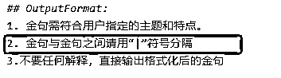

### ②、拆分短句为数组

用文本处理节点，把每一句拆成列表项。为什么要拆？因为后面做内容图时，要循环处理每一项：

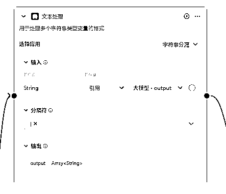

### ③、先搞定封面

加入封面工作流节点。它需要标题、👸号名称和主体图片。前两者已经在开始节点传进来了，现在缺主体图，所以加一个图像流节点来生成。

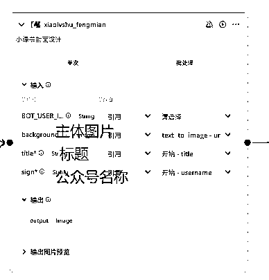

图像流我再补一下，提示词我暂时固定为“书本、女孩、花朵”。如果你想每次换风格，那就需要再加一个生成提示词的节点，具体优化看自己。

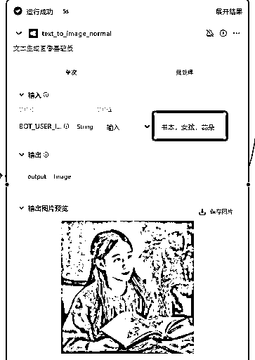

现在整个工作流已经有模有样了：

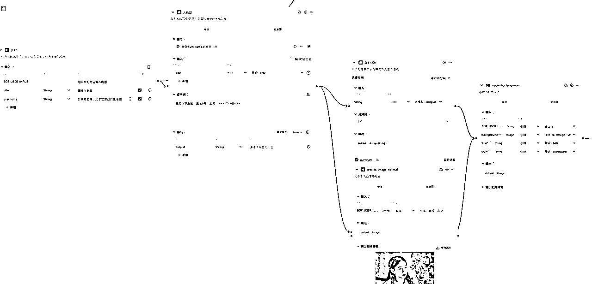

### ④、接着做内容图

把之前做好的内容制作工作流加进来。正常情况下，它输入一句内容，输出一张图片；那如果要多张图片，难道要复制多个工作流？肯定不合理。所以要用“批处理”功能。批处理接收数组或列表，这正是刚才用文本处理拆句子的原因。输入选择前面文本处理的输出，图片用图像流生成的图。注意：内容的输入项要选当前节点的item1，代表从数组中循环取值。

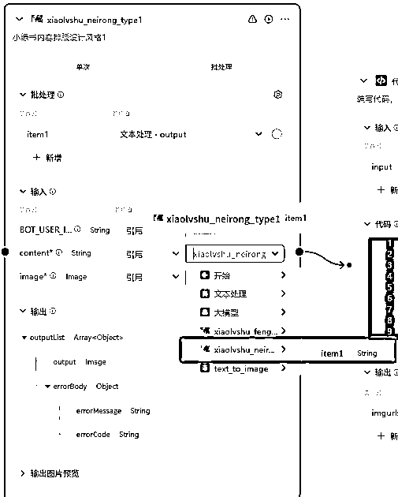

批处理记得设置并行运行数量，开太大会报错：

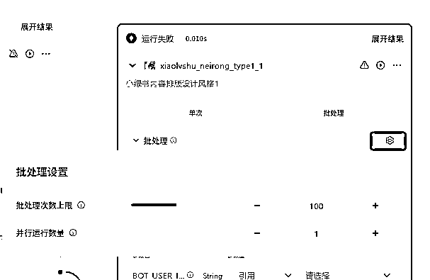

### ⑤、用代码格式化

批处理输出的数组格式不是我最终录入文章时需要的样子，所以用代码转换一下。代码节点选Python模式，源码如下：

```
async def main(args: Args) -> Output:
    params = args.params
     # 将JSON字符串转换为Python字典
    # data = json.loads(json_data)

    # 提取"String1"键对应的列表
    string1_list = params['input']

    # 提取列表中每个字典的"output"键的值，并构建新的列表
    output_list = [item["output"] for item in string1_list]

    # 返回转换后的列表
    ret: Output = {
        "imgurls": output_list
    }
    return ret
```

这段代码把批处理的输出从类似[{output:1.jpg},{output:2.jpg},{output:3.jpg}]这种格式，转成["1.jpg","2.jpg","3.jpg"]，这样就能拼成“1.jpg，2.jpg，3.jpg”的字符串——这正是录入插件要的格式。接下来拼接字符串：

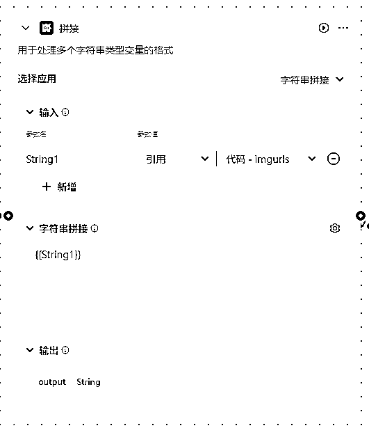

拼完后发现封面图是单独生成的，而且必须排在第一张。于是再写一段代码，把封面图拼到内容图前面：

```
async def main(args: Args) -> Output:
    params = args.params
    ret: Output = {
        "output": params['image1'] +","+ params['image2'],        
    }
    return ret
```

### ⑥、接入飞书录入插件

把之前用过的“录入飞书”插件拿过来用。图片填最后拼接完封面图的输出；领域根据你要发的账号去选，只要能对应上就行。标题就填开始节点输入的标题。到这儿发现还缺简介，接着补。

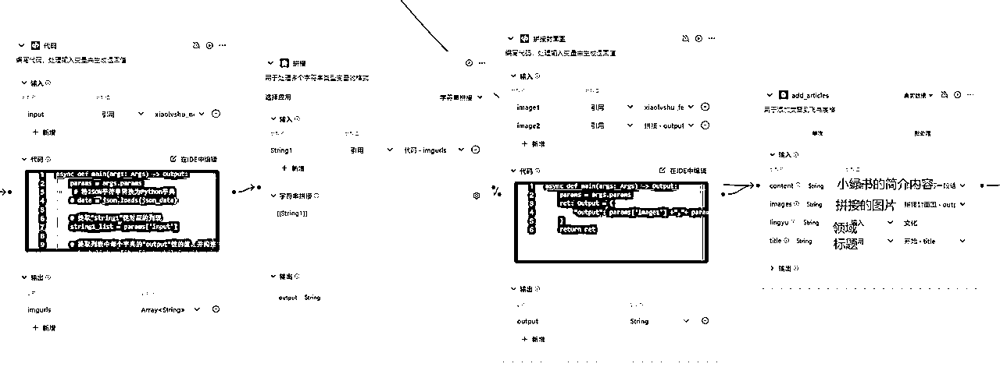

### ⑦、生成简介

新增一个简介生成节点，输入参数是开始节点的标题，用提示词写一段简介。我的提示词很简单，大家按需求优化：

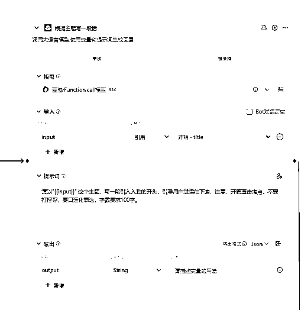

```
请以"{{input}}" 这个主题，写一段引入入胜的开头，引导用户继续往下读，注意，开篇直击痛点，不要打招呼，要口语化表达，字数要求100字。 
```

最后把这个节点连到录入文章的“内容”参数上，整个工作流就完工了。放一张总览图：

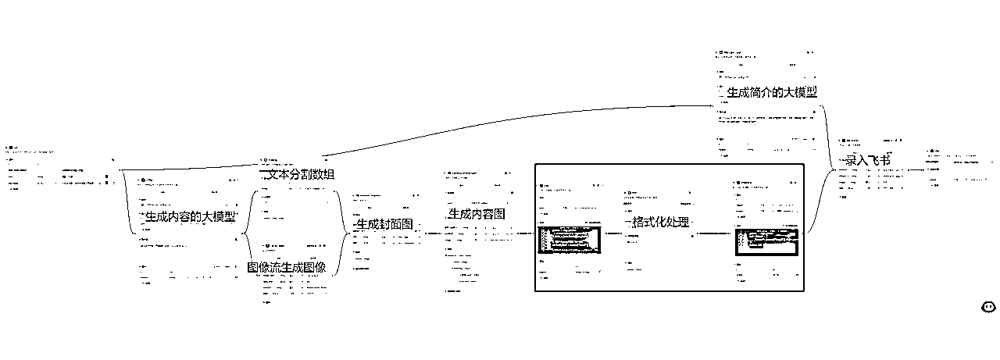

# 二、一键自动发布脚本

发布脚本的思路很简单：从飞书“待发布文章”表格里拉取内容。下面是对代码的标注说明。

## 1、配置信息与批量获取账号

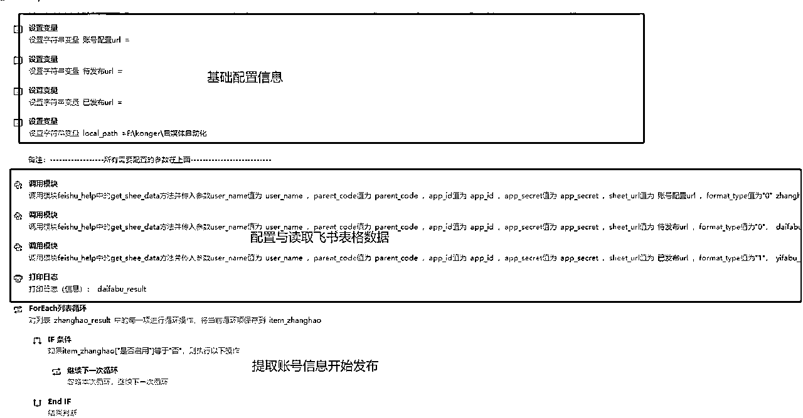

## 2、拉取待发布文章并发布

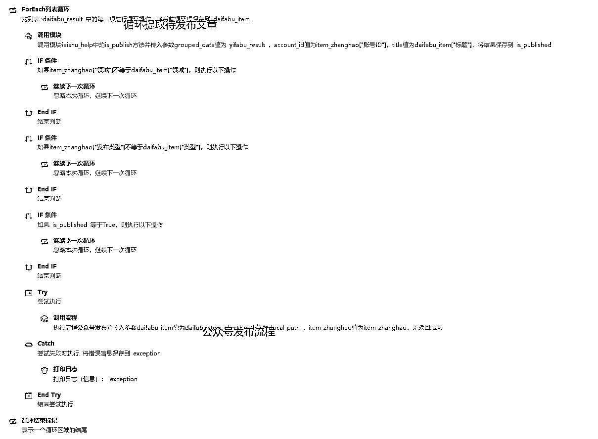

## 3、👸号发布流程

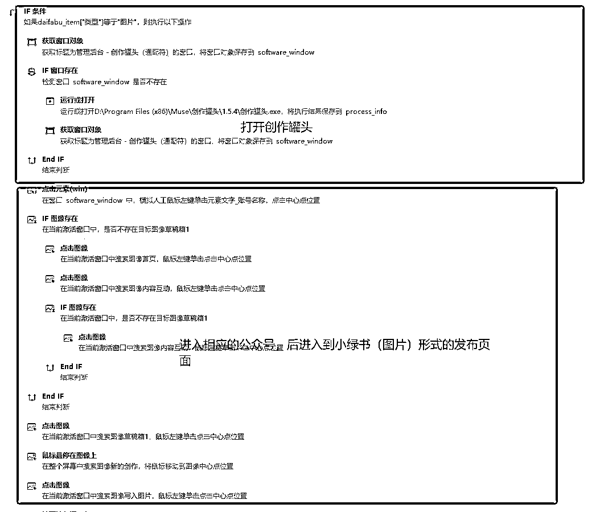

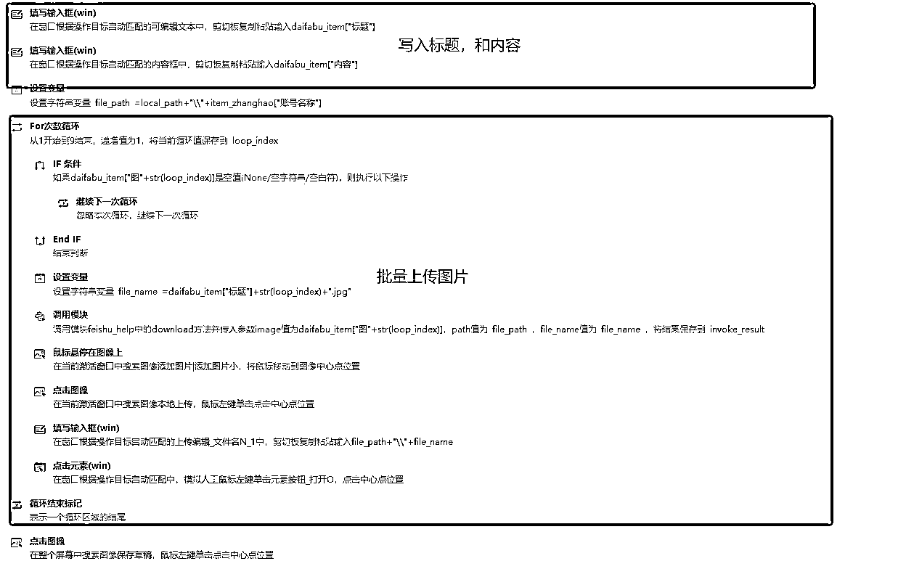

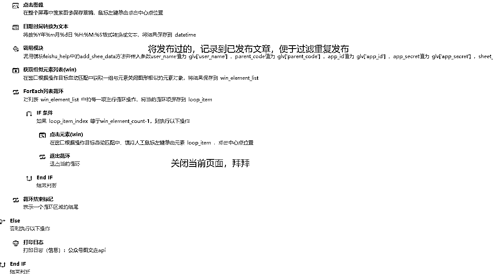

# 最后

我是谁？一个12年经验的大龄程序员。可以提供的服务：RPA自动化脚本、网站软件开发、平面设计、手绘。

# RPA附件

小绿书一键发布脚本：
链接: https://pan.baidu.com/s/15wr4H-5XZhoJ6ift5OENMg?pwd=4geq 提取码: 4geq