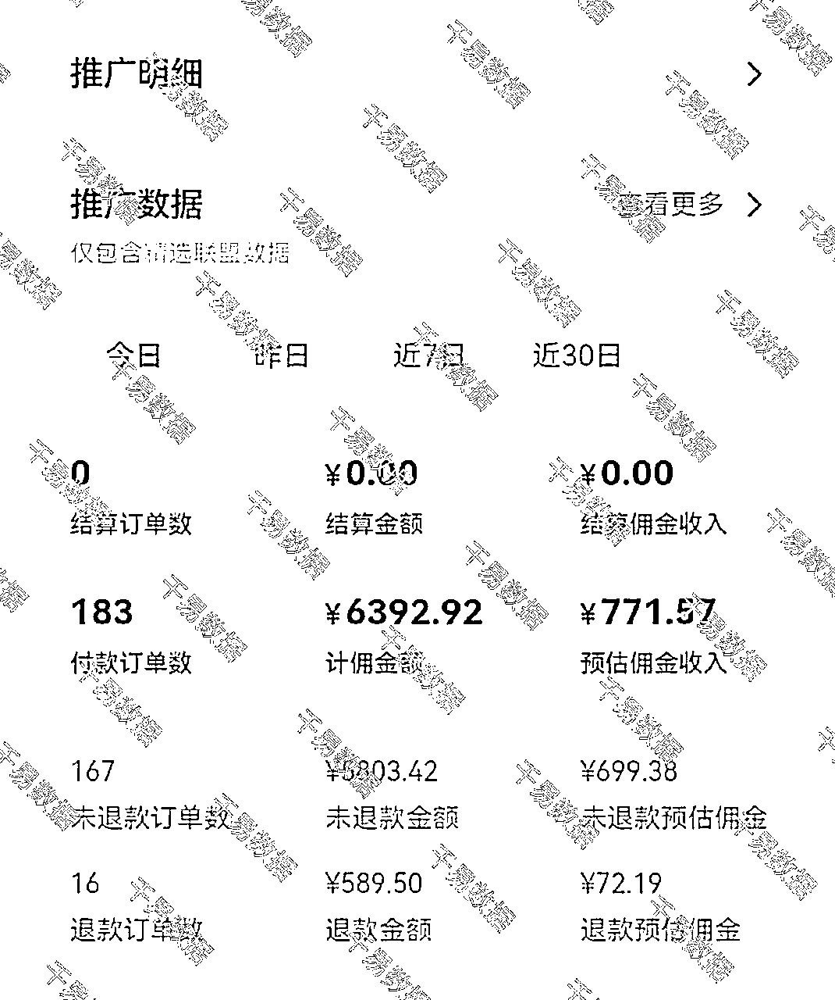
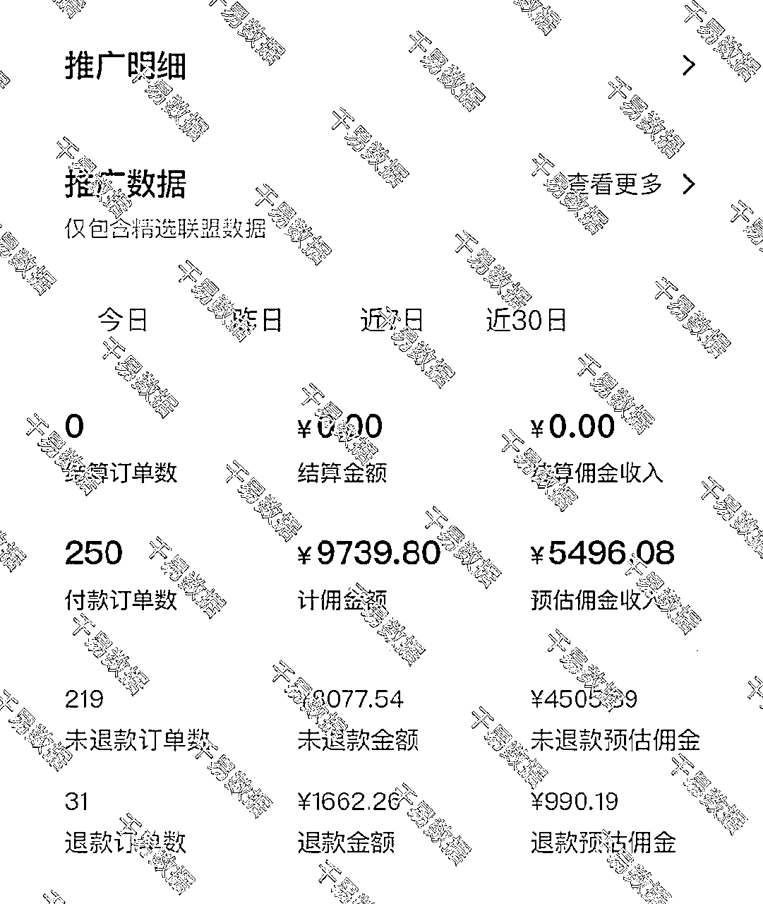
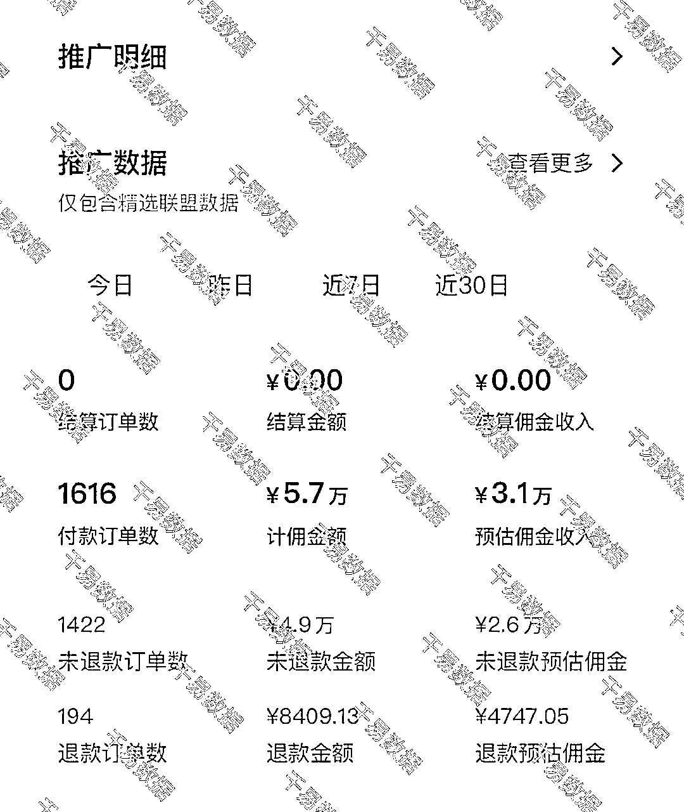

# ('选择的威力！同样玩法收益为何产生10倍差距', (2, 23))

同样的玩法、差不多的投入，为什么有人赚得比你多10倍？

同样的玩法、差不多的付出，有人一个月只赚一万，有人却能月入五十万。你可能觉得我在讲鸡汤，但这是我过去七年创业最深的体感。

这七年里，我卖过滋补品，也卖过铁锅；碰过园艺品、零食、百货，还做过咨询。流量上，免流量和纯付费都跑过；形式上，短视频、直播带货全下场试了一遍，抖音上主流的玩法我基本都玩过。但有意思的是，有些项目一个月利润就一万出头，有些项目单月能冲到五十万。团队还是那支团队，流程还是那套流程，人也是同一个人，差距到底是从哪里冒出来的？

最近一个学员的案例，把这个问题摆到了台面上。

八月份我分享了搜索流2.0的直播带货玩法，不少人来问，我就抽空带了几个学员。其中一个学员的表现，和其他学员以及我自己直播间放在一起比，收益差距大概在5到10倍。

我们用的确实是同一个玩法，每天直播时长都拉到16-17个小时，没有任何投流，连话术都是对照同一套跑的。当时我自己那个直播间，月GMV在20W左右，利润率约10%，算下来一个月净利2W；拆到每天，销售额5-7K，利润差不多700。后来这个账号我直接送给了团队伙伴。

那位学员完全不是这个量级。他一天大概能卖1W，利润率50%左右，也就是一天能赚5000上下。这样算下来，他七天的收入，就顶得上我一个月的利润。

你看看，玩法一样、投入一样、背后的人也一样，只是赛道不同，结果就拉开了5倍、10倍甚至更远。

这就是“选择大于努力”最直白的注释。老话讲“男怕入错行”，放到今天仍然是这个道理：赛道没选对，勤奋只能撑起下限，撑不起上限。收益说到底由三件事决定——自身能力、赛道选择、项目周期里的红利窗口。其中努力保住的是底线，选对赛道才能把底线抬高、把上限撑大。

下面我抛开个人能力，纯粹从客观市场角度，把赛道选择到底怎么影响收益这件事讲透。

一、行业的底层逻辑

一个行业能存在，是因为有一群人有共同的需求，要通过购买某种产品或服务来解决某个问题。商家、产品（解决方案）、消费者，这三个角色组合在一起，才构成一个行业。三者之间的不同搭配，往往会生长出完全不同的生意。

拿母婴行业来说，这几年生育率下降，消费者规模缩小，商家之间的竞争肉眼可见地加剧。但同样身处其中的商家，有些反而活得不错——因为家长对孩子食品安全的关注度越来越高，“无添加”类产品受大环境的影响就小很多。

再看银发经济，画风完全不同。我们正在进入老龄化阶段，老年群体规模持续扩大，消费需求还在增长。商家虽然也在不断涌入，但远没到拥挤的程度。

你会发现，这三个要素任何一个发生变化，其他两个也会跟着联动。

二、红利的本质，以及两种红利

拉开收益差距最关键的变量之一，是行业红利。什么算红利？简单说，就是行业还处于成长期时，产品卖得上价、利润充足、同行不多、价格战还没全面开打的那段窗口期。这个时候进场，拿利润容易得多，还能借着高增长快速组建团队、沉淀经验，建立自己的竞争优势，等到行业成熟时才活得下去。

没有红利和时间窗口，想把生意慢慢做大非常困难。现在让你从零起一个抖音号，或者从零做一个女装品牌，难度和前几年完全不在一个量级。

红利大体分两种。

第一种，行业本身处在成长期。用户需求还没被充分满足，市场还在不断扩大。比如高考志愿填报，我上大学那个年代几乎没有这个行当，这几年却做得如火如荼。

第二种，行业所在的渠道处在成长期。这一两年到处都能看到，本质上属于平台机会。抖音、快手、小红书、视频号的出现，打破了地域限制，让原本在线下就有的需求被进一步放大。家庭教育、情感咨询都属于这一类——线下本来就有，靠互联网把市场做大了。

怎么识别红利？最实用的办法是找对标账号，观察它们的数量、质量、利润率，以及项目收益天花板，综合判断。如果对手不多、对手不强、市场仍在增长、产品做得还比较粗糙，那大概率就是机会。我最近一年的体感是，实物电商已经卷得厉害，服务型电商的机会还剩不少，最近常被提起的本地生活，本质上就是服务型电商，可以往这个方向多看看。

三、天花板、周期和特性

除了红利，还有三个因素在限制收益体量。

第一，行业天花板。市场规模有个很直观的公式：客单价×消费者数量×复购次数。不同行业的天花板差距极大——2023年我国女装行业市场规模是10443.2亿元，休闲渔业产值只有931.47亿元。同样做到第一，体量差距可能就有十倍。所以如果你想做一家百亿级公司，至少先选一个能装得下百亿的池子。当然，女装的卷也是出了名的，所以不能只看天花板，还得结合后面的因素一起评估。

第二，行业周期。成长期进市场，入局者少、需求上升，最容易拿到利润；到了成熟期，大部分利润会被头部商家拿走，剩下的人只能拼得头破血流。什么时候进场，有时候比你有多大能力还重要。

第三，行业特性。有的行业天生带着一条利润率区间，消费者心智定在那里，打价格战也换不来多少增量；有的行业则从早打到晚，直到毛利被压到5%-10%才停下来。最典型的就是啤酒和白酒——同样粮食酿造，啤酒十几块一瓶就是常态，白酒从十几块到几千块都有市场。白酒圈子里，往往茅台一涨，大家跟着调价；啤酒圈子里谁也不服谁，只能互相杀价。利润，只是行业特性里大家感受最深的一项，实际远不止这些。

还有一些行业属于逆周期行业，经济大盘不好的时候反而更好，比如黄金、考证、考研。另一些行业稳定得惊人，比如给三峡大坝做变压器、做密封圈的企业，设备多久换一次都是固定的，全国能做的也就那几家。

四、六种行业，对照自查

我把行业粗略分成六类，你可以对照看看自己现在处于哪一种。

打麻将行业：款式多、更新快，有季节性和周期性，这局没胡还有下一局，筹码还在就有机会。典型代表是服装、鞋、箱包、家纺。

打穿行业：价格战一轮又一轮，产品几乎不变，毛利非常低。比如卫生纸、洗脸巾、脸盆，干起来又累又苦，还赚不到什么钱。

梭哈行业：成长期特别短，窗口一关闭基本没机会，必须在那段时间全力押注。网红、娱乐IP就是例子，平台红利期一过，基本没有翻身余地。

不变行业：不管外面怎么变动，它一直不动。特种装备、米面粮油都算，需求稳定、商家稳定，早已进入成熟期，想挤进去难度不小。

衰退行业：用户数量在减少，市场在萎缩，这种行业无论打工还是创业都尽量别碰。

线性行业：市场开发得差不多了，消费者没有太大变化，产品更新乏力，大部分商家只能守着行业平均毛利。能做，但规模被锁死，利润被压住，像鸡肋一样，偶尔还波动一下。市面上很多行业都处在这样的状态。

五、雷军那句话

雷军在一次采访里说过一段话，我一直记着。他说我们从小被教育要勤奋、要努力、要拼命，但光有这些远远不够，很多人根本不知道自己要往哪个方向去。等他到了四十多岁才彻底想明白，踩风口不只是加分项，而是大成的前提。方向没找对，奔跑得再努力也有可能跑偏。

六、几点提醒

最后，说几句掏心窝的话。

第一，别把上面这些理解成“努力不重要”。以现在的竞争强度，进任何行业都要努力挤进前三，才有机会活得更久。

第二，行业里的很多客观条件，我们确实改不了，只能去选择。所以，认真对待每一次选择和决定，比盲目坚持重要得多。

第三，就算行业选对了，红利也赶上了，最终还是要看你的能力能不能稳稳接住。你接不住的机会，就不算机会。光会追风口，很容易来得快去得也快，飞得越高跌得越重。

第四，吃到红利以后，一定要快速建立自己的竞争壁垒和优势。潮水总会退去，别当那个裸泳的人。

第五，如果现在还没遇到红利，就先找一个能赚钱的项目活下去，一边生存一边探索。没有人能一击必中，你测试过的项目越多，选对方向的概率就越大。

第六，你赚到的每一块钱，背后都站着一波时代红利。无论上班还是创业，走正确的方向，比正确地走路更重要。顺势而为，才能真正乘风破浪。

我是千易，9年自媒体人，6年电商人，2017年创业至今，最早从今日头条做起。头条、抖音、视频号、小红书都做过，曾连续三次用5万本金赚到100万，也操盘过多个不同类型的项目。目前主要深耕大健康产业的直播间和短视频带货，多平台矩阵运营，有相关资源的伙伴，欢迎来链接。