# 海外旅游赛道，天坑赛道中的清北，2024要怎么破局

2024年做海外旅游，说句不好听的，就是往天坑赛道里扎。这坑深到什么程度？放眼望去，大概只有留学行业能跟它平起平坐。国内游和境外游，往后大概率会走成两条完全不同的路线。

我是龙哥，在📕做了两年留学业务，累计做了2700万，后来转场房产，两个月卖掉了一个亿。我的合伙人陈铭Ivy和我，当初是从1500块起步的。今年是我们创业的第三年，总算没跌进“创业公司三年必倒闭”的魔咒里。

很多人问我，凭什么敢这么频繁换赛道？答案很简单：运营的底层逻辑是通的。我拿到一个产品，基本能推算出它要卖给谁：目标客户的年龄段、喜好、职业，都能估个大概。再往深扒一扒，痛点就出来了。痛点清楚以后，卖点自然能调整，投放方向也就有了。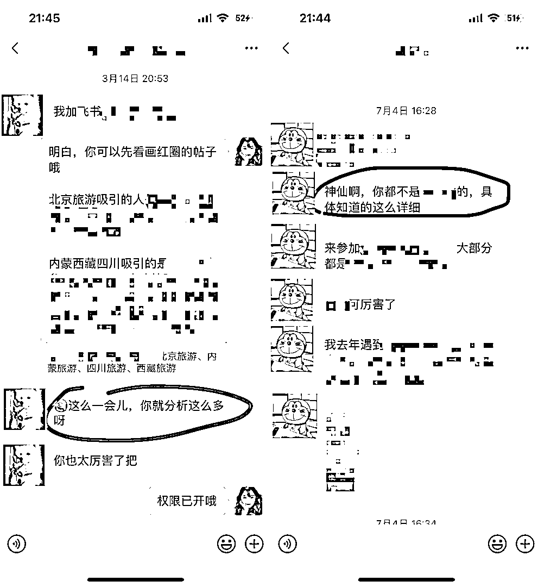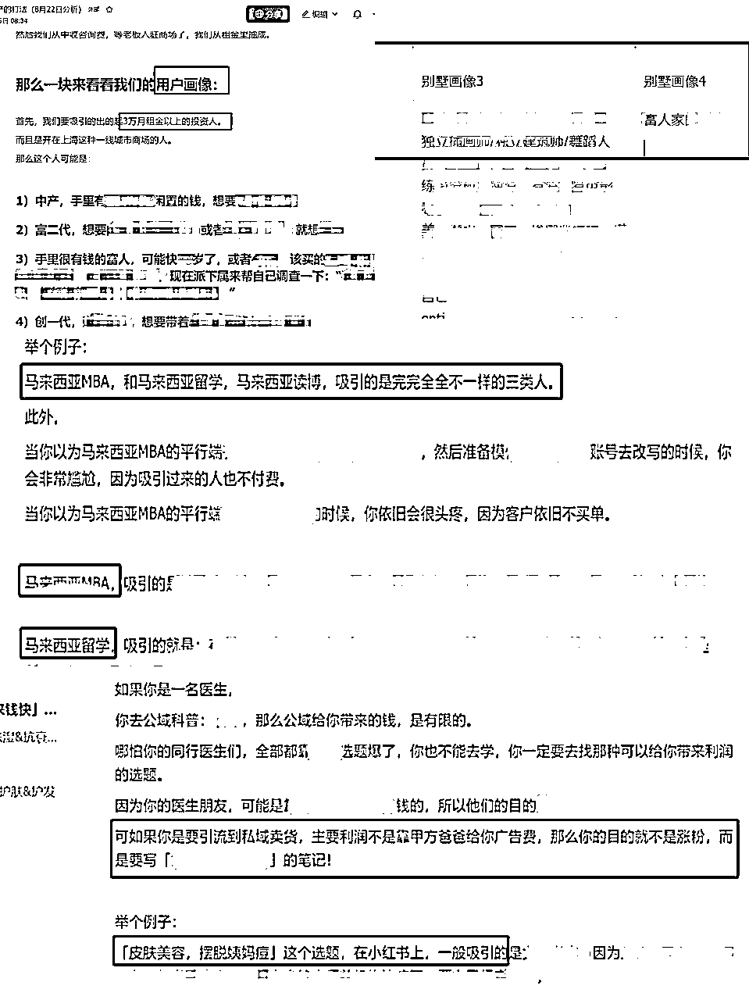

举个例子。有位做境外旅游的老板，来找我改笔记。我帮他调整完，引流成本肉眼可见地掉了——咨询开口价从45块降到了13.16，每天来找的人多到回不过来。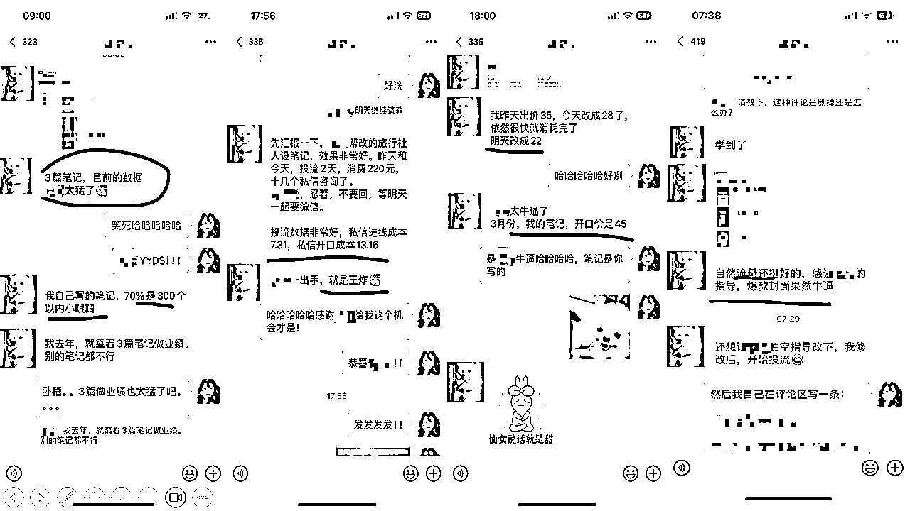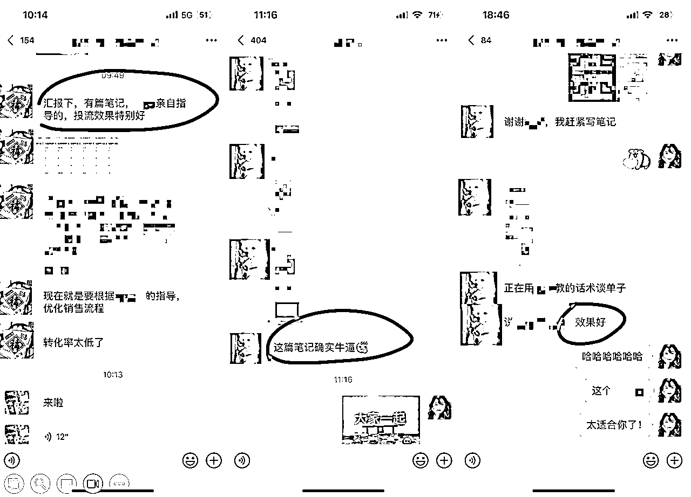

所以说，我的经验在旅游赛道同样管用。

今年3月，我开始集中拆解40多个高客单赛道，旅游就是其中一个。正是通过研究这些卷王赛道，我才悟出一套降维打法，然后把它用在了房产上，这才快速跑通了卖房单边代理项目。我们进场那会儿，整个📕几乎找不到卖房代理的爆款图文，连对标都没有，算是硬闯出来的。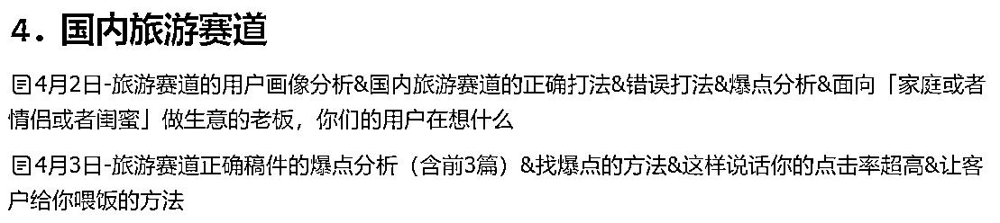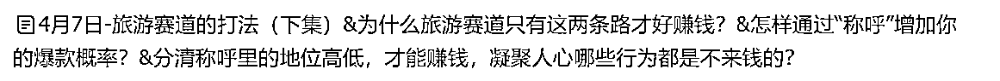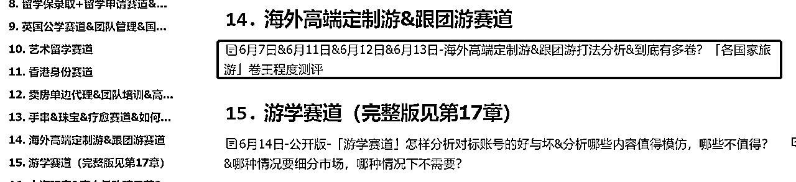

下面，把我对旅游赛道的观察完整说一说。

先解决两个问题：谁是旅游赛道的金主？谁又是那种只爱看、不爱掏钱、还特别能砍价的人？

我把家庭游消费者分成两类：A类家庭和B类家庭。怕文字看得累，先上一张思路导图。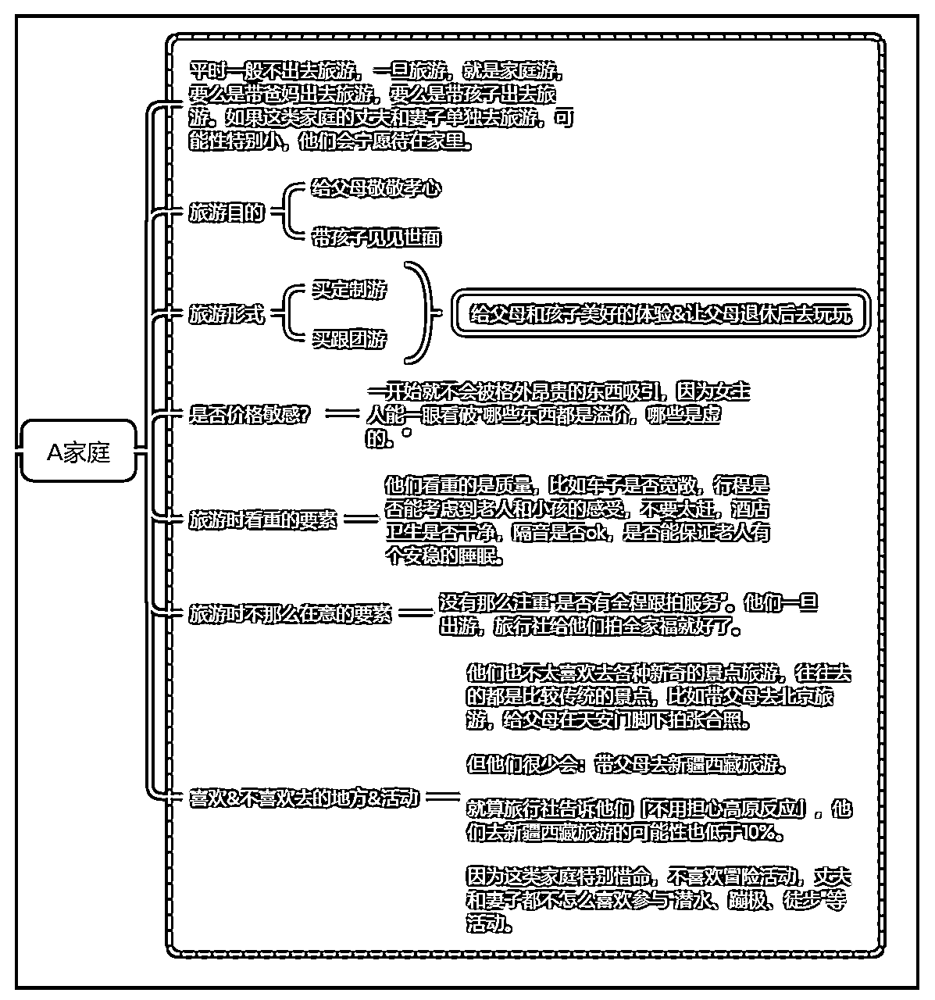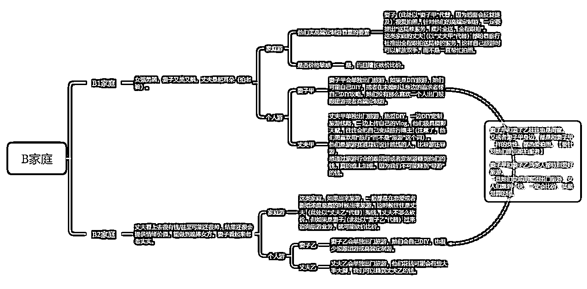

A类家庭，平时基本不旅游，一动就是全家出动，要么带父母出去，要么带孩子出去。夫妻俩单独旅行？可能性很小，他们宁愿待在家里。出游目的也简单：一是表孝心，二是让孩子开眼界。选择上，要么定制游，要么跟团游。

这类家庭的女主人管着钱，行程也由她安排。她不爱四处比价，但也不是乱花钱的类型，因为她一眼就能看穿哪些东西是溢价、哪些是虚的。她们真正在意的是：车子够不够宽敞，行程会不会太赶，老人小孩能不能被照顾到，酒店是否干净、隔音好不好，老人能不能睡个安稳觉。至于全程跟拍、精修照片，她们不太上心，旅行社交张全家福就够了。

A类家庭去的景点也比较经典。带父母去北京，在天安门底下拍张合照，他们就很满足。但你要让他们去新疆、西藏？哪怕你反复强调“不用担心高反”，他们去的概率也不会超过一成。这一家人惜命得很，潜水、蹦极、徒步这类项目基本不碰。想用“超高端定制”的名头让他们高溢价买单，很难。

B类家庭，完全是另一个画风。夫妻俩普遍有个环游世界的梦，专往新奇的地方跑。北京这种传统路线，反而勾不起他们的兴趣。国内他们爱川西、新疆、内蒙、云南、东北；国外更是常年刷。

B类家庭还能再拆成两拨。

B1家庭：女强男弱，太太又美又飒，先生是典型的“耙耳朵”。太太特别爱拍照，咨询高端定制游时，开口就会问：送不送精修？底片全不全？能不能全程跟拍？先生心里也巴不得旅行社推出这种服务，这样自己就不用一路举着相机当人肉三脚架了。这一家人，砍价比价是强项。

B2家庭：先生看着体面，条件不差，甚至可能还挺帅，关键是情绪价值给得足，能把太太捧得开开心心，太太看起来则是老实乖巧的类型。这种家庭出来玩，通常正处在恋爱或新婚的甜蜜期，基本都是先生掏钱，也不怎么砍价。但如果来咨询的是太太，那比价砍价的架势，一点都不会少。

再说闺蜜游。说白了，就是B1和B2里的那两位太太，她们很可能本身就是闺蜜。身边围绕的也都是同类女性，爱美、爱拍照、爱旅行。这群姐妹凑一起出门，必然要货比三家，谁家划算就选谁。

至于单人游，主力其实就是B类家庭的男女主人。

丈夫甲一个人出门时，特别享受DIY，一边自己排路线，一边拍Vlog。他们摄影天赋还不差，慢慢就把自己变成了旅行博主。注意，他们说的是“旅行”，不是“旅游”。这种人本身就是设计路线的高手，比导游还懂行。想从他们身上赚跟团游、定制游的钱，几乎没戏——因为我们赚不到“导游”的钱。

丈夫乙就不一样了，单独出门也愿意花钱，这笔钱是能赚到的。

妻子甲一个人出门时，要么自己DIY，要么还在单身时让追求者帮着做攻略，很少会自己去报跟团或高端定制团。妻子乙也一样，基本自己动手，报团的意愿不高。

聊完画像，再看看大家的消费力。

A类家庭底子厚，哪怕经济下行，那也是“瘦死的骆驼比马大”，该花照样花。B类家庭就麻烦了。他们平时花钱大手大脚，又因为太想赚钱，时不时被割韭菜。更惨的是，他们扎堆的行业本身就在下行：金融、跨境电商、KTV、咖啡、轻食、留学、英语培训、奢侈品、电影院、旅游、宠物……降薪、裁员、被迫转行，一个都跑不了。消费能力自然越来越弱。

所以结论很清晰：这个赛道真正花得起钱的，就A类和B类。A类给父母孩子花钱，自己反而不怎么出门。B类爱玩但爱砍价，收入还在缩水。如果只盯着B类做生意，高利润基本别想。

再看赛道本身的卷度。旅游赛道的卷，和留学赛道有一拼。圈内有老板给我看了张图，据说从2024年初开始就反复出现。我拿它当标尺去判断各赛道的卷法，结果发现，美国、日本的旅游笔记已经把这张图卷出了N个变体，其次是芬兰、法国、意大利、瑞士。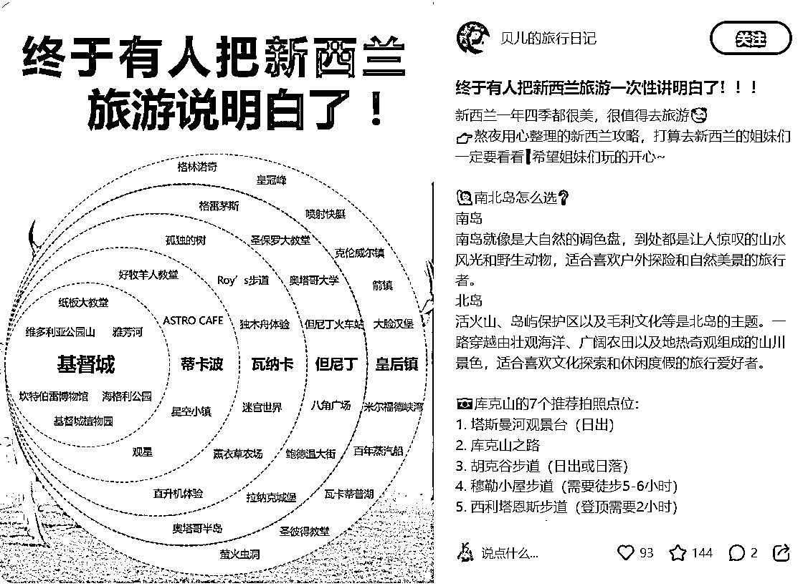

我以新西兰旅游为例，挑了几篇笔记来拆：数据差的两篇，数据一般的一篇，数据好的一篇。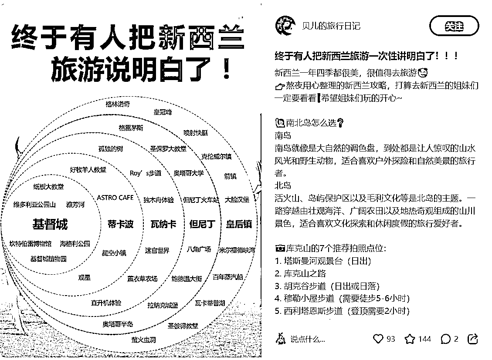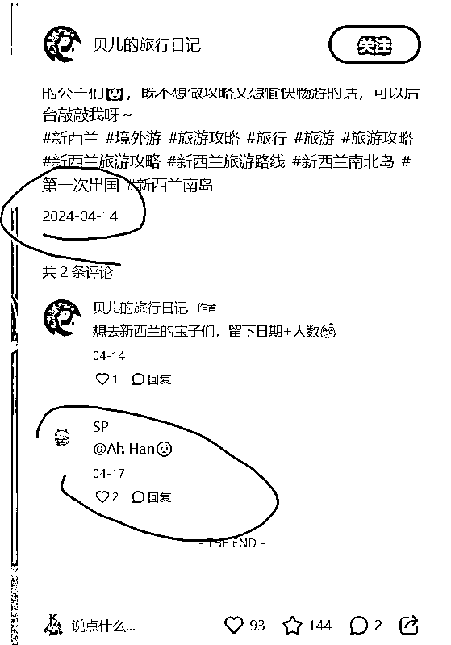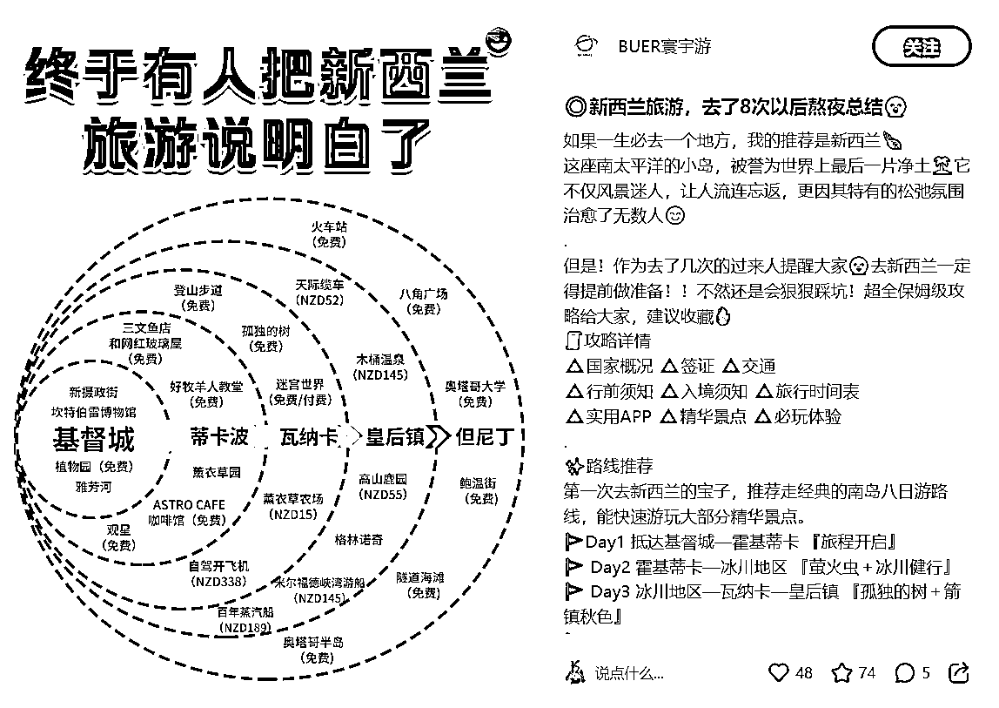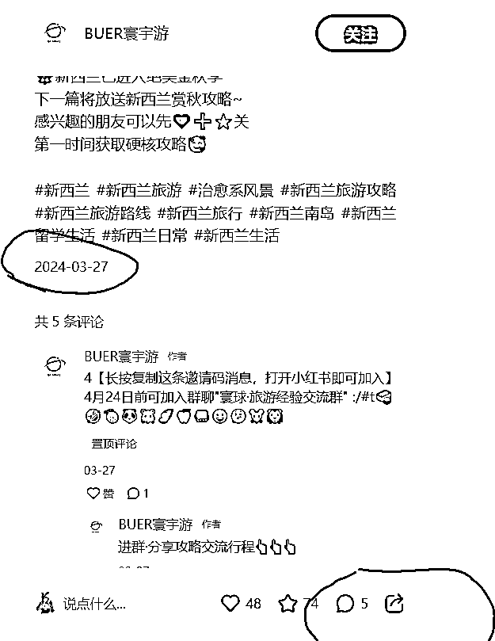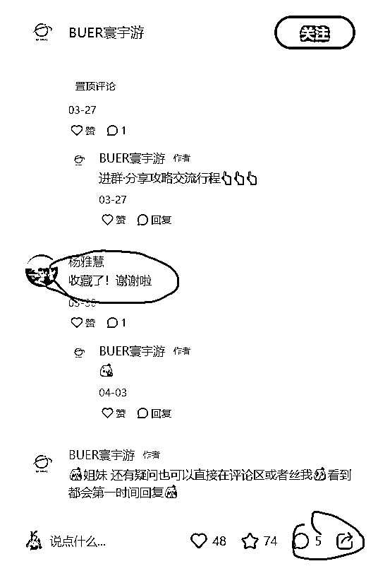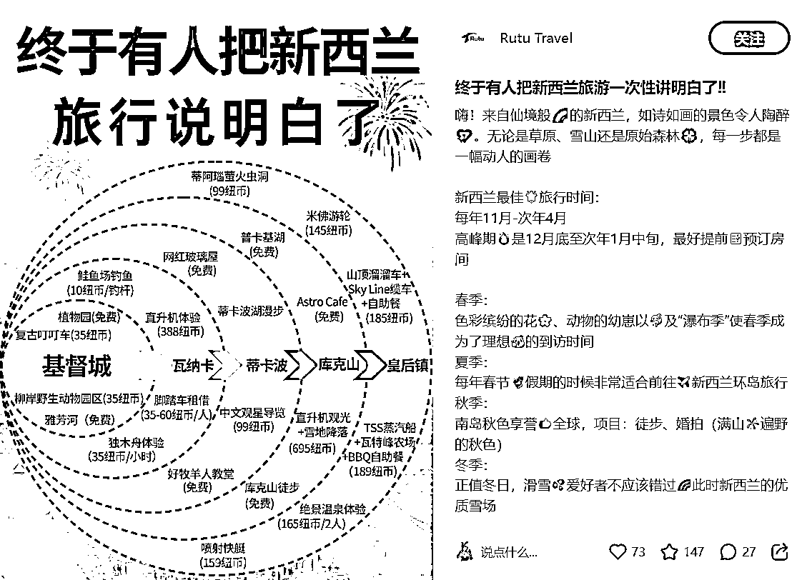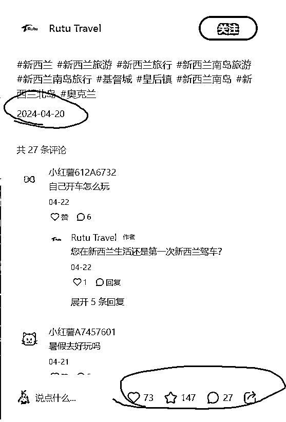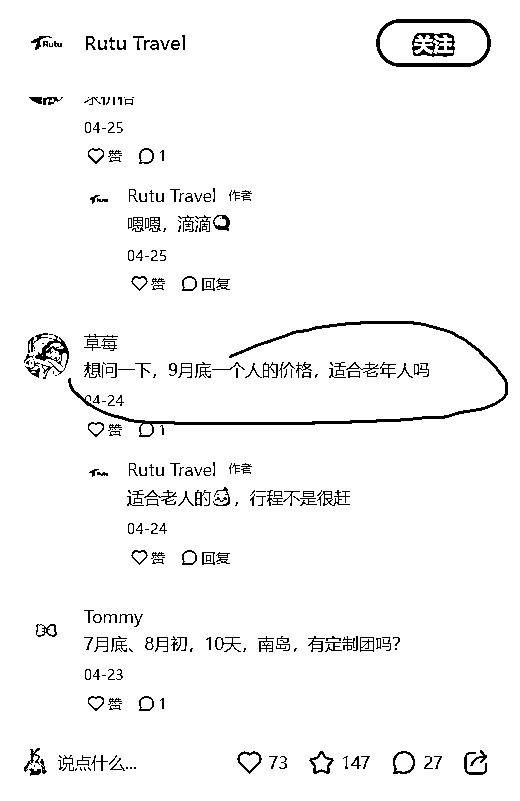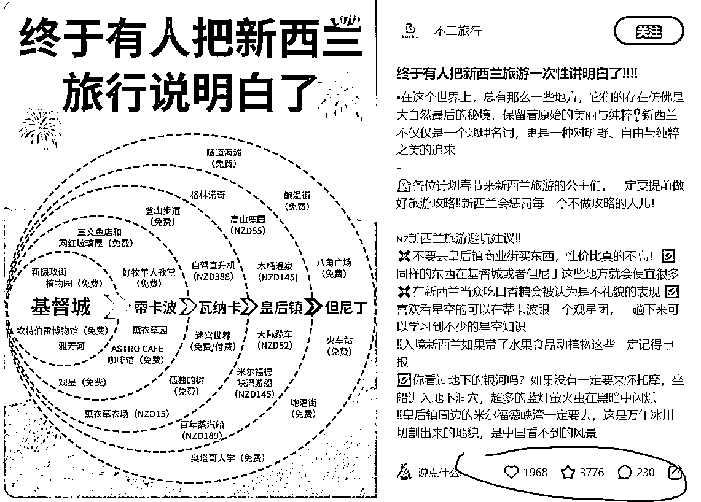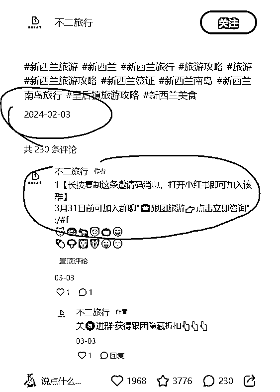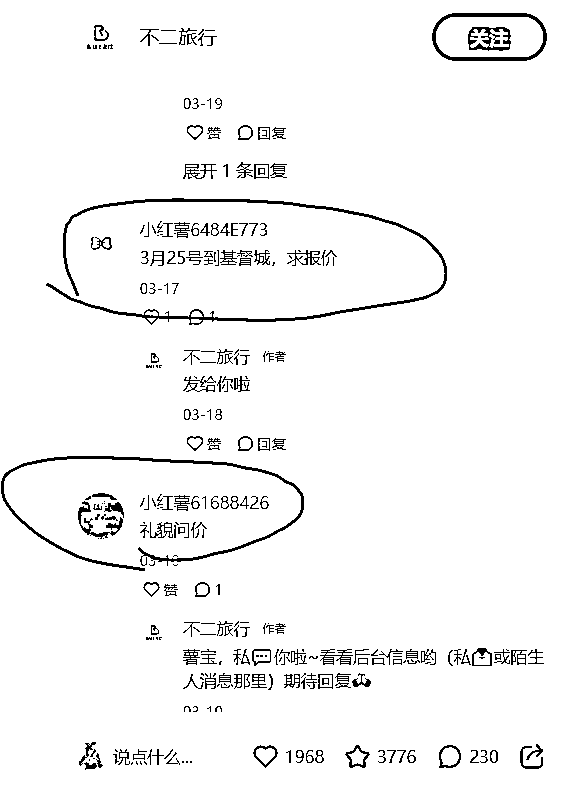

先说发布时间。数据好的那篇是2月3号发的，最早；数据一般的是4月20号；数据差的两篇分别是3月27号和4月14号。很明显，发得早确实更容易拿到流量，但这不是“能不能成爆款”的决定性因素。

再看文字标题。数据好的写“终于有人把新西兰旅游一次性讲明白了”，感叹号加倍；数据一般的少了几个叹号；数据差的两篇，一个写“去了8次以后熬夜总结”，一个也用了“终于有人讲明白”但语气平平。标题选项不同，却不构成数据好坏的分水岭。

封面那块，四张图长得大差不差，标题也接近，基本没有分析价值。

真正的差距，出现在正文第二段。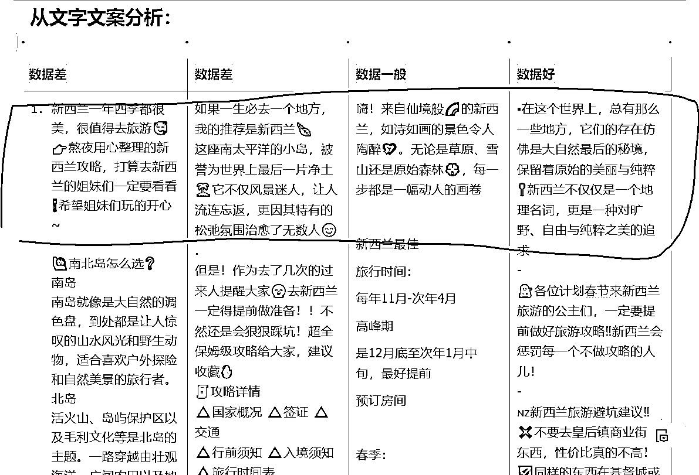

数据好的那篇，第二段直接进入“避坑建议”，列了一堆“别去皇后镇商业街买东西”“在新西兰当众嚼口香糖不礼貌”“入境带水果要申报”之类的实操提醒。而数据最差的两篇，恰恰在避雷和提醒上做得比较弱。用户点进来，不是来看你夸风景多美的，是想知道“哪些坑千万别踩”。谁能把避坑信息讲明白，谁就能留住人。

最后说点我的个人判断。

旅游和留学这两个赛道，钱还是能赚到，但利润会越来越薄。那种“大风刮来钱”的日子，已经过去了。如果你只擅长引流和销售，没有能力去改造背后的产品链路、调整服务设计，同时又接受不了微薄的利润，那不如趁早转行。要是你能接受薄利，也愿意往下深耕，那继续做也未必不行。

我拆解这些高客单赛道的时候，就是想看看那些卷王天花板里，到底藏着什么共通的玩法。旅游赛道带给我的启发，最后反而用在了房产上，也算是一种意想不到的收获。

2024年，如果你也在旅游赛道里苦苦挣扎，希望这篇拆解能帮你一点点看清：你的客户到底是谁，钱在谁手里，以及，你还有没有继续留在牌桌上的理由。

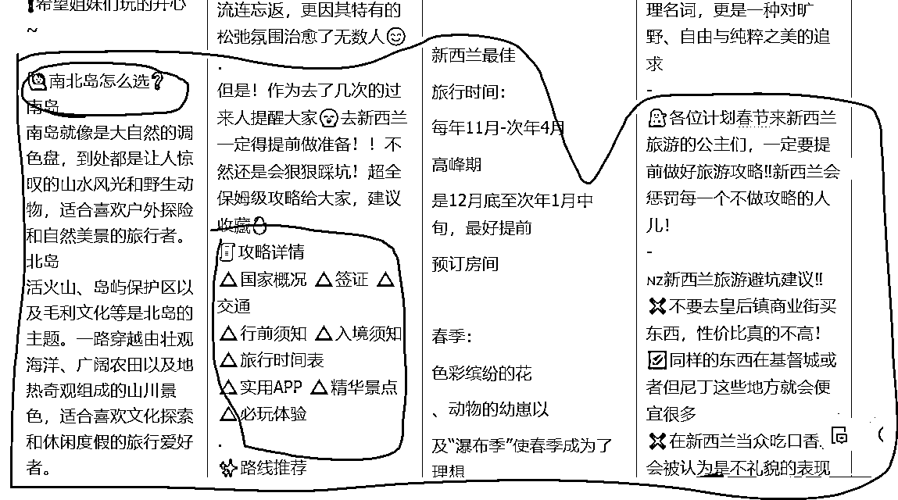

最近刷到不少标题写着“南北岛怎么选”或“会狠狠踩坑”的帖子，兴冲冲点进去，却发现通篇在讲行程怎么安排，坑在哪一个字都没提。

把几篇放在一起做对比后，结果很有意思。表现居中那篇（左侧第三篇）聊的是出行时间和客流高峰，正好打在用户最关心的点上；数据最好的那篇（右侧第一篇）上来就亮出“防坑提醒”。说白了，“恐吓式”内容天生容易爆，这种规律放到新西兰产品上也成立。

“新西兰会狠狠教训每一个不做功课的人”，其实是留学圈一句老爆款的变体，原句是“考雅思会教训每一个临时抱佛脚的人”，2022年底到2023年初那阵特别流行。留学圈做内容的人下手最狠，他们的招数拿来打别的赛道，相当于让顶尖名校学生去做小学毕业卷子。

拉开差距的关键就在这里：数据好的那篇，给的建议全是具体可感、有画面感的；数据差的那两篇，读起来活像一台没有感情的行程播报机。

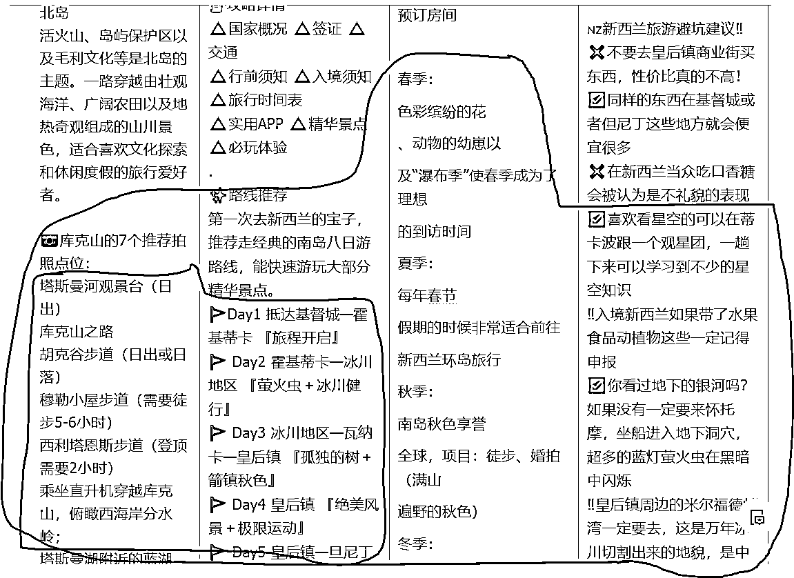

左侧两篇数据惨淡，问题出在它们只会堆名词：塔斯曼河观景台、库克山之路、冰川地区……对没去过新西兰的人，这些地名看过即忘。在动心去咨询之前，我不会在意别人在笔记里如何替我排列路线。想买高端定制的人，只关心带队够不够格、服务细不细致、包车能不能给辆舒服的车；想跟团的人，只在乎谁更便宜、谁家住宿更好。一旦选择跟团，路线丰富度对我就没那么重要了——路线越丰富，跑起来越累，谁价格低我就去哪家。反正又不是只活这一次，这次跟团踩点，下次再高端定制，把没走过的地方补走完。

因此左侧两篇属于标准的旅行流水账，让人看完就忘。旅游内容卷成这样，少有人愿意主动询价，实在太正常。

左三虽然数据一般，但它做了件聪明事：按季节划分玩法，比如说春天去正合适，夏天适合环岛，秋天能徒步和拍婚纱照。这种内容至少让人记住点什么，不再是悬空的名词。可它也算不上优秀范本，因为废话不少。“色彩缤纷的花、动物的幼崽、及‘瀑布季’是春季成为了理想的到访时间”，花是彩色的，这还需要你说吗？废话一旦变多，想变现就难了。

再看看左侧两篇那些拗口名词：塔斯曼河、库克山、胡克谷、穆勒小屋、西利塔恩斯，读都读不顺，更别提记进脑子。换个视角——我作为一名外地游客，为什么要牢记住每个地名？记住它又能怎样？我在乎的只有：风景是否养眼、食物是否美味、床铺是否舒适、每天奔波的强度大不大、带团的人是否贴心。给我看形容词，别给我罗列名词。

那右一篇为什么能拿到这么好的数据？

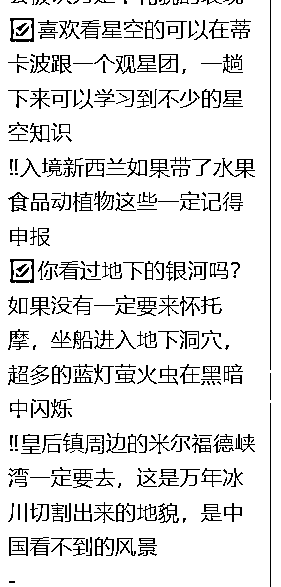

因为它满篇都是能让人看到画面的形容词！观星、地底的银河、坐着小船深入洞穴、无数蓝光小虫在黑暗中一闪一闪、远古冰川开凿出的奇特地貌、在中国见不到的神奇景象！而且它没有废话。

如果它把米尔福德峡湾写成“神斧劈开的峭壁与山峦，水面和崖壁垂直相接，冰川刻出一道V形缺口，大小瀑布叮咚轰鸣，像天然乐团在演奏”——读者可能立刻关掉页面。可它没有，它只写“远古冰川开凿出的地貌、中国看不到的风景”。

如果它把地底溶洞写成“岩溶地层里藏着庞大的洞窟网，钟乳石和石笋四处点缀，萤火虫一闪一闪，坐着竹筏在黑暗中顺流而下，有专人讲解”——读者照样会退出。它还是没有，它写的是：“你看过地底的银河吗？没有的话，去怀托摩吧，坐船进洞，看无数蓝光萤火虫在黑夜里发光。”

这句话看完，谁扛得住？反正我第二天就想订团。

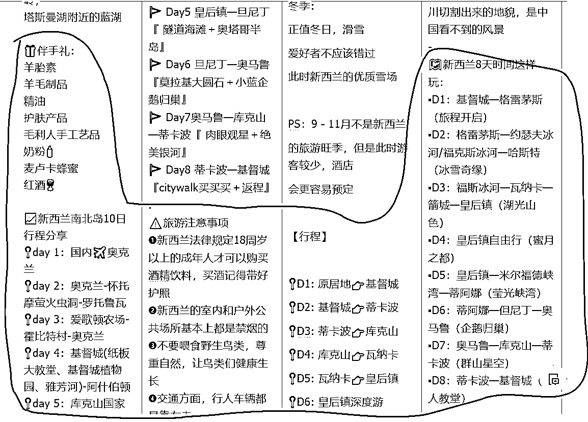

再翻到第四段，四篇内容其实半斤八两，谁也没比谁强多少。这当中，左一黄线圈出的伴手礼部分，倒是多了一点独特感。

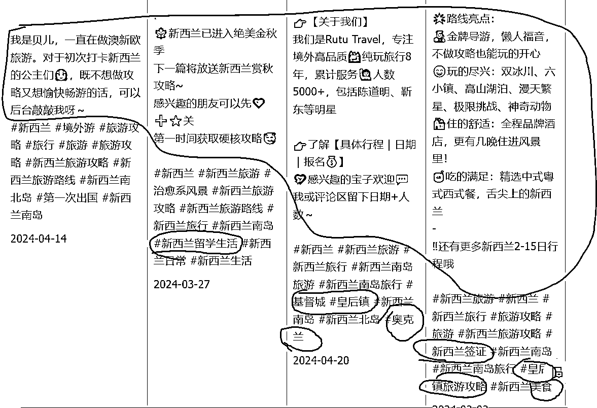

结尾和话题标签摆在一起，编辑功力立刻见分晓。左边两篇连最基础的广告都不会打。右边两篇就机灵得多：

1）用硬数据给自己立人设：累计服务5000人，还把陈道明、靳东等明星搬了出来；
2）用“懒人福音”做钩子：不用做攻略也能玩爽；
3）突出住宿配置：全程品牌酒店，还有几晚干脆睡进风景里；
4）照顾中国胃：中餐、粤菜、西餐都给备好。

为什么特意提粤菜？因为广东游客消费力强，是新西兰客群里的主力。

再看标签。左一的标签没有存在感；左二埋了“新西兰留学日常”，把在那边念书的年轻人也划拉进来了。但和澳洲相比，新西兰留学生预算有限，更倾向砍价或自由行。不过“XX留学”这个套路可以迁移，比如做美国游内容就植入“美国留学日常”，美国留学生是所有留学人群里消费天花板。

左三的标签带了城市：基督城、皇后镇、奥克兰。左四更进一步：皇后镇旅游攻略、新西兰美食、新西兰签证。光看标签设置，专业度就分出胜负了。

差别在哪里？

如果标签只写“皇后镇”，系统可能把内容推给在皇后镇生活的人——人家出门靠车就够了，哪需要旅行团？但写成“皇后镇旅游攻略”，对准的是正在计划去皇后镇的人，这才是能成交的客群。“新西兰美食”更是所有观光客都绕不开的话题。

最绝的是“新西兰签证”。办签证的人要么拿旅游签，要么拿学生签，总之拿到手就会飞去新西兰。哪怕原本没打算安排游玩，只要刷到这篇，心动就是一瞬间的事。

再举一个跨行业的例子：如果写艺术留学申请类内容，标签可以这样搭配（据传📕只认前10个标签，所以要精打细算）——

4个国际学校的准确名称，专挑北上广深江浙沪学费顶尖的那类，比较典型的有北京德威、深国交、上海光华启迪；
3个艺术院校的名字，比如普瑞特艺术学院、NYU TISCH；
1个“艺术留学”大类；
1个“专业+留学”的组合，比如“交互设计留学”，加上“留学”二字，才不会误吸引没打算出国的本科生；
最后1个“作品集辅导”，因为要申请艺术专业必然绕不开作品集。

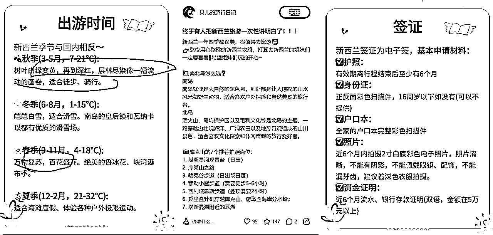

### 表现差的一批：

配图分析也能看出差距。数据不佳的笔记，蓝圈里堆满了抒情句子，很像是AI随手编的，一点诚意也没有。用户看到只会想：我只是来选条路线，没空听你抒发情怀。大家已经够忙了，谁还在意运营的人文章写得好不好看？“层林尽染像一幅流动的画卷”，我看到这句话的时候真的一口气没上来。做📕要写人话，一定要写人话，一旦开始晒文采，离掉粉就不远了。

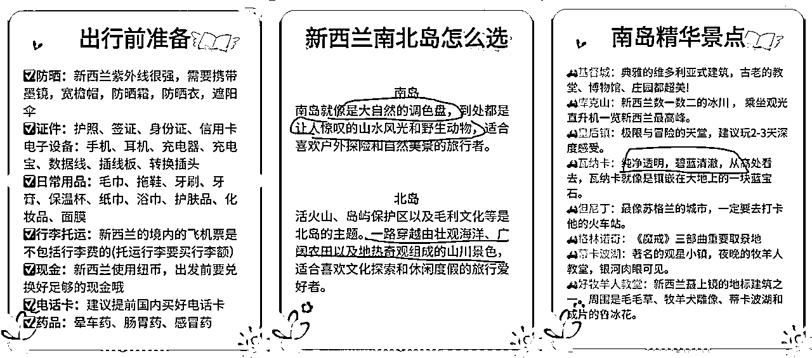

再看下一组配图。“出行前准备”这个栏目为什么存在？这不是明摆着告诉用户：来，拿好这些干货，自己订机票去吧。一个靠旅行产品赚钱的人，把这么细的攻略免费挂在公开平台做什么？真愿意付费的客户，不会关心博主有没有公开这些；会付费的人也没空读这些。蓝圈里照例是文学展示。我自己的态度是直接开启屏蔽，其他读者多半更没有耐心，一秒钟就划走了。

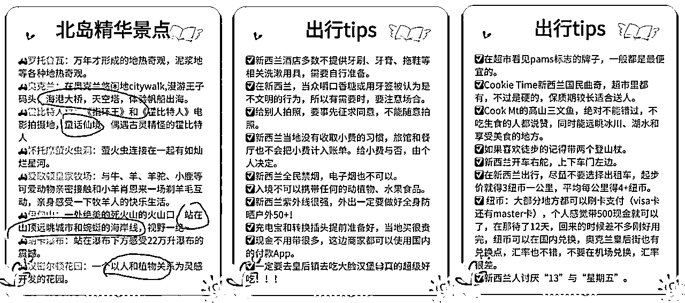

蓝圈里的句子依然在表演文笔，比如“站在山顶远眺城市和蜿蜒的海岸线”“以人和植物关系为灵感开发的花园”——看得人脚趾抠地。它还做了整整两屏旅行贴士，字排得密密麻麻。

站在即将付费出行的用户角度想：这些贴士，等我报完名，旅行社会主动发PDF给我，根本不需要来这儿看满屏小字。但如果某位导游把同样内容改叫“新西兰防雷手册”，我哪怕是已经付过费的客人，也会认真读完，因为我想知道怎么才能不当冤大头。要是他还能讲几个连旅行社都不一定注意到的坑，我绝对会去私信咨询。

“行前贴士”和“防雷指南”本质上是一回事，可换个表达，吸到的人群完全不同。

帖子最后还有一批纯风景图，就不逐张看了。

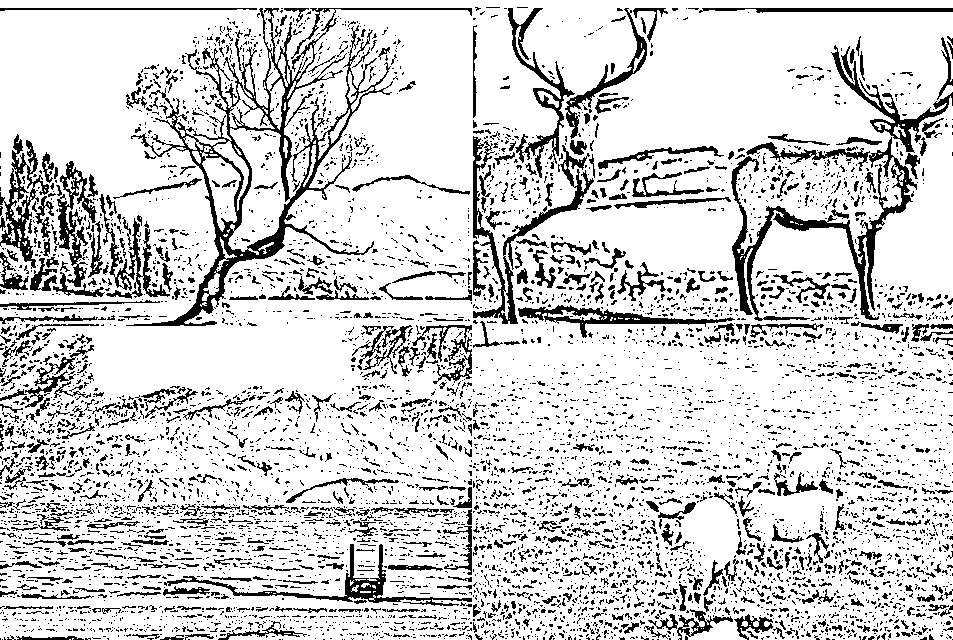

接下来是第二组对比，主题是“新西兰游玩指南”。一共三篇：一篇表现不好，一篇表现一般，一篇很好。前两篇一笔带过，重点拆解最好的那篇厉害在哪。

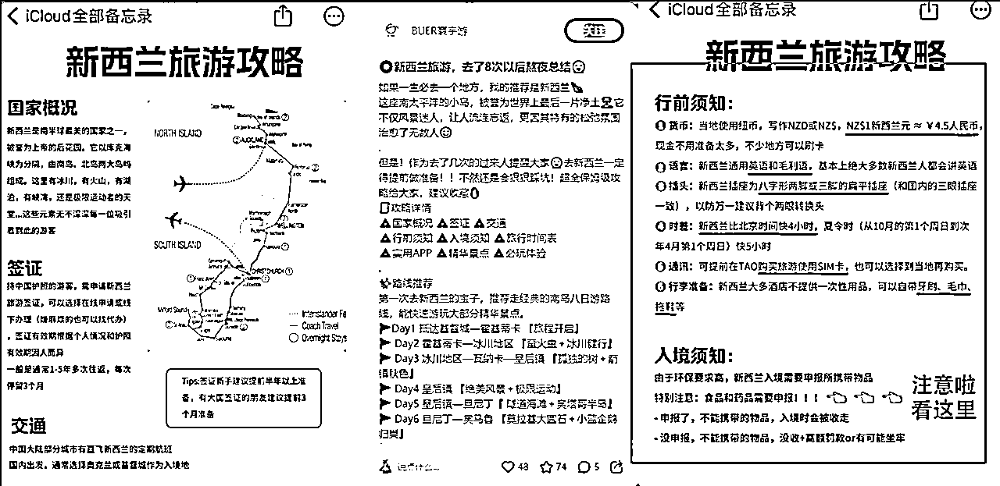

表现差的一篇，配图红色框里又在苦口婆心地科普如何换钱、如何处理语言问题、插头标准、时差、通讯……这不是干货，这是在帮用户实现DIY出行，让对方白白拿走所有整理好的信息。

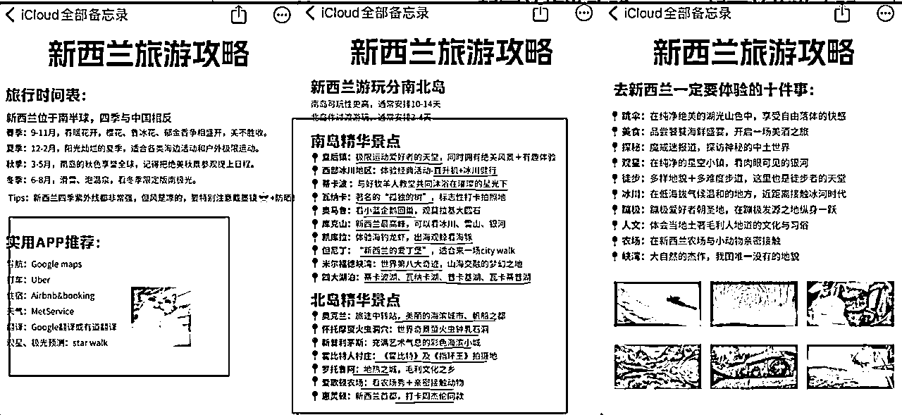

红框里的实用APP推荐，还是同一个问题：自断后路。精华景点的介绍也看不出这家旅行社和其他家有什么区别，用户咨询时，大概率只会拿你当比价工具。

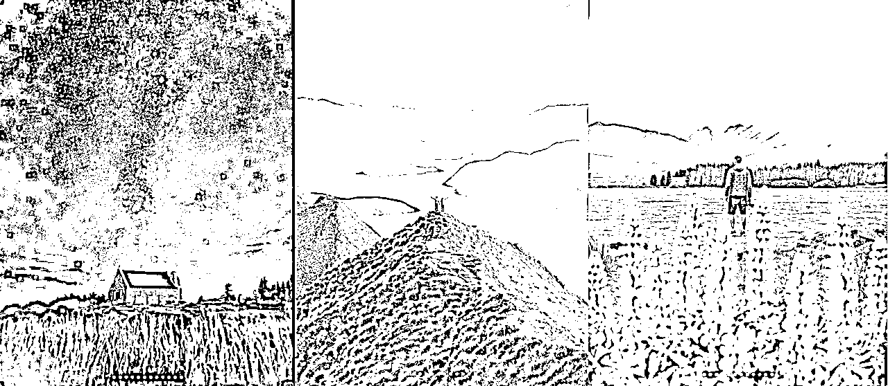

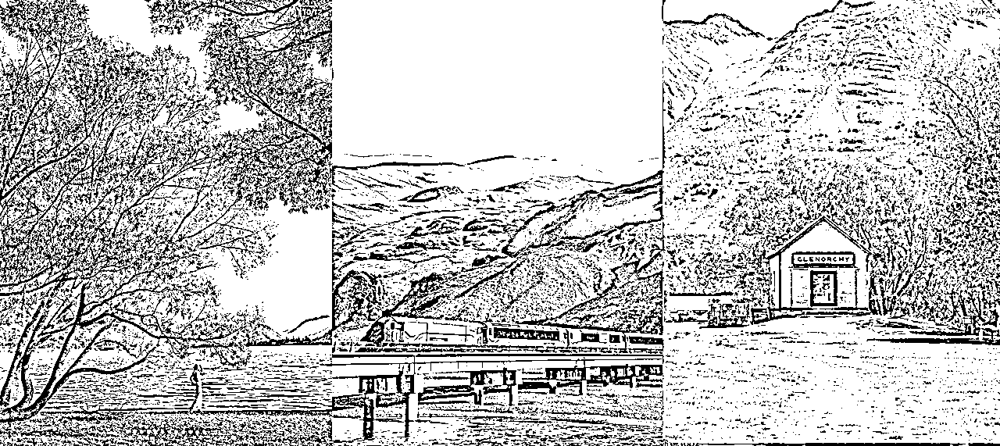

### 表现一般的一组：

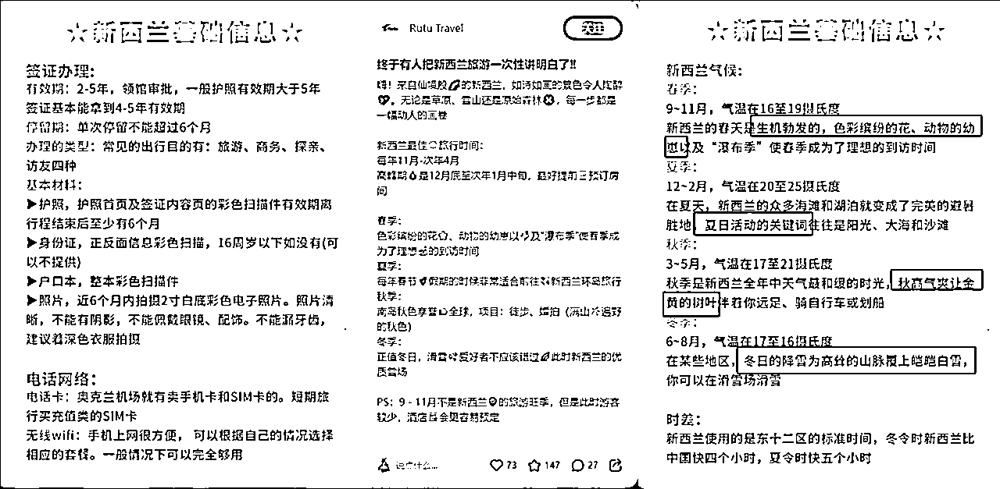

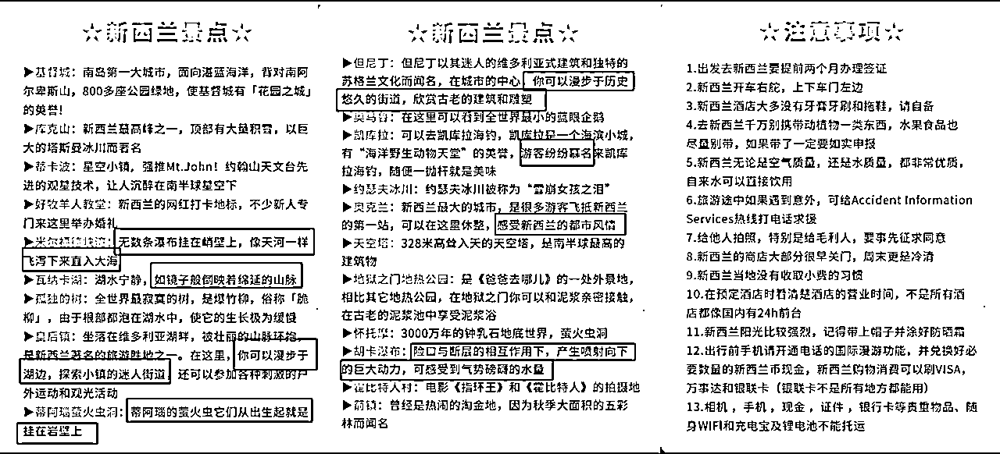

蓝色圈的段落又密又长，我实在没有耐力读完一屏又一屏的文字。“游客纷纷慕名”，这种表达真的太像小学语文病句了。

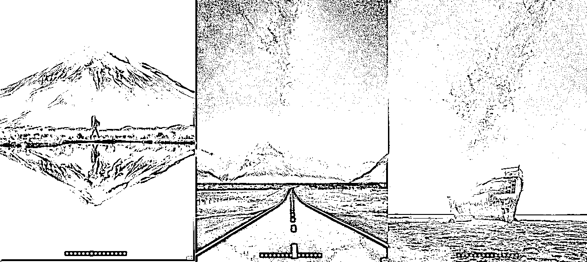

其它配图基本是风景，这里略过。

### 数据不错的一篇：

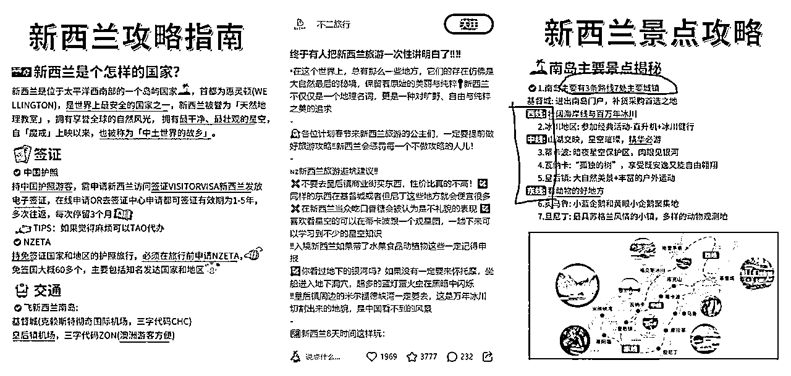

这篇就完全换了一套路：不用一整页讲签证怎么弄，第二张配图也没走“小字报”路线，而是用风光照+路线示意图，标注出3条线路和7个主要城镇，西线、中线、东线全部画清楚。看图的人一眼就能知道线路之间的连接、各自能看到什么风光、自己更倾向哪条线。

景点攻略部分仍然零废话。拿“奥马鲁”举例，人家就写：“看萌翻天的蓝企鹅回窝、海边的大石头”。要是换成前面几篇的编辑，大概会写成：奥马鲁海港是企鹅的聚居地，这里出没着黄眼企鹅和世界上最小的蓝企鹅；小镇在淘金热时期繁盛一时，石灰岩建筑格外洁净……然后页面就被划走了。

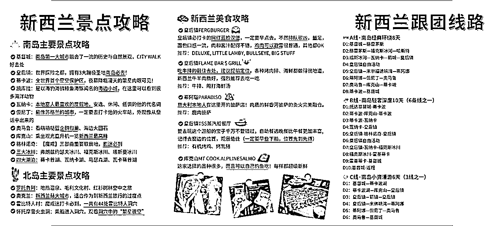

这页还夹带了一份新西兰美食指南。出去玩，吃当然排第一。红线圈出来的几句尤其拉好感：“记得早点来，不然排队能排到崩溃。鸡肉很普通，避雷，其他的都没问题”“这家牛排值得专程去，最好提前订位”。这种话只有真正花时间吃过、排过队的人才写得出。反观其他账号，内容就像是没有感情的GPT流水线。

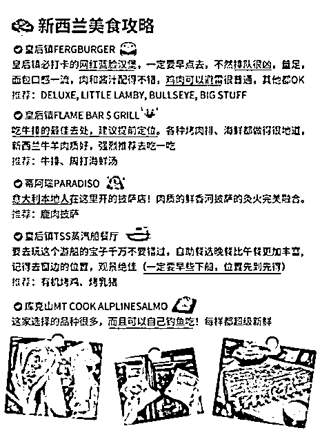

再往下翻：

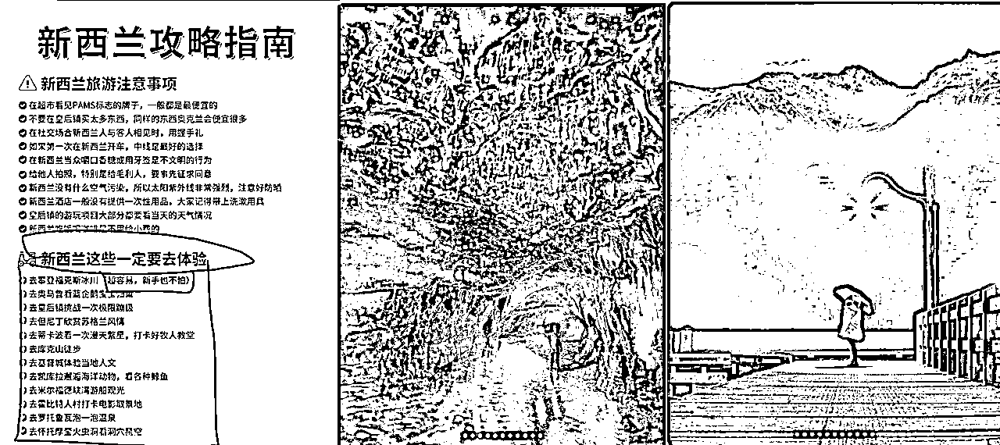

天，这种编者请给我来一窝！没有一句废话。“新西兰这些一定要去体验”，这不就是2009年🐧空间里疯转的爆款句式吗？把同一招搬到2024年的📕，照样有人买账——网友喜欢的，始终是这种直给的热情。

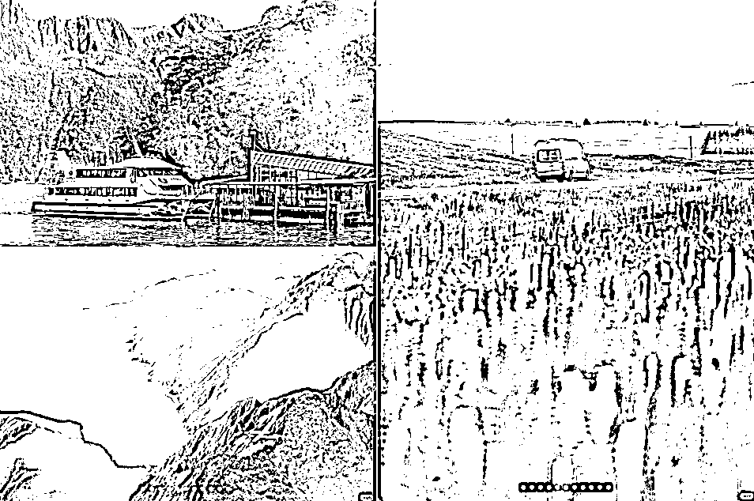

这些新西兰内容用的是相同的主图，为什么流量差出好几倍？我把发布时间、标题、封面文案、正文、配图、标签都拆开看了一遍，越拆越确定：干旅游这行的人，大概率都在这上面栽过跟头。但只要你还在运营📕，那些用来撑场面的漂亮话、每个卖弄文采的形容、每张鼓励用户来薅东西的配图，都会一点一点吃掉你的利润。

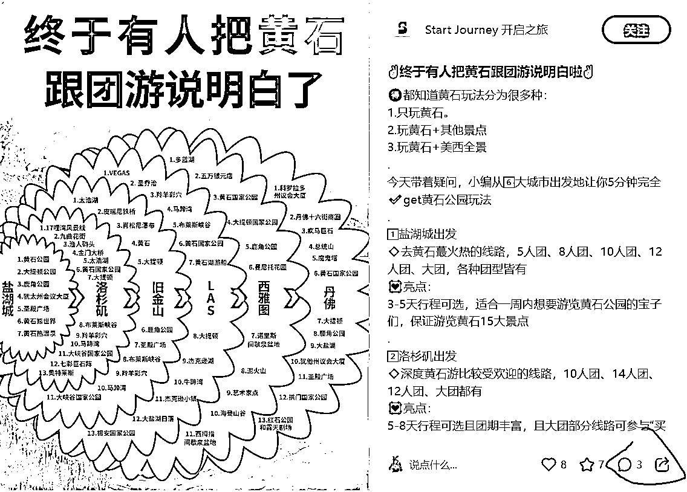

接着看第三组，图片形式同样是“环环相套”的变体，目的地换成了美国。一共选了6篇：表现垫底的有2篇，表现一般的有3篇，表现亮眼的有1篇。

### 表现垫底的两篇：

第一篇：（原笔记链接略）

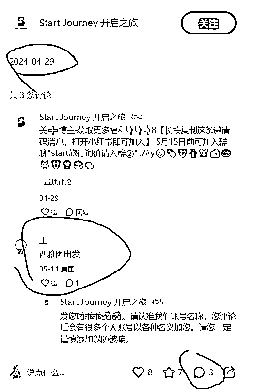

第二篇：（原笔记链接略）

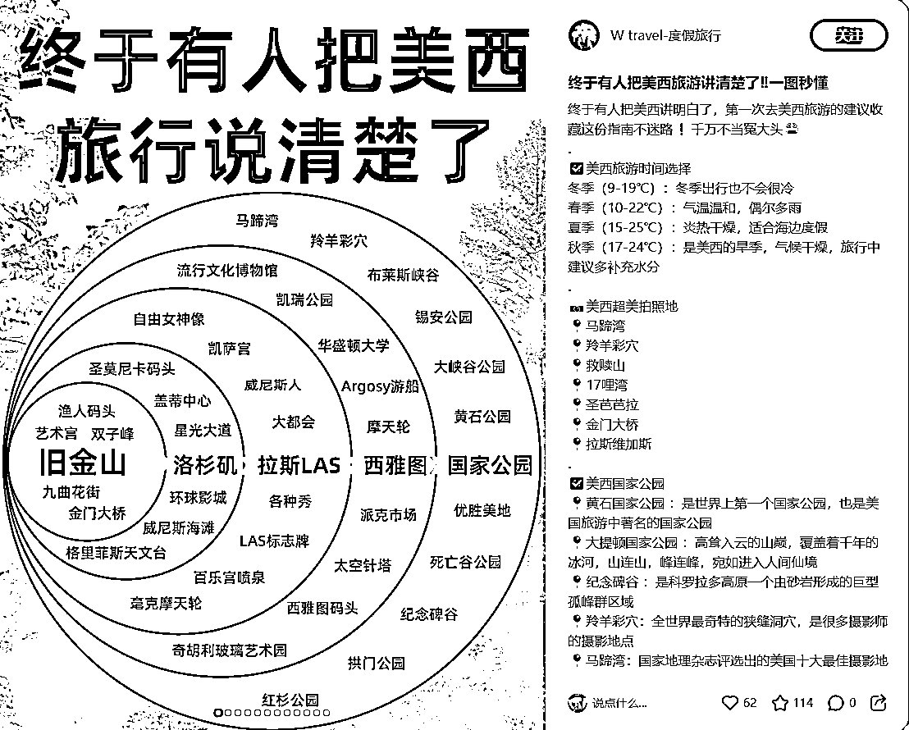

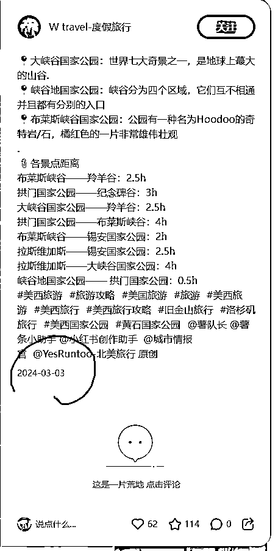

### 表现一般的三篇：

第一篇：（原笔记链接略）

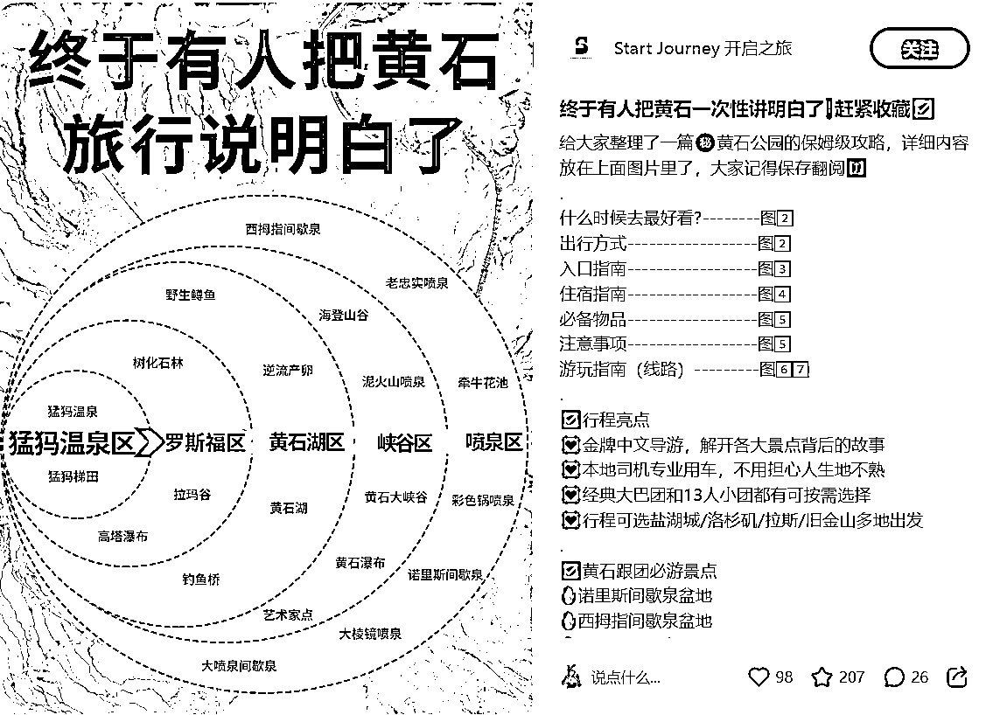

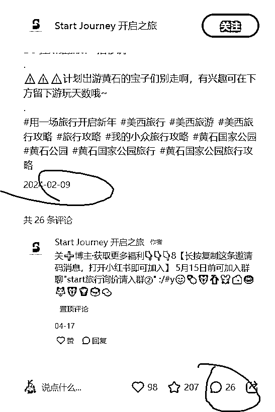

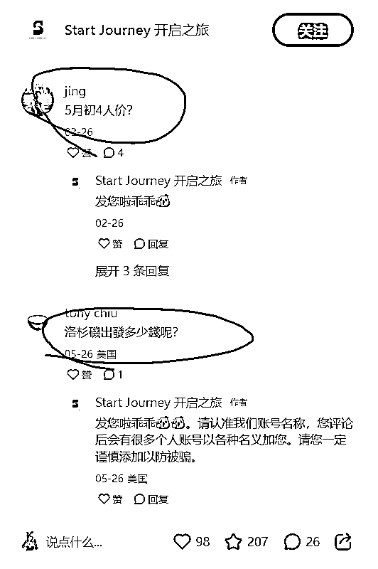

第二篇：（原笔记链接略）

第三篇：（原笔记链接略）

### 表现亮眼的一篇：

（原笔记链接略）

最后总结一下。

先说发布时间：表现垫底的两篇里，第一篇发布于2024年4月29日。

最近刷到一组📕美国游笔记，挺有意思的：同样都是聊美国，好几篇旅游攻略数据都平平无奇，甚至冷清；偏偏有一篇写“美国机票”的内容跑了出来，数据明显好一截。为什么？今天拆给你看。

先看发布时间线，给大家一个大致感受：有一篇2月9日编辑的，评论区最早留言要到2月19日，推测发布得很早但没人理；另一篇3月6日首发、3月7日修改，数据也一般；4月7日发的那篇同样一般；真正数据好的是5月14日发的机票那篇。

再看标题，差别其实不大。“终于有人把黄石跟团游说明白啦”“终于有人把美西旅游讲清楚了”“终于有人把美国旅游一次性讲清楚了”“终于有人把美东旅游说明白了”……你会发现，这些标题几乎是一个模子刻出来的。而且，哪怕换到不同地区、不同景点，效果也没差——因为整个美国旅游赛道已经卷到天花板了。至于那篇数据好的机票帖，珍妮判断，纯粹是因为“美国票务”这个细分赛道还没多少人卷。

再看看封面和标题的搭配：美国旅游内容比新西兰旅游卷太多，封面一个比一个花哨，但封面上的文字核心其实差不多，差异很小。

然后看正文，问题就更明显了。有的笔记从“盐湖城出发、洛杉矶出发、拉斯维加斯出发”一路罗列过去，看起来信息量很足，实际上就是一堆“5人团、8人团、10人团”的排列组合；有的笔记大谈“春夏秋冬”季节温度，再堆几个景点名字和车程时长；还有的干脆用“金牌中文导游、本地司机”这种谁家都能写的套话。

再说副图。数据差的几篇，副图做得挺普通，就像之前聊新西兰旅游时说的那样：一个外地人第一次来美国，根本记不住这些地名。如果光看一个地名，没办法让我立刻想到“我去了能玩什么”，那这篇内容就是没什么营养的。

这一篇的做法也很典型——蓝圈里全是“废话文学”。“是灯光璀璨、纸醉金迷的世界娱乐之都”“有一个美丽而充满乐趣的历史古城”，这些句子放在作文里可能拿高分，但在互联网传播里，基本等于负分。

数据一般的几篇，副图开始写“小作文”了。比如黄石住宿指南里写“园内园外住宿条件不一，各有千秋”，然后又补了一页：“想要露营要提前做好准备哦，价格贵需要提前预定。”这种话真让人不知道怎么评价。谁不知道露营要提前准备？作为旅游攻略，本来该给人实打实的信息，比如：园区有几家住宿，哪个评分最差、为什么，排名前三的住宿各自特色是什么，哪个房间能看什么景观，价格区间是多少。——可惜没有。

更离谱的是所谓的“黄石注意事项”：什么“餐馆座位有限，可能根本吃不上饭”“不知道怎么规划路线，老走回头路，又累又玩不好”。这些明明可以写成避雷帖，把具体的坑一个个列出来；或者直接在开头戳痛点：“以前自由行总是走回头路，又累又没玩好”，然后引出自家跟团游和别人的差异。可惜写出来的全是“看似有用的废话”，网上一搜一大把。到处都能搜到的信息，算什么实用价值？

这种感觉就像珍妮去做身体护理。长沙满大街都是按摩店：A家200-300元，做了跟没做一样；B家不按摩只洗脚，60多块，胜在便宜，大家也不在意效果；只有C家1500元，但人家做的是真有效果，珍妮每天高强度工作全靠C家续命。A和B提供的根本不是实用价值，因为满大街都有，客户只是来消遣，买点情绪价值。如果连情绪价值也做得一般，那跟竞争对手没有任何差距，被比价是必然的。

回到那批美国旅游笔记：其实每一篇都没有特别大的硬伤，各有各的小亮点。但偏偏所有美国旅游的内容数据都差。只有美国机票那篇跑出来了。

珍妮怀疑原因有二：一是美国旅游已经严重内卷，而美国机票代理还没那么卷，所以后者更容易跑出数据；二是这些旅游笔记虽然文字上难分高下，但有的确实在副图上做得更好一点，然而整体还是不够突出。那我们来验证一下，去📕搜“美国机票”，结果发现：这个赛道确实不太卷。大量笔记还在用“飞机上躺着两个人”或者“机舱实拍”当首图，随便P几个字就发出来了。这么低成本的事他们都在做，说明光靠这种普通硬广就能赚钱。

其他段落的情况也差不多——美国票务行业真的太蓝海了，这样随便写写文案都能火。

所以结论很清晰：不是美国旅游没有需求，而是大部分人提供的“攻略”都只是复制粘贴的片汤话。要真正脱颖而出，你得拿出别人拿不出的东西——比如和同行对比车辆宽敞度、备用物品全面度、导游专业度、价格、隐藏小众路线、签证代办、摄影修图服务、住宿资源……而不是写一堆“园内园外各有千秋”的废话。卷不卷，从来不是决定性因素；有没有实用价值、能不能让人记住，才是。

这位商家倒好，上面那些东西一个都没说。客户凭什么选他？没有理由啊。

客户就像你暗恋的男神或女神。你和另外一个追求者，身材一样、学历一样、家境一样、性格一样、长得也差不多，男神女神凭什么选你？所有维度都平平无奇，没一样能压过对方，眼光挑剔的男神女神，怎么会透过那么普通的外表，去发现你独有的内在？还指望着弱水三千只取一瓢？

### 先说数据好的笔记：

这个笔记数据好，跟副图没有半毛钱关系，因为它压根没有副图。纯粹是赛道够空：稍微提一句航空公司名字，甩几个特价航班，咨询就来了。属于老天爷追着喂饭。

旅游赛道里，值得拆解的对标还有“日本旅游”“北极旅游”“国内旅游”。等把这些区域的打法都看一遍，“全球旅游赛道”到底谁引流强、谁引流弱，基本就清楚了。以后有空，我再专门聊聊“日本旅游”“北极旅游”“国内旅游”里，值得每个旅游运营人学习的地方。

### 旅游赛道总结：

篇幅所限，我没法把整个赛道里那些“卷王封面”全贴出来，真要贴，飞书文档怕是要上百页。

不过，在我看过的40多个高客单赛道里，我发现一件事：搞旅游的人，尤其是做海外旅游的，特别不爱用“巧劲”。他们更喜欢把首图堆得满满当当，费了半天劲，最后只能和同行硬碰硬地卷。论封面上的巧劲，旅游赛道的人远不如公考和留学赛道的人。

单看📕笔记的引流形式（只看形式，不看背后真正的厮杀程度），各国旅游的卷度可以排成这样：

南极＜北极＜新西兰＜芬兰、法国、意大利、瑞士＜美国、日本

其中美国最夸张，已经卷出花了。它的卷度，基本可以对标留学申请里的英澳留学——这俩简直是同款配方生出来的双胞胎。

如果给卷度打个分，满分10分：

新西兰旅游，大概等于留学界的艺术留学，卷度5分。

芬兰、法国、意大利、瑞士，卷度7分，这种赛道我自己是躲着走的。

美国和日本，卷度直接10分，对标留学界的雅思/托福培训、英澳留学申请。光看就让我心慌，不把投放开口价调上去，靠自然流根本卷不过别人。

从2024年7月开始，我也辅助过一些做旅游的老板拿到结果，如下图：

据我观察，旅游赛道已经到“大洗牌”的时候了。

如果你：没在这个行业深耕过；没有能力去调整幕后供应链；不知道“产品该怎么改才是对的”；写的旅游宣传笔记千篇一律，只会晒旅游线路——

那说明你还根本没摸清客户真正要什么。想在这个行业搞到钱，会非常难。

现在还能在旅游行业赚到钱的人，一定是把旅游前、中、后端都摸透了，并且有能力对产品做出变革的人。

### 旅游从业者“转行”要避开的坑

旅游赛道和留学赛道一样，正在走下坡路，📕上引流也卷得厉害。

如果继续待在旅游赛道，就要做好心理准备：只懂引流、不会变革产品，那就只能被人狠命砍价、反复比价，最后利润越做越薄。

这行为什么没落？因为主流消费者是B类家庭，也就是“男剪女布”人群。现在，“男剪女布”们没钱了。

你看那些行业：金融业在降薪，健身房一间接一间地关，咖啡店撑不住，留学行业忙着裁员。做英语培训的、开电影院KTV的、卖奢侈品的，能赚到的钱都在缩水。这些行业里的人，基本都属于“男剪女布”。

大家都没钱了，我们还想去赚大钱，不现实。

那现在谁还有钱？

1. A类家庭“男布女石”群体。他们虽然也受了点大环境的影响，赚得不如以前多，但瘦死的骆驼比马大。

想赚他们的钱，可以围绕健康和阶层来做：养生、按摩、正骨、康复、上门做饭、高端医疗、资金管理。说白了，就是让他们的孩子接受好教育，让家里人更健康，让他们的阶层不往下滑。

2. C类家庭“男石女剪”群体。他们钱没有“男布女石”多，但同样有钱。只不过他们不爱铺张，也不会乱花钱。

想赚他们的钱，可以卖游戏（比如《黑神话：悟空》）赚男石头的钱，卖保养品赚女剪子的钱。

如果还是有人想继续赚“男剪女布”的钱，也不是完全没路：去做心理咨询。因为收入突然下滑的年代，他们会很慌，尤其是女布，特别需要情绪价值来填空虚的内心。至于男剪嘛……这话在公开场合就不展开了。

但说到底，时代进程比个人努力重要得多。

就像我们内部团队，明明知道留学行业瘦死的骆驼比马大，还是把留学业务砍到只剩一个细分，转去做卖房单边代理。

过程中当然要付出很多、改变很多，但至少能早一点从泰坦尼克号上跳船逃生。

希望看到这里的你，能对照自己的情况判断：到底还适不适合继续留在旅游赛道。

下面是我个人的看法：

要是你在旅游行业没啥底子，过去只会靠引流拿单，销售端和交付端的门道都没摸过，客户真正想要什么也没搞清楚，更别谈靠自己的资源和能力去改变这个行业——那就别再耗了，早点走。

不然等你的就是：引流端卷到没边，销售端被别人比价到怀疑人生，交付端忙死累死还赚不到几个钱。

2024年做旅游还能赚钱的，哪一个不是把行业前中后端都搞明白了？

我自己能看懂留学的引流端和交付端，Ivy则懂销售端和交付端。但我们就算有能力去改这个行业，也不会下手。原因很简单：我从骨子里不看好留学，甚至连整个英语教育相关的赛道都不看好。

我自己的底子，就是英语教育专业的二本免费师范生。毕业后整整8年，我都在英语这根绳上拴着：乡镇英语老师、班主任，雅思写作老师，留学生作业代写，外教管理员，英文润色运营操盘手，后来又攒了一笔学费，去法国刷了个水硕。

英语学员和留学生的痛点，我比很多人都清楚；我也算过账，自己为这个行业已经搭进去了8年、甚至9年——从2015年大三那年，我就在给自己铺路。

但到了最后，我还是决定断臂求生，趁早走人。

在一艘注定要沉的泰坦尼克号上耗着，没有任何意义。要么被淹死，要么就只能在冰水里等待救援。

假如你也准备跑路，有个重要提醒：别再往“男剪女布”那些行业里跳。具体可以看：https://t.zsxq.com/SOgPV

下一回，珍妮会把那些“适合转行进入”的行业，好好整理一份清单放出来。

### 致谢：

这篇文章最早的动笔时间是2024年4月2日，当时只覆盖了国内旅游。后来6月7日，我又解析了海外旅游——跟团游和高端定制游都包含在内。来回理了好几轮，最终才有了你现在看到的2024年10月版。

那段时间，除了周日，我们坚持日更各行业的运营玩法，目标很直接：从清北卷王行业里挖出高招，再用降维的方式去收拾那些“小学生赛道”。

也正是在这段日子，我们把房产单边代理项目给跑通了。

这一路，要感谢和我一起创业的合伙人Ivy；感谢和我们一起死磕房产的海里；感谢给我们派单代运营订单的幕后地产大佬；感谢国庆假期还在和房东沟通的销售代理人；感谢晚上11点还在外面和关键节点沟通的交付端代理人；感谢和我一起琢磨打法的运营团队小伙伴。

还要谢谢梁靠谱梁医生的销冠群精华，芷蓝姐的玩赚合伙人，理白的乐活十年星辰会。哪怕我仅仅是泡在这些圈子里，也已经得到很多灵感，还绕开了不少创业路上的雷。

感谢龙哥盟给的机会，让我遇到了一批贵人，也让我遇见了真正热爱的项目。

谢谢每一位的指点、提拔和信任。接下来，我会继续用结果说话，为衣食父母们创造更多价值。

珍妮敬上