# 微信👸号爆文变现的正确姿势与未来展望

我是财火，白天干的是程序员，业余时间全押在自媒体上。从2015年算起，我在图文自媒体这行摸爬滚打了差不多十年，头条、百家、大鱼、企鹅、趣头条这些平台全都做过，单个账号单个平台的最高进账超过95万：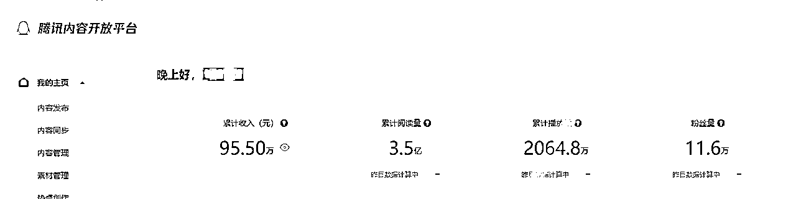

这次👸号航海项目，我有个挺强烈的感受：它跟我当年做头条号那会儿太像了。学完航海手册、听了教练们的分享后，再叠加上我自己过去攒下的经验，整个过程收获不小。这期间，我每天的收入情况都记录了下来：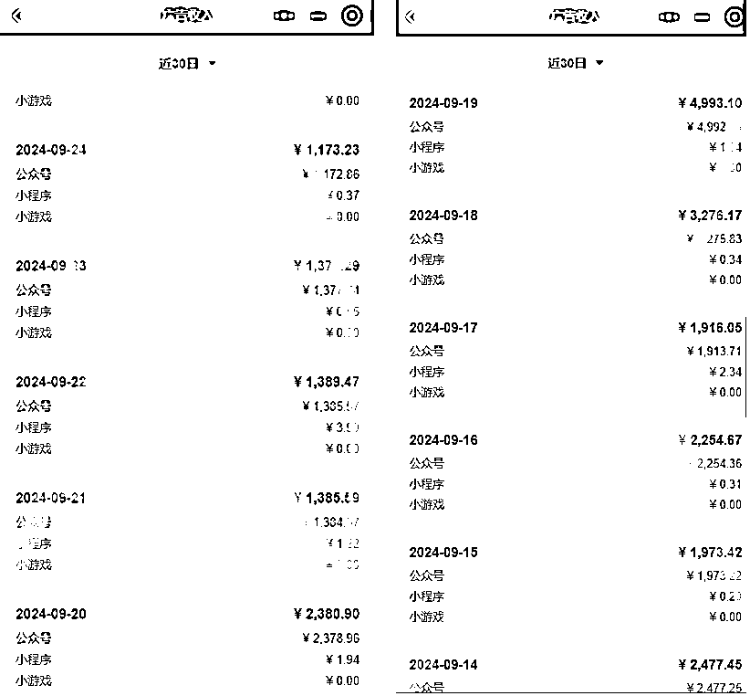

其中一个👸号的整体收益明细，也放出来给大家做个参考：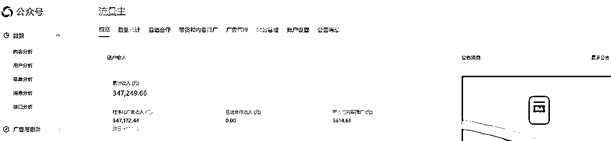

今天的分享，实操层面我不会讲太多——像怎么注册账号、怎么找选题、怎么搭RPA、怎么用AI这些，航海手册里都写得明明白白。我更想聊的是👸号爆文背后的“道”，以及我对这个项目未来走向的判断。主要分三块：一是图文自媒体的起落往事，二是做👸号该有的心态和正确方法，三是对👸号未来趋势的预判和应对思路。

## 一、图文自媒体那几年的起起落落

从野蛮生长到遍地哀嚎，这段历史我算是全程在场。

2015年头条号刚上线时，做的人不多，官方给的钱却异常大方：一万阅读能到手100块。现在呢？头条号一万首发阅读也就10-20块，非原创更低。那时候规则松，内容越猎奇越容易爆。我记得有个号整天发外星人传闻，几乎篇篇都是爆款。

2016年开始，大鱼号、企鹅号、百家号这些大平台疯狂拉人入驻，单价开得都高。后面又冒出一堆小平台：惠头条、搜狗号、趣头条，连卖二手车的优信都搞了个内容创作平台来抢作者。

为了让优质内容留在自家阵地，各平台陆续推出首发、独家功能，只要你勾选，收益直接翻倍。企鹅号还跟作者签独家协议。除了这些，各大平台又叠加了各种榜单激励。连百度百科都来凑热闹，搞了个"百科他说"，邀请垂类头部作者入驻，每月给3000块保底。

那阵子真是图文作者的黄金时代。一篇文章写完，往各个平台一撒，一个号月入轻松破万。如果百家号能上“百家榜”，每月还有至少5000的奖励，最高能拿到2万；大鱼、企鹅那边也有类似的月度榜单奖励。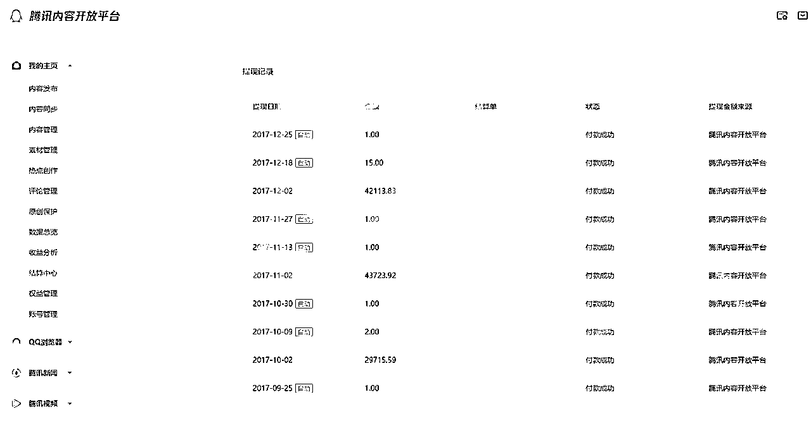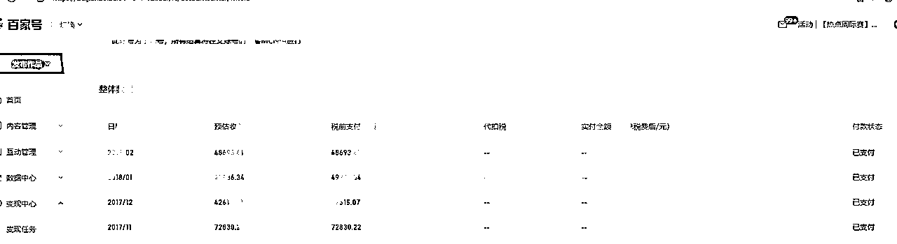

转折点出现在2018年下半年。平台开始严打标题党，头条号率先把单价从万次100块一路砍到1块——好在后来又回升了一点——其他平台跟着降，一大批工作室直接凉透。

这个时候，平台又转而扶持图文带货。头条最早做了个“特卖创作平台”，拉了一批中头部作者进QQ群交流。官方有句话我到现在还记得：“你们的文章要有信息增量。”

到了2019年，平台集体转向视频，图文自媒体开始走下坡路。再往后，单号单平台想月入过万都变成奢望。创作者的结局不外乎两种：要么转型做视频，要么彻底退场。

## 二、👸号爆文的正确打开方式

微信👸号早期是典型的订阅制私域，有粉丝就不缺钱。但后来打开率一直在跌，平台就慢慢往公域推，这恰恰给新人留了扇门。

现在的👸号生态，跟2017年的自媒体平台很像。总有人说“👸号爆文是门槛最低的入门项目”，这话对，也不对。对在——靠流量主赚钱确实不难；不对在——想长期稳定月入五万、十万以上，真不是件容易事。

**1、收益大起大落是常态，别慌**

这是我一个号的收入走势：前天流量主收入还有4169元，第三天就只剩下11元。而且这个账号的推荐流量占比依然有80%，账号也照样在推荐池里。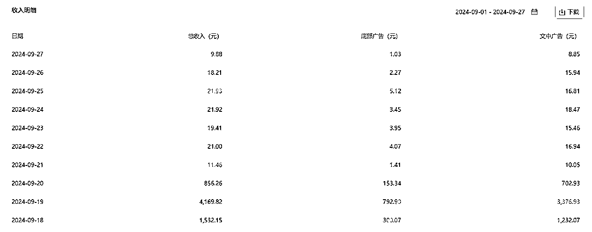

做自媒体谁没被收益波动折磨过？我以前也这样：晚上翻来覆去睡不着，琢磨到底是标题出了问题，还是选题不行，或者被同行举报了？各种瞎猜，越猜越焦虑，动作走形。后来研究了几十次，终于看明白了——这玩意儿就是门玄学，普通人根本分析不出个所以然。

只要账号状态正常，坚持按自己的选题思路持续发文就行。流量差就少发，流量好就发满。

**2、矩阵化运作，用数量对抗概率**

单个账号的收入注定不稳定，我们能做的，就是用更多的号去压平波动。记得有个台湾“名嘴”闹过笑话，说他们飞弹命中率70%，3枚合起来命中率210%。数学上当然不对——正确算法是1减去“全部失手”的概率：1 - (1-70%)×(1-70%)×(1-70%) = 97.3%。但道理却没错：数量堆上去了，概率自然会向你倾斜。

过去做矩阵得雇人，成本不低。现在有了AI，生成文章的活儿全交给工具，只需要搞定账号来源即可，矩阵化的门槛大幅降低。搞账号有几种路子：一是用家人信息注册，二是用公司主体注册，三是接代运营。代运营这块可以参考教练兔子鱼的文章。

**3、👸号的变现玩法还能更多**

**🔸带货**

图文带货就是在文章里插入跟内容相关的商品卡片。一方面补充信息，另一方面给有需求的读者提供购买入口。用户看完点了链接下单，你就能分到佣金。卖得越多，赚得越多。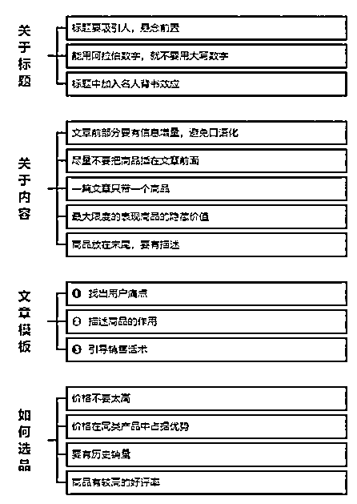

标题是带货文的半条命。我观察了一圈卖得好的带货文章，几乎都是标题就足够抓人：数字尽量用阿拉伯数字，把“3万”写成“30000”；或者借名人背书，像名师、出版社、知名IP都行。但注意——标题承诺了，正文必须兑现，不然会被机器判定为诱导而毙稿。

内容方面，要一步步把读者引到商品上。前半篇尽量给出实质性的信息增量，少写口水话。所谓信息增量，就是读者读完能学到东西、涨见识，得到正向的启发。这决定文章会不会被二次甚至多次推荐。

商品卡片别放太靠前，放在结尾附近最理想。一篇文可以插多个商品，但最稳妥的还是一个产品为主推。比如写楚汉之争，讲到了韩信，结尾就可以这样转：现在的小学生一提韩信就只想到“打野”，传统文化的传承出了大问题——由此自然引出历史读物推荐。

带货文有个万能的三步走公式：第一步，找准用户痛点。切菜总切到手，所以需要护手工具；孩子只爱看漫画不爱读四书五经，所以需要有趣的历史书。第二步，突出产品价值，用名人背书、销量数据这些硬信息，配合轻松的表达把产品优势讲透。第三步，用销售话术收尾：买这套书能让孩子爱上学习，提高文化修养，对将来考试有帮助，和人聊天也更有底气。

这三步套下去，任何带货文都能写。当然，别把产品吹上天——什么长生不老之类的话千万别碰。你可以渲染场景：“阳光微醺的午后，躺在阳台靠椅上，一边喝茶一边翻书，日子安稳又惬意”，这种对生活的想象是允许的。多去看看那些头部带货文，看得多了自然就会了。

选品方面：美妆护肤适合时尚、生活、旅游类作者；居家好物配生活、育儿、美食类；书籍类跟人文、历史、教育、育儿类很搭；衣服穿搭适合时尚、娱乐、体育、健身；小零食覆盖美食、时尚、育儿；数码产品配科技、数码、生活；盆栽花卉适合生活、三农、健康、家居。

**🔸小说分销**

小说分销一直是热门赛道，尤其在抖音、快手这类短视频平台，推广番茄、知乎等平台的小说，赚佣金收益。但这条路有几个毛病：要申请关键词，流程繁琐；还要经过多层代理才能拿到推广权，收益的稳定性和透明度都受影响。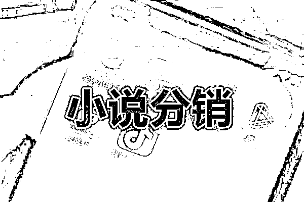

👸号反而给了更顺畅的路径：能发更长内容，可以做详细的小说摘要或试读章节；互动更直接，能跟读者建立更亲近的关系；最关键的是，省掉了关键词申请和代理周旋的流程，推广更直接、更高效。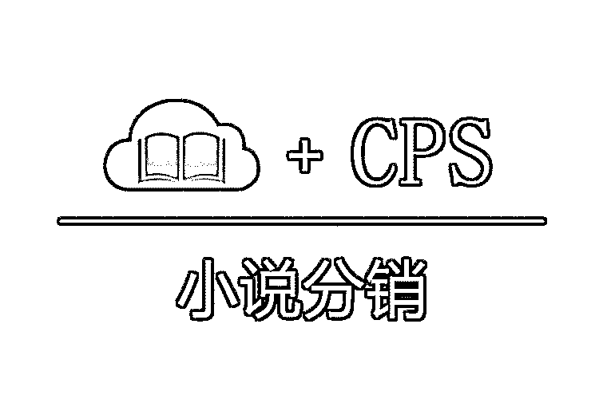

渠道怎么选？以前的小平台很多，版权都不干净，被专门的公司盯上索赔的案例不少。我推荐两个正版平台：一是掌中云，原创小说多，要求有认证服务号，名称也有讲究——这也是我自己在走的渠道；二是微小宝，小说种类略少但也不少，要求认证服务号加公司账号。如果手头没有认证服务号，可以找有资质的人帮你开一个代理链接。

**🔸让流量主收益最大化**

先搞懂一个概念：eCPM——每千次广告曝光能赚多少钱。

读者看广告有三种情况：一划而过，至少产生一次广告拉取，网络问题可能造成反复拉取，拉取量会有偏差；停下来停留一会儿再划走，会形成一次有效曝光——具体停留几秒才算有效，系统说了算，但时间越长越有利；点了广告，就是一次有效点击。所有数据都在流量主后台的“广告数据-每日数据明细”里看，优化全靠这些数字。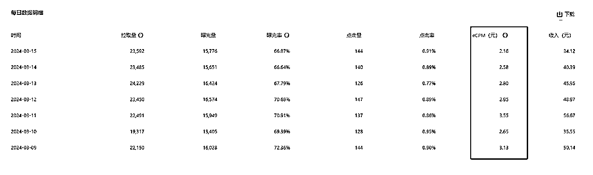

怎么拉高eCPM？核心就两件事：提高广告曝光率和点击率。

先说曝光率。广告光是“出现”不够，系统会判断是否构成“有效曝光”。规则不透明，但有一点很确定：展示时间越长，越可能被算作有效曝光。所以视频内容比纯文字能带来更高的eCPM——读者看视频时会持续停留在页面上。我拿自己一个个人号和另一个视频号做过对比，后者eCPM高达140，比图文高出好几倍。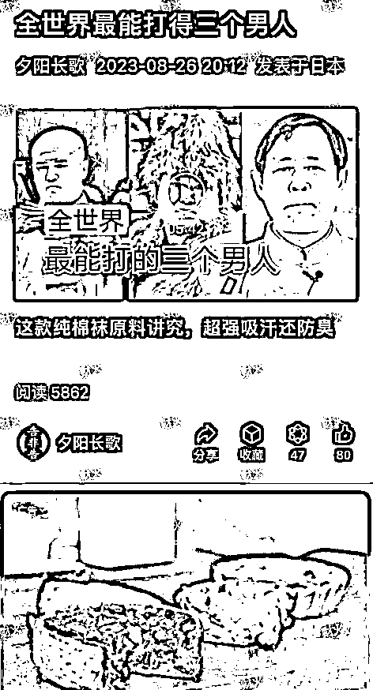

但眼下GPT批量生产爆文是主流，如果号里全是视频，很可能被系统冷落。折中办法是：文章主体保持图文，底部配上视频或吸睛的图片，把读者在底部的停留时间拉长。

再说点击率。很多人忽略一个利器——广告屏蔽功能。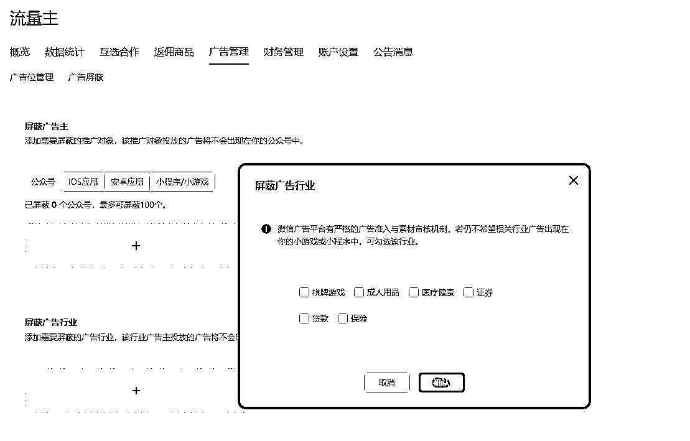 这个功能可以基于粉丝画像，屏蔽跟读者完全不搭边的广告。比如你的读者大多是中老年人，就把“电动车”这类面向年轻人的游戏广告屏蔽掉。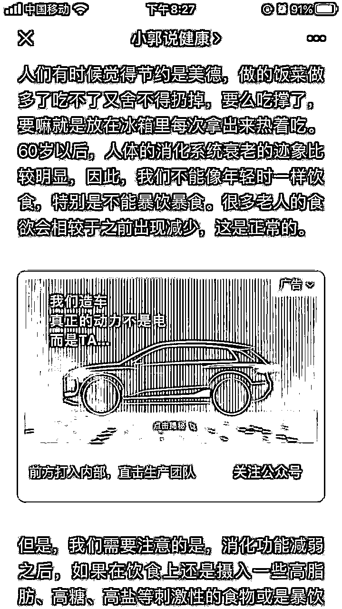 相反，中老年男性感兴趣的广告类型就保留着——点击率相当高。别小看这些细节，不优化永远没机会，优化了可能直接打开收益的天花板。

还有一点：建私域流量池。平台的红利期不会永远持续，私域池就是你的护城河。把读者吸引进微信群、加订阅号，你可以更直接、更频繁地触达他们，同时也可以做内容分发、产品推广和用户调研。有了私域池，你才能自由地策划各种活动——线上讲座、限时优惠——进一步激发粉丝的购买欲望。

公域流量永远是租来的，私域流量才是自己的。通过文章引导读者扫码加群、参加活动，把公域用户沉淀到私域群里，反复触达、建立信任，转化率自然水涨船高。👸号文章、朋友圈、视频号都能帮你往私域导流。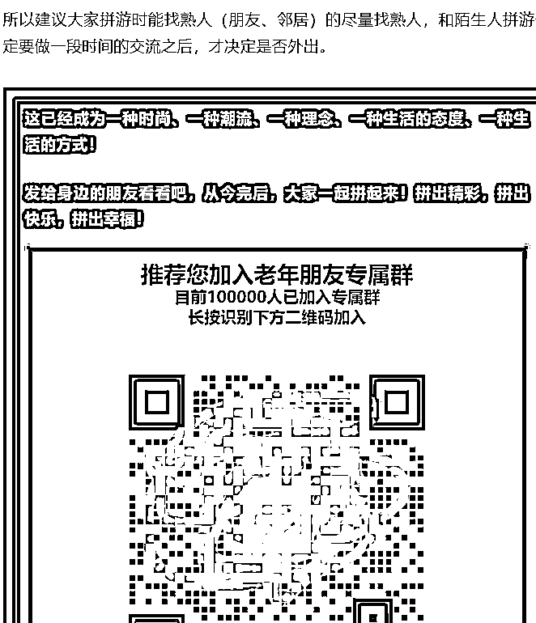

## 三、👸号的下一站在哪？

我为什么要讲那些陈年往事？因为历史总是相似的。

👸号未来会跟头条号、百家号一样：单价慢慢降下来，对内容质量的要求越来越高。所以，趁着公域流量还在，赶紧规划IP、沉淀私域、布局自己的产品线。

另外，👸号图文内容未来肯定会像头条、百家一样开通投放功能。已经有些号收到【账号成长】的邀请，里面包含【内容助推】和【成长足迹】两块——内容助推说白了就是付费投放。趁现在把产品和带货内容准备好，将来只要ROI为正，投放就能帮你放大收益。

机会永远是留给有准备的人。愿我们都能在这个浪潮里稳稳接住属于自己的那份回报：流量暴涨，财富暴涨，健康值也一起暴涨。